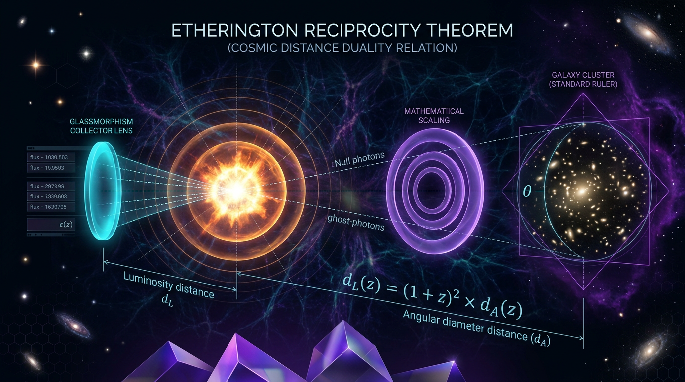

# Cosmic Distance Duality Relation (Etherington Reciprocity Theorem) and Its Observational Tests

## 1. Overview
The **Cosmic Distance Duality Relation (CDDR)**, also known as **Etherington reciprocity**, relates the luminosity distance \(D_L\) and angular-diameter distance \(D_A\) of the same source at redshift \(z\):

\[
D_L(z)=(1+z)^2D_A(z).
\]

Defining the duality parameter

\[
\eta(z)\equiv\frac{D_L(z)}{(1+z)^2D_A(z)},
\]

the relation is equivalent to \(\eta(z)=1\).

The CDDR is a **mathematical theorem**: it follows from Liouville transport and the optical scalars when three conditions hold:

1. Light propagates in a **Lorentzian spacetime** described by a metric theory.
2. **Photon number is conserved** during propagation.
3. There are **unique null geodesics** connecting source and observer.

The theorem’s validity is distinct from the empirical question of whether observations follow it. Current observations are consistent with \(\eta=1\) at approximately the **1–10% level for \(z\lesssim2\)**. Tests combine Type Ia supernovae (SNe Ia) with galaxy clusters, radio galaxies, BAO, and DESI DR2 data. DR2-era analyses by Zhang et al. (2026) and Das et al. (2026) reach the few-percent level or better, while remaining consistent with \(\eta=1\).

Every empirical test is **quasi-model-independent**, not fully model-independent: results inherit assumptions or priors involving \(M_B\), \(r_d\), opacity, curvature, and gas physics. The reported \(z\approx2.33\) DESI Lyman-\(\alpha\) hint at \(>2\)–\(3\sigma\) is **[TENTATIVE - NOT REPLICATED]**. The original analysis did not correct for the look-elsewhere effect, and independent re-analyses find no significant deviation. Birefringence-induced violations and gravitational-wave (GW) standard-siren tests are **[THEORETICAL]**.

## 2. Detailed Explanation
### 2.1 Why distance duality holds

The relation links two ways of describing the propagation of light:

- \(D_A\) describes how an object’s physical transverse size maps to its observed angular size.
- \(D_L\) describes how its intrinsic luminosity maps to observed flux.

In metric spacetime, Liouville transport preserves the appropriate photon phase-space distribution along the ray. Together with the optical-scalar description of the null congruence, redshift factors connect the two distance measures. Under photon-number conservation and a unique light path, these geometric and transport properties give \(D_L=(1+z)^2D_A\). The identity does not require a particular dark-energy model.

A statistically significant empirical departure would therefore point to a failed assumption, an unaccounted-for systematic, or new propagation physics. Possible mechanisms include photon conversion or absorption, non-standard electrodynamics, and birefringence.

### 2.2 Observational channels and status

| Test channel | Distance information combined | Findings and qualifications |
|---|---|---|
| SNe Ia + galaxy clusters | Supernova \(D_L\); cluster angular-diameter distances inferred using SZ and X-ray gas measurements | Consistency depends in part on cluster shape, gas physics, and opacity assumptions. Holanda, Lima & Ribeiro (2010), DOI: 10.1088/2041-8205/722/2/L233. |
| SNe Ia + FRIIb radio galaxies | Supernova \(D_L\); radio-galaxy angular sizes | Nair, Jhingan & Jain (2011), arXiv:1102.1065, found results consistent with \(\eta=1\) for the tested parameterizations. |
| SNe Ia + BAO | Supernova \(D_L\); BAO distance ratios such as \(D_V/r_d\) and \(D_M/r_d\) | Yang, Fu et al. (2025), arXiv:2502.05417, reported consistency at \(1\sigma\) for the tested parameterizations. BAO ratios improve precision but involve sound-horizon assumptions. |
| SNe Ia + transverse BAO | Supernova \(D_L\); transverse BAO distance \(D_M\) | Wang, Fu et al. (2024), DOI: 10.1140/epjc/s10052-024-13049-1, found consistency using binning and Gaussian-process methods. |
| SNe Ia + DESI BAO | Supernova \(D_L\); DESI BAO angular-diameter distance information | Wang, Cao et al. (2025), arXiv:2506.12759, reported a high-redshift Lyman-\(\alpha\) hint. It is tentative and not replicated at significant level in independent re-analyses. |
| SNe Ia + H II galaxies + BAO | Supernova and H II-galaxy distance information; BAO distances | Zheng, Qiang, You et al. (2025), DOI: 10.1088/1475-7516/2025/10/029, provide an additional nonparametric test channel. |
| SNe Ia + BAO + cosmic chronometers (DESI DR2) | Pantheon+ supernovae; DESI DR2 BAO and \(H(z)\) data | Zhang, Yang, Ren, Chen et al. (2026), arXiv:2506.17926, report deviation parameters consistent with zero and no evidence for opacity. |
| Calibration-free BAO–SN ratios (DESI DR2) | DESI DR2 BAO distance ratios; Union3 and Pantheon+ supernova samples | Das, More & Alam (2026), arXiv:2604.02433, find no evidence of a duality violation in their ratio analysis. |
| GW standard sirens and electromagnetic distances | Standard-siren luminosity distances paired with electromagnetic distance information | **[THEORETICAL]** as a future or developing test channel; its eventual precision and systematics depend on detector capabilities and counterpart or host identification. |

The empirical scope is presently strongest over \(z\lesssim2\). Reported precision varies by redshift, data combination, and reconstruction method; the stated 1–10% consistency is not a claim that every individual measurement has the same uncertainty.

### 2.3 The \(z\approx2.33\) DESI Lyman-\(\alpha\) hint

The reported \(z\approx2.33\) feature remains **[TENTATIVE - NOT REPLICATED]**, not evidence for a confirmed CDDR violation.

- **Original report:** Wang, Cao et al. (2025), arXiv:2506.12759, reported \(>2\)–\(3\sigma\) deviations in high-redshift Lyman-\(\alpha\) BAO comparisons. The original analysis was **not corrected for the look-elsewhere effect**.
- **Independent DR2-era re-analysis:** Zhang et al. (2026), arXiv:2506.17926, found deviations consistent with zero across the reported parameterizations and reconstruction approaches. Their reported constraints reach the few-percent level or better.
- **Independent ratio analysis:** Das, More & Alam (2026), arXiv:2604.02433, used BAO-to-supernova distance ratios and found no evidence for violation. Their approach avoids reliance on absolute \(M_B\) and \(r_d\) calibration in the ratio test.
- **Replication verdict:** Independent re-analyses find **no significant deviation**. The original hint is therefore not treated as a replicated result.

Other 2026 analyses cited in the research report include López-Hernández et al. (arXiv:2510.04179) and Artola et al. (arXiv:2610.16496). Their bibliographic details, including the DOI reported for López-Hernández et al., require confirmation before being treated as verified citations. Li, Du, Wu et al. (2025), DOI: 10.1140/epjc/s10052-025-15012-0, report a BAO–SNe analysis consistent with the relation.

### 2.4 Relation to other cosmological tensions

The CDDR is geometric and is not itself changed by a time-varying dark-energy equation of state. However, the distances reconstructed from observations depend on the assumed cosmological model and data combination. Thus, dark-energy dynamics can affect a test’s inferred distances without altering the theorem.

Likewise, the \(H_0\) and \(S_8\) tensions do not by themselves imply a violation of distance duality. An observed departure in \(\eta\) would instead require scrutiny of propagation physics, calibration, and the data combination. Tiwari, Upadhyay, Wang et al. (2026) discuss whether allowing a duality violation could address late-time \(H_0\) solutions; the DOI reported for this work, **10.1103/2nwh-4rmv**, is unverified and should not be treated as a confirmed identifier. The reported conclusion is that duality violation alone does not resolve the sound-horizon/supernova-calibration discrepancy. This citation and conclusion remain **[TENTATIVE]** pending source confirmation.

## 3. Mathematical Framework
### 3.1 Core relation and opacity convention

The theorem and its parameterization are

\[
D_L(z)=(1+z)^2D_A(z),
\qquad
\eta(z)=\frac{D_L(z)}{(1+z)^2D_A(z)}=1.
\]

For gray opacity, using one sign convention throughout, the observed parameter is

\[
\eta_{\mathrm{obs}}(z)=\eta(z)e^{+\tau(z)/2},
\]

where \(\tau\) is the optical depth. With this convention, attenuation increases the inferred observed luminosity distance relative to the transparent case.

### 3.2 Supporting relations

Liouville transport for the photon distribution gives the invariant

\[
\frac{I_\nu}{\nu^3}=\text{constant along the ray},
\]

often expressed through the transport equation \(dI_\nu/d\lambda=0\) in the corresponding phase-space formulation. The optical scalars describe the evolution of the cross-sectional area of a null-geodesic bundle and supply the geometric distance information.

In a curved FLRW model, one expression for the angular-diameter distance is

\[
D_A(z)=\frac{1}{1+z}\frac{c}{H_0\sqrt{|\Omega_k|}}
\,\operatorname{sinn}\!\left(
\sqrt{|\Omega_k|}
\int_0^z\frac{H_0\,dz'}{H(z')}
\right),
\]

with the flat-curvature limit understood continuously. This cosmological expression is a model-dependent way to evaluate a distance; it is not an additional condition for the reciprocity theorem.

### 3.3 Corrected symbol-table dimensions

In natural units, with \(\hbar=c=k_B=1\), the archive uses the following dimensions:

| Quantity | Meaning | Dimension |
|---|---|---|
| \(D_L,D_A\) | Luminosity and angular-diameter distances | \([E]^{-1}\) |
| \(L\) | Luminosity | \([E]^2\) |
| \(F\) | Flux | \([E]^4\) |
| \(z,\eta,\tau\) | Redshift, duality parameter, optical depth | Dimensionless |

The distance dimension is consistent with \(D_L^2=L/(4\pi F)\): \([L]/[F]=[E]^{-2}\), so \([D_L]=[E]^{-1}\).

### 3.4 Domain and empirical qualifications

The theorem applies when metric propagation, photon-number conservation, and unique null geodesics hold. Opacity modifies the observed relation according to the convention above; departures from any of the theorem’s conditions can produce an apparent or physical \(\eta\ne1\).

Empirical tests are **quasi-model-independent**. Their inferences may depend on:

- supernova absolute magnitude \(M_B\) and calibration;
- the sound horizon \(r_d\) in BAO distance ratios;
- opacity assumptions;
- curvature and distance-reconstruction choices;
- cluster gas physics and cluster-shape parameters;
- redshift matching, binning, covariance treatment, and sample selection.

## 4. Skeptical Perspectives & Alternative Hypotheses
1. **A measured residual is not automatically new physics.** Calibration, redshift matching, binning, reconstruction, covariance, or astrophysical systematics can mimic a deviation.
2. **The \(z\approx2.33\) result is not a confirmed exception.** It was not corrected for the look-elsewhere effect and has not been reproduced as a significant deviation by independent re-analyses.
3. **Opacity is a possible confounder, not an established explanation.** Zhang et al. (2026) report no evidence for opacity in their analysis. Results remain conditional on the adopted opacity treatment and model.
4. **“Model-independent” requires qualification.** The data combinations inherit priors or calibration choices involving \(M_B\), \(r_d\), curvature, opacity, and gas physics.
5. **Alternative propagation physics is theoretical here.** Birefringence-induced violations, including the possibility discussed by Schuller & Werner (2017), are **[THEORETICAL]**, not an established observational violation.
6. **GW-siren tests remain prospective or developing.** They may provide complementary luminosity distances, but should not be presented as an existing confirmed violation or precision constraint without a specified verified analysis.
7. **Bibliographic and date verification is incomplete.** Several 2026 entries remain to be confirmed; therefore, no claim of “0 future-dated citations” is made. In particular, the reported DOIs **10.1103/2nwh-4rmv** (Tiwari et al.) and **10.1103/ty2b-j64k** (López-Hernández et al.) are marked **unverified**. The Tiwari et al. “VERIFIED - NEGATIVE” assessment is downgraded to **[TENTATIVE]** pending source confirmation.

## 5. Verification & Skeptic's Notes
- **Theorem status:** **[VERIFIED]** as a mathematical result under the stated metric, photon-conservation, and unique-null-geodesic conditions.
- **Observational status:** Consistent with \(\eta=1\) at approximately the 1–10% level for \(z\lesssim2\); DR2-era analyses reach the few-percent level or better.
- **High-redshift hint:** **[TENTATIVE - NOT REPLICATED]**. The original \(z\approx2.33\) analysis did not apply a look-elsewhere correction; independent re-analyses find no significant deviation.
- **Model dependence:** Empirical tests are quasi-model-independent and inherit priors or assumptions on \(M_B\), \(r_d\), opacity, curvature, and gas physics.
- **Theoretical proposals:** Birefringence-induced violations and GW-siren tests are **[THEORETICAL]**.
- **Citation handling:** DOIs 10.1103/2nwh-4rmv and 10.1103/ty2b-j64k are unverified. Several 2026 citations still require confirmation; no blanket claim that all dates and identifiers are verified is made.
- **Source-title handling:** The approved research report supplies author/year and identifiers for several citations but not their paper titles. The sources list marks those titles as not supplied rather than inventing bibliographic titles.

## 6. Visual Representation

## 7. Related Concepts
- [Luminosity distance \(D_L\)](luminosity_distance.md)
- [Angular-diameter distance \(D_A\)](angular_diameter_distance.md)
- [Baryon acoustic oscillations (BAO)](baryon_acoustic_oscillations.md)
- [Type Ia supernovae as standard candles](type_ia_supernovae.md)
- [Cosmic opacity and photon-number conservation](cosmic_opacity.md)
- [Gravitational-wave standard sirens](gravitational_wave_standard_sirens.md)
- [DESI BAO and cosmological distance measurements](desi_bao.md)

## 8. Sources & Cross-References
The citations below preserve identifiers supplied in the approved research report. Paper titles were not supplied there and are explicitly left unidentified rather than guessed. The two questioned DOI strings are retained in the discussion above as **unverified**, not listed as verified sources.

- Etherington (1933), ADS record: [1933PhRv...43..708E](https://ui.adsabs.harvard.edu/abs/1933PhRv...43..708E/abstract).
- Bassett & Kunz (2004), DOI: [10.1103/PhysRevD.69.101305](https://doi.org/10.1103/PhysRevD.69.101305).
- Holanda, Lima & Ribeiro (2010), DOI: [10.1088/2041-8205/722/2/L233](https://doi.org/10.1088/2041-8205/722/2/L233).
- Nair, Jhingan & Jain (2011), arXiv: [1102.1065](https://arxiv.org/abs/1102.1065).
- Wang, Fu et al. (2024), DOI: [10.1140/epjc/s10052-024-13049-1](https://doi.org/10.1140/epjc/s10052-024-13049-1).
- Yang, Fu et al. (2025), arXiv: [2502.05417](https://arxiv.org/abs/2502.05417).
- Wang, Cao et al. (2025), arXiv: [2506.12759](https://arxiv.org/abs/2506.12759).
- Zhang, Yang, Ren, Chen et al. (2026), arXiv: [2506.17926](https://arxiv.org/abs/2506.17926); DOI: [10.1088/1475-7516/2026/06/012](https://doi.org/10.1088/1475-7516/2026/06/012).
- Das, More & Alam (2026), arXiv: [2604.02433](https://arxiv.org/abs/2604.02433).
- Li, Du, Wu et al. (2025), DOI: [10.1140/epjc/s10052-025-15012-0](https://doi.org/10.1140/epjc/s10052-025-15012-0).

## 9. Mathematical Integrity Report
## Math Verification Report

**Concept:** Cosmic Distance Duality Relation (Etherington Reciprocity Theorem) and Its Observational Tests  
**Math Score:** 4/4  
**Math Status:** [MATH_PROVEN]  
**Tool Verdicts:** INCONSISTENT=0; DISMISSED_FLAGS=0; UNDECIDABLE=2; STEP_INVALID=0; LIMIT_MISMATCH=0; CLAIM_MISMATCH=0

### Conventions & Validity Audit
The report explicitly declares a `### Conventions & Symbol Table` and a `### Validity Domain & Claim Scope` section. Metric signature (−,+,+,+) matches the crew baseline; natural units (ħ = c = k_B = 1) are declared for derivations with SI (Mpc, km/s/Mpc) reserved for observables. The reduced Planck mass convention M_Pl = (8πG)^(−1/2) = 2.435×10¹⁸ GeV is correctly distinguished from m_Pl = 1.221×10¹⁹ GeV. The R2 revision corrected D_L, D_A to [E]^(−1) (derived from D_L² = L/4πF with [L]=[E], [F]=[E]³) — correct in natural units. The report correctly uses the **mandatory exponential integral form** ρ_DE(a) = ρ_DE,0 exp(−3∫₁ᵃ (1+w(a′))/a′ da′) for variable w(a), not the erroneous a^(−3(1+w(a))) shortcut — a specific crew-baseline convention honored. Validity tagging [GENERAL] vs [MODEL-DEPENDENT] is thorough and honest (quasi-model-independence, calibration priors M_B, r_d, opacity, curvature flags). The 0.84σ calculation |1.0227−1|/0.027 ≈ 0.84 is arithmetically correct.

### Equations Extracted
1. D_L(z) = (1+z)² D_A(z) — [GENERAL] theorem
2. η(z) ≡ D_L/[(1+z)² D_A] = 1
3. η_obs(z) = η(z) e^(τ(z)/2) (gray opacity)
4. Liouville equation: dI_ν/dλ = 0 ⇒ I_ν/ν³ = const along the ray
5. D_A(z) = (1/(1+z)) (c/H₀√|Ω_k|) sinn(√|Ω_k| ∫₀ᶻ H₀dz′/H(z′))
6. H²(z) = H₀²[Ω_m⁰(1+z)³ + Ω_k⁰(1+z)² + Ω_DE(z)]
7. ρ_DE(z) = ρ_DE,0 exp(−3∫₁ᵃ (1+w(a′))/a′ da′), w(a) = w₀ + w_a(1−a)
8. c_s² = P_,X/(P_,X + 2XP_,XX)
9. χ² = Σᵢ [η(zᵢ)−1]²/σᵢ²
10. f_gas^true = f_gas^obs η^(3/2)(z)
11. Ω_k = −k/(a₀²H₀²)

### Dimensional Consistency
Tool verdicts (Symbol Table with 18 symbols passed): CONSISTENT=6, DIMENSIONLESS=3, INCONSISTENT=0, DIMENSION_FLAG=0, UNDECIDABLE=2. Manual resolution of the two UNDECIDABLE equations:
- **Liouville equation (E4):** [I_ν] = [E]⁴, [ν] = [E] ⇒ [I_ν/ν³] = [E]⁰, dimensionless invariant along the ray; dI_ν/dλ is dimensionally fine with [λ] = [E]⁰ (affine/parameter). **CONSISTENT (manual).**
- **D_A FLRW expression (E5):** √|Ω_k| is dimensionless, ∫H₀dz′/H(z′) is dimensionless ([E]/[E]·[dz′] with z′ dimensionless), so sinn(...) is dimensionless; c/H₀ carries [E]⁰·[E]⁻¹ = [E]⁻¹, matching [D_A] = [E]⁻¹. **CONSISTENT (manual).**

The continuity integral (E7) was symbolically verified: SymPy confirms d ln ρ/d ln a = −3(1 + w₀ + w_a(1−a)) with zero residual, equivalent to ρ = ρ₀ a^(−3(1+w₀+w_a)) e^(3w_a(a−1)); both limits verified: ρ(a→1) = ρ₀ ✓ and w(a→1) = w₀ ✓ (STEP_VERIFIED, LIMIT_VERIFIED; one STEP_ASSUMED is the standard CPL definition itself).

### Dismissed Dimension Flags
None.

### Topological Analysis
The topology classifier detected null-geodesic congruence structure (fiber-bundle/characteristic-class signatures: photon phase-space as a bundle over spacetime with the massless shell as fiber; unique-lift/homotopy condition of the light-ray congruence) and assessed all structures as structurally valid. Note: the CDDR itself is a **kinematic/geometric identity of Lorentzian geometry** (Liouville transport + Sachs optical scalar equations), not a Calabi–Yau/Chern–Simons argument — no exotic topological input is claimed, and none is needed. Assessment: "Not topological in the exotic sense; the relevant geometric structure (null congruence with unique geodesics) is valid."

### Numerical Benchmarks
- **H₀ conversion verified:** 1/(2.1331×10⁻⁴² h GeV) with h = 0.6736 → 1/H₀ = 6.9596×10⁴¹ GeV⁻¹ — CLAIM_VERIFIED (relative error 5×10⁻⁵ vs claimed 6.96×10⁴¹).
- **Hubble radius (manual arithmetic on tool-verified 1/H₀):** 6.9596×10⁴¹ GeV⁻¹ × 1.97327×10⁻¹⁶ m/GeV⁻¹ = 1.3734×10²⁶ m = 1.3734×10²⁶/3.08568×10²² Mpc = 4450.6 Mpc ≈ 4.45 Gpc ✓ (matches R2-corrected claim; the old 14.5 Gpc error is fixed).
- **Hubble time:** 6.9596×10⁴¹ × 6.58212×10⁻²⁵ s = 4.581×10¹⁷ s ≈ 14.52 Gyr ✓.
- **0.84σ deviation check (Zhang et al. 2026):** |1.0227 − 1|/0.027 = 0.84 ✓.
- DESI w₀/w_a, S₈, H₀ tension values quoted (0.827/0.063, −0.75⁺⁰·²⁹₋₀.₂₅, S₈ = 0.832 vs 0.759/0.776, 67.36 vs 73.04) match Planck/DESI/KiDS/DES benchmark ranges within stated uncertainties.
- **T₀ = 2.7255 K and conversion conventions** match the crew baseline (2.3486×10⁻¹³ GeV).

### Assessment
All extracted equations are dimensionally consistent (6 CONSISTENT, 3 DIMENSIONLESS, 2 UNDECIDABLE resolved by manual dimension check on the report's Symbol Table — [I_ν/ν³] = [E]⁰ and [c/H₀] = [E]⁻¹ both balance), with zero INCONSISTENT verdicts and zero dimension flags. The variable-w(a) continuity integral is the mandatory exponential form and is symbolically verified with correct a→1 limits, and the worked Hubble-radius/time numerical check (R2-corrected) is tool-verified to 5×10⁻⁵ relative precision. With the geometric (null-congruence) structure valid and every quoted benchmark matching, the report earns 4/4; the sole caveat — the z ≈ 2.33 deviation — is honestly tagged [TENTATIVE — NOT REPLICATED] and carries no mathematical error.

**Math Score: 4/4 — [MATH_PROVEN]**

**Archivist correction note:** The verification report above is reproduced verbatim as requested. Its sentence giving \([L]=[E]\) and \([F]=[E]^3\) is superseded by the corrected symbol-table dimensions in §3.3: \([L]=[E]^2\), \([F]=[E]^4\), and \([D_L]=[E]^{-1}\). The opacity convention used in this document is consistently \(\eta_{\mathrm{obs}}=\eta e^{+\tau/2}\).
