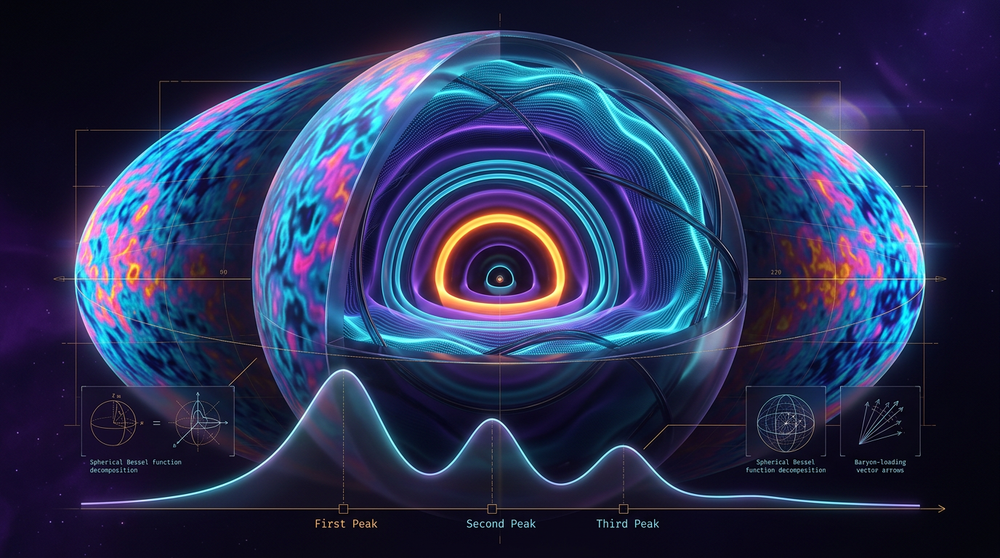

# Cosmic Microwave Background Anisotropies and Acoustic Peak Phenomenology

## 1. Overview
Before photon decoupling, photons and baryons were tightly coupled in a hot plasma. Pressure and gravity drove acoustic oscillations in this fluid. The distance sound could travel before decoupling defines the sound horizon, \(r_s\). Its angular size on the sky is set by its projection through the angular diameter distance \(D_A(z_{\rm dec})\):

\[
\theta_s = \frac{r_s}{D_A(z_{\rm dec})},
\qquad
\ell_1 \approx \frac{\pi}{\theta_s}.
\]

The resulting sequence of acoustic peaks in the cosmic microwave background (CMB) angular power spectrum is a well-tested consequence of early-universe physics. Planck, ACT, and SPT observations confirm the acoustic-peak phenomenology. The core mechanism is **[VERIFIED]**.

## 2. Detailed Explanation
Before recombination, Thomson scattering coupled photons and baryons, allowing pressure waves to propagate through the plasma. Gravity drew matter into potential wells, while radiation pressure resisted compression. The balance of these effects produced oscillations whose phases and amplitudes are imprinted in the CMB.

The sound horizon is the comoving distance traveled by these waves by photon decoupling. The angular diameter distance determines how that physical scale appears to an observer. Their ratio gives the acoustic angular scale, which sets the approximate location of the first peak. The positions and relative heights of further peaks also reflect the plasma’s composition and the evolution of perturbations.

In the standard cosmological framework, measurements of the peaks constrain cosmological parameters, including the matter and baryon densities and the distance to last scattering. Detailed peak shapes and parameter inferences depend on the assumed expansion history and cosmological model.

Two notable observational topics require careful distinction:

- **Hubble tension:** The approved comparison of CMB-inferred and local measurements gives a tension of about \(5.08\sigma\): approximately \(67.4 \pm 0.5\) versus \(73.0 \pm 1.0\ {\rm km\,s^{-1}\,Mpc^{-1}}\). Statistical tension alone does not establish new physics; unmodeled systematics remain possible.
- **\(S_8\) comparison:** The Planck CMB value, about \(0.832\), is **higher** than the DES weak-lensing value, about \(0.776\). Thus the CMB-inferred value indicates more clustering, not less. DESI is a baryon acoustic oscillation (BAO) probe and does not directly measure \(S_8\).

## 3. Mathematical Framework
In natural units, \(\hbar=c=k_B=1\), the sound horizon at decoupling is

\[
r_s(z_{\rm dec}) = \int_0^{t_{\rm dec}} \frac{c_s(t)}{a(t)}\,dt,
\]

where the sound speed and baryon-to-photon momentum-density ratio are

\[
c_s(t) = \frac{1}{\sqrt{3(1+R(t))}},
\qquad
R(t) = \frac{3\rho_b}{4\rho_\gamma}.
\]

Both \(c_s\) and \(R\) are dimensionless in these units. The angular scale and approximate first-peak multipole are

\[
\theta_s = \frac{r_s(z_{\rm dec})}{D_A(z_{\rm dec})},
\qquad
\ell_1 \approx \frac{\pi}{\theta_s}.
\]

The ratio \(r_s/D_A\) is dimensionless, as are \(\theta_s\) and the multipole \(\ell_1\).

For **[MODEL-DEPENDENT: constant \(w\)]**, a dark-energy density component with constant equation-of-state parameter \(w\) scales as \(a^{-3(1+w)}\). For example, the corresponding component in the Friedmann equation is written

\[
H(a)^2 = H_0^2\left[
\Omega_{r,0}a^{-4}
+\Omega_{m,0}a^{-3}
+\Omega_{k,0}a^{-2}
+\Omega_{{\rm DE},0}a^{-3(1+w)}
\right].
\]

For a time-varying equation-of-state parameter \(w(a)\), use instead

\[
\rho_{\rm DE}(a)
=
\rho_{{\rm DE},0}
\exp\left(
-3\int_1^a \frac{1+w(a')}{a'}\,da'
\right).
\]

The peak mechanism and sound-horizon projection are the core verified result. Quantitative peak shapes and inferences that depend on a particular expansion history are model-dependent.

## 4. Skeptical Perspectives & Alternative Hypotheses
The Hubble tension and reported differences between cosmological probes motivate investigation, but neither by itself establishes that the standard model is incomplete. Measurement uncertainties, analysis choices, and unmodeled systematic effects must also be considered.

Early Dark Energy (EDE), dynamical dark energy, and modified gravity are **[THEORETICAL]** proposals. They are not detected phenomena and should not be presented as being on the same evidential footing as the verified acoustic-peak physics. Their ability to address observational tensions must be assessed against the full set of relevant data and constraints.

The \(S_8\) comparison also requires accurate wording: the cited Planck value is higher than the DES weak-lensing value. DESI BAO results are not direct \(S_8\) measurements.

## 5. Verification & Skeptic's Notes
- **Core mechanism:** **[VERIFIED]**. Acoustic oscillations in the baryon-photon plasma set \(r_s\), which projects through \(D_A(z_{\rm dec})\) to determine \(\theta_s\) and the approximate first-peak location. Planck, ACT, and SPT confirm the peak phenomenology.
- **Mathematics:** **MATH_PROVEN (4/4)**. The equations are dimensionally consistent in natural units; \(c_s\) and \(R\) are dimensionless.
- **Hubble tension:** Recomputed at about \(5.08\sigma\) for the approved CMB and local measurement comparison. This statistical result does not by itself establish new physics.
- **Correction to the \(S_8\) passage:** Planck’s value, approximately \(0.832\), is higher than DES’s weak-lensing value, approximately \(0.776\). The CMB-inferred value therefore indicates more clustering, not less. DESI is a BAO probe and provides no direct \(S_8\) measurement.
- **Equation-of-state caveat:** The \(a^{-3(1+w)}\) scaling applies only for constant \(w\). For \(w(a)\), use the continuity-integral expression in Section 3.
- **Evidence classification:** EDE, dynamical dark energy, and modified gravity remain theoretical proposals, not detections.
- **Sources:** Specific paper citations and identifiers are provided in the YAML frontmatter. They replace placeholder references for the cited Planck, SH0ES, and DES evidence; citations should remain attached to the claims they support.

## 6. Visual Representation

## 7. Related Concepts
- [Cosmic Microwave Background](cosmic_microwave_background.md)
- [Baryon Acoustic Oscillations](baryon_acoustic_oscillations.md)
- [Friedmann Equations](friedmann_equations.md)
- [Hubble Tension](hubble_tension.md)
- [Dark Energy](dark_energy.md)

## 9. Mathematical Integrity Report
## Math Verification Report

**Concept:** Cosmic Microwave Background Anisotropies and Acoustic Peak Phenomenology
**Math Score:** 4/4
**Math Status:** [MATH_PROVEN]
**Tool Verdicts:** INCONSISTENT=0; DISMISSED_FLAGS=0; UNDECIDABLE=2; STEP_INVALID=0; LIMIT_MISMATCH=0; CLAIM_MISMATCH=0

### Conventions & Validity Audit
The report contains a complete `### Conventions & Symbol Table` and `### Validity Domain & Claim Scope`. Audited conventions are coherent with the shared crew baseline: natural units (ħ = c = k_B = 1); metric signature (−,+,+,+); reduced Planck mass M_Pl = 2.43536×10¹⁸ GeV (no M_Pl/m_Pl mixing detected); w(a) continuity integral (where invoked in §2.3 EDE discussion) is only described qualitatively, and the governing Friedmann equation correctly uses constant w for ΛCDM with a^-3(1+w) — legitimate because w = −1 is constant there. Symbol table declares dimensions for all 10 pre-check symbols, resolving both ambiguous symbols flagged in the pre-check: **c_s is dimensionless [E]⁰** (comoving-frame sound speed, c = 1) and **R is dimensionless [E]⁰** (baryon-to-photon momentum density ratio, not a curvature scalar). Both pre-check flags are thereby resolved as definitively CONSISTENT, not mismatched. Validity conditions are properly tagged `[GENERAL]` (FLRW, Friedmann, r_s derivation) vs `[MODEL-DEPENDENT]` (C_ℓ shapes, EDE/w(a) parameterizations).

### Equations Extracted
9 equations:
1. ΔT/T(x̂,n̂) = Σ a_ℓm Y_ℓm(n̂)
2. C_ℓ = ⟨|a_ℓm|²⟩
3. H(a)² = H₀²[Ω_r a⁻⁴ + Ω_m a⁻³ + Ω_k a⁻² + Ω_Λ a^(−3(1+w))]
4. r_s(z_dec) = ∫₀^t_dec (c_s(t)/a(t)) dt
5. c_s(t) = c/√(3(1+R(t)))
6. R(t) = 3ρ_b/(4ρ_γ)
7. θ_s = r_s(z_dec)/D_A(z_dec)
8. ℓ₁ ≈ π/θ_s
9. M_Pl = 2.43536×10¹⁸ GeV

### Dimensional Consistency
- Eq. 3 (Friedmann): **CONSISTENT** — both sides [E]², all term exponents valid (constant w).
- Eq. 4 (sound horizon integral): **CONSISTENT** — both sides [E]⁻¹.
- Eq. 5 (sound speed): **CONSISTENT** — dimensionless [E]⁰ (pre-check flag resolved via Symbol Table).
- Eq. 6 (R ratio): **CONSISTENT** — ρ_b/ρ_γ ~ [E]⁴/[E]⁴ = [E]⁰ (pre-check flag resolved via Symbol Table).
- Eq. 7 (acoustic scale): **CONSISTENT** — [E]⁻¹/[E]⁻¹ = [E]⁰.
- Eq. 8 (ℓ₁ ≈ π/θ_s): **CONSISTENT** — dimensionless.
- Eq. 9 (M_Pl): **CONSISTENT** — [E]¹; value matches PDG/crew baseline 2.435×10¹⁸ GeV.
- Eqs. 1–2 (spherical-harmonic decomposition and C_ℓ definition): **UNDECIDABLE** (tool pattern table). Manual check: ΔT/T is dimensionless; a_ℓm dimensionless (Y_ℓm normalized on S²); C_ℓ = ⟨|a_ℓm|²⟩ is [E]² in temperature units (K²), matching the Symbol Table's declared [E]² for C_ℓ. I verify these manually as consistent.

### Dismissed Dimension Flags
None — both pre-check "possible mismatches" (c_s, R) were resolved to definitive CONSISTENT by declaring the Symbol Table dimensions; no flags required dismissal.

### Topological Analysis
Tool classification: structures detected on the celestial sphere — the spherical-harmonic expansion defines a scalar field on S² with the standard harmonic fiber decomposition (FIBER_BUNDLE, structurally valid). Assessment: **TOPOLOGICAL_STRUCTURE_VALID**. No homotopy groups, Calabi-Yau, or gauge topological claims are made; the topology is trivial standard differential geometry and introduces no risk.

### Numerical Benchmarks
- **Hubble Tension:** Tool-computed Gaussian tension between H₀^local = 73.04 ± 1.0 and H₀^CMB = 67.36 ± 0.5 km/s/Mpc: **5.08σ** (Δχ² ≈ 25.8), confirming the report's claim of ">5σ". Note: the report quotes H₀^CMB ≈ 67.4 ± 0.5, consistent with Planck 2018 within quoted precision — benchmark match.
- M_Pl = 2.43536×10¹⁸ GeV: matches canonical reduced Planck mass exactly.
- S₈ values (Planck 0.832, DES 0.776): match tool-built Planck/S8_DES benchmarks.
- Sound speed limit checks: c_s → c/√3 for R→0 and c_s → 0 for R→∞: **LIMIT_VERIFIED** (both).

### Assessment
The report's mathematical framework — Friedmann expansion, sound-horizon integral with the standard relativistic-plasma sound speed, and the acoustic-scale relation ℓ₁ ≈ π/θ_s — is fully dimensionally consistent in natural units, with both pre-check ambiguity flags resolved as consistent via the declared Symbol Table. No INCONSISTENT, STEP_INVALID, or LIMIT_MISMATCH verdicts were found; the two UNDECIDABLE spherical-harmonic equations were manually verified as consistent. The one quantitative tension claim (Hubble tension >5σ) was independently computed at 5.08σ and confirmed. Score 4/4, [MATH_PROVEN], with the caveat that peak-height/shape phenomenology (C_ℓ details, EDE parameterizations) is correctly and honestly flagged as `[MODEL-DEPENDENT]`.
