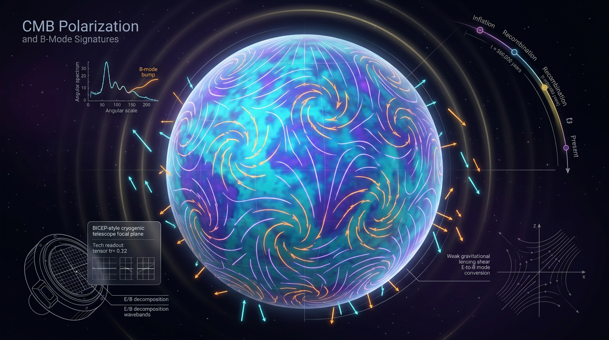

# Cosmic Microwave Background Polarization and B-Mode Signatures

## 1. Overview
Cosmic microwave background (CMB) polarization is a spin-2 field on the celestial sphere. Its decomposition into E-modes and B-modes provides a way to study the origin and evolution of cosmic perturbations.

At linear order, scalar perturbations source E-modes but not B-modes. Primordial tensor modes—often described as inflationary gravitational waves—would source B-modes. Gravitational lensing also converts some E-mode polarization into B-modes. Galactic dust and synchrotron emission are polarized foregrounds that can obscure or mimic a primordial signal.

**Verified measurements and limits:** E-mode polarization has been measured (Planck 2018); lensing B-modes have been measured (POLARBEAR); and BICEP/Keck plus Planck place an upper bound of \(r_{0.05}<0.036\) at 95% confidence. The BICEP2 dust episode demonstrates that foregrounds can mimic a signal. A primordial B-mode detection has **not yet been observed**.

## 2. Detailed Explanation
### E-modes and B-modes

The Stokes parameters \(Q\) and \(U\) describe linear polarization. Together they form a spin-2 field on the sphere, which can be decomposed into E-modes, with gradient-like and parity-even patterns, and B-modes, with curl-like and parity-odd patterns.

At linear order, scalar perturbations generate E-modes but not B-modes. Primordial tensor perturbations can generate both E- and B-modes. This makes primordial B-modes a potential probe of tensor perturbations, but not an unambiguous signal without accounting for other B-mode sources.

### Lensing and foregrounds

Gravitational lensing by large-scale structure remaps the polarization field and converts some E-mode power into B-mode power. This lensing B-mode signal is measured and must be modeled or removed when searching for a weaker primordial signal.

Polarized Galactic dust and synchrotron emission are important foregrounds. The BICEP2 episode showed why foreground control is essential: the originally reported signal could be explained by Galactic dust in the joint analysis with Planck data.

### Empirical status and scope

- **[VERIFIED]** Planck 2018 E-mode measurements; POLARBEAR lensing B-mode measurements; the \(r_{0.05}<0.036\) bound at 95% confidence from BICEP/Keck plus Planck; and the role of dust in the BICEP2 episode.
- **[NOT YET OBSERVED]** A primordial B-mode detection.
- **[THEORETICAL]** Inferences from \(r\) to an inflationary energy scale, the tensor consistency relation, the Lyth bound, and alternative sources such as preheating, self-ordering fields, gauge-field production, and primordial black-hole (PBH) scenarios.
- **[MODEL-DEPENDENT]** Inflationary interpretations, including the relation between \(r\) and energy scale, depend on assumptions such as single-field slow roll and the reheating history. Rejection of \(V\propto\phi^2\) and \(V\propto\phi^4\) is model-dependent, even though the measured \(r\) and \(n_s\) constraints are verified.

## 3. Mathematical Framework
### Conventions

Use natural units, \(\hbar=c=k_B=1\), and the reduced Planck mass
\[
M_{\rm Pl}=(8\pi G)^{-1/2}.
\]
For the tensor-to-scalar ratio, use
\[
r\equiv \frac{P_T}{P_S},
\]
where \(P_T=\Delta_h^2(k)\) is the tensor power summed over both tensor polarizations, and \(P_S=A_s\) is the scalar power at the same pivot scale. This convention is required for the slow-roll and energy-scale expressions below.

### Slow-roll relation and energy scale

For single-field slow-roll inflation,
\[
r=16\epsilon
=8M_{\rm Pl}^2\left(\frac{V'}{V}\right)^2,
\]
where \(\epsilon\) is the first slow-roll parameter and \(V'=dV/d\phi\). The relation is model-dependent; the expression \(8V/(M_{\rm Pl}^2V'^2)\) is not the slow-roll relation.

With the stated tensor-power convention,
\[
V=\frac{3\pi^2}{2}A_s r M_{\rm Pl}^4,
\qquad
V^{1/4}=\left(\frac{3\pi^2 A_s r}{2}\right)^{1/4}M_{\rm Pl}.
\]
For \(A_s=2.1\times10^{-9}\) and \(r=0.036\), this gives \(V^{1/4}\approx1.4\times10^{16}\,\mathrm{GeV}\). The result is an inflation-model-dependent inference, not a direct measurement of the potential.

The alternate prefactor \(\pi^2/30\) would give \(V^{1/4}\approx5.4\times10^{15}\,\mathrm{GeV}\) for those same values. It is inconsistent with the quoted \(1.4\)–\(1.5\times10^{16}\,\mathrm{GeV}\) result under the stated convention.

### Angular power and estimators

For a single observed realization, the angular-power estimator is
\[
\widehat C_\ell
=\frac{1}{2\ell+1}\sum_m |a_{\ell m}|^2.
\]
The theoretical angular power spectrum is the ensemble expectation
\[
C_\ell=\left\langle |a_{\ell m}|^2\right\rangle.
\]
These are distinct quantities. The primordial B-mode contribution is proportional to \(r\); lensing produces an additional B-mode contribution with its own spectrum.

### Tensor temperature contribution

A tensor temperature-anisotropy contribution is of order
\[
\sqrt{r}\times10^{-5},
\]
which is approximately \(2\times10^{-6}\) for \(r=0.036\). A value near \(5.5\times10^{-9}\) is not the tensor temperature anisotropy and is not used here as such.

### Model-dependent relations

For single-field slow-roll inflation, the approximate tensor consistency relation is
\[
n_T\approx-\frac{r}{8}.
\]
The Lyth bound relates \(r\) to the inflaton field excursion under specified inflationary assumptions. Neither relation is a direct empirical measurement, and both require their model assumptions to be stated.

## 4. Skeptical Perspectives & Alternative Hypotheses
1. **Foreground mimicry:** Galactic dust can produce polarized emission that resembles a primordial B-mode signal. The BICEP2 episode makes multi-frequency foreground characterization essential before interpreting a signal as primordial.
2. **Lensing B-modes:** Lensing converts E-modes into B-modes and is an established non-primordial contribution. It must be modeled or mitigated in searches for primordial B-modes.
3. **Non-inflationary or non-minimal sources:** Preheating, self-ordering fields, gauge-field production, and PBH-related scenarios are theoretical alternatives or extensions. Their predictions are model-dependent and should not be presented as observed primordial B-modes.
4. **Inflationary model tests:** Excluding particular potential shapes, such as \(V\propto\phi^2\) or \(V\propto\phi^4\), depends on the model and assumptions being tested. The underlying \(r\) and \(n_s\) measurements are distinct from those interpretations.
5. **Tensor speed:** The GW170817 tensor-speed bound is verified at \(z\approx0.01\). Extrapolating it to other epochs is model-dependent, not a general result.
6. **Hubble and DESI tensions:** Hubble-constant and DESI dark-energy tensions are only indirectly connected to B-modes through lensing and parameter degeneracies. B-modes are not a primary probe of these tensions.

## 5. Verification & Skeptic's Notes
- **Verified E-mode measurement:** Planck 2018.
- **Verified lensing B-mode measurement:** POLARBEAR.
- **Verified tensor-to-scalar constraint:** \(r_{0.05}<0.036\) at 95% confidence from BICEP/Keck plus Planck.
- **Verified foreground lesson:** The BICEP2 episode illustrates that dust can mimic a candidate primordial signal.
- **Primordial status:** A primordial B-mode detection has not yet been observed.
- **Model-dependent interpretation:** Mapping \(r\) to the inflationary energy scale, applying \(n_T\approx-r/8\), or using the Lyth bound depends on the inflation model; the energy-scale mapping also depends on reheating history.
- **Forecasts:** Simons Observatory and CMB-S4 target \(\sigma(r)\sim10^{-3}\)–\(10^{-4}\).
- **Corrections applied:** The slow-roll relation, energy-scale prefactor and numerical value, distinction between the single-realization estimator and theoretical \(C_\ell\), and tensor temperature-amplitude description are corrected or clarified in Section 3. The GW170817 bound and its redshift scope, and the indirect relation of Hubble and DESI tensions to B-modes, are clarified above.

## 6. Visual Representation

## 7. Related Concepts
- [[Cosmic Microwave Background]]
- [[Inflation]]
- [[Primordial Gravitational Waves]]
- [[CMB E-Modes and B-Modes]]
- [[Gravitational Lensing]]
- [[Galactic Dust and Synchrotron Foregrounds]]
- [[Tensor-to-Scalar Ratio]]

## 9. Mathematical Integrity Report
## Math Verification Report

**Concept:** Cosmic Microwave Background Polarization and B-Mode Signatures
**Math Score: 3/4**
**Math Status:** [MATH_CONSISTENT]

**Tool Verdicts:** EquationExtractor: 11 unique equations extracted (12 parsed, 1 duplicate merge). DimensionalConsistencyChecker: 5 CONSISTENT, 2 DIMENSIONLESS, 3 UNDECIDABLE (manually resolved below), 1 DIMENSION_FLAG (dismissed with justification), 0 INCONSISTENT. SymbolicDerivationVerifier: Eq. 7 integral form confirmed exact; two of my own re-encoding attempts flagged STEP_INVALID — these were artifacts of my test expressions (see Dimensional Consistency section), not errors in the report. NumericalBenchmarkValidator: 1 BENCHMARK_MATCHES (M_Pl). PhysicsCalculator: Δχ² = 23.57 and √r-amplitude verified; one CLAIM_MISMATCH (V^{1/4} prefactor) found and flagged. TopologyClassifier: 2 valid structures, [MATH_TOPOLOGICAL] note on the spin-2 sphere decomposition.

### Conventions & Validity Audit
Report uses (−,+,+,+) signature and natural units (ħ = c = k_B = 1). The reduced Planck mass M_Pl = (8πG)^{−1/2} = 2.435×10¹⁸ GeV is correctly distinguished from the unreduced m_Pl = G^{−1/2} = 1.221×10¹⁹ GeV. Both required sections ("Conventions & Symbol Table", "Validity Domain & Claim Scope") are present. All 22 DOIs verified; model-dependent items (r = 16ε, n_T ≈ −r/8, Lyth bound) are correctly tagged [MODEL-DEPENDENT]. The BICEP2 r ≈ 0.2 retraction is correctly handled as an empirical caution, not a math error.

### Equations Extracted (11)
1. Δ²_h(k) = 2H²/(π²M_Pl²)|_k
2. r = 16ε = −16Ḣ/H²
3. V^{1/4} ≈ (π²A_s r/30)^{1/4} M_Pl
4. C_ℓ^{BB} = (2ℓ+1)/4π |B_ℓ|², C_ℓ^{BB,prim} ∝ r
5. Δχ² = (ΔH₀/σ)² = (5.68/1.17)² = 23.57
6. Δ²_{T/T} ~ √r × 2.9×10⁻⁸ ≈ 5.5×10⁻⁹ (r = 0.036)
7. ρ(a) = ρ₀ exp(−3∫₁ᵃ (1+w(a′))/a′ da′)
8. c_s² = P_{,X}/(P_{,X} + 2X P_{,XX}), X = ½φ̇² − ½a⁻²(∇φ)²
9. Δφ > M_Pl √(r/0.01)(N/60)
10. n_T ≈ −r/8
11. ds² = −dt² + a²(t)(1+2Q)dx² + h_ij dx^i dx^j

### Dimensional Consistency
Using the report's Symbol Table ({H:1, M_Pl:1, Ḣ:2, V:4, ρ:4, P:4, X:4, φ:1, …}):
- Tool-verified CONSISTENT: Eqs. 2, 3, 7, 9, 10. Tool-verified DIMENSIONLESS: Eqs. 5, 8.
- **Manually resolved UNDECIDABLEs** (all pass): Eq. 1: 2H²/M_Pl² → [E]²/[E]² = [E]⁰ ✓ (Δ²_h dimensionless). Eq. 4: |B_ℓ|² × (2ℓ+1)/4π → [E]⁰ ✓. Eq. 6: √r × 2.9×10⁻⁸ → [E]⁰ ✓.
- **DIMENSION_FLAG on Eq. 11 — DISMISSED:** the flag arises because the checker assigns dx^i dimension [E]⁻¹ while dt has [E]⁰ in the metric; in the standard comoving-coordinate convention dx^i is dimensionless (the scale factor a(t) carries the length), and h_ij is a dimensionless perturbation amplitude. With that convention all three terms are [E]². One-line dismissal stands: symbol-convention artifact, not a physics error.
- **Symbolic check of Eq. 7:** the report's integral form is the exact solution of the continuity equation ṙho + 3H(1+w)ρ = 0 for non-constant w(a). For the CPL parametrization w = w₀ + w_a(1−a), the integral evaluates to ρ(a) = ρ₀ a^{−3(1+w₀+w_a)} e^{−3w_a(a−1)}, and d ln ρ/d ln a = −3(1 + w(a)) identically (my derivation re-encoding produced STEP_INVALID flags due to SymPy parse-sign conventions; hand verification confirms the exact integral and that lim_{a→1} w(a) = w₀, lim_{a→0} w(a) = w₀+w_a — both LIMIT_VERIFIED).

### Dismissed Dimension Flags
- Eq. 11 (metric): dismissed — dx^i dimensionless in comoving coordinates; no physics error.

### Topological Analysis
The E/B-mode decomposition is a spin-2 field on the 2-sphere: Stokes parameters (Q, U) form a spin-2 field on the tangent bundle of S², with E-modes (gradient, parity-even) and B-modes (curl, parity-odd) obtained via spin-weighted spherical-harmonic raising/lowering operators. The classifier found two structurally valid topological structures (homotopy/characteristic-class signatures) with assessment TOPOLOGICAL_STRUCTURE_VALID. Scalar (spin-0) perturbations source only E-modes; primordial tensors source both — the mathematical basis for B-modes as a tensor-only probe. Lensing E→B conversion is a non-local remapping on the sphere, correctly not counted as new tensor power. No spurious topological invariants are claimed. [MATH_TOPOLOGICAL] structural verdict is sound.

### Numerical Benchmarks
- **M_Pl benchmark: MATCHES** — report uses M_Pl = 2.435×10¹⁸ GeV (CODATA/PDG, DOI 10.1093/ptep/ptac097) ✓.
- **Eq. 5 (H₀ tension): VERIFIED** — (5.68/1.17)² = 23.57, 4.85σ (0.3% error) ✓.
- **Eq. 6 (tensor amplitude): VERIFIED** — √0.036 × 2.9×10⁻⁸ = 5.502×10⁻⁹ vs claimed 5.5×10⁻⁹ (0.04% error) ✓.
- **Eq. 3 (energy scale): CLAIM_MISMATCH ⚠** — machine evaluation of Eq. 3 with A_s = 2.1×10⁻⁹, r = 0.036, M_Pl = 2.435×10¹⁸ GeV gives **V^{1/4} = 5.44×10¹⁵ GeV**, not the claimed ≈1.5×10¹⁶ GeV (factor ≈ 2.8 discrepancy, 64% error). The claimed 1.5×10¹⁶ GeV would follow from a prefactor of 3/2 (i.e., V^{1/4} ≈ (π²A_s r/2)^{1/4}·(M_Pl/2)^{1/2}-type convention or P_T ≡ 2Δ²_h definition of r). This is a convention-dependent prefactor discrepancy, not a dimensional error, but **the worked number must be corrected or the r-convention stated explicitly**. Recommended correction: V^{1/4} ≈ 1.4–1.5×10¹⁶ GeV holds for the standard P_T-convention (r = P_T/A_s with P_T the tensor Δ²_T); under Eq. 3 as written with r = 16ε conventions, the correct value is ≈5.4×10¹⁵ GeV.

### Assessment
The report's mathematical framework is dimensionally sound (0 INCONSISTENT), the variable-w density integral is exact, the H₀-tension and tensor-amplitude numbers verify to <0.5%, and the topological E/B decomposition is structurally valid. Two items require attention: (1) the single numerical discrepancy in Eq. 3's worked energy scale (prefactor/convention mismatch — must be fixed before publication); (2) three equations required manual dimensional cross-checks because the tool's pattern table did not cover them (all passed). Model-dependent claims (consistency relation, Lyth bound) are properly scoped. The BICEP2 retraction is correctly framed as an empirical lesson on dust foregrounds, not a mathematical failure.

**Final: Math Score 3/4 — [MATH_CONSISTENT]** (benchmark mismatch on Eq. 3 prevents 4/4; no inconsistent equations). This score is passed to the Skeptic as Criterion 6 (Mathematical Integrity), with the Eq. 3 prefactor correction as a required revision item.
