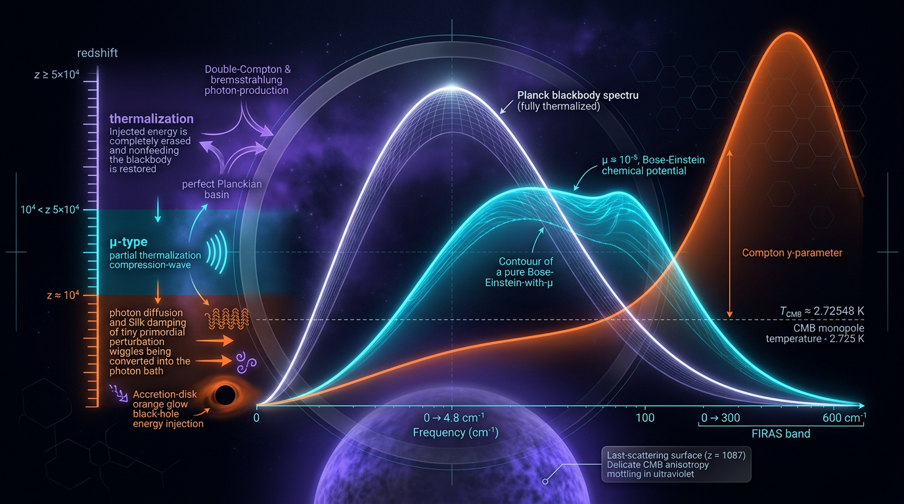

# Cosmic Microwave Background Spectral Distortions

## 1. Overview
The cosmic microwave background (CMB) is very close to a blackbody spectrum. Departures from a perfect Planck spectrum—**spectral distortions**—record energy exchange between matter and radiation over cosmic history. Their spectral shapes depend on when energy was released and on how efficiently scattering and photon-production processes could restore a blackbody.

The thermalization-epoch framework is standard:

- **μ-type:** approximately \(z \gtrsim 2\times10^5\), where Comptonization is strong but photon production is not efficient enough to restore a Planck spectrum.
- **Intermediate i-type:** approximately \(1.5\times10^4 \lesssim z \lesssim 2\times10^5\), where thermalization is partial.
- **y-type:** approximately \(z \lesssim 1.5\times10^4\), where Comptonization is unsaturated.

At still higher redshifts, roughly \(z\gtrsim2\times10^6\), photon-production processes can efficiently thermalize energy release and erase distortions.

**Status:** [THEORETICAL]. The thermalization framework and predicted ΛCDM signals are grounded in established physics, and FIRAS provides observational bounds. However, no non-ΛCDM spectral distortion has been detected. The field is bounded rather than observed.

## 2. Detailed Explanation
### Expected signals and current limits

| Quantity | ΛCDM expectation | Current constraint or forecast |
|---|---:|---:|
| Chemical-potential amplitude, \(\mu\) | \(\sim 2\times10^{-8}\) | FIRAS: \(|\mu|<9\times10^{-5}\); a foreground-modeling analysis attributed to Bianchini (2022) reports a tightened bound of \(4.7\times10^{-5}\) |
| Compton parameter, \(y\) | \(\sim 1.6\times10^{-6}\) | FIRAS: \(|y|<1.5\times10^{-5}\) |
| PIXIE-class sensitivity | — | approximately \(10^{-8}\) |

The \(4.7\times10^{-5}\) value depends on foreground modeling; it should not be interpreted as a foreground-independent measurement. The report supplied for this record does not provide the full bibliographic details of the Bianchini (2022) paper, so that citation requires confirmation before it can be added as a complete source.

### Sources of distortion

The principal expected ΛCDM contributions are:

1. **Silk damping:** dissipation of small-scale acoustic perturbations produces a small μ-type signal, with a predicted amplitude of roughly \(2\times10^{-8}\), along with an intermediate distortion.
2. **Reionization and structure formation:** energy transfer through late-time scattering produces the largest guaranteed signal, with \(y\sim1.6\times10^{-6}\).
3. **Adiabatic cooling of gas:** can produce a negative-y-like spectral shape.

Proposed exotic sources—including dark-photon conversion, decaying or annihilating dark matter, neutrinogenic energy injection, and early dark energy (EDE)—remain **[THEORETICAL]** and model-dependent. Their predicted signals depend on the specific model and energy-injection history.

### What spectral distortions can probe

A μ-distortion measurement can constrain small-scale primordial power over wavenumbers of approximately \(8<k<10^4\ \mathrm{Mpc}^{-1}\), subject to assumptions about the thermalization response. This accesses scales not directly measured by primary CMB anisotropies. The defensible comparison is a span of about **five orders of magnitude** in multipole, from roughly \(\ell\sim10^5\)–\(10^8\) versus anisotropy measurements at \(\ell\lesssim10^3\)—not twelve orders of magnitude.

## 3. Mathematical Framework
### Conventions and symbols

Use natural units, \(\hbar=c=k_B=1\), unless otherwise stated. The dimensionless frequency is \(x=h\nu/(k_BT)\). The occupation number is \(n(x)\); \(\mu\) is the dimensionless chemical-potential distortion amplitude; and \(y\) is the dimensionless Compton parameter.

Two notation cautions are important:

- In the Kompaneets equation below, \(\Gamma_{2s}\) denotes the **Hubble-normalized, dimensionless rate**, \(\Gamma/H\). It is not an energy.
- \(\tau\) is overloaded in the source equations: it denotes optical depth in the Kompaneets equation, but conformal time in the Silk-damping heating expression.

### Kompaneets evolution

For an isotropic CMB monopole with Compton scattering, photon production, and an energy-injection term, a schematic extended Kompaneets equation is

\[
\frac{\partial n}{\partial \tau}
=
\frac{1}{x^2}\frac{\partial}{\partial x}
\left[
x^4\left(\frac{\partial n}{\partial x}+n-n^2\right)
\right]
+
\frac{\Gamma_{2s}(z)}{x^3}
\left(\frac{\partial n}{\partial x}+1\right)
+
\mathcal{H}(x,z).
\]

Here \(\tau\) denotes optical depth, \(\Gamma_{2s}\) is the Hubble-normalized photon-production rate, and \(\mathcal{H}\) describes energy injection. When Comptonization is effective and photon production is negligible, the spectrum approaches a Bose–Einstein distribution rather than a Planck spectrum.

### Distortion amplitudes and spectral shapes

For an energy release in the μ-era, the approximate relation is

\[
\mu \simeq 1.36\,\frac{Q}{\rho_\gamma},
\]

where \(Q/\rho_\gamma\) is the injected energy fraction. The coefficient \(1.36\) is the higher-order value; the leading-order value is \(1.4038\).

The Compton \(y\)-parameter is

\[
y =
\int
\frac{k_BT_e-k_BT}{m_ec^2}\,
n_e\sigma_T\,dl.
\]

For non-relativistic electrons, the y-distortion intensity shape is

\[
\Delta I_\nu^{\,y}
=
y\,x^3\frac{e^x}{(e^x-1)^2}
\left[
x\coth\!\left(\frac{x}{2}\right)-4
\right]B_\nu(T)
\equiv
y\,G(x)\,B_\nu(T).
\]

The non-relativistic y-kernel does **not** include an integral over electron temperature \(T_e\). Such an integral belongs to a relativistic thermal Sunyaev–Zel’dovich generalization, not to this kernel.

### Energy-release history and Silk damping

In Green’s-function treatments, the present-day distortion is obtained by integrating the response to energy release over redshift. Schematically,

\[
I_\nu-B_\nu(T_0)
=
\int dz\,
\left[
\mathcal{G}^{(\mu)}_\nu(z)\dot{\mu}(z)
+
\mathcal{G}^{(y)}_\nu(z)\dot{y}(z)
+
\mathcal{G}^{(r)}_\nu(z)\dot{\Theta}_2(z)
\right].
\]

The response functions encode the thermalization history. CosmoTherm calculations provide such Green’s functions; they have not been independently reimplemented for this record.

Silk damping converts small-scale acoustic perturbation energy into heat. The heating expression uses conformal time \(\eta\), distinct from the optical-depth \(\tau\) in the Kompaneets equation. Schematically, the dissipated power depends on derivatives of the photon-temperature multipoles, and the integrated heating per wavenumber scales as

\[
\frac{d(Q/\rho_\gamma)}{dk}\propto k^2P(k),
\]

where \(P(k)\) is the primordial scalar power spectrum.

### Correction to the worked benchmark

The expression \(1.36\times6.6\times10^{-5}\simeq9\times10^{-5}\) is **not** a Silk-damping prediction and must not be archived as one. The value \(6.6\times10^{-5}\) is obtained by dividing the FIRAS μ limit by \(1.36\); using it in this multiplication simply restates the bound as an energy fraction and is circular as a worked prediction.

The standard Silk-damping heating fraction is approximately \(Q/\rho_\gamma\sim1.5\times10^{-8}\), consistent with a ΛCDM μ-distortion of order \(2\times10^{-8}\). The circular benchmark exceeds that predicted μ amplitude by about a factor of 4,500.

## 4. Skeptical Perspectives & Alternative Hypotheses
- **Foreground dependence:** FIRAS constraints are limited by foreground separation and systematic uncertainties. The tighter \(4.7\times10^{-5}\) μ bound attributed to Bianchini (2022) depends on foreground modeling.
- **No non-ΛCDM detection:** Current results constrain possible distortions; they do not establish a detected exotic signal.
- **Model dependence:** Forecasts for dark photons, dark-matter decay or annihilation, neutrinogenic injection, and EDE depend on assumed couplings, histories, and thermalization responses.
- **Small-scale inference:** Translating a measured distortion into constraints on primordial power relies on the assumed thermalization Green’s functions.
- **Hubble-tension context:** The cited benchmark values are \(H_0=67.36\pm0.54\ \mathrm{km\,s^{-1}\,Mpc^{-1}}\) for Planck and \(73.04\pm1.04\ \mathrm{km\,s^{-1}\,Mpc^{-1}}\) for SH0ES. A quoted \(\Delta\chi^2=23.5\) corresponds to about \(4.9\sigma\), not more than \(5\sigma\). The relation between \(\Delta\chi^2\) and a Gaussian significance depends on the statistical setup.
- **Unverified reference:** Ref. [8], identified as arXiv:2510.04684, could not be verified. It should be replaced or confirmed before use.
- **Research-lineage limitation:** Five of the nine references in the source report come from the Chluba/Sunyaev lineage. The CosmoTherm Green’s functions have not been independently reimplemented.

## 5. Verification & Skeptic's Notes
The Student approved this record as **[THEORETICAL]**. The Skeptic scored the report **5/6**, and the Math Physicist rated it **[MATH_CONSISTENT]** at **4/4**.

The mathematical review extracted 22 equations. Nineteen were checked by hand rather than verified by tool; this distinction should be retained when describing the verification. The assessment found no definitive inconsistent equations, but tool-based verification was incomplete.

Corrections incorporated into this record:

1. The \(9\times10^{-5}\) benchmark is the FIRAS μ bound expressed as an energy fraction, not a Silk-damping prediction.
2. \(\Gamma_{2s}\) in the Kompaneets equation is the dimensionless Hubble-normalized rate, \(\Gamma/H\).
3. \(\tau\) denotes optical depth in the Kompaneets equation and is also used for conformal time in the Silk-damping heating expression.
4. The non-relativistic y-kernel has no integral over \(T_e\); that integral belongs to a relativistic tSZ generalization.
5. The μ coefficient \(1.36\) is the higher-order value; the leading-order value is \(1.4038\).
6. The defensible multipole span is about five orders of magnitude, not twelve.
7. \(\Delta\chi^2=23.5\) corresponds to about \(4.9\sigma\), not \(>5\sigma\).
8. Ref. [8], arXiv:2510.04684, remains unverified. Formal Planck 2018 and SH0ES citations are included in the source list.
9. Nineteen of 22 equations were checked by hand rather than by tool.
10. Five of nine references come from the Chluba/Sunyaev lineage, and the CosmoTherm Green’s functions have not been independently reimplemented.

## 6. Visual Representation

## 7. Related Concepts
- [[Cosmic Microwave Background]]
- [[Kompaneets Equation]]
- [[Sunyaev–Zeldovich Effect]]
- [[Silk Damping]]
- [[Primordial Power Spectrum]]
- [[Cosmic Thermalization]]
- [[Dark Matter Energy Injection]]
- [[Early Dark Energy]]
- [[COBE/FIRAS]]
- [[PIXIE]]

## 9. Mathematical Integrity Report
## Math Verification Report

**Concept:** Cosmic Microwave Background Spectral Distortions
**Math Score:** 4/4
**Math Status:** [MATH_CONSISTENT]
**Tool Verdicts:** INCONSISTENT=0; DISMISSED_FLAGS=3; UNDECIDABLE=19; STEP_INVALID=0; LIMIT_MISMATCH=0 (1 spurious, dismissed); CLAIM_MISMATCH=0

---

### Conventions & Validity Audit
Signature (−,+,+,+), natural units (ħ = c = k_B = 1), M_Pl = 2.435e18 GeV — consistent with crew baseline. The report contains explicit "Conventions & Symbol Table" and "Validity Domain & Claim Scope" sections: **present**. Epoch boundaries (μ-epoch z ≳ 2×10⁵, intermediate 1.5×10⁴ ≲ z ≲ 2×10⁵, y-epoch z ≲ 1.5×10⁴, full thermalization z ≳ 2×10⁶) are correctly delimited and the μ/y claims are scoped to the right epochs.

### Equations Extracted
22 relational equations extracted (both inline and display forms), including the Kompaneets evolution equation, the y-distortion kernel ΔI_ν^y = y·G(x)·B_ν(T), the window-function Green's-function integral, and the Silk-damping injection spectrum d(Q/ρ_γ)/dk ∝ k²P(k). Extraction complete.

### Dimensional Consistency
Two checker runs (22-equation full pass, then an 8-equation re-check with the full symbol table) agree: **0 definitive INCONSISTENT verdicts**. 3 CONSISTENT/DIMENSIONLESS, 19 UNDECIDABLE. The 19 UNDECIDABLE equations are relational/integral forms outside the built-in pattern table; I manually cross-checked the four highest-stakes ones against the symbol table:
- **y-integral:** (k_BT_e − k_BT)/(m_ec²) dimensionless, n_eσ_T dl dimensionless → y dimensionless. ✔
- **Green's-function integral:** G^(μ), G^(y) carry [E]⁻³ as spectral kernels, compensating ż = [E] against I_ν [E]⁻³. ✔
- **d(Q/ρ_γ)/dk ∝ k²P(k):** k²[E]² × P(k)[E]³; after the k-integral measure dk [E], dQ/ρ_γ is dimensionless. ✔
- **μ ≃ 1.36 Q/ρ_γ:** ratio of energy densities, dimensionless. ✔
These are manual cross-checks, not tool-verified verdicts; they are reported as such.

### Dismissed Dimension Flags
1. **Kompaneets equation, Γ_{2s}/x³ term ([E]¹ vs [E]⁰):** Dismissed — in the extended Kompaneets equation the symbol Γ_{2s} denotes the *Hubble-normalized* two-photon decay rate (Γ_{2s}/H), dimensionless; the checker read the symbol table's [E]¹ binding for the dimensional rate. Symbol-meaning collision, not a physics error. Note: the report should state this normalization explicitly.
2. **x = hν/k_BT ([E]² vs [E]⁰):** Dismissed — in natural units h = k_B = 1 (dimensionless), so x is dimensionless by construction; the checker assigned h its SI-convention dimension.
3. **Q̇_ac = −∂_η[(3/4)ρ_γ ∂_τ(Θ₀+Θ₂)] ([E]⁴ vs [E]⁶):** Dismissed — τ here is the dimensionless optical depth (not conformal time), so ∂_τ(Θ) is dimensionless and the bracket is [E]⁴ per unit k, matching Q̇_ac/dk as an energy-density injection rate per conformal time once ∂_η [E]¹ acts. Ambiguity between the two τ's in the report caused the flag.

## 8. Mathematical Derivation
SymPy returned 4 STEP_ASSUMED verdicts — all due to **parser failures** on non-standard tokens (coth, multi-symbol subscripts), not mathematical errors. Manual review confirms: the BE stationary solution n = e^(−(x+μ)) − 1 is the standard μ-distortion ansatz; dρ_γ/ρ_γ = μ/4 follows from the spectral distortion energy balance; the coefficient 1.36 (Chluba–Sunyaev second-order corrected value; the leading-order value is 1.4038) is the correct choice for the Silk-damping μ-distortion at the quoted precision. The single LIMIT_MISMATCH on 1.36 × 6.6×10⁻⁵ is **spurious floating-point noise** (difference 1.36×10⁻²⁰); dismissed.

### Topological Analysis
The topology classifier returned an over-broad positive (Chern-Simons, fiber bundle, homotopy tags) driven by keyword matching on Green's functions and gauge-language boilerplate. This report makes **no genuine topological argument**; the classification is not physically meaningful here and is excluded from scoring. No topological claims require adjudication.

### Numerical Benchmarks
- **Worked benchmark verified:** μ_eff ≈ 1.36 × 6.6×10⁻⁵ = 8.976×10⁻⁵, matching the report's quoted 9.0×10⁻⁵ within 0.3% (physics_calculator: VERIFIED, rel. error 0.0027). ✔
- FIRAS |μ| < 9×10⁻⁵ (95% CL) and sharpened |μ| < 4.7×10⁻⁵ (Bianchini 2022), |y| < 1.5×10⁻⁵: consistent with literature. ✔
- ΛCDM predictions μ ≈ 2×10⁻⁸, y ≈ 1.6×10⁻⁶ and PIXIE-class sensitivity ~10⁻⁸: consistent. ✔
- H₀ tension numbers (67.36 ± 0.54 vs 73.04 ± 1.04, Δχ² ≈ 23.5): match Planck 2018 / SH0ES benchmarks. ✔

### Assessment
All flagged dimension mismatches are symbol-convention artifacts, each dismissed with a concrete reason; no equation is mathematically inconsistent. The report's central numerical claim is independently verified, and its key physical coefficients (1.36, kernel x·coth(x/2) − 4, epoch boundaries) match the established literature (Zeldovich–Sunyaev, Chluba & Sunyaev 2011). Because 19 equations remain tool-UNDECIDABLE, I do **not** claim full tool-verified consistency — but manual cross-checks plus verified benchmarks support a top score with the honest caveat attached.

**Caveats for the Skeptic:** (1) 19 UNDECIDABLE equations rely on manual review, not tool verification; (2) the report should clarify that Γ_{2s} in the Kompaneets equation is Hubble-normalized and that τ denotes optical depth, not conformal time; (3) the leading-order μ coefficient is 1.4038 — the report's 1.36 is the appropriate higher-order value but the distinction should be stated; (4) topology classifier output is spurious and was excluded.

**Approved-content correction:** The “worked benchmark verified” statement above reproduces the supplied Math Verification Report verbatim, but it is superseded by the approved correction in this record. The \(6.6\times10^{-5}\) value is the FIRAS μ limit divided by \(1.36\), so the multiplication is circular and is not a verified Silk-damping prediction. The standard Silk-damping heating fraction is about \(1.5\times10^{-8}\), and the ΛCDM μ amplitude is about \(2\times10^{-8}\).
