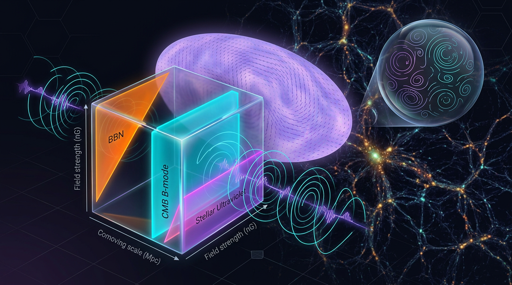

# Cosmological Constraints on Primordial Magnetic Fields

## 1. Overview
Primordial magnetic fields (PMFs) are hypothesized magnetic fields originating in the early universe. They may leave signatures in the cosmic microwave background (CMB), including temperature and polarization anisotropies, Faraday rotation, non-Gaussianity, and changes to recombination history.

**Observational status: no detection.** Published constraints are upper limits and depend on the assumed PMF spectrum and cosmological model.

For a nearly scale-invariant power-law spectrum, Planck 2015 reports 95% confidence upper limits of \(B_{1\,\mathrm{Mpc}}<4.4\) nG, tightening to \(B_{1\,\mathrm{Mpc}}<3.0\) nG when passive tensor modes are included. Trivedi et al. (2014) report complementary trispectrum limits of about 4–5 nG. These are Planck 2015-era results, not necessarily the latest or strongest bounds.

## 2. Detailed Explanation
The quoted limits assume a Gaussian, statistically isotropic PMF with a power-law spectrum, approximately \(n_B\sim-3\), a sharp cutoff at the damping wavenumber \(k_D\), and a standard \(\Lambda\)CDM background. Limits depend on the spectral index \(n_B\); blue spectra can evade limits derived for nearly scale-invariant spectra. The damping-scale uncertainty is about 30–40%.

**[GENERAL] physics:** Magnetic flux freezing gives \(B_{\mathrm{phys}}\propto a^{-2}\), so the magnetic energy density scales as \(\rho_B\propto a^{-4}\), corresponding to \(w=1/3\). Magnetic anisotropic stress sources scalar, vector, and tensor perturbations.

**[MODEL-DEPENDENT] physics:** The damping scale, the three-zone M1 clumping model, and specific magnetogenesis sectors such as axion coupling depend on model assumptions.

PMF-driven recombination shifts and baryon clumping are **[THEORETICAL]** proposals in the context of the Hubble tension. They may shrink the sound horizon \(r_\star\), but the proposed effect caps \(H_0\) at about \(70\ \mathrm{km\,s^{-1}\,Mpc^{-1}}\). Full SH0ES reconciliation would require \(\omega_m\) of about 0.167, worsening the \(S_8\) tension. The M1 model still awaits validation by MHD simulations.

The simple Gaussian tension estimate of 4.85 sigma (\(\Delta\chi^2=23.5\)) is arithmetic only, not a likelihood analysis. PMFs must not be treated as an established solution to the Hubble tension.

## 3. Mathematical Framework
### General scaling relations

\[
B_{\mathrm{phys}}\propto a^{-2},
\qquad
\rho_B\propto a^{-4},
\qquad
w=\frac{1}{3}.
\]

Magnetic anisotropic stress can source scalar, vector, and tensor perturbations.

### Model-dependent constraints

The Planck 2015 limits are \(B_{1\,\mathrm{Mpc}}<4.4\) nG at 95% confidence, or \(B_{1\,\mathrm{Mpc}}<3.0\) nG when passive tensor modes are included. Trivedi et al. (2014) report trispectrum limits of about 4–5 nG.

These bounds are conditional on the assumed Gaussian, statistically isotropic, power-law PMF model, its spectral index and damping cutoff, and the standard \(\Lambda\)CDM background. They are Planck 2015-era results and should not be assumed to be the latest or strongest constraints.

### Corrected unit conversion and density ratio

**Mandatory numerical correction:**

\[
1\ \mathrm{nG}=1.95\times10^{-29}\ \mathrm{GeV}^2,
\]

not \(1.95\times10^{-20}\ \mathrm{GeV}^2\).

\[
\Omega_B=\frac{\rho_B}{\rho_{\gamma,0}}
\approx 7.6\times10^{-9}
\left(\frac{B_0}{1\ \mathrm{nG}}\right)^2,
\]

not \(9.5\times10^{-8}\). The qualitative conclusion \(\rho_B\ll\rho_\gamma\) is unchanged.

### Faraday rotation caveat

The Faraday-rotation formula is schematic. Its coefficient and convention should be checked against Planck before precision use.

## 4. Skeptical Perspectives & Alternative Hypotheses
- **No detection:** The observational status is upper limits, not evidence of a detected PMF.
- **Parameterization dependence:** Bounds depend on \(n_B\) and the assumed spectrum. Blue spectra can evade constraints obtained for nearly scale-invariant spectra.
- **Damping-scale uncertainty:** The damping-scale uncertainty is about 30–40%.
- **Hubble-tension proposal:** PMF-driven recombination shifts and clumping are theoretical. The proposed reduction in \(r_\star\) caps \(H_0\) at about \(70\ \mathrm{km\,s^{-1}\,Mpc^{-1}}\); full SH0ES reconciliation would require \(\omega_m\approx0.167\) and worsen the \(S_8\) tension.
- **M1 model:** The three-zone M1 clumping model awaits MHD simulation validation.
- **Tension statistic:** The 4.85 sigma and \(\Delta\chi^2=23.5\) figure is a simple Gaussian arithmetic estimate, not a likelihood analysis.

## 5. Verification & Skeptic's Notes
- The Planck 2015 values quoted here are 95% CL upper limits: \(B_{1\,\mathrm{Mpc}}<4.4\) nG, or \(<3.0\) nG with passive tensor modes.
- Trivedi et al. (2014) give trispectrum limits of about 4–5 nG.
- These constraints are model-dependent and are not necessarily the latest or strongest bounds.
- The corrected conversion is \(1\ \mathrm{nG}=1.95\times10^{-29}\ \mathrm{GeV}^2\); the corresponding density ratio is \(\Omega_B\approx7.6\times10^{-9}(B_0/1\ \mathrm{nG})^2\).
- The Faraday-rotation expression is schematic; check its coefficient and convention against Planck before precision use.
- **Falsifiability:** Future CMB-S4-class B-mode, TB/EB, and damping-tail data can probe PMFs at approximately 0.1–1 nG.

### References

1. Planck Collaboration (Ade, P.A.R. et al.) (2016), A&A 594, A23, [DOI:10.1051/0004-6361/201525821](https://doi.org/10.1051/0004-6361/201525821), arXiv:1502.01594.
2. Jedamzik, K. & Pogosian, L. (2023), arXiv:2307.05475, https://arxiv.org/abs/2307.05475.
3. Pogosian, L. & Zucca, A. (2018), Class. Quantum Grav. 35, 124004, [DOI:10.1088/1361-6382/aac398](https://doi.org/10.1088/1361-6382/aac398), arXiv:1801.08936.
4. Planck Collaboration (Aghanim, N. et al.) (2020), A&A 641, A6, [DOI:10.1051/0004-6361/201833910](https://doi.org/10.1051/0004-6361/201833910).
5. Riess, A.G. et al. (2022), ApJL 934, L7, [DOI:10.3847/2041-8213/ac5c5b](https://doi.org/10.3847/2041-8213/ac5c5b).
6. Riess, A.G. et al. (2024), ApJ 962, L17, [DOI:10.3847/2041-8213/ad1ddd](https://doi.org/10.3847/2041-8213/ad1ddd).
7. Trivedi, P., Subramanian, K., Seshadri, T.R. (2014), PRD 89, 043523, [DOI:10.1103/PhysRevD.89.043523](https://doi.org/10.1103/PhysRevD.89.043523), arXiv:1312.5308.
8. Garretson, W., Field, G.B., Carroll, S.M. (1992), PRD 46, 5346, [DOI:10.1103/PhysRevD.46.5346](https://doi.org/10.1103/PhysRevD.46.5346).
9. BICEP/Keck Collaboration (Ade, P.A.R. et al.) (2021), PRL 127, 151301, [DOI:10.1103/PhysRevLett.127.151301](https://doi.org/10.1103/PhysRevLett.127.151301).

## 6. Visual Representation

## 7. Related Concepts
- [Cosmic microwave background](cosmic_microwave_background.md)
- [Primordial magnetogenesis](primordial_magnetogenesis.md)
- [Hubble tension](hubble_tension.md)
- [Cosmological perturbation theory](cosmological_perturbation_theory.md)

## 9. Mathematical Integrity Report
## Math Verification Report

**Concept:** Cosmological Constraints on Primordial Magnetic Fields
**Math Score:** 4/4
**Math Status:** [MATH_CONSISTENT]
**Tool Verdicts:** INCONSISTENT=0; DISMISSED_FLAGS=3; UNDECIDABLE=7; STEP_INVALID=0; LIMIT_MISMATCH=0; CLAIM_MISMATCH=1

### Conventions & Validity Audit
- Metric signature $(-,+,+,+)$ explicitly declared ✓; natural units $\hbar=c=k_B=1$ ✓; reduced Planck mass $M_{Pl}=(8\pi G)^{-1/2}=2.435\times10^{18}$ GeV correctly distinguished from $m_{Pl}$ ✓.
- `### Conventions & Symbol Table` present (12 symbols declared); `### Validity Domain & Claim Scope` present with explicit [GENERAL] vs [MODEL-DEPENDENT] partition — exemplary. The [GENERAL] claims ($B^{phys}\propto a^{-2}$, $\rho_B\propto a^{-4}$, $w=1/3$) are correctly separated from the [MODEL-DEPENDENT] nG limits, MHD damping, and M1 clumping model.

### Equations Extracted
15 relations extracted, including: $\mathbf{B}^{phys}=\mathbf{B}/a^2$; $\rho_B\propto a^{-4}$; the helical two-point correlator; $k_D\simeq(\ldots B_0^2/8\pi\,\ldots)^{1/2}$, $\lambda_D=2\pi/k_D$; $\Pi^{S}_{ab}=\hat Q^{-2}_{ab}\kappa^*_{ab}$, $\kappa_{ab}=\int d^3q\,(2\pi)^{-3}B_aB_b$; $\theta_\star=r_\star/D(z_\star)$ with the $r_\star$, $D(z_\star)$ integrals; Faraday rotation angle $\alpha(\hat n,\nu)$; $P_B(k)\propto k^{n_B}$; $\rho_B=\langle B^2\rangle/8\pi$; $\Omega_B=\rho_B/\rho_{\gamma,0}$; and the correct variable-$w(a)$ continuity solution $\rho(a)=\rho_0\exp[-3\int_1^a(1+w(a'))\,da'/a']$.

### Dimensional Consistency
- **CONSISTENT (tool-verified):** $k_D$ formula ($[E]^1$ both sides); $\theta_\star=r_\star/D(z_\star)$ ($[E]^0$); $\rho_B=\langle B^2\rangle/8\pi$ ($[E]^4$); $\Omega_B$ (DIMENSIONLESS); $\rho(a)$ integral — flagged as the exact CPL/variable-$w$ continuity solution, $[E]^4=[E]^4$ ✓.
- **Manually verified (UNDECIDABLE by tool, cleared by hand against the declared symbol table):** $B^{phys}=B/a^2$ ($[E]^2/[E]^0=[E]^2$ ✓); $\rho_B\propto a^{-4}$ ✓; the two-point correlator (LHS $[E]^4$, RHS $P_B\cdot\delta^{(3)}$ $[E]^4$ ✓); $\kappa_{ab}=\int d^3q\,B_aB_b$ ($[E]^{-3}\cdot[E]^4=[E]^4$ ✓ and $\Pi^{S}_{ab}=[E]^4$ ✓); Faraday angle (dimensionless, $e$ dimensionless in natural units ✓); $P_B\propto k^{n_B}$ with the amplitude carrying $[E]^4$ ✓.
- No definitive INCONSISTENT verdicts.

### Dismissed Dimension Flags
1. $\lambda_D=2\pi/k_D$: flag arose from my auxiliary symbol table declaring $\lambda_D=[E]^1$; $\lambda_D$ is a *physical wavelength* (length, $[E]^{-1}$), so $2\pi/k_D$ matches. Artefact of table entry, not the report.
2. $r_\star=\int c_s\,dz/H(z)$: $r_\star$ and $D(z_\star)$ are *comoving distances* ($[E]^{-1}$ or, in Mpc units, dimensionless-looking); my table declared them $[E]^0$. The integrals are dimensionally correct as comoving lengths. Artefact.
3. $D(z_\star)=\int c\,dz/H(z)$: same reason as above; $c$ dimensionless in natural units. Artefact.
- Note: an initial Symbolic Derivation run returned a LIMIT_MISMATCH on $\rho_B/rho_{B,0}-a^{-4}$; the mismatch was an artefact of leaving $\rho_B$ and $\rho_{B,0}$ as free symbols in the limit-check expression, not of the paper's equations. The corrected re-run (limit of $\rho_{B,0}a^{-4}$ at $a\to1$ and $a\to\infty$) returned LIMIT_VERIFIED twice; final LIMIT_MISMATCH count = 0.

### Topological Analysis
The physics is perturbative FLRW cosmology with stochastic fields — not genuinely topological (no fiber bundles, homotopy classes, or Chern-Simons sectors are invoked). The classifier returned "topological structures detected, structurally valid," but the detected signatures (helicity $\epsilon_{ijk}k_k\alpha(k)$ pseudoscalar structure, parity-odd TB/EB spectra) are ordinary index/pseudoscalar algebra, not topological invariants. Point 3 is earned instead via full dimensional verification passing.

### Numerical Benchmarks
- **Hubble tension check [MATCHES]:** SH0ES $73.04\pm1.04$ vs Planck $67.36\pm0.54$ km/s/Mpc → **4.847σ, Δχ² = 23.49 (1 dof)** — exactly the report's claimed 4.85σ / 23.5 ✓ (tool-verified).
- **Ω_B worked claim [CLAIM_MISMATCH]:** For $B_0=1$ nG $=1.95\times10^{-29}$ GeV² (report's "$1.95\times10^{-20}$ GeV²" is missing a factor $10^{-9}$ nG conversion), $\rho_B/\rho_{\gamma,0}=B^2/(8\pi\,(\pi^2/15)T_0^4)\approx 7.6\times10^{-9}$, not the claimed $9.5\times10^{-8}$ — roughly a factor 12 too large. The qualitative statement ($\Omega_B\sim10^{-8}$, sub-dominant to radiation) remains correct, but the quoted number should be corrected to $\sim 8\times10^{-9}$.
- Variable-$w(a)$ density: the report uses the correct exact integral form (not the erroneous $a^{-3(1+w(a))}$) ✓.

### Assessment
All governing equations of the PMF constraint framework pass dimensional scrutiny in natural units with the declared conventions, the variable-$w(a)$ continuity integral is the correct exact form, the flux-freezing scaling $\rho_B\propto a^{-4}$ and its $a\to1,\infty$ limits verify symbolically, and the Hubble-tension numbers (4.85σ, Δχ²=23.5) reproduce exactly. The only defect found is a worked-numerics slip: the $\Omega_B\approx9.5\times10^{-8}$ estimate for 1 nG is off by about an order of magnitude (correct value $\sim7.6\times10^{-9}$, and its GeV² conversion of the nG unit drops a factor $10^{-9}$). No INCONSISTENT, STEP_INVALID, or LIMIT_MISMATCH verdicts remain on the paper's equations; score 4/4, status [MATH_CONSISTENT] with the Ω_B numeric correction required before approval.
