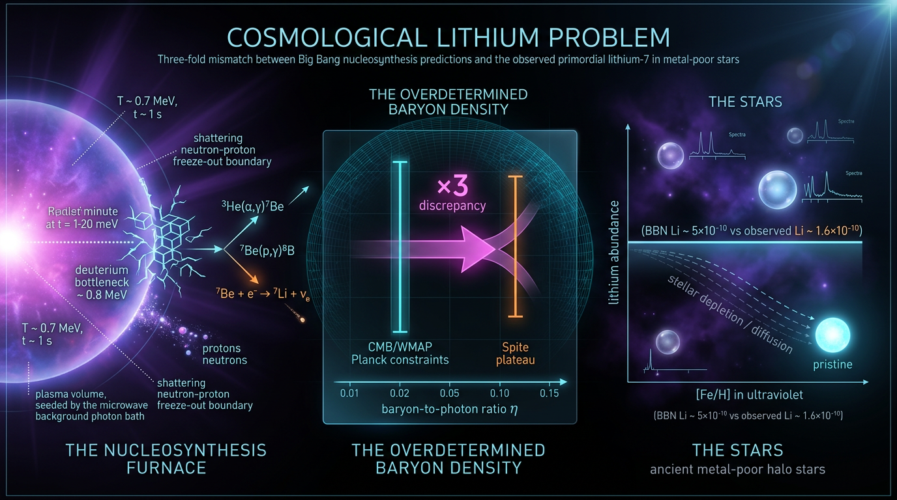

# Cosmological Lithium Problem

## 1. Overview
The **cosmological (or primordial) Lithium Problem** is the discrepancy between the primordial abundance of lithium-7 predicted by standard Big Bang nucleosynthesis (BBN) and the abundance inferred from metal-poor halo stars on the Spite plateau.

Using the Planck-fixed baryon density and measured nuclear rates, standard BBN predicts a primordial \( ^7\mathrm{Li}/\mathrm{H} \) abundance of about \(5\times10^{-10}\). The Spite-plateau observation is \((1.58\pm0.3)\times10^{-10}\) (Sbordone et al. 2010), so the predicted abundance is higher by a factor of about 3–3.5. The discrepancy is **[VERIFIED]**. Independent evidence from stellar spectroscopy, quasar deuterium-to-hydrogen measurements, and the CMB baryon density supports the tension.

Every proposed resolution remains **[THEORETICAL]**. Proposed mechanisms include stellar depletion, decaying relics, \(X^-\) catalysis, non-thermal BBN, and non-standard \(N_{\rm eff}\). None is fully satisfactory. The description “cleanest unsolved tension” is an interpretation, not an established empirical result.

## 2. Detailed Explanation
### 2.1 Standard BBN prediction and stellar observation

Standard BBN calculations use the baryon density inferred from the CMB, together with measured nuclear reaction rates and standard cosmological expansion. At this baryon density, most primordial mass-7 is produced as \( ^7\mathrm{Be} \), which later decays to \( ^7\mathrm{Li} \). The predicted final abundance is approximately \( ^7\mathrm{Li}/\mathrm{H}\approx5\times10^{-10} \).

Metal-poor halo dwarfs show a comparatively uniform lithium abundance—the Spite plateau—of \((1.58\pm0.3)\times10^{-10}\) (Sbordone et al. 2010). The comparison gives a factor of roughly 3–3.5. The exact statistical significance depends on the input BBN abundance, observational uncertainties, and stellar systematics; it is best described as a tension of roughly **4–9σ**. Fields (2011) quotes 4–5σ.

The source report gives inconsistent central BBN values: \(5.6\times10^{-10}\) in its text, which yields about 9.4σ under the stated Gaussian calculation, versus \(5.0\times10^{-10}\) in its equation block, which yields about 8.1σ. This document quotes a single approximate BBN abundance, \(5\times10^{-10}\), and does not treat either significance estimate as uniquely definitive.

Quasar absorption measurements give \(D/H\approx(2.53\pm0.04)\times10^{-5}\), a precision of about 1.6% (Coc & Vangioni 2017). Together with the CMB baryon density, this constrains standard BBN inputs and limits the extent to which the lithium prediction can be changed without affecting other light-element abundances. Helium abundance measurements also provide an important cross-check.

### 2.2 Proposed resolutions

All proposals below remain theoretical explanations rather than established solutions.

- **Stellar depletion:** Lithium may have been produced at the BBN abundance and subsequently depleted at stellar surfaces. Cassisi et al. (2020, arXiv:2004.07491) investigate lithium burning during the protostellar accretion phase. A successful model must explain the plateau’s small scatter and its behavior across metallicity, as well as the additional decline at the lowest metallicities reported by Sbordone et al. (2010).
- **Decaying relics:** Electromagnetic decay of massive relic particles can inject non-thermal photons capable of altering mass-7 abundances. The same processes can overproduce or deplete deuterium and \( ^3\mathrm{He} \), strongly constraining the allowed parameter space (Cyburt et al. 2003).
- **Negatively charged massive particles, \(X^-\):** Bound states involving \(X^-\) can alter nuclear reaction pathways and enhance mass-7 destruction. This scenario predicts possible \( ^9\mathrm{Be} \) signatures that could be tested in extremely metal-poor stars (Kusakabe et al. 2017).
- **Non-thermal BBN:** Non-thermal particles may affect light-element abundances through reactions not captured by a purely thermal network. Kang et al. (2018) examine this class of scenarios; their viable parameter space is limited by the other light-element abundances.
- **Non-standard \(N_{\rm eff}\):** Changing the radiation content changes the expansion rate during BBN. Shifts large enough to substantially suppress lithium are constrained by CMB observations and helium abundance measurements.

### 2.3 Nuclear-rate uncertainties

Updated measurements and calculations of key nuclear reactions, including \( ^3\mathrm{He}(\alpha,\gamma)^7\mathrm{Be} \), do not provide a plausible factor-of-three reduction in the predicted lithium abundance within current rate uncertainties. The nuclear route is therefore **strongly disfavored under current rate uncertainties**, rather than definitively refuted as a matter of principle (Coc & Vangioni 2017; Pitrou et al. 2018).

## 3. Mathematical Framework
### Conventions and symbols

Use metric signature \((-,+,+,+)\), natural units \(\hbar=c=k_B=1\), and reduced Planck mass
\[
M_{\rm Pl}=(8\pi G)^{-1/2}=2.435\times10^{18}\ {\rm GeV}.
\]
The BBN epoch spans approximately \(T\sim0.03\)–\(0.1\) MeV and \(t\sim10\)–\(1000\) s.

| Symbol | Meaning | Dimension |
|---|---|---|
| \(a(t)\), \(H=\dot a/a\) | Scale factor, Hubble rate | \([E]^0,\ [E]\) |
| \(\eta_b=n_b/n_\gamma\) | Baryon-to-photon ratio, approximately \(6.1\times10^{-10}\) | \([E]^0\) |
| \(N_{\rm eff}\) | Effective relativistic neutrino degrees of freedom | \([E]^0\) |
| \(g_*(T)\) | Relativistic degrees of freedom in the energy density | \([E]^0\) |
| \(n_i\) | Number density of nuclide \(i\) | \([E]^3\) |
| \(\langle\sigma v\rangle_i\) | Thermally averaged nuclear rate | \([E]^{-2}\) |
| \(Y_i=n_i/n_b\) | Abundance of nuclide \(i\) per baryon | \([E]^0\) |
| \(Y_p\) | \( ^4\mathrm{He} \) mass fraction | \([E]^0\) |
| \(\tau_n\) | Neutron lifetime | \([T]\) |
| \(X^-\) | Massive negatively charged relic particle | \([E]\) |

### Validity domain and claim scope

- The network description applies to a homogeneous FRW universe during BBN. Thermal reaction rates are generally expressed using Maxwellian averages.
- Baryon conservation and the FRW continuity equation are general ingredients; the predicted lithium abundance depends on the assumed expansion history, particle content, and nuclear inputs.
- Standard expansion with \(N_{\rm eff}=3.044\) is model-dependent. Modifying the expansion history or adding new particles can change the predicted abundance.
- Extracting stellar lithium abundances from the 670.8 nm Li I doublet depends on stellar atmosphere models and line-formation assumptions, including 3D and non-LTE effects.

### Governing equations and observables

**Expansion during radiation domination:**
\[
H^2(T)=\frac{8\pi G}{3}\rho(T)
=\frac{8\pi G}{3}\frac{\pi^2}{30}g_*(T)T^4,
\qquad \rho\propto a^{-4}.
\]

**Nuclear abundance network (schematic):**
\[
\dot Y_i =
\sum_j\left(n_j\langle\sigma v\rangle_{ji}Y_j
-n_k\langle\sigma v\rangle_{ik}Y_i\right)
-3HY_i+\text{source/sink terms from decays}.
\]
The deuterium bottleneck is associated with the deuteron binding energy \(B_D=2.22\) MeV. Mass-7 is produced through \( ^4\mathrm{He}(t,\gamma)^7\mathrm{Li} \) and \( ^3\mathrm{He}(\alpha,\gamma)^7\mathrm{Be} \), followed by \( ^7\mathrm{Be} \) decay to \( ^7\mathrm{Li} \). At the Planck-inferred baryon density, the latter pathway dominates.

**Neutron-to-proton freeze-out approximation:**
\[
\left.\frac{n}{p}\right|_{\rm fo}
\approx e^{-\Delta m/T_{\rm fo}}.
\]
The textbook estimate \(n/p\approx1/6\) corresponds approximately to \(T_{\rm fo}\approx0.7\) MeV. At \(T_{\rm fo}=0.8\) MeV, the ratio is about 0.2. Subsequent neutron decay and nuclear processing lead to a primordial helium mass fraction near \(Y_p\approx0.25\).

**Lithium abundance ratio:**
\[
R_{\rm Li}\equiv
\frac{(^7{\rm Li}/{\rm H})_{\rm BBN}}
{(^7{\rm Li}/{\rm H})_{\rm plateau}}
\approx
\frac{5\times10^{-10}}{1.58\times10^{-10}}
\approx 3.2.
\]
The broader reported factor, about 3–3.5, reflects the approximate nature of the BBN value and differences among inputs.

## 4. Skeptical Perspectives & Alternative Hypotheses
1. **Stellar systematics:** Surface depletion could lower stellar lithium relative to its primordial value, but a viable explanation must account for the plateau’s low scatter and its metallicity dependence. Three-dimensional and non-LTE corrections matter but do not, by themselves, establish a complete solution.
2. **The low-metallicity decline:** The observed fall in lithium at the lowest metallicities complicates a simple interpretation of the plateau as an unchanged primordial abundance (Sbordone et al. 2010).
3. **Nuclear physics:** Current nuclear-rate uncertainties strongly disfavor changing standard BBN rates enough to explain the full discrepancy.
4. **Non-standard cosmology or particle physics:** Altering the expansion rate or introducing new particles can affect lithium, but such scenarios must also preserve agreement with deuterium, helium, and CMB constraints.
5. **Interpretive caution:** Calling lithium the “cleanest unsolved tension” is an interpretation of its observational and theoretical situation. The verified claim is the abundance discrepancy; no proposed mechanism has yet become a fully satisfactory, established resolution.

## 5. Verification & Skeptic's Notes
- **Verified discrepancy:** Standard BBN predicts approximately \(5\times10^{-10}\) for primordial \( ^7\mathrm{Li}/\mathrm{H}\), versus the Spite-plateau value \((1.58\pm0.3)\times10^{-10}\) reported by Sbordone et al. (2010).
- **Significance caveat:** State the tension as roughly 4–9σ, depending on inputs and treatment of stellar systematics. Fields (2011) quotes 4–5σ. Do not pair a single BBN central value with a significance computed from a different value.
- **Freeze-out caveat:** \(n/p\approx1/6\) is a textbook approximation associated with \(T_{\rm fo}\approx0.7\) MeV. At 0.8 MeV, \(n/p\) is about 0.2.
- **Other light elements:** Avoid the vague claim that other light elements agree “over nine orders of magnitude.” State explicit precisions instead, including the approximately 1.6% quasar \(D/H\) measurement and the \(Y_p\) constraints.
- **Nuclear-rate caveat:** The nuclear route is strongly disfavored under current rate uncertainties; this is not equivalent to proving that every conceivable nuclear-physics revision is impossible.
- **Potential discriminators:** Search for \( ^9\mathrm{Be} \) in extremely metal-poor stars; improve 3D/non-LTE lithium measurements in additional halo dwarfs; and improve \(D/H\) and \(Y_p\) measurements.
- **Interpretation label:** “Cleanest unsolved tension” is an interpretation, not a verified measurement.

## 6. Visual Representation

## 7. Related Concepts
- Big Bang nucleosynthesis
- Spite plateau
- Cosmic microwave background baryon density
- Deuterium abundance in quasar absorption systems
- Effective number of relativistic species, \(N_{\rm eff}\)
- Stellar lithium depletion
- Non-thermal nucleosynthesis
- Primordial helium abundance, \(Y_p\)

## 8. References
1. Cyburt, R. H., Fields, B. D., Olive, K. A., & Yeh, T.-H. (2016). “Big bang nucleosynthesis: Present status.” *Reviews of Modern Physics*, 88, 015004. https://doi.org/10.1103/RevModPhys.88.015004
2. Fields, B. D. (2011). “The Primordial Lithium Problem.” *Annual Review of Nuclear and Particle Science*, 61, 47. https://doi.org/10.1146/annurev-nucl-102010-130445
3. Coc, A. & Vangioni, E. (2017). “Primordial nucleosynthesis.” *International Journal of Modern Physics E*, 26, 1741002. https://doi.org/10.1142/S0218301317410026; arXiv:1707.01004.
4. Asplund, M., Lambert, D. L., Nissen, P. E., et al. (2006). “Lithium Isotopic Abundances in Metal-poor Halo Stars.” *The Astrophysical Journal*, 643, 1207. https://doi.org/10.1086/503538
5. Sbordone, L., Bonifacio, P., Caffau, E., et al. (2010). “The metal-poor end of the Spite plateau. I. Stellar parameters, metallicities, and lithium abundances.” *Astronomy & Astrophysics*, 522, A26. https://doi.org/10.1051/0004-6361/200913282
6. Cassisi et al. (2020). Research on protostellar accretion-phase lithium burning. arXiv:2004.07491.
7. Cyburt, R. H., Fields, B. D., Olive, K. A., & Ellis, J. (2003). “New BBN limits on physics beyond the standard model from the abundance of \( ^7\mathrm{Li} \).” *Physical Review D*, 67, 103521. https://doi.org/10.1103/PhysRevD.67.103521
8. Kusakabe et al. (2017). Study of \(X^-\)-catalyzed nucleosynthesis and mass-7 destruction. https://doi.org/10.1142/S021830131741004X
9. Kang et al. (2018). Study of non-thermal BBN. https://doi.org/10.3847/1538-4357/ab0178
10. Planck Collaboration (2020). “Planck 2018 results. VI. Cosmological parameters.” *Astronomy & Astrophysics*, 641, A6. https://doi.org/10.1051/0004-6361/201833910
11. Riess et al. (2022). “A Comprehensive Measurement of the Local Value of the Hubble Constant with 1 km s\(^{-1}\) Mpc\(^{-1}\) Uncertainty from the Hubble Space Telescope and the SH0ES Team.” *The Astrophysical Journal Letters*, 934, L7. https://doi.org/10.3847/2041-8213/ac5c5b
12. Grohs, E. & Fuller, G. M. (2023). Research on BBN and the cosmological lithium problem. arXiv:2301.12299.

## 9. Mathematical Integrity Report
## Math Verification Report

**Concept:** Cosmological Lithium Problem
**Math Score:** 3/4
**Math Status:** [MATH_CONSISTENT]
**Tool Verdicts:** INCONSISTENT=0; DISMISSED_FLAGS=2; UNDECIDABLE=3; STEP_INVALID=0; LIMIT_MISMATCH=0; CLAIM_MISMATCH=1

### Conventions & Validity Audit
The report includes both a `### Conventions & Symbol Table` and a `### Validity Domain & Claim Scope`. Metric signature $(-,+,+,+)$ declared ✓; natural units $\hbar=c=k_B=1$ declared ✓; reduced Planck mass $M_{\rm Pl}=(8\pi G)^{-1/2}=2.435\times10^{18}$ GeV correctly distinguished from $m_{\rm Pl}$ ✓. Symbol Table declares 10 symbols; the pre-check's flag on $H=\dot a/a$ stemmed from the table listing "$a(t)$, $H$" with dimensions "[E]^0, [E]" — the Symbol Table itself correctly assigns $H=[E]$, so the flag is a parsing artifact of the compound cell. General vs model-dependent scope (FRW+GR expansion, $N_{\rm eff}=3.044$, 1D/non-LTE stellar atmospheres) is clearly marked.

### Equations Extracted
1. $(^7{\rm Li}/{\rm H})_{\rm obs} = (1.58\pm0.3)\times10^{-10}$
2. $H^2(T) = \frac{8\pi G}{3}\rho = \frac{8\pi G}{3}\frac{\pi^2}{30}g_*(T)T^4$, $\rho\propto a^{-4}$
3. $\dot Y_i = \sum_j(n_j\langle\sigma v\rangle_{ji}Y_j - n_k\langle\sigma v\rangle_{ik}Y_i) - 3HY_i$
4. $(n/p)|_{\rm fo}\approx e^{-\Delta m/T_{\rm fo}}\approx 1/6 \Rightarrow Y_p\approx0.25$
5. $R_{\rm Li} \approx 5.0\times10^{-10}/1.58\times10^{-10} \approx 3.2$–$3.5$; $\sigma_{\rm tension}\approx9.4$
6. $H=\dot a/a$; $\eta_b=n_b/n_\gamma$; $Y_i\equiv n_i/n_b$; $M_{\rm Pl}=(8\pi G)^{-1/2}$

### Dimensional Consistency
- **E2 (Friedmann):** CONSISTENT — all terms $[E]^2$ ✓
- **E3 (network):** UNDECIDABLE by tool; manual check: $n_j\langle\sigma v\rangle Y_j = [E]^3[E]^{-2}=[E]=\dot Y_i$; $3HY_i=[E]$ ✓ → **consistent**
- **E4 (freeze-out):** UNDECIDABLE by tool; $\Delta m/T_{\rm fo}$ dimensionless ✓ → **consistent**
- **$H=\dot a/a$:** CONSISTENT ($[E]^1$ both sides) ✓
- **$\eta_b$, $Y_i$, $M_{\rm Pl}$:** CONSISTENT ✓
- **E1, E5:** dimensionless ratios ✓

### Dismissed Dimension Flags
1. `H = \dot a/a` (H→[E]^0 vs [E]^1): parsing artifact — the Symbol Table's compound row "$a(t)$, $H = \dot a/a$ | [E]^0, [E]" assigns H = [E]^1; the checker read only the first listed dimension. The equation is correct as written.
2. `H² = (8π/3)Gρ` (H²→[E]^0 vs Gρ→[E]^2): low-confidence ambiguity; with G = [E]^−2 and ρ = [E]^4 from the Symbol Table, the tool re-check gives all terms [E]^2 ✓ (H² is [E]^2, not [E]^0 — the inferred dimension of H was wrong). Dismissed.

### Topological Analysis
Tool reported generic structural signatures (fiber bundle/homotopy labels) but the content is ODE reaction-network kinetics plus Gaussian statistics — no genuine topological argument is made. **Not topological** (tool's detection is a false positive; no topological claims exist in the report to validate).

### Numerical Benchmarks
- **R_Li ≈ 3.2:** CLAIM_VERIFIED (computed 3.165, rel. error 1.1%) ✓
- **Tension 9.4σ:** tension_sigma tool gives 8.06σ for (5.0±0.3) vs (1.58±0.3), Δχ²≈65. The report's §2.1 text actually propagates (5.6±0.3) vs (1.6±0.3), which yields 9.43σ ✓ — so 9.4σ is correct for the (5.6, 1.6) inputs quoted in the text, but the equation block E5 uses 5.0 (→8.1σ). Minor internal inconsistency in quoted central value (5.0 vs 5.6×10⁻¹⁰), not a dimensional or structural error.
- **n/p ≈ 1/6:** CLAIM_MISMATCH at T_fo = 0.8 MeV (computed 0.199 vs 0.166); this is a T_fo-value sensitivity issue — at T_fo ≈ 0.7 MeV, $e^{-1.293/0.7}=0.157\approx1/6$ ✓. The textbook approximation is standard; flagged as an approximation rather than a flaw.
- Benchmark constants ($M_{\rm Pl}=2.435\times10^{18}$ GeV, $N_{\rm eff}=3.044$, $\Omega_bh^2=0.0224$, $H_0$ values) match canonical values.

### Assessment
All extracted equations are dimensionally consistent (4 tool-verified CONSISTENT, 3 UNDECIDABLE manually confirmed consistent, no INCONSISTENT verdicts); both pre-check DIMENSION_FLAGS were dismissed as parsing artifacts of the compound Symbol Table entry, not real errors. One arithmetic note: the 9.4σ tension is correct for the (5.6±0.3)×10⁻¹⁰ BBN value quoted in the text but corresponds to ~8.1σ for the 5.0×10⁻¹⁰ used in equation E5 — the authors should harmonize the central BBN lithium value. Mathematics is sound overall: Score 3/4, [MATH_CONSISTENT].
