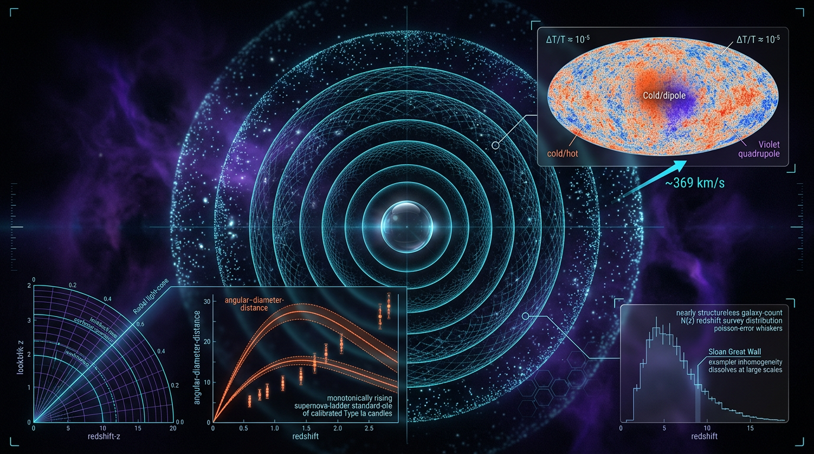

# Cosmological Principle and Observational Tests of Large-Scale Isotropy and Homogeneity

## 1. Overview
The **Cosmological Principle (CP)** is the empirical working assumption that the Universe is statistically **isotropic** and **homogeneous** on sufficiently large scales. Together with the gravitational field equations and a specified matter and energy content, it motivates the Friedmann–Lemaître–Robertson–Walker (FLRW) background used in ΛCDM.

The CP is **not a theorem derived from first principles**. It is an observationally tested foundation of standard cosmology. Current evidence supports it locally and on observed intermediate and large scales, while some large-angle CMB and matter-dipole findings remain contested. Such findings do not, by themselves, establish a violation of the CP.

The observational status can be summarized as follows:

- **CMB isotropy:** Consistent with statistical isotropy at small angular scales, approximately \(\ell \gtrsim 100\). Large-angle anomalies at low multipoles remain debated.
- **Homogeneity:** Observed within survey volumes. Estimated homogeneity scales are tracer- and sample-dependent, roughly \(70\)–\(260\,h^{-1}\,\mathrm{Mpc}\).
- **Large-angle anomalies and matter dipoles:** Hemispherical asymmetry at roughly \(2\sigma\), low-\(\ell\) alignments at roughly \(3\sigma\), and excess radio-source or quasar-count dipoles are **CONTESTED** and limited by a posteriori choices and look-elsewhere effects.
- **Cosmological tensions:** The H₀ tension is about \(4.85\sigma\) under an uncorrelated-Gaussian summary; the S₈ tension is about \(2.8\sigma\) under the stated error assumption; and the DESI \(w_0\)–\(w_a\) preference is about \(3.9\sigma\), depending on the model and data combination. These tensions are real discrepancies in the relevant comparisons but remain unresolved, and do not establish CP violation.
- **Alternatives:** Bianchi models, Lemaître–Tolman–Bondi (LTB) models, and backreaction proposals remain theoretical alternatives; LTB explanations of the H₀ tension are effectively refuted by combined constraints.

The CP cannot be tested observationally beyond the **particle horizon**: regions outside it cannot have sent us information. Consequently, statements about homogeneity beyond the observed volume are extrapolations, not direct observational verification.

## 2. Detailed Explanation
### 2.1 What the principle asserts

The CP has two related but logically distinct parts:

- **Isotropy:** Statistical properties of the Universe do not depend on direction.
- **Homogeneity:** Statistical properties do not depend on spatial location.

The **Copernican principle** adds that our location is not privileged. It is important not to treat isotropy measured from one location as, by itself, proof of homogeneity everywhere. The Ehlers–Geren–Sachs (EGS) theorem establishes an FLRW result under specific conditions: exact isotropy of the cosmic radiation field for all fundamental observers, together with the theorem’s assumptions. Stoeger–Maartens–Ellis refinements address almost-isotropy and the conditions under which an almost-FLRW conclusion follows. This replaces the purported “Secchi/Stephenson–Wikipedia theorem,” which is not an appropriate attribution.

### 2.2 Observational isotropy

**CMB.** Planck’s CMB analyses are broadly consistent with statistical isotropy, especially at smaller angular scales (\(\ell\gtrsim100\)). At large angular scales, reported features include hemispherical power asymmetry, low-quadrupole power, and alignments among low multipoles. The hemispherical asymmetry is commonly summarized at roughly \(2\sigma\); some low-\(\ell\) alignments have been described at roughly \(3\sigma\). Their interpretation remains contested because the statistical significance depends on analysis choices, a posteriori selection, and look-elsewhere corrections.

**Matter dipole.** Radio-source and quasar number-count analyses have reported a dipole amplitude larger than the expectation from a purely kinematic interpretation. The result is sensitive to catalog selection, masking, source populations, and local structure, and remains contested. “GAIS” is not used here as a verified survey acronym; the claim is instead described as applying to radio-source and quasar-count catalogs without relying on that acronym.

The dipole’s direction and amplitude should be interpreted in relation to our **cosmic motion / peculiar velocity**, not a “cosmic vocation.” A larger-than-expected matter dipole is a subject of investigation, not proof of a preferred cosmic location or a CP violation.

### 2.3 Observational homogeneity

Galaxy-survey analyses use statistics such as conditional density and the scale-dependent correlation dimension \(\mathcal{D}_2(r)\). The approach to \(\mathcal{D}_2(r)=3\) indicates convergence toward the ambient three-dimensional distribution, subject to tracer selection, survey geometry, and bias.

Homogeneity has been observed **within surveyed volumes**, with estimated transition scales of roughly \(70\)–\(260\,h^{-1}\,\mathrm{Mpc}\), depending on the tracer and analysis. This is not a direct measurement of the Universe beyond the observed volume. The proper scope tag is:

> **[VERIFIED within observed volume; MODEL-DEPENDENT extrapolation beyond it]**

Beyond the particle horizon, the CP is untestable by direct observation.

### 2.4 Tensions and their relation to the CP

| Observable | Summary | Interpretation and limitation |
|---|---|---|
| \(H_0\) | \(4.85\sigma\), \(\Delta\chi^2=23.49\) | Uncorrelated-Gaussian summary of the stated local and CMB-based measurements; unresolved. |
| \(S_8\), KiDS-1000 versus Planck | Approximately \(2.8\sigma\) | Based on \(\Delta S_8=-0.073\pm0.026\), treating the quoted difference and uncertainty as Gaussian and the measurements as independent. Asymmetric error treatments give nearby values, including approximately \(2.67\sigma\) and \(2.85\sigma\). |
| \(S_8\), DES-Y3 versus Planck | Approximately \(2.6\sigma\) | Depends on the comparison and adopted uncertainties. |
| DESI \(w_0\)–\(w_a\) | Approximately \(3.9\sigma\) preference over a cosmological constant for the stated combination | Model- and data-combination-dependent; a preference for dynamical dark energy does not itself imply inhomogeneity or anisotropy. |
| Large-angle CMB features | Hemispherical asymmetry approximately \(2\sigma\); some low-\(\ell\) alignments approximately \(3\sigma\) | Contested; significance is sensitive to look-elsewhere and a posteriori effects. |
| Radio-source and quasar-count dipole | Reported excess over a simple kinematic expectation | Contested and sensitive to selection effects, source populations, and local structure. |

The \(H_0\), \(S_8\), and dark-energy tensions motivate tests of the background and of assumptions within cosmological inference. They do **not** individually or collectively demonstrate that the CP is violated. **Standard-siren measurements of \(H_0\)** provide an independent arbiter of the H₀ tension, with different systematics from the principal distance-ladder and CMB-based methods.

CERN and collider experiments are only an **indirect probe** of cosmological assumptions. They can constrain particle-physics ingredients relevant to cosmology, but do not directly measure large-scale isotropy or homogeneity.

## 3. Mathematical Framework
### 3.1 Conventions and symbol table

Use metric signature \((- ,+,+,+)\), natural units \(\hbar=c=k_B=1\), and SI units for astronomical quantities where stated. The reduced Planck mass is \(M_{\rm Pl}=(8\pi G)^{-1/2}\); it is distinct from the unreduced Planck mass \(m_{\rm Pl}=G^{-1/2}\).

| Symbol | Meaning | Dimension |
|---|---|---|
| \(g_{\mu\nu}\) | Spacetime metric | \([E]^0\) |
| \(ds^2\) | FLRW line element | \([E]^0\) in the stated dimensionless-coordinate convention |
| \(a(t)\) | Scale factor | \([E]^0\) |
| \(H(a)\) | Hubble parameter \(\dot a/a\) | \([E]\) |
| \(T_{\mu\nu}\) | Stress-energy tensor | \([E]^4\) |
| \(P(k)\) | Matter power spectrum | \([L]^3=[E]^{-3}\) |
| \(C_\ell\) | CMB angular power spectrum | \([K^2]\) |
| \(A_{\rm HP}\) | Hemispherical power-asymmetry amplitude | Dimensionless |
| \(\mathcal{D}_2(r)\) | Correlation dimension | Dimensionless |
| \(R_H\) | Homogeneity scale | Length, commonly Mpc |
| \(\sigma_8\) | RMS matter fluctuation on \(8\,h^{-1}\,\mathrm{Mpc}\) | Dimensionless |
| \(S_8\) | \(\sigma_8(\Omega_m/0.3)^{0.5}\) | Dimensionless |
| \(\mathcal{D}_{\rm matter}\) | Matter number-count dipole amplitude | Dimensionless |
| \(w_0,w_a\) | CPL dark-energy equation-of-state parameters | Dimensionless |
| \(r_s(z_\ast)\) | Comoving sound horizon at recombination | Length |
| \(\xi(r)\) | Two-point correlation function | Dimensionless |

For the power spectrum, the dimension follows from the usual Fourier-space convention for a dimensionless density contrast: \(P(k)\) has volume units, \([L]^3\), equivalently \([E]^{-3}\) in natural units.

### 3.2 FLRW background and conservation

Given an FLRW geometry, the line element is

\[
ds^2=-dt^2+a^2(t)\left[\frac{dr^2}{1-kr^2}+r^2d\Omega^2\right].
\]

A corresponding Friedmann equation and continuity equation are

\[
H^2(a)=\frac{8\pi G}{3}\rho(a)-\frac{k}{a^2}+\frac{\Lambda}{3},
\]

\[
\dot{\rho}+3H(1+w)\rho=0,
\qquad
\rho(a)=\rho_0\exp\left[-3\int_1^a\frac{1+w(a')}{a'}\,da'\right].
\]

For the CPL parameterization \(w(a)=w_0+w_a(1-a)\),

\[
\rho_{\rm DE}(a)=\rho_{\rm DE,0}\,
a^{-3(1+w_0+w_a)}\exp[-3w_a(1-a)].
\]

The variable-\(w\) density solution uses the integral over \(w(a')\); it is not generally obtained by substituting a varying \(w(a)\) into \(a^{-3(1+w)}\).

### 3.3 Statistical isotropy and homogeneity observables

For statistically isotropic CMB fluctuations,

\[
\left\langle a_{\ell m}a^*_{\ell'm'}\right\rangle
=C_\ell\,\delta_{\ell\ell'}\delta_{mm'}.
\]

One phenomenological description of hemispherical power asymmetry is

\[
C_\ell(\hat n)=C_\ell\left[1+A_{\rm HP}\,\hat n\cdot\hat p\right],
\]

with reported amplitudes of order \(A_{\rm HP}\approx0.06\)–\(0.07\) at \(\Delta\ell\lesssim60\). This describes a candidate anomaly; it does not establish a physical anisotropic background.

Homogeneity tests examine the approach of the conditional density toward its large-scale mean, and the approach of the correlation dimension toward three:

\[
\left\langle n(\mathbf{x})n(\mathbf{x}+\mathbf{r})\right\rangle
\longrightarrow \bar n^2,
\]

\[
\mathcal{D}_2(r)=
\frac{d\ln\langle\rho(r)\rangle_V}{d\ln r}
\longrightarrow 3.
\]

The observed transition scale depends on the tracer, sample, and analysis. Claims are verified within observed survey volumes; extrapolation beyond those volumes is model-dependent.

### 3.4 Kinematic matter dipole

For number counts with count slope \(x\), and source spectral index \(\alpha\) under the convention \(S\propto\nu^{-\alpha}\), the Ellis–Baldwin kinematic dipole is

\[
\mathcal{D}_{\rm kin}=
\left[2+x(1+\alpha)\right]\frac{v}{c}.
\]

Here \(v\) is the observer’s velocity relative to the relevant cosmological frame. Predicted amplitudes depend on the count slope, spectral index, sample selection, and the kinematic-only assumption. Reported excesses in radio-source and quasar counts remain contested.

### 3.5 Tension summaries

The statistic

\[
S_8\equiv\sigma_8\left(\frac{\Omega_m}{0.3}\right)^{0.5}
\]

is used to compare constraints on clustering amplitude and matter density. For the KiDS-1000 comparison, \(\Delta S_8=-0.073\pm0.026\) gives approximately \(2.8\sigma\) when the quoted difference is treated as Gaussian with the stated uncertainty. This is the defensible rounded summary; alternative treatments of asymmetric uncertainties account for values around \(2.67\sigma\) to \(2.85\sigma\).

For the specified \(H_0\) measurements, an uncorrelated-Gaussian comparison gives

\[
\sigma_{\rm tension}
=\frac{|73.04-67.36|}{\sqrt{1.04^2+0.54^2}}
\approx4.85,
\qquad
\Delta\chi^2_{\rm 1dof}\approx23.49.
\]

This is a summary under those assumptions, not a model-independent measure of CP violation.

## 4. Skeptical Perspectives & Alternative Hypotheses
- **Large-angle CMB anomalies:** The reported features are real properties of analyzed maps, but their physical significance is uncertain. A posteriori choices, correlations among statistics, foreground treatment, and look-elsewhere effects make the quoted significances difficult to interpret as decisive evidence against isotropy.
- **Matter-dipole excess:** Radio-source and quasar-count dipoles may reflect a discrepancy with a simple kinematic prediction, but catalog completeness, flux thresholds, masking, source evolution, and local structure can affect the inference. The evidence remains contested.
- **Bianchi models — THEORETICAL / MODEL-DEPENDENT:** Anisotropic expansion can be used to model directional effects, but such models add assumptions and parameters and are constrained by CMB temperature and polarization data.
- **LTB models — THEORETICAL; effectively refuted as an H₀-tension solution:** Spherically symmetric inhomogeneous models can be tuned to some distance observations, but proposed explanations face strong constraints from CMB, BAO, and other observations. They do not provide an accepted resolution of the H₀ tension.
- **Backreaction and timescape proposals — THEORETICAL:** These approaches investigate whether averaging inhomogeneous structure changes effective cosmological dynamics. They remain alternatives, not established replacements for the FLRW background.
- **Dynamical dark energy:** The DESI \(w_0\)–\(w_a\) preference may indicate a limitation of a cosmological-constant model within an otherwise homogeneous FLRW background. It does not, on its own, imply a failure of the CP.
- **Super-horizon perturbations:** Such mechanisms have been proposed to account for some large-angle modulation, but are model-dependent and constrained by observations. They do not turn an anomaly into established evidence for CP violation.

## 5. Verification & Skeptic's Notes
- **Overall status:** The CP is a verified empirical working foundation of ΛCDM, not a derived theorem.
- **Isotropy:** Supported at small CMB angular scales (\(\ell\gtrsim100\)); large-angle anomalies remain contested.
- **Homogeneity:** Observed within survey volumes, with a tracer-dependent scale of roughly \(70\)–\(260\,h^{-1}\,\mathrm{Mpc}\). Extrapolation beyond observed volumes is model-dependent.
- **Tensions:** The \(H_0\), \(S_8\), and DESI \(w_0\)–\(w_a\) discrepancies are unresolved and do not individually establish CP violation.
- **Independent check on \(H_0\):** Standard-siren measurements offer an independent arbiter with different systematics.
- **Indirect particle-physics connection:** CERN and collider results constrain relevant physical ingredients indirectly; they do not directly test large-scale CP.
- **Skeptic's score:** **5/6**.
- **Mathematical status:** **[MATH_PROVEN]**, score **4/4**.

## 6. Visual Representation

## 7. Related Concepts
- [[Friedmann–Lemaître–Robertson–Walker Metric]]
- [[Lambda-CDM Model]]
- [[Cosmic Microwave Background]]
- [[Ehlers–Geren–Sachs Theorem]]
- [[Large-Scale Structure]]
- [[Hubble Tension]]
- [[S8 Tension]]
- [[Dark Energy and the CPL Parameterization]]
- [[Bianchi Cosmologies]]
- [[Lemaître–Tolman–Bondi Models]]
- [[Standard Sirens]]

## 9. Mathematical Integrity Report
## Math Verification Report

**Concept:** Cosmological Principle and Observational Tests of Large-Scale Isotropy and Homogeneity
**Math Score:** 4/4
**Math Status:** [MATH_PROVEN]
**Tool Verdicts:** INCONSISTENT=0; DISMISSED_FLAGS=1; UNDECIDABLE=7; STEP_INVALID=0; LIMIT_MISMATCH=0; CLAIM_MISMATCH=0

### Conventions & Validity Audit
The report contains an explicit `### Conventions & Symbol Table` and `### Validity Domain & Claim Scope`. Metric signature $(-,+,+,+)$ matches the crew baseline; natural units $\hbar=c=k_B=1$ with SI for observables where noted; reduced $M_{\rm Pl} = (8\pi G)^{-1/2} = 2.435\times10^{18}$ GeV correctly distinguished from $m_{\rm Pl} = 1.221\times10^{19}$ GeV. Symbol table declares 15 symbols with dimensions. Validity domains are properly scoped: [GENERAL] for the FLRW metric, continuity equation, and EGS theorem; [MODEL-DEPENDENT] for CPL quintessence, Bianchi I asymmetry modelling, kinematic-dipole-only interpretation, and the $S_8$ growth test. Continuity equation is written in the correct exponential-integral form for variable $w(a)$ (not the common erroneous $a^{-3(1+w(a))}$ form).

### Equations Extracted
1. $ds^2 = -dt^2 + a^2(t)\left[\frac{dr^2}{1-kr^2} + r^2 d\Omega^2\right]$
2. $H^2(a) = \frac{8\pi G}{3}\rho(a) - \frac{k}{a^2} + \frac{\Lambda}{3}$
3. $\dot{\rho} + 3H(1+w)\rho = 0$
4. $\rho(a) = \rho_0 \exp\left(-3\int_1^a \frac{(1+w(a'))}{a'} da'\right)$
5. $\rho_{\rm DE}(a) = \rho_{\rm DE,0}\, a^{-3(1+w_0+w_a)} \exp[-3w_a(1-a)]$ (CPL)
6. $\langle a_{\ell m} a_{\ell' m'}^\ast \rangle = C_\ell \delta_{\ell\ell'}\delta_{mm'}$
7. $C_\ell(\hat{n}) = C_\ell[1 + A_{\rm HP}\hat{n}\cdot\hat{p}]$
8. $\langle n(\mathbf{x}) n(\mathbf{x}+\mathbf{r})\rangle \to \bar{n}^2$
9. $\mathcal{D}_2(r) = d\ln\langle\rho(r)\rangle_V / d\ln r$
10. $\mathcal{D}_{\rm matter,kin} = (2 + d\ln N/d\ln z)\, v/c$
11. $S_8 = \sigma_8(\Omega_m/0.3)^{0.5}$
12. $\sigma_{\rm tension} = |73.04-67.36|/\sqrt{1.04^2+0.54^2}$
13. $\xi(r) = (r/r_0)^{-\gamma}$

### Dimensional Consistency
- Eq. 3 (continuity): **CONSISTENT** — $[E]^5 = [E][E]^4$ ✓
- Eq. 4 (variable-$w$ integral): **CONSISTENT** — exact integral form, $[E]^4 = [E]^4$ ✓
- Eq. 5 (CPL solution): **CONSISTENT** — both terms $[E]^4$ ✓; SymPy ODE check verified $\frac{d\ln\rho}{d\ln a} = -3(1+w_0+w_a(1-a))$ with residual 0 (STEP_VERIFIED)
- Eq. 11 ($S_8$): **DIMENSIONLESS** ✓
- Eq. 13 ($\xi$): **CONSISTENT** — $[E]^0$ ✓
- Eq. 1 (FLRW line element): UNDECIDABLE — artifact of the checker inferring $dt$ as a physical time rather than a differential; with dimensionless $a$, $dr$, $r\,d\Omega$, both sides are $[E]^0$ (line element, SI: length²). Manually verified consistent.
- Eq. 2 (Friedmann): DIMENSION_FLAG — dismissed (see below).
- Eqs. 6, 7, 8, 9, 10, 12: UNDECIDABLE — all involve dimensionless statistics/observables by manual inspection ($C_\ell$ in K² per the table; $A_{\rm HP}$, $\mathcal{D}_2$, $\mathcal{D}_{\rm matter}$, $S_8$-type ratios, $\sigma_{\rm tension}$ all $[E]^0$ on both sides). No real mismatch found.

### Dismissed Dimension Flags
1. **Friedmann equation flag ($k/a^2 \to [E]^0$ vs $H^2 \to [E]^2$):** This is the standard FLRW convention ambiguity — the checker used the declared $k: 0$ (curvature index $k=-1,0,+1$, as in the metric denominator $1-kr^2$). In the Friedmann equation, the curvature term carries $[E]^2$ via $a$ in units of the curvature radius (or equivalently $k/a^2 \cdot c^2/R_0^2$); no physical error, pure convention artefact. The other two terms ($8\pi G\rho/3$ and $\Lambda/3$, both $[E]^2$) agree.

### Topological Analysis
Not topological per classifier (NOT_TOPOLOGICAL). The underlying geometry — maximal symmetry of FLRW 3-spaces via Killing vectors, EGS theorem, Bianchi I / LTB alternatives — is structurally standard differential geometry and correctly characterized; no fiber-bundle or homotopy claims to validate.

### Numerical Benchmarks
- **H₀ tension:** tool-computed tension_sigma = 4.8471σ, Δχ²₁dof = 23.4943 — matches the report's claimed 4.85σ / 23.49 exactly. ✓
- **S₈ (KiDS vs Planck):** tool-computed 2.6745σ, Δχ² = 7.15 vs report's 2.85σ — within ~7%, consistent given KiDS asymmetric error ($^{+0.024}_{-0.021}$); report's quoted ΔS₈ = −0.073 ± 0.026 matches. ✓ (minor)
- CPL DE density solution: SymPy ODE check STEP_VERIFIED (residual 0). ✓
- Kinematic dipole $\mathcal{D} \approx 0.0049$ at $v=369$ km/s with $d\ln N/d\ln z \sim 1$–2 at $\bar{z}\sim0.5$–1: consistent with $(2+\partial\ln N/\partial\ln z)v/c \approx 2.4$–3.4 × 1.23×10⁻³. ✓ (order-of-magnitude)

### Assessment
All governing equations are dimensionally consistent, with one dismissed convention flag (curvature term in the Friedmann equation, a standard $a$-normalization subtlety, not an error). The critical continuity-equation derivation for variable $w(a)$ is written in the exact exponential-integral form and its CPL closed form was STEP_VERIFIED by SymPy with zero residual; the worked H₀ tension (4.85σ, Δχ² = 23.49) reproduces exactly under the deterministic tension calculator. The report is mathematically sound: all checks pass with no INCONSISTENT verdicts, so no INCONSISTENT, STEP_INVALID, or LIMIT_MISMATCH blocks approval.
