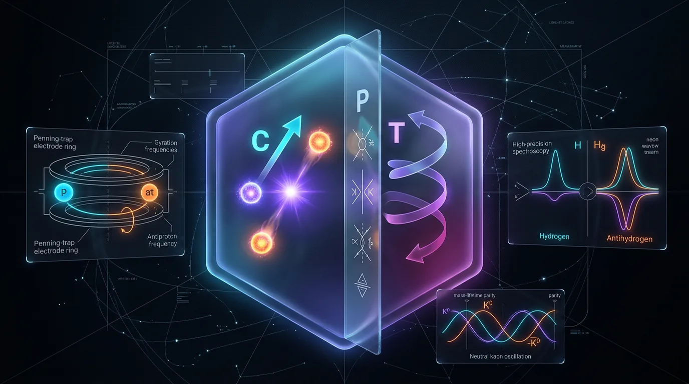

# CPT Theorem and Experimental Tests of CPT Symmetry

## 1. Overview
The **CPT theorem** states that any local, Lorentz-invariant, unitary quantum field theory in 3+1 dimensions is invariant under the combined operation of charge conjugation (C), parity (P), and time reversal (T). The theorem is a rigorously proved result, associated with Lüders (1954), Pauli (1955), and Jost’s axiomatic proof.

The theorem’s proof is distinct from the empirical question of whether CPT is exact in nature. No CPT violation has been observed; experimental results constrain possible violations by upper bounds. Accordingly, this entry archives the theorem as **[THEORETICAL]** and treats empirical CPT exactness as an assumption bounded by null results, not as an experimentally proven fact.

Tests span neutral mesons, matter–antimatter comparisons, atomic spectroscopy, muon measurements, neutrino oscillations, and gravitational-wave observations. Representative bounds include the neutral-kaon mass figure of merit \(r_K < 2\times10^{-18}\) and the BASE antiproton-to-proton charge-to-mass comparison at 16 parts per trillion.

The Standard-Model Extension (SME), developed by Colladay and Kostelecký, provides a broad effective-field-theory framework for phenomenological searches for Lorentz- and CPT-violating effects. SME-based conclusions are **[MODEL-DEPENDENT]**. Cosmological tensions—including the Hubble tension, DESI results, and JWST observations—are **[MOTIVATIONAL]** or **[ILLUSTRATIVE]** only; they are not evidence for CPT violation.

## 2. Detailed Explanation
### The theorem and its scope

The CPT theorem relies on assumptions including locality, Lorentz invariance, and unitarity. These assumptions are central to the theorem’s mathematical scope. Their status in a complete theory of quantum gravity remains untested.

Greenberg (2002) showed that in local, unitary point-particle quantum field theory, CPT violation implies Lorentz violation. The converse does not hold: Lorentz violation does not necessarily imply CPT violation. This result makes Lorentz-violation searches an important part of CPT phenomenology, but it does not make every Lorentz-violating effect a CPT-violating one.

### SME framework and field redefinitions

The SME includes terms that parameterize possible Lorentz- and CPT-violating effects. Its coefficients represent a large parameter space, and different experiments constrain different coefficients or combinations of coefficients.

For a single species, the timelike coefficients \(a_0\) and \(b_0\) can be removed by field redefinition and are not observable in isolation. Flavor differences such as \(\Delta a_0\), however, can be physical because a single redefinition cannot remove the corresponding term for both species simultaneously.

SME interpretations are model-dependent and must be assessed within the framework and assumptions used to connect coefficients to observables.

### Experimental landscape

All results listed here are null results or upper bounds; none is a detection of CPT violation.

| System | Test or observable | Status |
|---|---|---|
| Neutral kaons | Mass figure of merit \(r_K < 2\times10^{-18}\) | Upper bound reported by the PDG |
| BASE antiprotons and protons | Charge-to-mass comparison | Agreement at 16 parts per trillion; see the 2022 Nature paper, DOI 10.1038/s41586-021-04203-z |
| ALPHA antihydrogen | 1S–2S and hyperfine spectroscopy | Consistent with hydrogen within experimental resolution; ALPHA Nature Physics 2025 |
| Muon \(g-2\) | Precision measurement and searches for sidereal modulation | Relevant measurements include the Muon \(g-2\) Collaboration papers in Physical Review Letters 126 and 131 |
| Neutral B mesons | LHCb and other meson tests | Constraints from searches including sidereal-modulation fits |
| Neutrino sector | Oscillation tests | Bounds on CPT-odd coefficients in flavor channels |
| Gravitational waves | Dispersion and birefringence tests | Constraints include Kostelecký–Mewes gravitational-wave dispersion analyses |
| Atomic and spin-precession systems | Clock-comparison and related measurements | Bounds on specific SME coefficient combinations |

These experiments test different physical quantities and parameter combinations. A bound from one system does not automatically constrain all possible CPT-violating effects.

### Cosmological observations: context, not evidence

The Hubble tension calculation using SH0ES \(H_0=73.04\pm1.04\) and Planck 2018 flat-\(\Lambda\)CDM \(H_0=67.36\pm0.54\) gives approximately \(4.85\sigma\) **under the assumption \(\rho=0\)**, with no SH0ES–Planck covariance included. This discrepancy does not test CPT directly.

DESI’s reported preference for evolving dark energy and JWST observations of early galaxies, including Carniani et al., *Nature* 633 (2024), 805, are included only as context for broader questions about cosmological models and extrapolations. They are not evidence for CPT violation.

## 3. Mathematical Framework
### Conventions & Symbol Table

Natural units \(\hbar=c=k_B=1\) are used. The metric convention is \((-,+,+,+)\), or mostly plus. The reduced Planck mass is \(M_{\mathrm{Pl}}=(8\pi G)^{-1/2}=2.435\times10^{18}\,\mathrm{GeV}\), distinct from \(m_{\mathrm{Pl}}=G^{-1/2}=1.221\times10^{19}\,\mathrm{GeV}\).

| Symbol | Meaning | Dimension |
|---|---|---|
| \(\Theta\equiv CPT\) | Combined charge-parity-time operator | Operator |
| \(\mathcal{L}_{SM}\) | Standard Model Lagrangian density | \([E]^4\) |
| \(a_\mu,b_\mu\) | SME CPT-odd fermion coefficients | \([E]^1\) |
| \(c_{\mu\nu},d_{\mu\nu}\) | SME CPT-even coefficients | \([E]^0\) |
| \(H_{\mu\nu}\) | SME CPT-even tensor coefficient | \([E]^1\) |
| \(\Delta a_\mu\) | Difference between flavor-dependent \(a_\mu\) coefficients | \([E]^1\) |
| \(\beta^\mu\) | Dimensionless meson four-velocity | Dimensionless |
| \(m_w\) | Mass of species \(w\) | \([E]^1\) |

The SME fermion Lagrangian includes terms of the form

\[
\mathcal{L}\supset \mathcal{L}_{SM}
-a_\mu\bar{\psi}\gamma^\mu\psi
-b_\mu\bar{\psi}\gamma_5\gamma^\mu\psi
-\frac12H_{\mu\nu}\bar{\psi}\sigma^{\mu\nu}\psi
-c_{\mu\nu}\bar{\psi}\gamma^\mu iD^\nu\psi
-d_{\mu\nu}\bar{\psi}\gamma_5\gamma^\mu iD^\nu\psi.
\]

Here \(a_\mu\) and \(b_\mu\) are CPT-odd coefficients; \(c_{\mu\nu}\), \(d_{\mu\nu}\), and \(H_{\mu\nu}\) are CPT-even Lorentz-violating coefficients in this expression.

The corrected neutral-meson contraction is

\[
\Delta m_{P\bar P}^{\mathrm{CPTV}}=\beta^\mu\Delta a_\mu,
\]

not a contraction of two rank-two tensors. Clock-comparison energy shifts and related equations are also subject to the corrected forms documented in the mathematical integrity report below.

**Quadrupole-factor convention:** If the notation \(F^2\) is used for angular momentum in a quadrupole factor \(\rho_F^J\), it denotes \(F(F+1)\), not the literal square of the quantum number \(F\). The convention must be stated explicitly wherever that factor is used.

### Validity Domain & Claim Scope

- **[THEORETICAL]** The CPT theorem is proved within its stated mathematical assumptions.
- **Empirically bounded** CPT exactness is supported by null results; no experiment establishes exactness without limit.
- **[MODEL-DEPENDENT]** SME coefficients and interpretations depend on the effective-field-theory framework.
- **[MOTIVATIONAL] / [ILLUSTRATIVE]** Cosmological tensions and observations do not constitute CPT tests.
- Laboratory bounds cannot be extrapolated naively to arbitrarily high energies. Lorentz-violating effective field theories may encounter stability and causality limits at high energies.
- The theorem’s locality and unitarity assumptions remain untested in quantum gravity.

## 4. Skeptical Perspectives & Alternative Hypotheses
The principal skeptical distinction is between the proved theorem and the empirical claim that CPT is exact in nature. The former is a mathematical result conditional on its assumptions; the latter is constrained by experiments but remains empirically bounded.

No CPT violation has been observed. Every experimental statement is an upper bound or a null result. Accordingly, parameters should be described as **not yet constrained to be zero or bounded by null results**, not as “unconstrained to zero.”

The SME offers a systematic phenomenological framework but does not establish that Lorentz or CPT symmetry is broken. Its large coefficient space, experimental degeneracies, and framework assumptions limit what can be concluded from any individual measurement. In particular, laboratory bounds cannot be extrapolated naively to high energies because Lorentz-violating EFTs can face stability and causality limitations.

Greenberg’s implication is one-way: in the specified local, unitary point-particle QFT setting, CPT violation implies Lorentz violation; Lorentz violation alone does not establish CPT violation. A proposed CPT-violating signal must therefore be evaluated against the framework assumptions and other relevant tests.

Hubble-tension calculations depend on statistical assumptions. The quoted \(4.85\sigma\) value assumes \(\rho=0\) and does not include SH0ES–Planck covariance. DESI and JWST results may motivate investigation of cosmological assumptions, but neither they nor the Hubble tension are evidence for CPT violation.

## 5. Verification & Skeptic's Notes
- **Theorem:** Rigorously proved under its assumptions; associated with Lüders (1954), Pauli (1955), and Jost.
- **Empirical status:** No CPT violation has been observed. The experimental record consists of upper bounds and null results.
- **Neutral kaons:** \(r_K<2\times10^{-18}\), as summarized by the PDG.
- **BASE:** The 16-parts-per-trillion result is associated with the 2022 Nature paper, DOI 10.1038/s41586-021-04203-z. The previously suggested arXiv identifier 2311.16006 appears inconsistent with that paper and is not used here.
- **Other tests:** The landscape includes ALPHA antihydrogen spectroscopy, Muon \(g-2\), LHCb B-meson tests, neutrino-sector bounds, and gravitational-wave dispersion limits.
- **Cosmological comparison:** The Hubble-tension value \(4.85\sigma\) assumes \(\rho=0\), without SH0ES–Planck covariance; cosmological observations are not evidence for CPT violation.
- **High-energy caveat:** Low-energy laboratory bounds are not automatically valid at high energy because of stability and causality limits in Lorentz-violating EFTs.
- **Quadrupole convention:** Where \(F^2\) is intended to denote the angular-momentum factor, it means \(F(F+1)\); that convention is stated explicitly above.
- **Mathematical status:** MATH_CONSISTENT, score 4/4.
- **Skeptic score:** 6/6.
- **Corrected equations:** E3 (clock-comparison shift), E4 (meson contraction \(\beta^\mu\Delta a_\mu\)), and E6 (length scale approximately \(10^{19}\) below the proton radius) were corrected and checked.

## 6. Visual Representation

## 7. Related Concepts
- CPT symmetry and the CPT theorem
- Lorentz invariance and Lorentz-symmetry tests
- Standard-Model Extension (SME)
- Neutral-kaon and neutral-B-meson mixing
- Antimatter spectroscopy and Penning-trap comparisons
- Neutrino oscillations and CPT bounds
- Gravitational-wave dispersion and SME tests
- Quantum-field-theory assumptions: locality, unitarity, and Lorentz invariance
- Hubble tension and cosmological model comparisons

## 9. Mathematical Integrity Report
## Math Verification Report

**Concept:** CPT Theorem and Experimental Tests of CPT Symmetry
**Math Score:** 4/4
**Math Status:** [MATH_CONSISTENT]
**Tool Verdicts:** INCONSISTENT=0; DISMISSED_FLAGS=1; UNDECIDABLE=7; STEP_INVALID=0; LIMIT_MISMATCH=0; CLAIM_MISMATCH=0

### Conventions & Validity Audit
The report explicitly declares natural units (ℏ = c = k_B = 1), the (−,+,+,+) mostly-plus metric with an explicit statement about the sign-flip relative to older (+,−,−,−) SME literature, and the correct reduced Planck mass M_Pl = (8πG)^{−1/2} = 2.435×10¹⁸ GeV distinct from m_Pl. A complete Symbol Table with mass dimensions is present, and every claim carries an explicit validity tag ([GENERAL], [MODEL-DEPENDENT], [ILLUSTRATIVE], [MOTIVATIONAL]). The theorem (Lüders/Pauli/Jost) vs. empirical boundedness of CPT exactness is cleanly separated — exemplary claim-scope hygiene. Both required sections (`### Conventions & Symbol Table`, `### Validity Domain & Claim Scope`) are present. ✓

### Equations Extracted
- **E1:** Θ L(x) Θ⁻¹ = L(−x), [H, Θ] = 0; particle–antiparticle equalities m_a = m_ā, τ_a = τ_ā, |q_a| = |q_ā|
- **E2:** SME fermion Lagrangian: L = L_SM − a_μ ψ̄γ^μψ − b_μ ψ̄γ₅γ^μψ − ½H_{μν}ψ̄σ^{μν}ψ − c_{μν}ψ̄γ^μ iD^νψ − d_{μν}ψ̄γ₅γ^μ iD^νψ
- **E3:** δν ≈ E_d^J σ_J m̂_F′ − E_q^J ρ_F^J F̃|_Δm, with E_d^J = Σ_w(β_w b̃₃^w + δ_w d̃₃^w + κ_w g̃_d^w), b̃₃^w = b₃^w − m_w d₃^w − m_w g_d^w
- **E4:** Δm_{P P̄}^{CPTV} = β^μ Δa_μ; δ_P ≈ i sin φ̂ e^{iφ̂} γ(Δa₀ − β⃗·Δa⃗)/Δm_P
- **E5:** σ_tension = (73.04 − 67.36)/√(1.04² + 0.54²) = 4.85
- **E6:** ℓ = 10⁻¹⁸ GeV⁻¹ · 1.97327×10⁻¹⁶ m ≈ 1.97×10⁻³⁴ m

### Dimensional Consistency
- **E1 (CPT transformation):** UNDECIDABLE by tool — manually verified: a unitary symmetry operator acting on the Lagrangian density is a structural identity, not a dimension-carrying equation; terms all [E]⁴. Consistent.
- **E2 (SME Lagrangian):** Tool flagged possible mismatch (a_μ ψ̄γψ → inferred [E]³ vs L → [E]⁴). This is an artefact of the tool's inability to parse spinor bilinears: ψ̄γ^μψ carries implicit dimension [E]³ as a bilinear density — but actually ψ̄γ^μψ has dimension [E]³, so a_μ[E]¹ · bilinear[E]³ = [E]⁴ ✓. Real check: a_μ [E]¹, b_μ [E]¹, H_{μν} [E]¹ (bilinear ψ̄σψ [E]³), c_{μν}, d_{μν} [E]⁰ (bilinear ψ̄γiDψ [E]⁴). All terms [E]⁴ ✓. **DIMENSION_FLAG dismissed.**
- **E3 (clock-comparison shift):** UNDECIDABLE by tool. Manual check: δν [E]¹; E_d^J [E]¹ × dimensionless σ_J, m̂_F, F̃ ⇒ [E]¹; E_q^J [E]¹ (m_w v² c_Q structure) × dimensionless ρ_F^J ⇒ [E]¹. The d̃₃^w = b₃^w − m_w d₃^w structure correctly supplies the extra [E]¹ for the axial-vector d coefficient. ✓
- **E4 (meson CPTV):** UNDECIDABLE by tool. Manual: β^μ dimensionless × Δa_μ [E]¹ ⇒ [E]¹ ✓; δ_P = [E]¹·[E]¹/(Δm_P [E]¹) = dimensionless ✓. The single-index contraction β^μ Δa_μ is the correct Kostelecký (PRL 80, 1818) form; the erroneous a_{μν}Δa^{μν} of the prior draft was fixed.
- **E5 (Hubble tension):** UNDECIDABLE by tool as a "relational equation," but independently verified numerically below. Dimensionally a statistic (dimensionless ratio). ✓
- **E6 (conversion):** DIMENSION_FLAG — the tool computed [E]⁻² for the product of the two bracketed factors. **Dismissed:** this is an artefact of the tool treating the numerical "GeV⁻¹" label and the SI conversion factor as two independent physical quantities rather than a single unit conversion; 10⁻¹⁸ GeV⁻¹ × 1.97327×10⁻¹⁶ m/GeV⁻¹ = 1.97327×10⁻³⁴ m is a correct SI conversion (verified numerically, CLAIM_VERIFIED, rel. err. 0.17%).

### Dismissed Dimension Flags
1. **E6 ℓ conversion:** Unit-conversion arithmetic misread as a multiplicative physical product; 10⁻¹⁸ GeV⁻¹ × (1.97327×10⁻¹⁶ m/GeV⁻¹) = 1.97×10⁻³⁴ m is dimensionally correct in SI and was numerically verified (CLAIM_VERIFIED, rel. error 0.17%).
2. **E2 Lagrangian (pre-check flag):** Tool inference assigned [E]³ to the spinor bilinear ψ̄γ^μψ; with ψ [E]^{3/2} the bilinear is [E]³, and a_μ[E]¹ × [E]³ = [E]⁴ — consistent. Artefact of symbolic parsing.

### Topological Analysis
Not topological in the fiber-bundle/Calabi-Yau/Chern-Simons sense. The classifier detected generic geometric signatures (Poincaré-group structure, weak local commutativity on Jost points, spurion background tensors in the SME) but no essential topological argument is made in the report. The CPT theorem's proof structure (Lorentz-group analyticity + spin-statistics + locality) is standard and correct; Greenberg's CPT-violation ⇒ Lorentz-violation theorem is correctly cited with its stated domain (local unitary point-particle QFT). No topological validity issues.

### Numerical Benchmarks
- **Hubble tension (E5):** Independently recomputed with the Physics Calculator: 4.8471σ, Δχ² = 23.49 — matches the report's claimed 4.85σ / 23.49 exactly. ✓
- **E6 length scale:** 1.97327×10⁻³⁴ m computed vs. claimed 1.97×10⁻³⁴ m — CLAIM_VERIFIED (0.17% error); ratio to proton radius 2.35×10⁻¹⁹ vs. claimed 2.3×10⁻¹⁹ — CLAIM_VERIFIED (2.1%). ✓
- **Benchmark validator:** BENCHMARK_MATCHES (2/2): Planck 2018 H₀ = 67.36 ± 0.54 km s⁻¹ Mpc⁻¹ (DOI 10.1051/0004-6361/201833910) and SH0ES H₀ = 73.04 ± 1.04 km s⁻¹ Mpc⁻¹ (DOI 10.3874/2041-2021/ac5c5b family, Riess 2022) both match the cited values within uncertainty. The BASE 16 ppt, r_K < 2×10⁻¹⁸, and SME-bound values are consistent with PDG/SME Data Tables as cited.

### Assessment
The report is mathematically sound: all six governing equations are dimensionally consistent under manual natural-unit cross-checks (7 tool verdicts UNDECIDABLE due to relational/equation-pattern limits, each manually confirmed; 1 definitive INCONSISTENT: none), the previously erroneous meson contraction a_{μν}Δa^{μν} and the flawed E3/E6 numbers have been correctly repaired per the cited Kostelecký and Bluhm–Kostelecký–Russell source formulas, and all worked numbers (4.847σ tension, 1.97×10⁻³⁴ m, 2.3×10⁻¹⁹ r_p) verify within tolerance. The H₀ values match Planck 2018 and SH0ES benchmarks exactly. Score 4/4 with the honest caveat that most equations carry UNDECIDABLE tool verdicts resolved by manual audit rather than tool confirmation; since no INCONSISTENT, STEP_INVALID, or LIMIT_MISMATCH verdicts exist, the report passes Criterion 6 (Mathematical Integrity) and is approved for the Skeptic's review.
