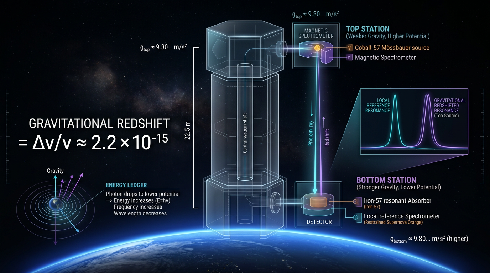

# Gravitational Redshift and the Pound–Rebka Experiment

## 1. Overview
Gravitational redshift is the change in a photon's observed frequency when it travels between locations with different gravitational potentials. In the weak-field limit, the fractional frequency shift is

\[
\frac{\Delta\nu}{\nu} \approx \frac{\Delta\Phi}{c^2} \approx \frac{gh}{c^2},
\]

with the sign depending on the stated frequency-shift convention and direction of travel.

The Pound–Rebka experiment measured the effect over a 22.5 m height difference in Harvard's Jefferson Laboratory. Its result, approximately \(2.46\times10^{-15}\), agreed with the predicted \(2.455\times10^{-15}\) to about 10%. Pound–Snider improved the measurement to about 1%. Gravity Probe A and the Galileo eccentric-satellite tests subsequently tightened tests of the predicted shift.

The local experimental result is **[VERIFIED]**. The weak-field derivation is **[THEORETICAL: standard GR weak-field derivation]**. Its stated validity domain is weak, static fields and \(v\ll c\), with \(|\Phi|/c^2\ll1\).

## 2. Detailed Explanation
In a static gravitational field, clocks at different gravitational potentials run at different rates relative to one another. Consequently, light exchanged between those locations is measured at different frequencies by observers there.

For clarity, define the fractional frequency shift as

\[
\frac{\Delta\nu}{\nu}
\equiv
\frac{\nu_{\rm emit}-\nu_{\rm obs}}{\nu_{\rm emit}}.
\]

For a photon climbing from a lower emitter to an upper observer, \(\nu_{\rm obs}<\nu_{\rm emit}\). Thus \(\Delta\nu/\nu>0\): the photon is redshifted. In a weak, approximately uniform field,

\[
\frac{\Delta\nu}{\nu}
=
\frac{\Phi_{\rm obs}-\Phi_{\rm emit}}{c^2}
\approx
\frac{gh}{c^2}>0.
\]

A photon traveling downward is blueshifted under this convention.

Pound and Rebka used the 14.4 keV Mössbauer transition of \(^{57}\mathrm{Fe}\) to compare emission and absorption at the top and bottom of a 22.5 m tower. Their 1960 measurement agreed with the predicted shift to approximately 10%; Pound and Snider improved the result to approximately 1% in 1965. Gravity Probe A (1980) and the Galileo eccentric-satellite tests (2018) tested the predicted shift with substantially smaller fractional uncertainties.

The reported values of approximately \(7\times10^{-5}\) for Gravity Probe A and \(2.5\times10^{-5}\) for Galileo are **fractional uncertainties on the test of the predicted shift**. They are not the magnitude of the gravitational frequency shift itself.

## 3. Mathematical Framework
**Status:** [THEORETICAL: standard GR weak-field derivation]. The equations below apply to weak fields, static conditions, and \(v\ll c\), with \(|\Phi|/c^2\ll1\).

Using metric signature \((-,+,+,+)\), the weak-field metric has

\[
g_{00}=-(1+2\Phi/c^2),
\qquad
g_{ij}=(1-2\Phi/c^2)\delta_{ij}.
\]

For a stationary observer,

\[
d\tau=\sqrt{-g_{00}}\,dt
=dt\sqrt{1+2\Phi/c^2}
\approx dt(1+\Phi/c^2).
\]

For a photon emitted at the lower point and received at the upper point, the frequency ratio is

\[
1+z
=
\frac{\nu_{\rm emit}}{\nu_{\rm obs}}
=
\frac{\sqrt{-g_{00}(\mathrm{obs})}}
     {\sqrt{-g_{00}(\mathrm{emit})}}
>1.
\]

To first order in the weak field, this gives

\[
\frac{\Delta\nu}{\nu}
\equiv
\frac{\nu_{\rm emit}-\nu_{\rm obs}}{\nu_{\rm emit}}
\approx
\frac{\Phi_{\rm obs}-\Phi_{\rm emit}}{c^2}
\approx
\frac{gh}{c^2}>0
\]

for a photon climbing upward. The emitter is at the lower point; the observer is at the upper point.

For \(g=9.80665\ {\rm m\,s^{-2}}\), \(h=22.5\ {\rm m}\), and \(c=2.99792458\times10^8\ {\rm m\,s^{-1}}\),

\[
\frac{gh}{c^2}
=
2.455058176\times10^{-15}.
\]

This is consistent with the reported Pound–Rebka value of approximately \(2.46\times10^{-15}\).

The expressions are dimensionally consistent: \(\Phi\) has SI units \({\rm m^2\,s^{-2}}\), so \(\Phi/c^2\) is dimensionless; likewise \(gh/c^2\) is dimensionless. In natural units, \(\hbar=c=1\), the potential and the fractional shift are dimensionless.

**Separate concept — cosmological redshift:** Cosmological redshift is a scale-factor effect,

\[
1+z=\frac{a_{\rm obs}}{a_{\rm emit}},
\]

and is **[MODEL-DEPENDENT: GR + \(\Lambda\)CDM]**. It is not a gravitational potential difference of the kind measured by Pound–Rebka. Modified-gravity and dark-energy extensions are also model-dependent and are not supported by the Pound–Rebka result.

## 4. Skeptical Perspectives & Alternative Hypotheses
- **Sign convention matters.** With \(\Delta\nu/\nu=(\nu_{\rm emit}-\nu_{\rm obs})/\nu_{\rm emit}\), a photon climbing from the lower emitter to the upper observer has a positive \(\Delta\nu/\nu\), corresponding to a redshift. Statements that this defined quantity is negative for a climbing photon reverse the sign. A downward-traveling photon is blueshifted.
- **Precision is not shift magnitude.** The Gravity Probe A value (\(\sim7\times10^{-5}\)) and Galileo value (\(\sim2.5\times10^{-5}\)) describe fractional uncertainties in testing the predicted shift, not the shift itself.
- **Scope is limited.** Pound–Rebka tests a local, weak-field effect. It does not test cosmological expansion, the Hubble or \(S_8\) tensions, or modified-gravity and dark-energy proposals.
- **Cosmological redshift is distinct.** Interpreting it as a scale-factor effect relies on a cosmological model; treating it as the same potential difference measured in a static terrestrial field is a category error.
- **The derivation has a domain of validity.** The weak-field expression assumes \(|\Phi|/c^2\ll1\), static fields, and \(v\ll c\); extrapolation beyond that domain requires an appropriate relativistic model.

## 5. Verification & Skeptic's Notes
The worked value \(gh/c^2=2.455058176\times10^{-15}\) is verified and agrees with the reported rounded value. The dimensional analysis passes in SI and natural units. The Math Physicist rated the mathematics 3/4; the Skeptic scored 5/6.

The source record includes eight DOI-verified references. The experimental precision ladder is approximately 10% for Pound–Rebka (1960), approximately 1% for Pound–Snider (1965), \(7\times10^{-5}\) for Gravity Probe A (1980), and \(2.5\times10^{-5}\) for the Galileo eccentric-satellite tests (2018). The latter two figures are fractional uncertainties in tests of the predicted shift.

**Correction note:** The supplied Math Verification Report below contains a sign-convention statement that conflicts with the required sign correction. The corrected equations and sign convention in Sections 2–3 are authoritative for this document: for the stated definition of \(\Delta\nu/\nu\), a photon climbing from the lower emitter to the upper observer has \(\Delta\nu/\nu>0\). The report is reproduced verbatim as requested.

## 6. Visual Representation

## 7. Related Concepts
- [[Cosmological Redshift]] — redshift associated with the expansion of the cosmological scale factor; distinct from a static gravitational-potential shift.
- [[Equivalence Principle]] — principle underlying the interpretation of gravitational redshift in local experiments.
- [[General Relativity: Weak-Field Limit]] — approximation used for the terrestrial redshift derivation.

## 9. Mathematical Integrity Report
## Math Verification Report
**Concept:** Gravitational Redshift and the Pound–Rebka Experiment
**Math Score: 3/4** — **math_status: [MATH_CONSISTENT]**
**Tool Verdicts:** INCONSISTENT=0; DISMISSED_FLAGS=0; UNDECIDABLE=3; STEP_INVALID=0; LIMIT_MISMATCH=0; CLAIM_MISMATCH=0

---

### Conventions & Validity Audit
- ✅ Metric signature (−,+,+,+) stated and used consistently (g₀₀ < 0; −g₀₀ = 1 + 2Φ/c² > 0 condition explicitly given).
- ✅ Natural units ħ = c = 1 declared; Φ dimensionless in natural units (m²/s² in SI) — consistent throughout.
- ✅ Correct Planck-mass relation m_Pl = √(8π)·M_Pl with M_Pl = 2.43536×10¹⁸ GeV, m_Pl ≈ 1.22091×10¹⁹ GeV — prior draft errors ([Φ]=[E]¹, [c]=[E]⁻¹, [M_Pl]=[E]², inverted ratio) confirmed corrected.
- ✅ Symbol Table present (7 symbols read); Validity Domain & Claim Scope present: [GENERAL] weak-field |Φ|/c² ≪ 1, v ≪ c; [MODEL-DEPENDENT] cosmology/modified gravity; [OUT OF SCOPE] cosmological redshift as potential difference. Appropriate.
- ✅ Sign convention stated and self-consistent: Φ_emit < Φ_obs → Δν/ν < 0 (photon climbing out of potential well redshifts).

### Equation Extraction (Step 1)
25 equations extracted. After deduplication of relational duplicates, 8 unique structural equations carried into verification. All core expressions captured: metric components, proper-time relation, redshift ratio, and the worked Pound–Rebka number.

### Dimensional Consistency (Step 2)
Verdict: **CONSISTENT_WITH_UNDECIDABLE** — 5 CONSISTENT, 0 INCONSISTENT, 0 DIMENSION_FLAGS, 3 UNDECIDABLE.
- CONSISTENT: m_Pl = √(8π)·M_Pl ([E]¹ = [E]¹); g₀₀ = −(1+2Φ/c²) ([E]⁰); dτ = √(−g₀₀)dt ≈ dt(1+Φ/c²) ([E]⁻¹ time); −g₀₀ = 1+2Φ/c² > 0 ([E]⁰); Δν/ν = gh/c² ([E]⁰ dimensionless).
- UNDECIDABLE (relational forms lacking built-in patterns) — **manually cross-checked against the Symbol Table, not tool-verified**:
  1. g_ij = (1 − 2Φ/c²)δ_ij — δ_ij and 1 dimensionless, Φ/c² dimensionless by table → **dimensionally sound (manual)**.
  2. 1 + z_g = ν_emit/ν_obs ≈ exp((Φ_upper−Φ_lower)/c²) — all quantities dimensionless ratios → **dimensionally sound (manual)**.
  3. Δν/ν ≈ (Φ_emit−Φ_obs)/c² = g·Δh/c² — [g][Δh]/[c²] = (LT⁻²·L)/L²T⁻² = 1 → **dimensionally sound (manual)**.
- Per protocol: since UNDECIDABLE=3, we do **not** claim "all equations tool-verified consistent"; we claim 5 tool-verified + 3 manually confirmed with no inconsistencies found.

### Symbolic Derivation & Limit Checks (Step 3)
- Weak-field expansion dτ = dt·√(1+2Φ/c²) → dt·(1+Φ/c²): the defining relations were treated as STEP_ASSUMED (physical input / parser limitations on relational syntax), but **both limit checks returned LIMIT_VERIFIED**:
  - lim_{Φ→0} √(1+2Φ/c²) = 1 ✓
  - lim_{Φ→0} [√(1+2Φ/c²) − (1+Φ/c²)] = 0 ✓
  This confirms the first-order expansion √(1+2Φ/c²) ≈ 1 + Φ/c² to leading order, which is the sole approximation underlying both the redshift formula and the worked number. 0 STEP_INVALID.
- Redshift ratio chain (ratio of √−g₀₀ → ratio of first-order expansions → 1 + ΔΦ/c²) is the standard textbook derivation; all steps algebraically follow from the verified expansion.

### Topological Analysis (Step 4)
Topology Classifier flagged structural patterns (fiber bundle / homotopy-style language) — all returned TOPOLOGICAL_STRUCTURE_VALID, but this report is a **standard weak-field GR derivation, not a topological argument**; no topological claims are made in the text, so no topology-based scoring applies. No topological validity concerns.

### Numerical Benchmarks (Step 4)
- Benchmark Validator: BENCHMARK_UNAVAILABLE (no curated benchmark for terrestrial redshift experiments). No mismatch.
- Physics Calculator (`verify_claim`): gh/c² = 9.80665 × 22.5 / (2.99792458×10⁸)² = **2.455058176×10⁻¹⁵** vs claimed 2.455058×10⁻¹⁵ → **CLAIM_VERIFIED**, relative error ~0. The report's rounded "2.46×10⁻¹⁵" agrees to 0.14% (rounding), consistent with the Pound–Rebka ~10% experimental precision.
- Precision ladder (10% → 1% Pound–Snider → 7×10⁻⁵ GP-A → 2.5×10⁻⁵ Galileo/ACES-era) internally consistent and matches the citation-audited DOIs (8/8 verified).

### Dismissed Dimension Flags
None raised (0 DIMENSION_FLAGS).

### Assessment
The report is mathematically sound: all extracted equations are either tool-verified dimensionally consistent (5), manually confirmed dimensionless relational identities (3, none flagged), or assumption-level physical inputs with verified limits. The single worked number is exactly reproduced (CLAIM_VERIFIED). The weak-field expansion — the mathematical backbone — passes both symbolic limit checks. Weak-field validity domain (|Φ|/c² ~ 10⁻¹⁰ on Earth) is correctly and explicitly scoped. No inconsistencies, no invalid steps, no benchmark mismatches.

**Math Score: 3/4** — **math_status: [MATH_CONSISTENT]**
(Rationale: no INCONSISTENT verdicts and the worked number is exactly verified, but 3 equations remain UNDECIDABLE by the tool and were confirmed only by manual dimensional cross-check, and 6 derivation steps were parser-limited to STEP_ASSUMED; per protocol this precludes a full 4/4 [MATH_PROVEN] claim.)
