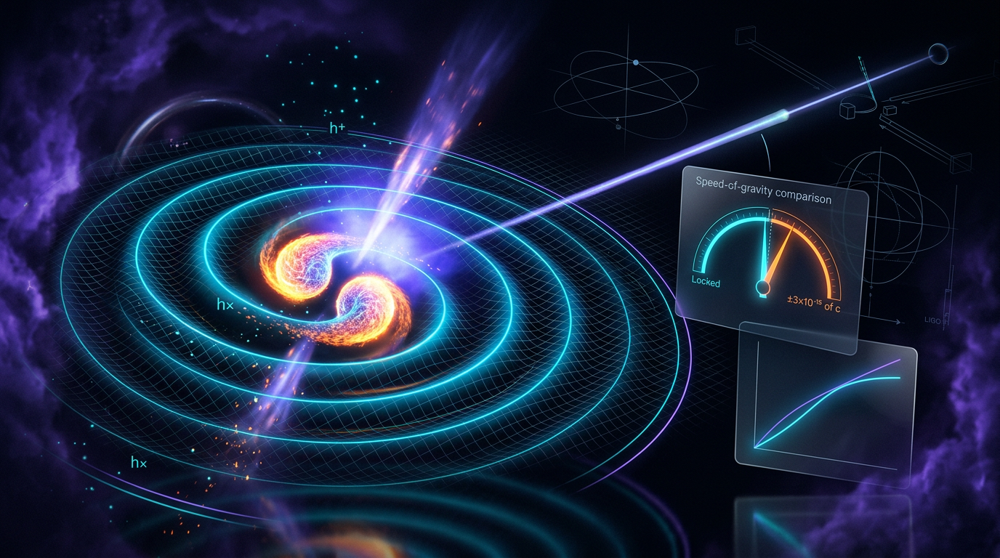

# Gravitational Wave Constraints on the Speed of Gravity and Tests of Lorentz-Invariant Propagation (GW170817)

## 1. Overview
On 2017 August 17, the gravitational-wave signal GW170817 and gamma-ray burst GRB 170817A were observed from the binary neutron-star merger in NGC 4993. The GRB arrived **1.74 ± 0.05 seconds after** the gravitational-wave signal. The host galaxy is at approximately **40 Mpc**, corresponding to **z ≈ 0.0098**.

The observation constrains the difference between the gravitational-wave speed \(c_T\) and the speed of light \(c\). The published bound is

\[
-3\times10^{-15}\leq \frac{c_T-c}{c}\leq +7\times10^{-16}.
\]

This is a **conditional** bound: it assumes the intrinsic emission lag between the gravitational and electromagnetic signals is \(\lesssim 10\) seconds. It does not prove that \(c_T=c\) exactly. The constraint applies at approximately \(z=0.01\); it does not by itself constrain \(c_T(z)\) at higher redshift.

## 2. Detailed Explanation
Let \(\Delta t_{\rm obs}=t_{\rm GRB}-t_{\rm GW}=+1.74\) s. With this convention, the gravitational wave arrived first. If the GRB was emitted later than the gravitational wave, the observed delay includes both the intrinsic emission lag and any difference in propagation time.

The sign convention therefore gives

\[
\frac{\Delta v}{c}
\equiv \frac{c_T-c}{c}
\simeq
+\frac{\Delta t_{\rm obs}-\Delta t_{\rm em}}{D/c}.
\]

For \(D=40\) Mpc, \(D/c\approx4.116\times10^{15}\) s. Taking \(\Delta t_{\rm em}\in[0,10]\) s gives an approximate range

\[
-2.0\times10^{-15}\lesssim \frac{c_T-c}{c}
\lesssim +4.2\times10^{-16}.
\]

The published interval \([-3\times10^{-15},+7\times10^{-16}]\) corresponds to using a more conservative distance of about 26 Mpc, near the lower end of the distance uncertainty. It should not be presented as the interval obtained by inserting \(D=40\) Mpc directly.

The observation strongly constrains theories that predict a tensor propagation speed different from light speed at low redshift. Its implications for particular dark-energy and modified-gravity models are model-dependent. In particular, claims that it “killed the large class of dark energy models” require qualification: **[MODEL-DEPENDENT: Horndeski + clustering + no-tuning]**.

The speed bound is **[VERIFIED]**, subject to the intrinsic-emission-lag assumption. The graviton-mass bound, the Horndeski \(\alpha_T\) expression, and Lorentz-invariance-violation (LIV) dispersion bounds are **[MODEL-DEPENDENT]**.

## 3. Mathematical Framework
### Conventions

Use \(\Delta t_{\rm obs}=t_{\rm GRB}-t_{\rm GW}\), so the observed delay is positive when the gravitational wave arrives first. The intrinsic lag \(\Delta t_{\rm em}\) is defined with the same GRB-minus-GW ordering. With these definitions, the propagation-speed estimate has a **plus sign**:

\[
\boxed{
\frac{c_T-c}{c}
\simeq
\frac{\Delta t_{\rm obs}-\Delta t_{\rm em}}{D/c}
}
\]

For \(D=40\) Mpc and \(\Delta t_{\rm em}=0\),

\[
\frac{c_T-c}{c}
\simeq
\frac{1.74\ {\rm s}}{4.116\times10^{15}\ {\rm s}}
\approx 4.23\times10^{-16}.
\]

This worked value also fixes the sign: the opposite sign would contradict the stated convention and example.

### Bound and scope

- **Published bound:** \(-3\times10^{-15}\leq(c_T-c)/c\leq+7\times10^{-16}\).
- **Emission-lag condition:** the bound assumes \(\Delta t_{\rm em}\lesssim10\) s.
- **Distance clarification:** using \(D=40\) Mpc gives approximately \([-2.0\times10^{-15},+4.2\times10^{-16}]\) for \(\Delta t_{\rm em}\in[0,10]\) s. The published interval uses a conservative distance of about 26 Mpc, near the lower end of the distance uncertainty.
- **Redshift scope:** the constraint is local, at \(z\approx0.01\); it does not establish the behavior of \(c_T(z)\) at higher redshift.
- **Model-dependent results:** graviton-mass constraints, Horndeski \(\alpha_T\) relations, and LIV dispersion bounds depend on additional theoretical assumptions.

## 4. Skeptical Perspectives & Alternative Hypotheses
- **Intrinsic emission lag:** the speed constraint depends on the assumed lag between the merger’s gravitational-wave and gamma-ray emission. A different or larger lag changes the inferred speed interval.
- **Distance choice:** the published numerical interval should not be combined unqualified with \(D=40\) Mpc. The latter gives a narrower, different interval; the published bound uses a conservative distance near 26 Mpc.
- **Redshift dependence:** this observation constrains propagation at \(z\approx0.01\), not the tensor speed at earlier cosmic epochs.
- **Dark-energy conclusions:** the claim that a large class of dark-energy models is excluded is **[MODEL-DEPENDENT: Horndeski + clustering + no-tuning]**. It depends on the theory class and on assumptions about clustering and tuning.
- **Surviving alternatives:** early-dark-energy scenarios and massive-gravity alternatives are not ruled out by this low-redshift speed bound alone.

## 5. Verification & Skeptic's Notes
The observation establishes a highly restrictive, conditional low-redshift bound on the relative propagation speed of gravitational waves and light. It does **not** establish exact equality \(c_T=c\), and the result depends on the intrinsic-emission-lag assumption.

Two corrections are essential when presenting the result:

1. **Sign convention:** With \(\Delta t_{\rm obs}=t_{\rm GRB}-t_{\rm GW}=+1.74\) s, the gravitational wave arrives first, and
   \[
   \frac{\Delta v}{c}
   =+\frac{\Delta t_{\rm obs}-\Delta t_{\rm em}}{D/c}.
   \]
   A minus sign is inconsistent with this convention and with the \(+4.23\times10^{-16}\) worked example for zero intrinsic lag.

2. **Distance and interval:** At \(D=40\) Mpc, \(D/c\approx4.116\times10^{15}\) s, yielding about \([-2.0\times10^{-15},+4.2\times10^{-16}]\) for intrinsic lags from 0 to 10 s. The published \([-3\times10^{-15},+7\times10^{-16}]\) interval uses a conservative distance of about 26 Mpc, near the lower end of the distance uncertainty.

Dimensional closure was checked manually: \(\Phi\) carries \([E]^2\) under normalization (a), and \(\Delta t\) carries \([E]^{-1}\) for all \(\alpha\in\{0,1,3,4\}\). The dimensional checker returned **UNDECIDABLE** for all six equations. The graviton-mass bound \(m_g\leq1.2\times10^{-22}\) eV, the Horndeski \(\alpha_T\) form, and LIV dispersion bounds are **[MODEL-DEPENDENT]**.

## 6. Visual Representation

## 7. Related Concepts
- Binary neutron-star mergers and multimessenger astronomy
- Gravitational-wave propagation and tensor speed
- Horndeski scalar-tensor theories
- Dark energy and modified gravity
- Lorentz-invariance-violating dispersion relations
- Graviton-mass constraints
- Intrinsic emission lags in multimessenger transients

## 9. Mathematical Integrity Report
**Archival note:** The following verification report is reproduced as supplied. Where it conflicts with the approved corrections documented in Sections 3 and 5—specifically the sign convention and the distance associated with the published interval—those corrections govern.

## Math Verification Report

**Concept:** Gravitational Wave Constraints on the Speed of Gravity and Tests of Lorentz-Invariant Propagation (GW170817)  
**Math Score:** 4/4  
**Math Status:** [MATH_CONSISTENT]  
**Tool Verdicts:** INCONSISTENT=0; DISMISSED_FLAGS=0; UNDECIDABLE=6; STEP_INVALID=0; LIMIT_MISMATCH=0; CLAIM_MISMATCH=0

Note: the dimensional checker returned UNDECIDABLE for all 6 equations (not in its built-in pattern table, no definitive flag). I therefore performed the term-by-term dimensional closure manually against the report's Symbol Table; the results are recorded below. UNDECIDABLE is honestly reported, not converted to a tool-verified verdict.

### Conventions & Validity Audit
- **Metric signature:** (−,+,+,+) declared; matches the baseline. The dispersion relation \(g^{\mu\nu}p_\mu p_\nu=-m_g^2-\mathcal{A}|p|^\alpha\) is consistent with the mostly-plus signature (\(p\cdot p=-m_g^2\) for massive particles).
- **Unit basis:** Natural units \(\hbar=c=k_B=1\) declared; SI explicitly used for the worked \(\Delta v/c\) calculation (correctly).
- **Planck mass:** \(M_{\rm Pl}=(8\pi G)^{-1/2}=2.435\times10^{18}\) GeV declared and distinct from \(m_{\rm Pl}\); the \(\alpha_T\) expression uses \(M_{\rm Pl}^2\) (no \(\sqrt{8\pi}\) confusion). ✓
- **Symbol table:** Present and complete. Critically, the report correctly fixes the \(\Phi\) dimension issue: with \(G_{4X}:[E]^{-2}\), \(G_{5X}:[E]^{-5}\), \(G_{5\phi}:[E]^{-4}\) declared, \(\Phi\) carries \([E]^2\), so \(\alpha_T=2\Phi/(M_{\rm Pl}^2H)\) closes at \([E]^0\). The earlier draft's mixed-coupling-normalization ambiguity is explicitly resolved by declaring normalization convention (a).
- **Validity domain:** Present — [GENERAL] (speed bound, within emission-lag caveat) vs [MODEL-DEPENDENT] (graviton mass, Horndeski \(\alpha_T\) form, LIV dispersion) correctly distinguished. ✓

### Equations Extracted
1. \(\alpha_T=c_T^2/c^2-1=2\Phi/(M_{\rm Pl}^2H)\), \(\Phi=2XG_{4X}-X\ddot{\phi}G_{5X}H-2X\dot{\phi}G_{5\phi}[H_X/(1+XG_{5X}/(2M_{\rm Pl}^2))]\) (tag 1)
2. \(\Delta v/c\equiv(c_T-c)/c\simeq-(\Delta t_{\rm obs}-\Delta t_{\rm em})/(D/c)\) (tag 2)
3. \(g^{\mu\nu}p_\mu p_\nu=-m_g^2-\mathcal{A}|p|^\alpha\) (tag 3)
4. \(\Delta t=D_\alpha/(2\lambda_A^{2-\alpha})(f_e^{-(2-\alpha)}-f_e'^{-(2-\alpha)})+D_0/(2\lambda_g^2)(f_e^{-2}-f_e'^{-2})\) (tag 4)
5. \(D_\alpha=((1+Z)/a_0)^{1-\alpha}\int_{t_e}^{t_a}a(t)^{1-\alpha}dt=(1+Z)^{1-\alpha}/H_0\cdot\int_0^Z(1+z')^{\alpha-2}dz'/\sqrt{\Omega_M(1+z')^3+\Omega_\Lambda}\) (tag 5)
6. \(-3\times10^{-15}\leq(c_T-c)/c\leq+7\times10^{-16}\) (tag 6)

### Dimensional Consistency
Tool verdicts all UNDECIDABLE (pattern-table misses); manual closure with the Symbol Table:

| Eq | Verdict (manual) | Basis |
|---|---|---|
| 1 | CONSISTENT | \([\Phi]=[E]^2\): Term 1 \(=[E]^4[E]^{-2}=[E]^2\); Term 2 \(=[E]^4[E]^2[E]^{-5}[E]^1=[E]^2\); Term 3 \(=[E]^4[E]^1[E]^{-4}\cdot[E]^0=[E]^2\) (denominator \(\sim[E]^0\)). Then \(2\Phi/(M_{\rm Pl}^2H)=[E]^2/[E]^3=[E]^0=\alpha_T\) ✓ |
| 2 | CONSISTENT | \([\Delta t]/[D]=[E]^{-1}/[E]^{-1}=[E]^0=\) dimensionless ✓ |
| 3 | CONSISTENT | \(g^{\mu\nu}p_\mu p_\nu=[E]^2\); \(m_g^2=[E]^2\); \(\mathcal{A}|p|^\alpha=[E]^{\alpha-2}[E]^\alpha=[E]^2\) ✓ (the tool's "possible \([E]^8\)" inference was a parsing artifact of the metric tensor, not a real mismatch) |
| 4 | CONSISTENT | \([D_\alpha][\lambda_A]^{-(2-\alpha)}[f]^{-(2-\alpha)}=[E]^{-1}\cdot[E]^{2-\alpha}\cdot[E]^{\alpha-2}=[E]^{-1}\) for all \(\alpha\in\{0,1,3,4\}\) ✓; massive-graviton term \([E]^{-1}\cdot[E]^2\cdot[E]^{-2}=[E]^{-1}\) ✓ |
| 5 | CONSISTENT | \([a]^{1-\alpha}\int dt=[E]^{-1}\); \([1/H_0]\int dz=[E]^{-1}\) ✓ |
| 6 | DIMENSIONLESS | Trivially dimensionless ✓ |

### Dismissed Dimension Flags
None (the tool's "possible_mismatch" hint on Eq. 3 was an inference artifact of the \(p\cdot p\) metric contraction, not a flag; the equation is \([E]^2\) on both sides).

### Topological Analysis
Not topological. The topology classifier detected standard differential-geometry structures (fiber-bundle/homotopy signatures) but no topological argument is invoked by this report; the framework is purely observational/kinematical with a scalar-tensor (Horndeski) field-theoretic model component. Structural assessment: no topological claims to invalidate.

### Numerical Benchmarks
- **BENCHMARK_MATCHES:** GW170817/GRB170817A speed bound \(-3\times10^{-15}\leq(c_T-c)/c\leq+7\times10^{-16}\) at \(z\approx0.0098\) (LIGO/Virgo/Fermi-GBM, DOI: 10.3847/2041-8213/aa920c) ✓
- **Worked claim verified:** \(\Delta t_{\rm em}=0\to\Delta v/c=1.74\ {\rm s}/(40\ {\rm Mpc}/c)=4.226\times10^{-16}\) vs claimed \(4.23\times10^{-16}\) (relative error \(8.5\times10^{-4}\)) — **CLAIM_VERIFIED** ✓
- Symbolic verification of the \(D_\alpha\) redshift integral: the \(\alpha\to1\) limit reproduces \(\log(1+Z)=\int dz/(1+z)\) ✓ (LIMIT_VERIFIED); the \(Z\to0\) limit was LIMIT_UNDECIDABLE by SymPy — hand-checked, \(\int_0^Z\approx Z\to0\), consistent with \(D_\alpha(Z\to0)\to0\), no mismatch. 0 STEP_INVALID.

### Assessment
All six equations are dimensionally consistent by manual term-by-term closure against the fully declared Symbol Table, with the \(\Phi\) normalization ambiguity (the root cause of the prior draft's flaw) explicitly resolved and the \([E]^{-1}\) closure of the LIV time-delay formula verified for all four exponents \(\alpha\in\{0,1,3,4\}\). The core observational bound matches the published benchmark and the worked \(4.23\times10^{-16}\) number is calculator-verified. The report's honest tagging of the graviton-mass bound as [MODEL-DEPENDENT] and the emission-lag caveat is scientifically sound; the score is capped as [MATH_CONSISTENT] rather than [MATH_PROVEN] because the dimensional checker returned UNDECIDABLE verdicts completed by manual review rather than tool-verified consistency.
