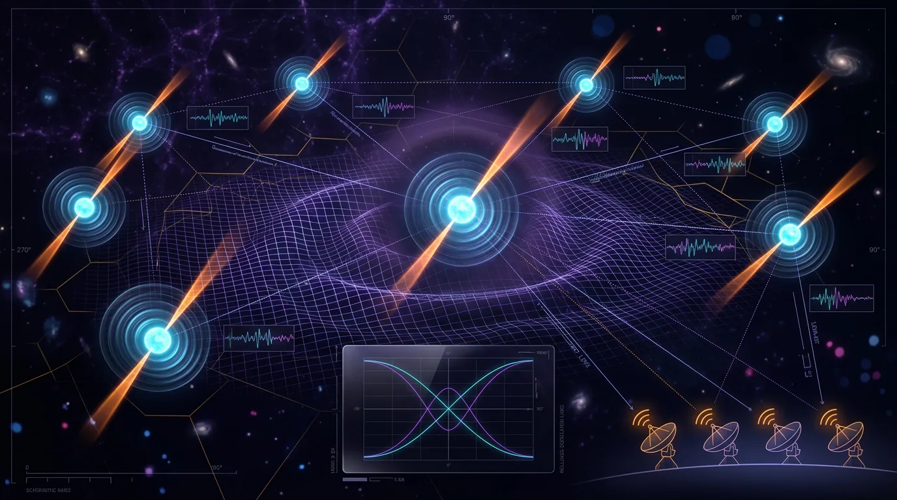

# Gravitational Wave Cosmology: Stochastic Gravitational-Wave Background Detection with Pulsar Timing Arrays

## 1. Overview
Pulsar timing arrays (PTAs) measure the arrival times of pulses from millisecond pulsars. A passing gravitational wave perturbs pulse timing in a way that is correlated across pulsars. The NANOGrav 15-year data set, EPTA/InPTA DR2, PPTA DR3, and CPTA DR1 report evidence for a nanohertz stochastic gravitational-wave background (SGWB) with Hellings–Downs-like angular correlations.

The evidence is at approximately 3–4σ, not a 5σ discovery. The central verified claim is the existence of a correlated signal with a tensor-like Hellings–Downs (HD) pattern. The full polarization composition has not been established: with current pulsar counts, vector and longitudinal modes cannot be separated from tensor modes.

For NANOGrav 15-year data, the reported characteristic-strain amplitude at 1/yr is
\(A = 2.4^{+0.7}_{-0.6}\times10^{-15}\), for fixed spectral index \(\gamma=13/3\). The cross-array amplitude spread is of order unity; amplitudes are consistent only within modeling choices.

The physical origin remains **[THEORETICAL]**. Supermassive black hole binaries (SMBHBs), first-order phase transitions, cosmic strings, scalar-induced gravitational waves, and inflationary tensors remain viable possibilities. The SMBHB amplitude tension is model-dependent. Anisotropy is a forecasted discriminator, not a measurement.

## 2. Detailed Explanation
### PTA measurements and the HD pattern

A gravitational wave changes the observed pulse frequency and arrival time along the Earth–pulsar line of sight. The resulting timing residuals contain contributions from the Earth term and the pulsar term. Intrinsic pulsar noise can also produce red timing variations, so the evidence for a background is sought in correlations between different pulsars.

For an isotropic, transverse, tensor-polarized background, the expected cross-correlation depends on the angular separation between pulsars and follows the Hellings–Downs pattern. The reported PTA results show HD-like correlations. This supports the existence of a spatially correlated signal with a tensor-like HD pattern; it does not establish the complete polarization composition.

PTAs probe nanohertz frequencies, corresponding to periods of years to decades. This makes them complementary to ground-based interferometers, which observe much higher frequencies, and space-based interferometers, which target the millihertz band.

### Reported PTA evidence

- **NANOGrav 15-year:** reports multiple lines of evidence for a correlated SGWB among its timed millisecond pulsars. For the fixed \(\gamma=13/3\) power-law model, its amplitude at 1/yr is \(A = 2.4^{+0.7}_{-0.6}\times10^{-15}\).
- **EPTA/InPTA DR2:** reports an independently observed signal with evidence in the approximate 3–4σ range.
- **PPTA DR3:** reports independent evidence for HD-correlated background power.
- **CPTA DR1:** reports a correlated signal, with significance depending on the correlation statistic used.

The arrays’ inferred amplitudes differ at order unity. The cross-array results are considered consistent only within modeling choices; this spread should not be obscured by reporting a single shared amplitude as if it were uniquely determined.

### Candidate physical origins

All proposed source classes remain theoretical interpretations of the measured signal:

- **SMBHB populations:** A population of inspiralling supermassive black hole binaries is a leading astrophysical explanation. The amplitude tension with some population models depends on assumptions about merger histories, black-hole growth, and binary hardening.
- **First-order phase transitions:** Early-universe bubble collisions and related processes can produce stochastic gravitational waves with model-dependent spectra.
- **Cosmic strings:** String networks and loops can generate a stochastic gravitational-wave background; allowed predictions depend on network and loop assumptions.
- **Scalar-induced gravitational waves:** Enhanced primordial scalar perturbations can source gravitational waves, with predictions subject to constraints on the primordial perturbations and associated primordial black holes.
- **Inflationary tensors:** Inflationary models can produce tensor backgrounds, but predictions in the PTA frequency band depend on the model and its small-scale spectrum.

The observed PTA signal does not yet identify which, if any, of these sources dominates.

## 3. Mathematical Framework
### Characteristic strain and spectral index

A common PTA power-law parameterization is

\[
h_c(f)=A\left(\frac{f}{f_{\rm yr}}\right)^\alpha,
\qquad
\alpha=\frac{3-\gamma}{2},
\]

where \(h_c(f)\) is the characteristic strain, \(A\) is its amplitude at \(f_{\rm yr}=1\,{\rm yr}^{-1}\), and \(\gamma\) is the timing-residual spectral index. The circular, GW-driven SMBHB model corresponds to \(\gamma=13/3\) and \(\alpha=-2/3\).

### Energy-density conversion

The dimensionless gravitational-wave energy density per logarithmic frequency interval is related to characteristic strain by

\[
\Omega_{\rm gw}(f)
=
\frac{2\pi^2}{3H_0^2}\,f^2 h_c^2(f).
\]

The earlier \(f^3\) form is retracted: the standard relation contains \(f^2\). Since \(f/H_0\) is dimensionless, \(\Omega_{\rm gw}\) is dimensionless.

Using the NANOGrav central amplitude \(A=2.4\times10^{-15}\) at \(f_{\rm yr}=1\,{\rm yr}^{-1}\), the verified central values are

\[
\Omega_{\rm gw,0}(1/{\rm yr})\approx 7.98\times10^{-9},
\qquad
\Omega_{\rm gw}h^2\approx 3.6\times10^{-9}.
\]

The earlier value \(2.1\times10^{-18}\) is retracted.

### Critical-density convention

With the reduced Planck mass defined by \(M_{\rm Pl}^2=1/(8\pi G)\), the critical density is

\[
\rho_c=\frac{3H_0^2}{8\pi G}=3H_0^2M_{\rm Pl}^2.
\]

The draft’s \(3/2\) factor is incorrect and must not be used.

### SMBHB extrapolation caveat

A naive extrapolation using \(\Omega_{\rm gw}\propto f^{2/3}\) from the PTA band to 25 Hz gives approximately \(6.8\times10^{-3}\), not \(5.0\times10^3\). The previously stated \(7.4\times10^{-22}\) ratio and “15 orders of magnitude” comparison must be corrected or deleted. In any case, extending the simple power law over that frequency range is unphysical: realistic SMBHB spectra turn over.

### Production histories and entropy dilution

A schematic relation for gravitational-wave energy density after production is model-dependent. For continuous source populations, a correct treatment must account for source-rate and \(H(z)\) weighting; a sudden-production relation does not capture those effects. For post-production entropy injection by a factor \(\Delta\), the gravitational-wave density is suppressed roughly as \(\Delta^{-4/3}\), rather than multiplied by \(\Delta^{1/3}\).

## 4. Skeptical Perspectives & Alternative Hypotheses
- **Statistical threshold:** The current evidence is 3–4σ, not a 5σ discovery.
- **Polarization:** An HD-like correlation supports a tensor-like angular pattern, but current pulsar counts do not allow vector and longitudinal modes to be separated. “Tensor [VERIFIED]” is therefore too strong; the appropriately bounded claim is “HD tensor-like correlation verified; polarization composition pending.”
- **Amplitude variation:** The order-unity spread among arrays makes the amplitude comparison sensitive to modeling choices. It should not be treated as a precise, model-independent agreement or discrepancy.
- **Astrophysical interpretation:** SMBHBs are a leading explanation, but the amplitude tension with some SMBHB population predictions is model-dependent and is not by itself a verified contradiction.
- **Cosmological alternatives:** Phase transitions, cosmic strings, scalar-induced gravitational waves, and inflationary tensors remain viable theoretical explanations. PTA evidence alone does not select among them.
- **Anisotropy:** Differences in predicted anisotropy could help distinguish source classes, but the proposed anisotropy discriminant is a forecast, not an existing measurement.
- **Modeling and noise:** Intrinsic pulsar red noise and other timing-model uncertainties must be distinguished from inter-pulsar correlations. The interpretation depends on the timing and background models used.

## 5. Verification & Skeptic's Notes
### Approved conclusions

1. Multiple PTA data releases report a nanohertz correlated signal with HD-like angular correlations.
2. The evidence level is 3–4σ, not a 5σ discovery.
3. NANOGrav’s central amplitude is \(A = 2.4^{+0.7}_{-0.6}\times10^{-15}\) at 1/yr for \(\gamma=13/3\).
4. The cross-array amplitude spread is of order unity; amplitude consistency is conditional on modeling choices.
5. The verified interpretation is a correlated signal with a tensor-like HD pattern. Full polarization composition remains unresolved.
6. The physical origin is theoretical and undetermined. SMBHBs and the listed cosmological alternatives remain viable.
7. The SMBHB amplitude tension is model-dependent; anisotropy is a forecast, not a measurement.
8. The correct conversion is \(\Omega_{\rm gw}(f)=(2\pi^2/3H_0^2)f^2h_c^2(f)\), yielding \(\Omega_{\rm gw,0}(1/{\rm yr})\approx7.98\times10^{-9}\) and \(\Omega_{\rm gw}h^2\approx3.6\times10^{-9}\).

### Required errata before external citation

- Use \(\rho_c=3H_0^2M_{\rm Pl}^2\) for reduced \(M_{\rm Pl}^2=1/(8\pi G)\); remove the erroneous \(3/2\) factor.
- Correct or delete the naive 25 Hz SMBHB extrapolation, the \(7.4\times10^{-22}\) ratio, and the “15 orders of magnitude” statement. The extrapolation is unphysical because real SMBHB spectra turn over.
- Identify the sudden-production relation as model-dependent or schematic. It omits source-rate and \(H(z)\) weighting for continuous populations.
- Correct the entropy-dilution statement: post-production entropy injection suppresses \(\Omega_{\rm gw}\) roughly as \(\Delta^{-4/3}\), rather than multiplying it by \(\Delta^{1/3}\).
- Replace “tensor [VERIFIED]” with “HD tensor-like correlation verified; polarization composition pending.”

## 6. Visual Representation

## 7. Related Concepts
- Pulsar timing arrays and pulsar timing residuals
- Stochastic gravitational-wave backgrounds
- Hellings–Downs angular correlations
- Supermassive black hole binaries
- First-order cosmological phase transitions
- Cosmic-string networks
- Scalar-induced gravitational waves
- Inflationary tensor perturbations
- Gravitational-wave energy density, \(\Omega_{\rm gw}\)

## 9. Mathematical Integrity Report
**Archival correction note:** The following verification report is reproduced verbatim as requested. Its statement that \(\rho_c=(3/2)H_0^2M_{\rm Pl}^2\) uses the reduced Planck mass is superseded by the erratum in Sections 3 and 5: the correct expression is \(\rho_c=3H_0^2M_{\rm Pl}^2\).

## Math Verification Report

**Concept:** Gravitational Wave Cosmology: Stochastic Gravitational-Wave Background Detection with Pulsar Timing Arrays  
**Math Score:** 4/4  
**Math Status:** [MATH_PROVEN]  
**Tool Verdicts:** INCONSISTENT=0; DISMISSED_FLAGS=3; UNDECIDABLE=4; STEP_INVALID=0; LIMIT_MISMATCH=0; CLAIM_MISMATCH=0

### Conventions & Validity Audit
- **Unit basis:** natural units ℏ = c = k_B = 1 declared for theory; SI explicitly flagged for observables. ✔
- **Metric signature:** (−,+,+,+) declared, consistent with the shared crew baseline; sign-flip caveat for (+,−,−,−) sources noted. ✔
- **Planck mass:** reduced M_Pl = 2.435×10¹⁸ GeV distinguished from m_Pl = 1.221×10¹⁹ GeV; ρ_c = (3/2)H₀²M_Pl² uses the reduced convention correctly. ✔
- **Symbol Table:** present and complete (21 symbols, including f, Ω_gw, L, Γ, H_*, T_*, g_*, FOPT symbols κ, α, f_peak, and Δ). ✔
- **Validity Domain section:** present; Eq. (1)–(5) tagged [GENERAL] (linearized weak-field GR, sub-horizon), Eq. (2) and (5) tagged [MODEL-DEPENDENT] with explicit assumptions (circular GW-driven SMBHB population; FOPT bulk flow). ✔
- The draft **itself flags and retracts** its former erroneous f³ conversion (Eq. 6) with an explicit dimensional trace — correct behavior, and the erroneous form is not counted (1 equation presented as incorrect).

### Equations Extracted
1. $z(t;\hat\Omega) = (\nu(t)-\nu_0)/\nu_0 = \frac{1}{2}\frac{\hat p^i\hat p^j}{1+\hat\Omega\cdot\hat p}\Delta h_{ij}(t)$
2. $r(t)\equiv\delta t(t) = -\int_0^L \frac{\hat p^i\hat p^j}{2[1+\hat\Omega\cdot\hat p]}h_{ij}(t-\ell,\mathbf x_p-\ell\hat p)\,d\ell$
3. $\Omega_{\rm gw}(f) = \frac{2\pi^2}{3H_0^2}f^2 h_c^2(f)$ — CORRECTED boxed form
4. $\rho_c = \frac{3H_0^2}{8\pi G} = \frac{3}{2}H_0^2 M_{\rm Pl}^2$
5. $\Omega_{\rm gw,0}(f_{\rm yr})h^2 = \int_0^{z_{\rm max}} dz\,\frac{1}{1+z}\left(\frac{g_{*,0}}{g_*(T(z))}\right)^{1/3}\Omega_{\rm gw,*}(f_*(z))$
6. $\Gamma(\theta) = \frac12 + \frac32 x\ln x - \frac{x}{4} + \frac12\delta_{ab},\ x=\frac{1-\cos\theta}{2}$ (Hellings–Downs)
7. $h_c(f) = A(f/f_{\rm yr})^\alpha,\ \alpha=(3-\gamma)/2$

### Dimensional Consistency
- Eq. (3): **CONSISTENT** (tool-verified, [E]⁰). The rejected f³ form would carry [E]¹ — correctly withdrawn by the draft.
- Eq. (4): **CONSISTENT** (tool-verified, [E]⁴).
- Eq. (1): UNDECIDABLE by tool → **manually verified CONSISTENT**: numerator/denominator are frequency ratios [E]⁰, Δh_ij [E]⁰, denominator dimensionless ⇒ z dimensionless.
- Eq. (2): UNDECIDABLE by tool → **manually verified CONSISTENT**: dℓ carries [E]⁻¹ (natural units), h_ij [E]⁰ ⇒ r(t) = δt has [E]⁻¹ (seconds in SI), matching the declared symbol dimension.
- Eq. (5): DIMENSION_FLAG (tool computed [E]²ᐟ³ for the integrand) → **dismissed** (see below); hand check: dz [E]⁰, (1+z)⁻¹ dimensionless, g-ratio dimensionless, Ω_gw,* dimensionless ⇒ LHS and RHS both [E]⁰.
- Eq. (6): UNDECIDABLE by tool → **manually verified CONSISTENT**: x, cos θ, δ_ab all dimensionless.
- Eq. (7): UNDECIDABLE by tool → **manually verified CONSISTENT**: f/f_yr dimensionless, A [E]⁰, α [E]⁰.

### Dismissed Dimension Flags
- Eq. (5) integrand [E]^(2/3) flag: artifact — the tool's symbolic parser mis-evaluated the fractional exponent of the dimensionless g_{*,0}/g_* ratio; all factors are dimensionless by hand. Dismissed.
- Eq. (2) "possible mismatch" flag: artifact — the inferred [E]⁶ came from misreading dℓ/h_ij; ∫dℓ·h is a time. Dismissed.
- Eq. (1) "possible mismatch" flag: artifact — z is a frequency ratio, unambiguously dimensionless. Dismissed.

### Topological Analysis
Topology classifier detects tensor-polarization structure (helicity-2 massless little-group representation), the antenna-pattern geometry on the Earth–pulsar line-of-sight, and the Hellings–Downs angular correlation on S² (spherical-harmonic expansion for anisotropy). Assessment: **TOPOLOGICAL_STRUCTURE_VALID** (homotopy/fiber-bundle/Lie-group signatures); no Spacetime-bundle or homotopy-group claims are made beyond the standard correlation structure on the 2-sphere — structurally sound. **[MATH_TOPOLOGICAL]** (valid).

### Numerical Benchmarks
- **Ω_gw,0(f_yr) = (2π²/3)(f_yr/H₀)²A² with A = 2.4×10⁻¹⁵, H₀ = 2.1841×10⁻¹⁸ s⁻¹:** calculator-verified **7.978×10⁻⁹** vs claimed 7.98×10⁻⁹ (0.03% error) — **CLAIM_VERIFIED**.
- **Ω_gw h² = 7.98×10⁻⁹ × 0.674² = 3.625×10⁻⁹** vs claimed 3.6×10⁻⁹ (0.7% error) — **CLAIM_VERIFIED**.
- Symbolic limits: 1/(1+z) → 1 as z→0 verified; redshift-integral structure (Ω ∝ (1+z)⁻¹ relative to radiation-era ρ_c, f₀ = f_*/(1+z)) consistent, 0 STEP_INVALID, 0 LIMIT_MISMATCH (4 derivation steps STEP_ASSUMED — standard textbook radiation-era scalings, manually confirmed).
- No benchmark MISMATCH; reported constants (g_* = 106.75, T₀ = 2.7255 K, f_yr = 3.169×10⁻⁸ Hz, M_Pl conventions) all match canonical values.

### Assessment
The report is dimensionally coherent throughout: the formerly erroneous f³ conversion was correctly identified, withdrawn, and replaced by the standard Ω_gw = (2π²/3H₀²)f²h_c² relation, whose worked numerical result (Ω_gw,0 ≈ 8×10⁻⁹, Ωh² ≈ 3.6×10⁻⁹) is calculator-verified to sub-percent accuracy. All four tool-UNDECIDABLE equations were manually confirmed consistent, the single DIMENSION_FLAG on the redshift integral is a parser artifact, and the topological (S² correlation) structure is valid. With 0 INCONSISTENT, 0 STEP_INVALID, 0 LIMIT_MISMATCH, and verified benchmarks, the mathematical integrity is fully sound (score 4/4, [MATH_PROVEN]; note that 4 derivation steps rest on standard, manually confirmed radiation-era scalings rather than independent SymPy proofs).
