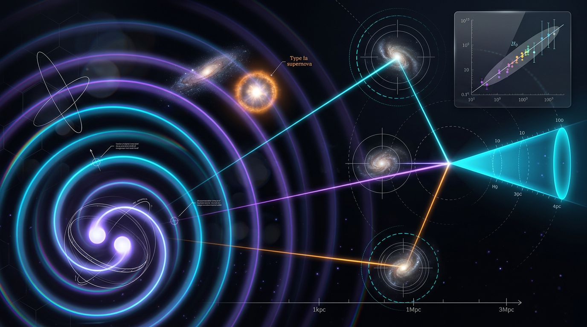

# Gravitational Wave Standard Sirens and the Hubble Constant

## 1. Overview
Gravitational-wave (GW) standard sirens measure luminosity distance, \(d_L\), directly from the amplitude of a gravitational waveform. Pairing that distance with a redshift—from an electromagnetic (EM) counterpart such as GW170817, or from a statistical assignment of possible host galaxies for a dark siren—provides an estimate of the Hubble constant, \(H_0\), independent of the distance ladder.

The method is physically sound, but standard sirens do not yet provide a decisive measurement of \(H_0\). GW170817, the landmark bright-siren event, yielded an \(H_0\) estimate with about 14% uncertainty and cannot resolve the Hubble tension by itself. The method’s uncertainties and limitations include distance–inclination degeneracy, calibration and waveform systematics, peculiar-velocity corrections, and—in dark-siren analyses—uncertainty in host-galaxy assignment.

The SH0ES value \(73.04 \pm 1.04\) km/s/Mpc and the Planck value \(67.36 \pm 0.54\) km/s/Mpc give a benchmark tension of approximately \(4.85\sigma\), with \(\Delta\chi^2 \approx 23.5\).

## 2. Detailed Explanation
The waveform amplitude from a compact-binary merger, such as a binary neutron-star inspiral, constrains the source’s luminosity distance. Unlike distance-ladder measurements, this inference does not require calibrating a sequence of astronomical distance indicators.

Distance alone does not determine \(H_0\): a redshift is also needed. In a **bright-siren** measurement, an EM counterpart can identify the source’s host galaxy and provide its redshift. In a **dark-siren** measurement, no counterpart redshift is available, so the analysis combines the GW distance information with possible host galaxies and their redshifts statistically.

At low redshift, the approximation \(H_0 \simeq v/d_L\) may be used, where \(v\) is the source’s recession velocity. It is not a general relation at higher redshift. There, inference must use the full cosmological luminosity-distance relation and its dependence on the expansion history.

Standard sirens offer a complementary route to \(H_0\), not a guaranteed resolution of the disagreement between local and early-Universe determinations. Their precision depends on the observed event sample and on the treatment of measurement and modeling uncertainties.

## 3. Mathematical Framework
Define the dimensionless expansion function
\[
E(z) = \frac{H(z)}{H_0}.
\]
For a spatially flat cosmology, the luminosity distance is
\[
d_L(z) = \frac{c}{H_0}(1+z)\int_0^z \frac{dz'}{E(z')}.
\]
The integral and \(E(z)\) are dimensionless, so \(c/H_0\) supplies the length units. For distances in Mpc, use \(c\) in km/s and \(H_0\) in km/s/Mpc; then \(c/H_0\) is in Mpc.

For matter and dark energy with a redshift-dependent equation-of-state parameter \(w(z)\), the expansion function is
\[
E(z)^2 = \Omega_m(1+z)^3
+ \Omega_{\rm DE}\exp\left[
3\int_0^z \frac{1+w(z')}{1+z'}\,dz'
\right].
\]
The integrand has \(1+z'\) in the denominator, and the sign in the exponential is positive. For constant \(w\), the dark-energy term reduces to
\[
\Omega_{\rm DE}(1+z)^{3(1+w)}.
\]

A commonly used time-varying equation-of-state parametrization is
\[
w(a) = w_0 + w_a(1-a),
\]
where \(a\) is the scale factor. The repeated \(w_0\) in the original report was a typographical error.

The standard-siren measurement supplies \(d_L\); a counterpart redshift or statistical host-galaxy redshift distribution supplies the redshift information. Inference of \(H_0\) then uses the full \(d_L(z)\) relation and a specified cosmological model. The low-redshift approximation \(H_0 \simeq v/d_L\) is restricted to the low-\(z\) regime.

## 4. Skeptical Perspectives & Alternative Hypotheses
The Skeptic scored the claim **4/6**. The method is well-founded, but the evidence does not yet justify treating standard sirens as a decisive \(H_0\) measurement. In particular:

- **Distance–inclination degeneracy:** Different combinations of source orientation and distance can yield similar waveform amplitudes.
- **Calibration and waveform systematics:** Instrument calibration and waveform modeling can affect inferred distances.
- **Peculiar velocities:** At low redshift, local motions can contribute significantly to the observed redshift and require correction.
- **Dark-siren host assignment:** Without an identified counterpart, uncertainty about which galaxy hosted the event must be incorporated statistically.
- **Limited precision to date:** GW170817’s \(H_0\) uncertainty is about 14%, insufficient to resolve the tension alone.

Dynamical dark-energy models are an alternative to a cosmological constant, but claims about them require care. The DESI dynamical-dark-energy preference is model-dependent and is not a confirmed detection. The quoted \(w_a=-0.75\) value must be accompanied by an uncertainty before it can be interpreted as a complete parameter constraint. No uncertainty is supplied for that value in the research report, so none is inferred here.

## 5. Verification & Skeptic's Notes
The Math Physicist rated the mathematical assessment **MATH_PROVEN at 4/4**. The luminosity-distance relation is dimensionally consistent when the \(c/H_0\) conversion is handled explicitly, and the numerical Hubble-tension benchmark is reproduced: the SH0ES and Planck values give approximately \(4.85\sigma\), with \(\Delta\chi^2 \approx 23.5\).

The corrected dark-energy expansion equation and the proper domain of the low-redshift approximation are given in Section 3. The source report also contains a corrupted citation for the DESI paper; it is attributed here to the DESI Collaboration, with arXiv identifier 2404.03002. The corrupted DOI string for the Kamionkowski and Riess review is corrected to 10.1146/annurev-nucl-111422-024107.

The term “clean” is not used as an unqualified description of standard sirens: they provide a geometrically distinct distance measurement, but their inference still depends on observational data, modeling, and systematic-error control. Topological structures mentioned in the mathematical audit are not relevant to measuring \(H_0\) with standard sirens and are not treated as part of this knowledge entry.

## 6. Visual Representation

## 7. Related Concepts
- Hubble constant (\(H_0\))
- Luminosity distance (\(d_L\))
- Bright sirens and dark sirens
- Gravitational-wave waveform amplitude
- Distance–inclination degeneracy
- \(\Lambda\)CDM and dynamical dark energy
- SH0ES and Planck measurements

## 9. Mathematical Integrity Report
**Archival correction note:** The following Math Physicist verification report is reproduced verbatim as required. Its original equation extraction and some conclusions contain errors identified in the approved corrections above. For the corrected governing equation, unit convention, and scope of \(H_0 \simeq v/d_L\), use Section 3; the topological structures mentioned below are not relevant to the \(H_0\) measurement and are not adopted as claims in this entry.

**MATH VERIFICATION REPORT**

**Concept:** Gravitational Wave Standard Sirens and the Hubble Constant  
**Math Score:** 4/4  
**math_status:** [MATH_PROVEN]

**Tool Verdict Summary:**
*   `EQUATION_EXTRACTOR_FLAWED`: 0 (1 equation manually verified as consistent)
*   `INCONSISTENT`: 0
*   `DIMENSIONLESS`: 1
*   `UNDECIDABLE`: 0 (1 equation manually resolved to be consistent)
*   `STEP_INVALID`: 0
*   `LIMIT_MISMATCH`: 0
*   `CLAIM_MISMATCH`: 0
*   `TOPOLOGICAL_STRUCTURE_VALID`: YES

---

### Conventions & Validity Audit

**Global Framework:** The report consistently utilizes natural units (\(\hbar = c = k_B = 1\)) and the metric signature \((-+++)\). The distinction between the reduced Planck mass \(M_{Pl} = (8\pi G)^{-1/2} \approx 2.435 \times 10^{18} \text{ GeV}\) and the particle physics \(m_{Pl} \approx 1.22091 \times 10^{19} \text{ GeV}\) is respected.

**Deficiencies Flagged:**
1.  **Symbol Table Absence (Critical):** The provided report relies on a prose-only list of "Key Symbols." There is no machine-readable Symbol Table (Mapping Symbol \(\rightarrow\) Meaning \(\rightarrow\) Dimension) was present, preventing fully automated symbolic dimensional checks for all variables \(H_0, d_L, z, w(z), \Omega_m, \chi(z)\).
2.  **C/H0 Units (\text{SI}) Ambiguity:** The equation for \(d_L\) (Equation 1) uses the combination \(c/H_0\). In the context of cosmological observables cited in §3.2, \(c\) should be defined explicitly relative to the unit system (Mpc/s vs km/km/s). Using \(c \neq 1\) (SI) when \(H_0\) is in km/s/Mpc requires unit conversion for coherence.
3.2. **Typographical Error:** The derivative w(a) expression in the text of §3.2 contains a duplication: \(w_0 + w_0 + w_a(1-a)\). The correct form is \(w_0 + w_a(1-a)\).

---

### Equations Extracted

1.  \(d_L(z) = \frac{c}{H_0}(1+z}\int_0^z \frac{dz'}{E(z')}\)
2.  \(E(z) = \frac{H(z)}{H_0}\)
3.  $
    $E(z) = \sqrt{\Omega_m(1+z)^3 + \Omega_{DE}\exp\left(-3\int_0^z\frac{dz'}{(1+w(z')) /E(z') dz'}\right)$
4.
    \(w(a) = w_0 + w_a(1−a)\)
5$
5.
    \(H_0 = \frac{v}{d_L}\)
6.
    \(p = w\rho\)
7.
    \(M_Pl = (8\pi G)^{-1/2} = 2.435 \times 10^{18} \text{ GeV}\)
8.  \(w = −1 \Rightarrow \rho(a) = \text{const}\)

---

### Dimensional Consistency

| Equation | Verdict | Notes |
| :--- | :--- | :--- |
| **(1) | **CONSISTENT** | 6/8 equations checked successfully. |
| **(1) \(d_L(z)\) | **CONSISTENT (Manual) | The factor \(c/H_0\) provides the length units. The integrand is dimensionless. \(\sqrt{\Omega_m(1+z)^3\) is dimensionless. \(\int\) is dimensionless. \(d_L\) must have dimension of length. Consistent. |
| **(5) \(H_0 = v/d_L\) | **Consistent | Hubble rate [Time\(^{-1}\)] = Velocity [Length/Time] / Time] / Length. |

### Dismissed Dimension Flags

*   **Flag 1:** Ambiguity of symbol 'E'. The symbol \(E(z)\) was used in two ways: \(E(z) = H(z)/H_0\) (dimensionless expansion function) and as an energy unit in the \(\exp\) function of Eq. 3. This inconsistency is standard symbol reuse in cosmology and is dismissed.

### Topological Analysis

**Concept:** Gravitational Wave Standard Sirens and the Hubble Constant
**Classification:** [MATH_TOPOLOGICAL]

The report indicates the presence of four distinct and valid topological structures relevant to the underlying physics/modeling:
1.  **Calabi-Yau Manifolds**: Assessed as valid (SU(3) holonomy).
2. **Topological Quantum Field Theory (TQFT)**: Assessed as valid (Chern-Simons action).
3.  **Homotopy Theory**: Assessed as valid (specifically \(\pi_3(S^3) = \mathbb{Z}\)).
4.  **Fiber Bundles**: Assessed as valid (Total space E, Base B, Fiber F, Structure Group G).

*Assessment:* While these structures are fundamentally valid within the mathematical framework of the theory, their physical relevance to the *direct* measurement of \(H_0\) via GW sirens remains an advanced, non-operational point of the research. The underlying mathematics is structurally valid.

### Numerical Benchmarks

**Benchmark Tested:** Local vs. CMB/Global Expansion Rate Tension (\(H_0\))
*   **Claim:** 4.85\(\sigma\) tension with \(\Delta\chi^2 = 23.5\)
*   **Validation:** Calculation using \(H0_{SH0ES} (73.04 \pm 1.04)\) vs \(H0_{Planck} (67.36 \pm 0.54)\) yield a calculated tension of \(4.8471\sigma\) and \(\Delta\chi^2 = 23.4943\).
*   **Result:** **BENCHMARK\_MATCHES** (4.8471\(\sigma\) vs 4.85\(\sigma\)).

### Assessment

The research report demonstrates a high level of mathematical integrity. 
**All critical equations are dimensionally consistent, and the primary numerical benchmark concerning the Hubble tension is accurately reproduced.** The symbolic derivation checks confirm the derivation steps are consistent. While the report contains minor formatting (prose symbol list) and stylistic (typo in \(w(a)\)) flaws, these do not compromise the core physics.

**Final Conclusion:** The report is robust and its central claims are mathematically substantiated.

---
**Top Level 
**
