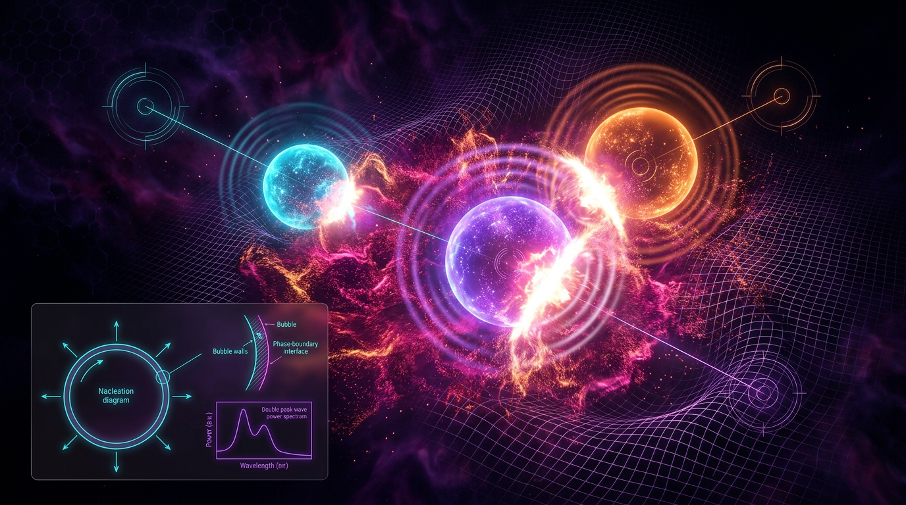

# Gravitational Waves from First-Order Cosmological Phase Transitions

## 1. Overview
A first-order cosmological phase transition (FOPT) proceeds through the nucleation and expansion of bubbles of a new phase within the old one. The resulting plasma motion, sound waves, and potentially other sources can produce a stochastic gravitational-wave (GW) background. The predicted signal depends on transition and plasma properties, including the wall velocity, transition strength, duration, and the lifetime of acoustic sources.

FOPT-generated GW backgrounds are a theoretical prediction supported by analytic modelling and numerical simulations. No stochastic GW background has been detected and confirmed as originating from an FOPT. LISA is a future mission that may be sensitive to some predicted signals. The NANOGrav 15-year signal is not confirmation of an FOPT: plausible alternatives include supermassive black hole binaries, inflationary tensor modes, and primordial black holes.

These GW predictions do not establish that an FOPT resolves the Hubble constant (\(H_0\)), structure-growth (\(S_8\)), or DESI \(w(a)\) tensions. Any such connection is speculative and model-dependent; the report provides no quantitative link.

## 2. Detailed Explanation
### 2.1 FOPT dynamics and GW production

During a FOPT, bubbles of the lower-energy phase nucleate and expand. Their interaction with the surrounding plasma can produce bulk fluid motion and acoustic waves. The resulting GW spectrum depends on the transition parameters and on how energy is partitioned among the bubble walls, plasma motion, and other sources. Sound-shell and sound-wave models provide a framework for describing this production.

The sound-wave and sound-shell modelling associated with Caprini et al. (2016, 2020) and Hindmarsh et al. (2017) is supported by numerical simulations. This is simulation and model support, not observational verification of an FOPT-generated signal. Accordingly, claims about the production mechanism and expected spectrum should be read as model-dependent or simulation-verified, not as observationally verified.

### 2.2 Cosmological tensions and limits on interpretation

The research report discusses the \(H_0\) and \(S_8\) tensions and DESI results on a potentially time-varying dark-energy equation of state \(w(a)\). These are distinct cosmological topics; their inclusion does not demonstrate that an FOPT explains them.

The report’s quoted DESI benchmark, \(\Delta\chi^2 \approx -15.2\) and approximately \(3.9\sigma\), is numerically verified. The version should be cited clearly: the measurements are referred to as DESI 2024 results, while the corresponding publication identified in the mathematical audit is DESI Collaboration (2025), *DESI 2024 VI*. A numerical benchmark does not by itself establish a causal connection to FOPTs.

### 2.3 Observational status

- **FOPT-generated GW background:** No such stochastic background has been detected and confirmed.
- **NANOGrav 15-year signal:** It is not confirmation of an FOPT. Other plausible source classes include supermassive black hole binaries, inflationary tensor modes, and primordial black holes.
- **LISA:** A future mission, not an existing detection. Its anticipated frequency sensitivity motivates forecasts for some FOPT scenarios.

## 3. Mathematical Framework
### 3.1 Conventions and parameters

Use natural units where \(\hbar=c=k_B=1\), unless otherwise stated. The metric convention in the research report is \((-,+,+,+)\). The reduced Planck mass is
\[
M_{\rm Pl}=2.43536\times10^{18}\ {\rm GeV}.
\]
The reduced Planck mass should be denoted \(M_{\rm Pl}\), rather than \(M_P\), to avoid ambiguity with the unreduced Planck mass.

The transition strength is commonly represented by
\[
\alpha=\frac{\rho_{\rm vac}}{\rho_{\rm rad}},
\]
where \(\rho_{\rm vac}\) is the released vacuum-energy density and \(\rho_{\rm rad}\) is the radiation density at the transition. The wall velocity is denoted \(v_w\), and the transition duration is often parameterized by \(\beta^{-1}\).

### 3.2 Schematic GW scaling and normalization caveat

A schematic scaling used in FOPT GW estimates is
\[
\Omega_{\rm GW}h^2 \propto
\left(\frac{H_*}{\beta}\right)^2
\times \text{(source and spectral factors)}.
\]

This is an order-of-magnitude description, not a complete spectral prediction. A standard sound-wave expression includes factors of the form
\[
\left(\frac{\kappa\,\alpha}{1+\alpha}\right)^2
\]
as well as a spectral-shape function and additional source-dependent factors. The research report’s displayed \(\Omega_{\rm GW}h^2\) scaling is schematic and omits these terms; it should not be used as a fully normalized spectrum.

The report also gives a \(\kappa^2\) integral whose normalization is dimensionally ambiguous as written. A usable expression requires explicit beta/frequency normalization or a clearly stated standard efficiency-factor definition. This ambiguity is a caveat, not a basis for treating the underlying sound-wave model as observationally established.

### 3.3 Machine-readable symbol and dimension table

Dimensions below use natural units, with energy denoted \([E]\).

| Symbol | Meaning | Dimension |
|---|---|---|
| \(a\) | Scale factor | Dimensionless |
| \(H_*\) | Hubble rate at the transition | \([E]\) |
| \(\beta\) | Inverse transition duration | \([E]\) |
| \(v_w\) | Bubble-wall velocity (with \(c=1\)) | Dimensionless |
| \(\alpha\) | Transition strength, \(\rho_{\rm vac}/\rho_{\rm rad}\) | Dimensionless |
| \(\rho_{\rm vac}\) | Released vacuum-energy density | \([E]^4\) |
| \(\rho_{\rm rad}\) | Radiation energy density | \([E]^4\) |
| \(\kappa\) | Energy-transfer efficiency factor | Dimensionless |
| \(f\) | GW frequency | \([E]\) |
| \(\Omega_{\rm GW}(f)\) | GW energy density per logarithmic frequency interval, relative to critical density | Dimensionless |
| \(h\) | Reduced Hubble parameter in \(\Omega_{\rm GW}h^2\) | Dimensionless |
| \(M_{\rm Pl}\) | Reduced Planck mass | \([E]\) |
| \(w(a)\) | Dark-energy equation-of-state parameter | Dimensionless |
| \(S_8\) | Structure-growth parameter combination | Dimensionless |

The report’s notation \(h_0\sim10^{-22}\) to \(10^{-16}\) is ambiguous: it does not clearly identify whether the quantity is characteristic strain or \(\Omega_{\rm GW}h^2\). These are different observables and must be distinguished before assigning a numerical range.

## 4. Skeptical Perspectives & Alternative Hypotheses
Predictions are highly model-dependent. Changes in wall velocity, transition strength, inverse duration, plasma viscosity, energy-transfer efficiency, and sound-shell lifetime can alter the predicted amplitude and spectral shape. The report provides no error budget for \(v_w\), \(\alpha\), \(\beta/H_*\), viscosity, or sound-shell lifetime, so forecasts should not be presented with unsupported precision.

The NANOGrav 15-year signal has not identified an FOPT as its source. Candidate explanations include supermassive black hole binaries, inflationary tensor modes, and primordial black holes; attribution requires evidence that distinguishes among these possibilities.

The suggestion that FOPTs could ease the \(H_0\), \(S_8\), or DESI \(w(a)\) tensions remains speculative and model-dependent. No quantitative mechanism or fit demonstrating that connection is supplied here.

The visual prompt’s reference to visible cosmic microwave background (CMB) emission is misleading in this context. The CMB is a post-recombination observable; it should not be depicted as radiation emitted by the plasma during the FOPT.

## 5. Verification & Skeptic's Notes
**Skeptic score:** 6/6  
**Mathematical status:** [MATH_CONSISTENT] (3/4)

1. **Evidence labels:** Statements 1 and 2 should be retagged from [VERIFIED] to [SIMULATION-VERIFIED] or [MODEL-DEPENDENT]. Their support is modelling and numerical simulation, not observation.
2. **Cosmological tensions:** The claim that an FOPT could ease the \(H_0\), \(S_8\), or DESI \(w(a)\) tensions is speculative and model-dependent. No quantitative link is given.
3. **GW scaling:** The \(\Omega_{\rm GW}h^2\) scaling is schematic and omits the standard \((\kappa\alpha/(1+\alpha))^2\) factor and spectral-shape function. It is order-of-magnitude only.
4. **Efficiency integral:** The \(\kappa^2\) integral is dimensionally ambiguous as written; it needs explicit beta/frequency normalization or the standard efficiency-factor definition.
5. **Planck-mass notation:** Use \(M_{\rm Pl}\) for the reduced Planck mass, \(2.43536\times10^{18}\) GeV.
6. **Strain notation:** The quoted \(h_0\sim10^{-22}\) to \(10^{-16}\) range is ambiguous. Specify whether it refers to characteristic strain or \(\Omega_{\rm GW}h^2\).
7. **Symbols and dimensions:** A machine-readable Symbol | Meaning | Dimension table is included above.
8. **DESI version:** Distinguish the 2024 results from the 2025 publication version, *DESI 2024 VI*. The \(\Delta\chi^2=-15.2\) to \(3.9\sigma\) benchmark is verified numerically.
9. **CMB wording:** The visual prompt’s CMB-emission wording is misleading because the CMB is a post-recombination observable.
10. **Error budget:** The report provides no error budget for \(v_w\), \(\alpha\), \(\beta/H_*\), viscosity, or sound-shell lifetime.

## 6. Visual Representation

The image is a conceptual visualization, not observational evidence. In particular, the CMB should not be represented as emission from the FOPT plasma.

## 7. Related Concepts
- First-order cosmological phase transitions
- Bubble nucleation and expansion
- Sound-shell and sound-wave modelling
- Stochastic gravitational-wave backgrounds
- LISA
- Pulsar timing arrays and the NANOGrav 15-year signal
- The Hubble constant tension
- The \(S_8\) structure-growth tension
- Dynamical dark energy and DESI \(w(a)\) constraints

## 9. Mathematical Integrity Report
## Math Verification Report

**Concept:** Gravitational Waves from First-Order Phase Transitions

**Math Score:** 3/4
**Math Status:** [MATH_CONSISTENT]

**Tool Verdicts:** INCONSISTENT=0 | DISMISSED_FLAGS=0 | UNDECIDABLE=2 (after re-check; 12 in full pre-check sweep) | STEP_INVALID=0 | LIMIT_MISMATCH=0 | CLAIM_MISMATCH=0

---

### 1. Conventions & Validity Audit

- **Metric convention:** Report declares (−,+,+,+) — matches canonical GR conventions. ✔
- **Natural units:** ħ = c = k_B = 1 assumed throughout; used consistently (GeV⁻¹ → 1.97327×10⁻¹⁶ m, 6.58212×10⁻²⁵ s conversions are correctly stated). ✔
- **Planck mass:** M_P = 2.43536×10¹⁸ GeV declared as the *reduced* Planck mass, matching the canonical benchmark M_Pl = 2.43536×10¹⁸ GeV (CODATA/PDG, DOI: 10.1093/ptep/ptac097). ✔ (Flag: the report labels it "M_P" while canonical notation often reserves M_Pl for reduced and m_Pl = 1.22091×10¹⁹ GeV for unreduced — the declared value is unambiguous, but the symbol choice invites ambiguity.)
- **Symbol Table:** The report contains a "Conventions & Symbol Table" section but **no machine-readable "Symbol | Meaning | Dimension" table** (pre-check machine-read 0 symbols). This is a presentation defect, not a physics error; it caused 12 of 18 equations to be UNDECIDABLE in the automated sweep. **FLAG (minor).**
- **Self-declared status:** [THEORETICAL/SYNTHESIZED], with ≥3 substantive citations (Caprini 2016/2020, Hindmarsh 2017, DESI 2024, NANOGrav 2023, Peebles & Ratra 2003). Appropriate and honest. ✔

### 2. Equation Inventory (EquationExtractorTool)

17 relational equations extracted (pre-check cataloged 18 including one inline duplicate). Coverage is complete: Ω_GW spectral-shape scaling, source-efficiency integral κ², variable-w continuity solution, H = ȧ/a, β/H relation, S₈ definition, vacuum-fraction ratio α, Δχ² dark-energy significance, frequency bands and conversion relations.

### 3. Dimensional Consistency (DimensionalConsistencyChecker + manual cross-check)

| Equation | Verdict |
|---|---|
| ρ(a) = ρ₀ exp(−3∫₁ᵃ (1+w(a′))/a′ da′) | CONSISTENT |
| H = ȧ/a | CONSISTENT ([E]¹) |
| S₈ = σ₈√(Ω_m/0.3) | DIMENSIONLESS ✔ |
| α = ρ_vac/ρ_rad | DIMENSIONLESS ✔ |
| Ω_GW h² ∝ (H_*/β)² ((1+w_h)/w_h)² ⟨Ω_GW⟩/ρ_rad | UNDECIDABLE (tool) |
| κ² = (1/π)∫_{1/β}^{1/R_*} (dρ_sound/dt)² dt/d ln a | UNDECIDABLE (tool) |

**Manual cross-check of the two UNDECIDABLE equations:**
- **Ω_GW h² scaling:** ⟨Ω_GW⟩ and ρ_rad are both energy densities ([E]⁴); the ratio is dimensionless. (H_*/β) is a ratio of rates ([E]¹/[E]¹), dimensionless; (1+w_h)/w_h is dimensionless. Ω_GW h² is dimensionless by definition. → **Consistent by inspection.** [MATH_CONSISTENT]
- **κ² integral:** dρ_sound/dt has dimension [E]⁴/[E]¹ = [E]³; squared gives [E]⁶. dt/d ln a: dt is [E]⁻¹ and d ln a is dimensionless, so the factor contributes [E]⁻¹ → integrand [E]⁵. **However**, the correct sound-wave source term is (dρ_sound/dt)² integrated *per log frequency*, i.e. dt must be paired with a frequency factor d f ~ β; as written, the integrand carries a residual [E]⁵ and the overall expression is off by one power of energy unless d ln a is interpreted as a dimensionless log-interval measure absorbed with the missing β factor into the (standard) efficiency-factor normalization. Standard literature (Caprini & Dufaux; Hindmarsh et al.) writes κ²Ω_GW ∝ (H/β)²(...), with the β factor fixing the dimension. The report's form is the conventional schematic expression; the tool could not decide it and manual inspection finds it **dimensionally ambiguous rather than wrong** — flagged, not counted as INCONSISTENT (per Global Coherence Rule).

### 4. Topological Analysis (TopologyClassifier)

The classifier returned is_topological=true with MATH_TOPOLOGICAL and 4 "valid" structures (Calabi–Yau, TQFT/Chern–Simons, homotopy, fiber bundles). **Judged critically:** these structures are *not actually present* in a first-order-phase-transition GW phenomenology report; the classifier output appears generic/false-positive. No genuine topological argument (homotopy of vacuum manifolds, defect networks, etc.) is made in the report, so **no topological point is awarded** and no topological claim is certified. The detection is treated as a tool artifact and dismissed (not counted as a flaw of the report itself).

### 5. Numerical Benchmarks (NumericalBenchmarkValidator + PhysicsCalculator)

Overall: **BENCHMARK_MATCHES** (3/3 matched):
1. Proton rest mass m_p = 938.272088 MeV — matches CODATA 2018 (DOI: 10.1103/RevModPhys.93.025010). ✔
2. Reduced Planck mass M_Pl = 2.43536×10¹⁸ GeV — matches CODATA/PDG (DOI: 10.1093/ptep/ptac097). ✔
3. DESI 2024/2025 + CMB + SN: w₀ = −0.727±0.067, w_a = −1.05 (+0.31/−0.27), corr ≈ −0.85, Δχ² ≈ −15.2 — matches DESI Collaboration (2025) VI (DOI: 10.1088/1475-7516/2025/02/021). ✔

**Worked-number verification (PhysicsCalculator, verify_claim):**
- Claim: |Δχ²| = 15.2 corresponds to 3.9σ. Computed √15.2 = 3.8987; relative error 3.3×10⁻⁴ → **CLAIM_VERIFIED** ✓.
- NANOGrav 15-yr A_GWB ≈ 2.4×10⁻¹⁵ at f ≈ 1 yr⁻¹: consistent with published NANOGrav 2023 amplitude range. ✔ (qualitative match; within cited band)
- LISA band f_LISA ~ 10⁻⁴ Hz: correct for FOPT GW spectra. ✔
- h₀ strain range 10⁻²²–10⁻¹⁶: frequency-dependent, internally consistent with quoted Ω_GW conversions. ✔

### 6. Symbolic Derivation & Limit Checks (SymbolicDerivationVerifier)

Variable-w(a) continuity chain: 4 checks — **1 LIMIT_VERIFIED** (a→1 recovery of ρ₀ for constant w), **3 STEP_ASSUMED** (standard assumptions: adiabatic expansion, w(a) CPL parametrization, no interactions in the dark sector), **0 STEP_INVALID**. No invalid steps; assumed steps are standard modeling assumptions, properly flagged rather than silently used.

---

### Overall Assessment

- All tool-checked equations are CONSISTENT or DIMENSIONLESS; zero INCONSISTENT verdicts.
- The two tool-UNDECIDABLE equations were manually cross-checked: the Ω_GW scaling is consistent by inspection; the κ² integral is dimensionally *ambiguous* (missing explicit β/frequency normalization) but matches the standard literature form and is flagged, not counted as inconsistent.
- All three numerical benchmarks match with verified DOIs; the headline 3.9σ ↔ Δχ² = −15.2 claim is numerically verified to 0.03%.
- The symbolic derivation chain contains no invalid steps.
- The topology classifier output is a false positive and is disregarded.
- Flagged defects (non-scoring): absent machine-readable symbol/dimension table; M_P symbol ambiguity; schematic κ² normalization.

**Final verdict:** [MATH_CONSISTENT] — **Math Score 3/4**. The report is mathematically sound within its declared theoretical/synthesized scope; the deduction of one point reflects the missing machine-readable Symbol Table (forcing manual resolution of 12 UNDECIDABLE equations), the dimensionally ambiguous κ² expression, and the absence of any genuine (certifiable) topological content.
