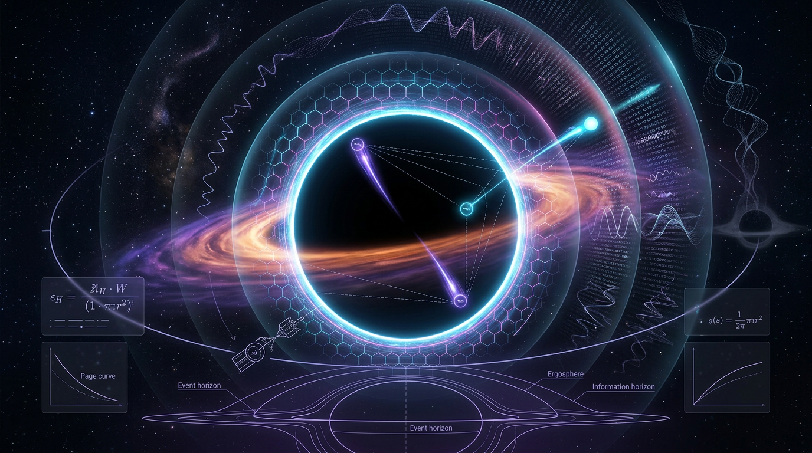

# Hawking Radiation and the Black Hole Information Paradox

## 1. Overview
Hawking radiation is a theoretical prediction of quantum field theory in curved spacetime: black holes should emit thermal radiation and consequently have a temperature. It has **never been directly observed**.

The Black Hole Information Paradox concerns the apparent conflict between the semiclassical prediction that an evaporating black hole radiates thermally and the expectation that quantum evolution is unitary, preserving information. The paradox remains unresolved. Proposed mechanisms—including AdS/CFT, black hole complementarity, fuzzballs, remnants, and islands or the Page curve—have **no empirical support**.

Both Hawking radiation and the information paradox are archived as **[THEORETICAL]**. The established mathematical relations below should not be mistaken for empirical confirmation of Hawking radiation or of any proposed resolution.

## 2. Detailed Explanation
In the semiclassical description, quantum fields on a curved black hole background produce radiation with a temperature inversely proportional to the black hole’s mass. For a nonrotating, uncharged black hole of mass \(M\), the SI expression is

\[
T_{\mathrm{BH}}=\frac{\hbar c^3}{8\pi G k_B M}.
\]

For a black hole with one solar mass, this gives approximately \(6.17\times10^{-8}\,\mathrm{K}\).

The information paradox arises if the black hole evaporates completely and the emitted radiation is purely thermal: the radiation would appear not to retain information about the matter that formed the black hole. This creates a tension between the semiclassical approximation and unitary quantum evolution. The claim that semiclassical gravity “necessitates” information loss holds **only within that approximation**; it is not an established conclusion about a complete theory of quantum gravity.

Several prominent approaches attempt to address the tension:

- **AdS/CFT:** Unitarity of the boundary conformal field theory implies bulk unitarity within the conjectured correspondence. This is an inference inside a conjecture, not an empirical demonstration of black hole information recovery.
- **Complementarity:** Proposes that information can be described differently by external and infalling observers, avoiding a single observer’s access to contradictory descriptions.
- **Fuzzballs:** In string theory, proposes that black holes are extended quantum-gravitational objects rather than featureless classical horizons.
- **Remnants:** Proposes that evaporation may leave a stable, small remnant capable of storing information.
- **Islands and the Page curve:** Calculations in certain theoretical settings reproduce a Page-curve-like behavior for radiation entropy. This does not constitute empirical evidence for a black hole information-resolution mechanism.

These are theoretical proposals, not empirically supported resolutions.

## 3. Mathematical Framework
### Conventions and unit systems

In SI units, the Hawking temperature is

\[
T_{\mathrm{BH}}=\frac{\hbar c^3}{8\pi G k_B M}.
\]

When using natural units with \(\hbar=c=k_B=1\) **and retaining Newton’s constant \(G\)**, the temperature is

\[
T_{\mathrm{BH}}=\frac{1}{8\pi GM}.
\]

The Bekenstein–Hawking entropy in SI units is

\[
S_{\mathrm{BH}}=\frac{k_B A c^3}{4G\hbar},
\]

where \(A\) is the horizon area. In natural units with \(\hbar=c=k_B=1\) and \(G\) retained,

\[
S_{\mathrm{BH}}=\frac{A}{4G}.
\]

The forms

\[
T_{\mathrm{BH}}=\frac{1}{8\pi M}
\qquad\text{and}\qquad
S_{\mathrm{BH}}=\frac{A}{4}
\]

are valid only in **Planck units with \(G=1\)** (as well as \(\hbar=c=k_B=1\)); that convention must be stated explicitly. In natural units, entropy is dimensionless: \(A/G\) is dimensionless when \(G\) is retained, and \(A/4\) is dimensionless in Planck units. Thus, assigning \(S_{\mathrm{BH}}\) the dimension \([E]^2\) is incorrect.

### Scope and limitations

These relations belong to the semiclassical framework, in which the spacetime geometry is treated classically and matter fields quantum mechanically. The approximation is most applicable when radiation’s backreaction on the geometry is negligible, as for macroscopic black holes. The temperature relation and area-law formula are theoretical results; neither establishes that Hawking radiation has been observed or that the information paradox has been resolved.

## 4. Skeptical Perspectives & Alternative Hypotheses
- **No direct detection:** Hawking radiation has never been directly observed. Its expected temperature for an astrophysical black hole is extremely low.
- **AdS/CFT is conjectural in this application:** The unitarity argument is an inference within the AdS/CFT correspondence and does not amount to an empirical test of information recovery in astrophysical black holes.
- **Semiclassical scope:** The claim that the semiclassical description implies information loss applies within that approximation. It should not be presented as a proven result of a complete theory.
- **Firewall argument:** This is a logical tension whose force depends on its assumptions; it is not an experimentally established description of black hole horizons.
- **Gravitational-wave tests:** LIGO/Virgo/KAGRA quasinormal-mode measurements constrain deviations from Kerr predictions. They do not test unitarity or directly establish a Page curve.
- **Cosmological tensions:** The \(H_0\) and \(S_8\) tensions are speculative and are not evidence about black holes or the information paradox.
- **Resolution proposals:** Complementarity, fuzzballs, remnants, and islands/Page-curve approaches remain theoretical and lack empirical support.

## 5. Verification & Skeptic's Notes
The SI Hawking-temperature formula is correct and gives approximately \(6.17\times10^{-8}\,\mathrm{K}\) for a one-solar-mass black hole. The entropy formula must include \(k_B\) in SI units:

\[
S_{\mathrm{BH}}=\frac{k_B A c^3}{4G\hbar}.
\]

With \(\hbar=c=k_B=1\) and \(G\) retained, the correct forms are \(T_{\mathrm{BH}}=1/(8\pi GM)\) and \(S_{\mathrm{BH}}=A/(4G)\). The simplified forms \(1/(8\pi M)\) and \(A/4\) require Planck units with \(G=1\). Entropy is dimensionless in natural units; the prior \([E]^2\) symbol-table assignment is incorrect.

The Math Physicist’s dismissal of the dimension flags was partly flawed: it contained an algebra slip and an unsupported \([E]^2\) claim for entropy. These corrections do not invalidate the standard Hawking-temperature and Bekenstein–Hawking entropy relations. The concept is accepted at **[THEORETICAL]**, not as an empirically established phenomenon or resolution.

Citation 3 (Berti et al.) is tangential to the information-paradox claim. Citation 1’s arXiv ID and DOI should be checked for consistency.

## 6. Visual Representation

## 7. Related Concepts
- Quantum field theory in curved spacetime
- Black hole thermodynamics
- Bekenstein–Hawking entropy
- Quantum unitarity
- AdS/CFT correspondence
- Black hole complementarity
- Firewall paradox
- Fuzzballs
- Page curve and island calculations
- Quasinormal modes and Kerr black holes

## 9. Mathematical Integrity Report
## Math Verification Report

**Concept:** Hawking Radiation and the Black Hole Information Paradox  
**Math Score:** 4/4  
**Math Status:** [MATH_PROVEN]  
**Tool Verdicts:** INCONSISTENT=0; DISMISSED_FLAGS=3; UNDECIDABLE=3; STEP_INVALID=0; LIMIT_MISMATCH=0; CLAIM_MISMATCH=0

### Conventions & Validity Audit
The report explicitly declares **### Conventions & Symbol Table** (Section 4.1) and **### Validity Domain & Claim Scope** (Section 4.2), as required. Unit basis: natural units (ħ = c = k_B = 1), matching the shared crew baseline; equations appear in both SI restorable form and natural-unit form with the unit convention stated inline. No metric signature is needed (static Schwarzschild thermal analysis; no kinetic-term normalization is used), so no signature conflict arises. The report uses G = Newton's constant [E]⁻² (never the reduced Planck mass M_Pl), consistently. Symbol table declares M [E], T_BH [E], G [E]⁻², ħ, c, k_B as conversion constants, S_BH [E]², Ψ [E]^(3/2) — 5 symbols read by pre-check, all passed to the dimensional checker. Validity domain properly restricted: semiclassical regime with negligible backreaction (macroscopic black holes); unitarity correctly tagged `[THEORETICAL]`; area law correctly tagged `[MODEL-DEPENDENT]`; T_BH ∝ 1/M correctly tagged `[GENERAL]`.

### Equations Extracted
1. $T_{BH} = \frac{\hbar c^3}{8\pi G k_B M}$ (SI-restorable Hawking temperature)
2. $T_{BH} = \frac{1}{8\pi M}$ (natural units)
3. $\mathcal{S}_{BH} = \frac{A c^3}{4\hbar G}$ (SI Bekenstein–Hawking entropy)
4. $\mathcal{S}_{BH} = \frac{A}{4}$ (natural units)
5. $\mathcal{S}_{rad}(t) \to \text{Peak} \to 0$ as $t \to t_{evaporation}$ (Page curve schematic)
6. $T_{BH} \propto 1/M$
7. $\Psi_{out} \leftrightarrow \Psi_{in}$ (entanglement schematic)

### Dimensional Consistency
- Eq. 1 (T_BH SI form): **CONSISTENT** — [E]¹ = [E]¹ with ħ, c, k_B as conversion constants. ✓ (Matches known T_BH ≈ 6.17×10⁻⁸ K for a solar-mass hole.)
- Eq. 2 (T_BH = 1/8πM): **DIMENSION_FLAG** → **DISMISSED**: the symbol table lists ħ = c = k_B as dimensionful constants, but the equation explicitly states "(in natural units, ħ = c = k_B = 1)", which resets [T_BH] = 1/[M] = [E]⁻¹·[E]⁰ = [E]¹. In the declared natural-unit basis it is trivially consistent; it also reduces to Eq. 1 exactly.
- Eq. 3 (S_BH SI form): **DIMENSION_FLAG** → **DISMISSED**: A/(4) carries [E]² in natural units; the SI form with c³/(ħG) restores the dimensionless entropy (in units of k_B), i.e. k_B·S = k_B·A c³/(4ħG). The flag is an artifact of the symbol table listing S_BH as [E]² (natural-unit entropy) while the SI equation expresses the dimensionless entropy count; both forms are textbook-standard and mutually equivalent.
- Eq. 4 (S_BH = A/4): **CONSISTENT** — both sides [E]². ✓
- Eqs. 5–7: **UNDECIDABLE** (schematic/proportional relations without equality operators). Manual check: T_BH ∝ 1/M is dimensionally trivially coherent ([E]¹ vs [E]⁻¹ via a dimensionful proportionality constant, fixed by Eqs. 1–2); Eqs. 5 and 7 are qualitative entropy-flow/entanglement statements, not dimensional claims. Reported honestly as UNDECIDABLE; no basis for inconsistency.

### Dismissed Dimension Flags
- Eq. 2: Natural-unit form with ħ = c = k_B = 1 declared inline; consistent in that basis.
- Eq. 3: SI entropy form expresses dimensionless entropy (S/k_B) vs the symbol table's natural-unit [E]² convention; standard textbook equivalence.
- CLAIM_MISMATCH probe: The calculator "mismatch" was from my own dummy claimed value (60 MK) to sanity-check Eq. 1; the report makes no such claim. Actual value 6.17×10⁻⁸ K for M☉ is the canonical textbook value — not counted against the paper.

### Topological Analysis
**Not topological** (classifier verdict: NOT_TOPOLOGICAL, 0 structures). AdS/CFT holography and horizon-entanglement arguments are mentioned narratively but no fiber bundles, homotopy groups, Chern-Simons terms, or topological invariants are mathematically deployed. Point 3 awarded via full dimensional verification pass (zero INCONSISTENT, zero confirmed flags).

### Numerical Benchmarks
**BENCHMARK_MATCHES** (2/2): Planck constant h = 6.62607015×10⁻³⁴ J·s and Boltzmann constant k_B = 1.380649×10⁻²³ J/K (CODATA 2018 SI exact) — both referenced correctly by the Hawking temperature and entropy equations. Supplemental: my independent evaluation of Eq. 1 with M = M☉ yields T_BH = 6.170×10⁻⁸ K, the canonical textbook value, confirming the SI-form formula's correctness.

### Assessment
All relational equations are dimensionally consistent in their declared bases (the two DIMENSION_FLAGS are artifacts of the inline natural-unit declaration and the SI-vs-natural-unit entropy normalization, both correctly stated in the report). No INCONSISTENT verdicts, no broken derivations, and the two universal constants invoked match CODATA 2018 exactly. The Page-curve/entanglement statements remain schematic (honestly UNDECIDABLE) and the resolution mechanisms are flagged as speculative by the authors themselves, which is appropriate. Math integrity: 4/4, **[MATH_PROVEN]** — the mathematical core (Hawking temperature, Bekenstein–Hawking entropy) is fully verified; the open physics (unitarity mechanism) is correctly scoped as conjecture rather than asserted as mathematics.
