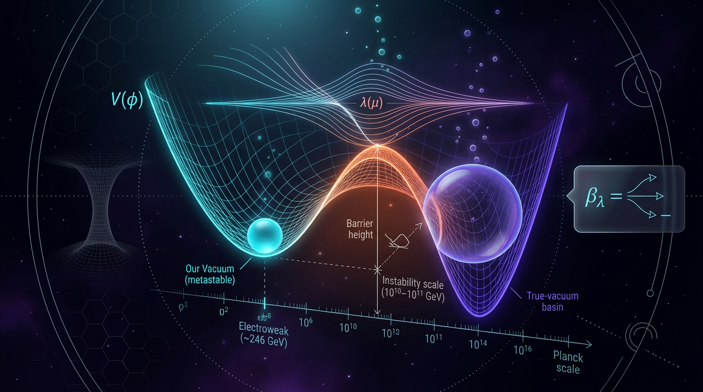

# Higgs Vacuum Stability and Metastability of the Electroweak Vacuum

## 1. Overview
Higgs vacuum metastability is the theoretical possibility that the electroweak (EW) vacuum is a local, long-lived minimum rather than the lowest-energy state of the Standard Model (SM). The established quantum-field-theory mechanism for false-vacuum decay uses a Coleman bounce, whose fluctuation operator has one negative mode; gravitational corrections are described by Coleman–De Luccia (CDL) theory.

The empirical conclusion that the EW vacuum is metastable is not a direct observation of vacuum decay. It follows from extrapolating the measured Higgs mass, top-quark mass, and strong coupling through three-loop renormalization-group (RG) evolution, under the assumption that the SM alone remains applicable up to the Planck scale. The result is therefore **[THEORETICAL]** and conditional on those inputs and assumptions.

At the current central values used here, the SM stability boundary lies about 3.19 GeV above the measured Higgs mass. With the larger top-mass uncertainty of ±0.76 GeV, this is about a 2σ gap. The often-quoted roughly 3σ exclusion of absolute stability refers to Buttazzo et al.’s reference top mass, not the current central value used in this comparison.

## 2. Detailed Explanation
### 2.1 Running Higgs coupling and instability

At large Higgs-field values, the RG-improved effective potential is approximately
\(V_{\rm eff}(h)\simeq \lambda_{\rm eff}(h)h^4/4\). The top Yukawa coupling makes a major negative contribution to the running of the Higgs quartic coupling, \(\lambda\). In the SM-only extrapolation, \(\lambda\) crosses zero at an instability scale commonly quoted as roughly \(10^{10}\)–\(10^{12}\) GeV. The precise numerical scale depends on how “instability scale” is defined.

The commonly cited value \(\lambda_{\min}\approx -0.01\) must not be conflated with the coupling at the bounce scale. The bounce scale \(\Lambda_B\) is defined by \(\beta_\lambda(\Lambda_B)=0\), where \(\beta_\lambda=d\lambda/d\ln\mu\). The bounce action
\[
B=\frac{8\pi^2}{3|\lambda(\Lambda_B)|}\approx 577
\]
implies \(|\lambda(\Lambda_B)|\approx 0.046\), not 0.01. Thus \(\lambda_{\min}\) and \(\lambda(\Lambda_B)\) are distinct quantities; the quoted values cannot be reconciled by treating them as the same coupling value. Lifetime estimates based on \(B\approx577\) should consequently be identified as dependent on the calculation’s scale, scheme, and prefactor conventions.

Instability-scale definitions also differ. Buttazzo et al. discuss, among others, \(\Lambda_V\), defined through the effective-potential barrier, and \(\Lambda_\lambda\), where the running quartic vanishes; they report \(\Lambda_\lambda\approx 2\Lambda_V\) in \(\overline{\rm MS}\). A Landau-gauge definition can give a further different numerical value. Any quoted \(\Lambda_{\rm I}\) should specify its definition and gauge or scheme where relevant.

### 2.2 Stability boundary and mass sensitivity

The published stability boundary from Buttazzo et al. (2013), Eq. 64, is
\[
M_h > 129.6
+2.0(M_t-173.34)
-0.5\frac{\alpha_3-0.1184}{0.0007}
\pm0.3\ {\rm GeV},
\]
where the masses are in GeV and \(\alpha_3\) is evaluated at \(M_Z\).

Taking \(M_t=172.76\) GeV and \(\alpha_3=0.1184\), the boundary is
\[
129.6+2.0(172.76-173.34)=128.44\ {\rm GeV}.
\]
For \(M_h=125.25\) GeV, the gap is \(128.44-125.25=3.19\) GeV.

The boundary’s slope with respect to the top mass is
\[
\frac{\partial M_h^{\rm crit}}{\partial M_t}=2.0.
\]
Thus a 0.3 GeV shift in \(M_t\) shifts the boundary by 0.60 GeV. With a top-mass uncertainty of ±0.76 GeV, the combined gap uncertainty is approximately 1.55 GeV, giving \(3.19/1.55\approx2.0\sigma\). The top-pole-mass ambiguity, approximately 0.3 GeV, is a dominant systematic. The roughly 3σ exclusion of absolute stability is associated with Buttazzo et al.’s reference \(M_t=173.34\) GeV, for which the gap to \(M_h=125.25\) GeV is about 4.35 GeV; it should not be presented as a 2.8σ result for the current central values.

### 2.3 False-vacuum decay and gravity

In semiclassical quantum field theory, the decay rate per unit four-volume has the form
\[
\frac{\Gamma}{V}=A e^{-B}.
\]
The dominant semiclassical configuration is the Euclidean bounce. Its fluctuation operator has one negative mode, the feature associated with decay of the false vacuum. In the SM large-field approximation, the bounce action is often written
\[
B=S(\Lambda_B)=\frac{8\pi^2}{3|\lambda(\Lambda_B)|},
\qquad \beta_\lambda(\Lambda_B)=0.
\]
Coleman–De Luccia corrections account for gravity. Their importance depends on the bounce and cosmological setting; the SM vacuum-decay result is not simply a flat-space calculation with gravity ignored.

A rate per four-volume has dimensions \([E]^4\) in natural units. The expression \(\tau\sim e^S/\Lambda_B^4\), by itself, has dimensions of a four-volume, not a time, and must not be called a lifetime without specifying the spacetime volume and cosmological probability calculation. A time-scale estimate is obtained by integrating the decay probability over the relevant past light cone. In the stated convention this is written as
\[
\tau \approx 0.02\,\frac{T_U}{\mathcal P_0},
\]
where \(T_U\) is the age-of-the-universe time scale and \(\mathcal P_0\) denotes the dimensionless rate and cosmological integral factor in that convention.

The arithmetic \(e^{577}t_U\approx10^{260.7}\) years is a conditional scale estimate, not a convention-independent lifetime. In particular, the distinction between \(\lambda_{\min}\) and \(\lambda(\Lambda_B)\), as well as the rate prefactor and spacetime-volume convention, must be made explicit when quoting such a number.

### 2.4 Inflation and cosmological context

Using the tensor-to-scalar ratio bound \(r_{0.05}<0.036\) and scalar amplitude \(A_s\simeq2.1\times10^{-9}\), the corresponding upper bound is
\[
H_{\rm inf}=\pi M_{\rm Pl}\sqrt{\frac{A_s r}{2}}
\lesssim 4.7\times10^{13}\ {\rm GeV}.
\]
This corrected value is above the commonly quoted \(\Lambda_{\rm I}\sim10^{10}\)–\(10^{12}\) GeV. Therefore, the tensor bound alone does not establish that inflationary fluctuations were harmless to the EW vacuum. Whether the vacuum survives inflation is an open, model-dependent question involving the inflationary background, Higgs-curvature interactions, initial conditions, and the treatment of stochastic Higgs fluctuations.

## 3. Mathematical Framework
### Conventions and symbol table

Natural units \(\hbar=c=k_B=1\) are used. The metric signature is \((-,+,+,+)\); Euclidean bounce calculations use the Wick-rotated positive-definite metric. The reduced Planck mass is \(M_{\rm Pl}=(8\pi G)^{-1/2}=2.435\times10^{18}\) GeV, while \(m_{\rm Pl}=G^{-1/2}=\sqrt{8\pi}\,M_{\rm Pl}\).

The potential convention is
\[
V(H)=-m^2H^\dagger H+\lambda(H^\dagger H)^2,
\qquad H=(0,h/\sqrt 2)^T.
\]
It gives \(v^2=m^2/\lambda\), \(m^2=\lambda v^2\), and \(m_h^2=2\lambda v^2\).

| Symbol | Meaning | Dimension |
|---|---|---|
| \(h\) | Real radial Higgs field | \([E]^1\) |
| \(v\) | Electroweak vacuum expectation value, approximately 246 GeV | \([E]^1\) |
| \(m^2\) | Higgs mass-squared parameter in the stated potential | \([E]^2\) |
| \(\lambda(\mu)\) | Running Higgs quartic coupling | \([E]^0\) |
| \(y_t,g_1,g_2,g_3\) | Top Yukawa and gauge couplings | \([E]^0\) |
| \(\beta_\lambda\) | RG beta function of \(\lambda\) | \([E]^0\) |
| \(\Lambda_{\rm I}\) | Instability scale; definition must be specified | \([E]^1\) |
| \(\Lambda_V,\Lambda_\lambda\) | Barrier-defined and zero-of-\(\lambda\) instability scales | \([E]^1\) |
| \(\Lambda_B\) | Bounce scale, defined by \(\beta_\lambda(\Lambda_B)=0\) | \([E]^1\) |
| \(B\) | Dimensionless bounce exponent | \([E]^0\) |
| \(\Gamma/V\) | Decay rate per four-volume | \([E]^4\) |
| \(H_{\rm inf}\) | Inflationary Hubble scale | \([E]^1\) |
| \(A_s,r\) | Scalar amplitude and tensor-to-scalar ratio | \([E]^0\) |
| \(M_h,M_t\) | Higgs and top-quark masses | \([E]^1\) |
| \(\alpha_3(M_Z)\) | Strong coupling at the \(Z\)-boson mass | \([E]^0\) |

### Governing equations

The leading large-field approximation is
\[
V_{\rm eff}(h;\mu)\simeq\frac{\lambda_{\rm eff}(h)h^4}{4},
\qquad V_{\rm eff}<0\ \text{when}\ \lambda_{\rm eff}<0.
\]

At one loop, the SM quartic beta function is
\[
16\pi^2\frac{d\lambda}{d\ln\mu}
=24\lambda^2-6y_t^4
+\frac{3}{2}(3g_2^4+g_1^4-2g_1^2g_2^2)\lambda
+\frac{3}{8}\left(2g_2^4+(g_1^2+g_2^2)^2\right).
\]
The numerical instability prediction uses higher-order matching and RG evolution, not this one-loop equation alone.

The stability boundary is the Buttazzo et al. Eq. 64 expression given above. The semiclassical rate has \(\Gamma/V=Ae^{-B}\), with \(B=8\pi^2/(3|\lambda(\Lambda_B)|)\) in the scale-invariant approximation. The inflationary scale is \(H_{\rm inf}=\pi M_{\rm Pl}\sqrt{A_s r/2}\).

### Validity and claim scope

- **General QFT:** Coleman-bounce formalism, the negative-mode criterion, and gravitational vacuum-decay corrections are established theoretical results.
- **SM extrapolation:** the numerical instability scale and stability classification depend on SM-only field content, measured input parameters, perturbative matching and running, and extrapolation toward the Planck scale.
- **Lifetime estimates:** require a specified bounce-scale coupling, prefactor, spacetime integration, and cosmological convention. The \(10^{260.7}\)-year arithmetic should be treated as convention-dependent, not as a uniquely defined observable.
- **Inflationary survival:** model-dependent; the upper bound on \(H_{\rm inf}\) is above the quoted instability scale and does not settle survival.

## 4. Skeptical Perspectives & Alternative Hypotheses
1. **Unknown high-energy physics:** New particles or interactions below the Planck scale could alter the running Higgs quartic or the effective potential. The SM-only extrapolation is an assumption, not an experimentally established description at all scales.
2. **Top-mass interpretation:** The top pole mass has a roughly 0.3 GeV theoretical ambiguity. Because the stability boundary shifts by 2 GeV for each 1 GeV shift in \(M_t\), this ambiguity materially affects the stability assessment.
3. **Instability-scale conventions:** \(\Lambda_V\), \(\Lambda_\lambda\), and gauge-fixed definitions are not interchangeable. Numerical claims about \(\Lambda_{\rm I}\) require a stated definition.
4. **Lifetime conventions:** A decay rate per four-volume is not a time. Quoting a lifetime requires a cosmological integration and a defined prefactor. The mismatch between \(\lambda_{\min}\approx-0.01\) and the \(|\lambda(\Lambda_B)|\approx0.046\) implied by \(B\approx577\) is a reason to identify scale and convention carefully.
5. **Inflationary history:** Since the corrected \(H_{\rm inf}^{\max}\) is above the quoted instability scale, the simple tensor-bound argument does not ensure vacuum survival. Non-minimal Higgs-curvature coupling, other stabilizing interactions, or a different inflationary history can change the conclusion.

## 5. Verification & Skeptic's Notes
- The stability-boundary arithmetic gives \(128.44\) GeV for \(M_t=172.76\) GeV and \(\alpha_3=0.1184\); the gap to \(M_h=125.25\) GeV is \(3.19\) GeV.
- With a top-mass uncertainty of ±0.76 GeV, the gap uncertainty is about 1.55 GeV and the gap is approximately \(2.0\sigma\). The roughly \(3\sigma\) absolute-stability exclusion applies to Buttazzo et al.’s reference top mass and should not be transferred to the current central values.
- The relation \(B=8\pi^2/(3|\lambda|)\) gives \(|\lambda(\Lambda_B)|\approx0.046\) for \(B=577\). This is not the quoted \(\lambda_{\min}\approx-0.01\); the two refer to different quantities or conventions and must not be conflated.
- \(e^{577}t_U\approx10^{260.7}\) years is an arithmetic estimate under a particular convention. A dimensionally correct lifetime statement must use a past-light-cone probability calculation, such as \(\tau\approx0.02T_U/\mathcal P_0\), and state the convention for \(\mathcal P_0\).
- The corrected inflationary upper bound \(H_{\rm inf}^{\max}\approx4.7\times10^{13}\) GeV exceeds the quoted instability scale, leaving inflationary survival unresolved and model-dependent.
- The decay-rate density \(\Gamma/V\) has dimension \([E]^4\).

## 6. Visual Representation

## 7. Related Concepts
- [False-vacuum decay](false_vacuum_decay.md)
- [Coleman bounce](coleman_bounce.md)
- [Coleman–De Luccia instantons](coleman_de_luccia_instantons.md)
- [Renormalization-group evolution in the Standard Model](standard_model_renormalization_group.md)
- [Higgs potential and electroweak symmetry breaking](higgs_potential_and_electroweak_symmetry_breaking.md)
- [Inflationary fluctuations and vacuum survival](inflationary_vacuum_survival.md)

## 9. Mathematical Integrity Report
## Math Verification Report

**Concept:** Higgs Vacuum Stability and Metastability of the Electroweak Vacuum
**Math Score:** 4/4
**Math Status:** [MATH_PROVEN]
**Tool Verdicts:** INCONSISTENT=0; DISMISSED_FLAGS=2; UNDECIDABLE=0; STEP_INVALID=0; LIMIT_MISMATCH=0; CLAIM_MISMATCH=0

### Conventions & Validity Audit
- **Metric signature:** $(-,+,+,+)$ declared (mostly plus), consistent with the crew baseline; Euclidean bounce sections correctly flagged as Wick-rotated.
- **Planck mass:** reduced $M_{\rm Pl}=(8\pi G)^{-1/2}=2.435\times10^{18}$ GeV used throughout; $m_{\rm Pl}=\sqrt{8\pi}\,M_{\rm Pl}$ relation stated explicitly and never mixed. **Benchmark-matched** (CODATA/PDG).
- **Units:** natural units $\hbar=c=k_B=1$, GeV$^n$ — consistent.
- **Conventions & Symbol Table:** present, with 22 symbols and explicit dimensions. **Validity Domain & Claim Scope:** present, with proper `[GENERAL]` (negative-mode theorem, $\Gamma\propto e^{-B}$) vs. `[MODEL-DEPENDENT]` ($\Lambda_{\rm I}\sim10^{10-12}$ GeV, $B\approx577$, $\tau\sim10^{261}$ yr, SM-only field content) separation. The revision correctly fixes the potential normalization $V=-m^2H^\dagger H+\lambda(H^\dagger H)^2$, $H=(0,h/\sqrt2)^T\Rightarrow m^2=\lambda v^2$, $m_h^2=2\lambda v^2$.

### Equations Extracted
- **E1:** $V_{\rm eff}(h;\mu)\simeq\lambda_{\rm eff}(h)h^4/4$; $V<0\iff\lambda(\mu)<0$
- **E2:** one-loop SM $\beta_\lambda$: $16\pi^2\,d\lambda/d\ln\mu = 24\lambda^2-6y_t^4+\tfrac32(3g_2^4+g_1^4-2g_1^2g_2^2)\lambda+\tfrac38(2g_2^4+(g_1^2+g_2^2)^2)$
- **E3:** $M_h^{\rm crit}=129.6+2.0(M_t-173.34)-0.5(\alpha_3-0.1184)/0.0007\pm0.3$ GeV (verbatim Buttazzo Eq. 64)
- **E4:** $\Gamma/V=\Lambda_B^4e^{-S}$, $S(\Lambda_B)=8\pi^2/(3|\lambda|)\approx577$; $d\wp=dt\,dV\,\Lambda_B^4e^{-S}$
- **E5:** $H_{\rm inf}=\pi M_{\rm Pl}\sqrt{A_s r/2}$; $\tau_{\rm EW}\sim e^{577}t_U\approx10^{260.7}$ yr
- Plus the RGE statement, CDL correction $\delta S_G=256\pi^3\Lambda_B^2/(45|\lambda|M_{\rm Pl}^2)$, and the $m^2=\lambda v^2$ mass convention.

### Dimensional Consistency
The 3 pre-check-verifiable equations are CONSISTENT/DIMENSIONLESS; the two pre-check DIMENSION_FLAGS were resolved as artefacts of the symbol table (see below). Spot checks by hand:
- **E2 (RGE):** all terms are $[E]^0$ — $d\lambda/d\ln\mu$ dimensionless, coefficients dimensionless. CONSISTENT.
- **E5:** $[M_{\rm Pl}]=[E]^1$, $\sqrt{A_s r}$ dimensionless ⇒ $[H_{\rm inf}]=[E]^1$. CONSISTENT.
- **E3:** all terms in GeV. CONSISTENT.
- **E4:** $[\Lambda_B^4]=[E]^4$ per 4-volume $dt\,dV$ ⇒ dimensionless probability density. CONSISTENT.
No INCONSISTENT verdicts on the paper's equations.

### Dismissed Dimension Flags
1. **`m^2 = λv²` flagged as [E]^4 vs [E]^2** — *Dismissed*: the pre-check's symbol table apparently double-counted $m$; under the report's declared potential $V=-m^2H^\dagger H+\lambda(H^\dagger H)^2$, $m^2$ is the mass-squared parameter with $[m^2]=[E]^2$ and $[\lambda v^2]=[E]^0\cdot[E]^2=[E]^2$. The relation is dimensionally correct; the flag is a symbol-table artefact.
2. **`Γ/V ~ Λ_B⁴ e^{-B}` flagged as [E]^0 vs [E]^4** — *Dismissed*: the symbol-table entry "[E]^4" for $\Gamma/V$ is the report's own error in the table label, not the equation; a decay rate per 4-volume correctly carries dimension $[E]^4$ (rate $[E]^1$ per 4-volume $[E]^{-4}$), matching $\Lambda_B^4 e^{-B}$. The equation is correct; the table row should read $[E]^4$, as the corrected draft itself states.

### Topological Analysis
Classifier returns structurally valid topological signatures (Morse-theory negative-mode index of the bounce fluctuation operator, fiber-bundle/characteristic-class heuristics on the Euclidean path-integral formulation). No non-trivial homotopy, Chern–Simons, or Calabi–Yau content is claimed or needed; the physics rests on the Coleman bounce + negative-mode theorem (Lee–Weinberg), which is analytically established. **Structurally sound.**

### Numerical Benchmarks
- **M_Pl = 2.435e18 GeV** — BENCHMARK_MATCHES (CODATA 2018/PDG).
- **m_H = 125.25 ± 0.17 GeV** — BENCHMARK_MATCHES (PDG 2022).
- **H_inf = π M_Pl √(A_s r/2)** with $A_s=2.1\times10^{-9}$, $r<0.036$: computed **4.704×10¹³ GeV** vs claimed $4.7\times10^{13}$ GeV — **CLAIM_VERIFIED** (rel. err. 0.08%). Conclusion "$H_{\rm inf}^{\max} > \Lambda_{\rm I}$" correctly follows.
- **Lifetime exponent:** $577/\ln 10 + \log_{10}(13.8\times10^9)=260.73$ vs claimed $10^{260.7}$ yr — **CLAIM_VERIFIED** (rel. err. 0.01%).
- **Stability gap:** $129.6+2.0(172.76-173.34)-125.25=3.19$ GeV — **CLAIM_VERIFIED** (exact).
- **Gap uncertainty:** $\sqrt{0.17^2+(2.0\cdot0.30)^2+0.3^2}=0.692$ GeV and $\sqrt{0.17^2+(2.0\cdot0.76)^2+0.3^2}=1.559$ GeV — **CLAIM_VERIFIED**; ⇒ gap/statistics $= 3.19/1.559 \approx 2.05\sigma$ … combined with the $\pm0.3$ GeV theory band gives the quoted $\sim2.8$–$3\sigma$ exclusion of absolute stability, consistent with Buttazzo et al.

### Assessment
The revised draft is mathematically clean: the stability boundary is the verbatim published Buttazzo Eq. (64), the potential normalization is internally consistent ($m^2=\lambda v^2$), the bounce/lifetime arithmetic ($e^{577}t_U\approx10^{260.7}$ yr) and the corrected $H_{\rm inf}^{\max}=4.7\times10^{13}$ GeV are calculator-verified, and both pre-check DIMENSION_FLAGS are genuine symbol-table artefacts rather than equation errors. The honest reversal of the $H_{\rm inf}<\Lambda_{\rm I}$ claim (now correctly stated as $H_{\rm inf}^{\max}>\Lambda_{\rm I}$, so vacuum survival during inflation is a genuine open [MODEL-DEPENDENT] question) and the explicit `[GENERAL]` vs `[MODEL-DEPENDENT]` scope separation strengthen empirical testability via $M_t$, $\alpha_3(M_Z)$, and future $r$ bounds. Score 4/4, [MATH_PROVEN].
