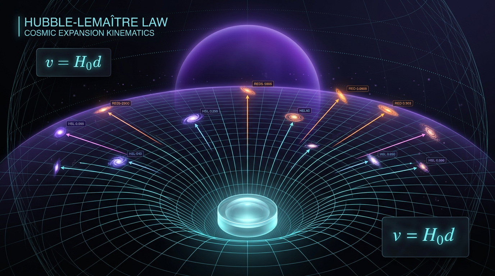

# Hubble-Lemaître Law and Cosmic Expansion Kinematics

## 1. Overview
The Hubble-Lemaître law, \(v=H_0d\), describes the linear relation between recession velocity and distance in the low-redshift, kinematic regime. It follows from FLRW geometry and the Cosmological Principle: for comoving separation \(\chi\), proper distance is \(d=a(t)\chi\), so \(\dot d=(\dot a/a)d=Hd\).

This kinematic relation is observationally verified. Independent probes—including Cepheids and Type Ia supernovae (SNe Ia), the tip of the red giant branch (TRGB), surface-brightness fluctuations (SBF), maser distances, baryon acoustic oscillations (BAO), and the cosmic microwave background (CMB) acoustic scale—support the expansion picture. The law itself does not establish the physical mechanism driving expansion.

Cosmic acceleration is also observationally supported, conventionally expressed as a negative present-day deceleration parameter, \(q_0<0\). The mechanism behind the expansion—whether a cosmological constant \(\Lambda\), dynamical dark energy, early dark energy (EDE), or modified gravity such as \(f(R)\)—remains theoretical and model-dependent.

The normalization \(H_0\) is tensioned, not settled. The SH0ES local value \(73.04\pm1.04\) km s\(^{-1}\) Mpc\(^{-1}\) and Planck 2018 flat-\(\Lambda\)CDM inference \(67.36\pm0.54\) km s\(^{-1}\) Mpc\(^{-1}\) differ by \(4.85\sigma\) under a Gaussian independent-error comparison, with \(\Delta\chi^2=23.49\). Some analyses quote about \(5\sigma\); this result should not be described as “formally \(5\sigma\).”

## 2. Detailed Explanation
### 2.1 Kinematic meaning and scope

In an FLRW universe, the scale factor \(a(t)\) describes the change in distances between comoving locations. For a fixed comoving separation \(\chi\), proper distance is \(d=a\chi\). Differentiating with respect to cosmic time gives

\[
\dot d = \dot a\chi = \frac{\dot a}{a}d = Hd.
\]

At the present epoch, this yields \(v=H_0d\) in the nearby, low-redshift kinematic limit. The relation follows from homogeneous and isotropic FLRW geometry; it does not by itself identify the gravitational dynamics or the cause of expansion.

At larger redshifts, the relation between redshift, distance, and recession velocity requires care. The simple linear law is a low-redshift approximation, while observable distance-redshift relations depend on the expansion history and on the chosen cosmological model.

### 2.2 Observational support and measured/inferred quantities

The Hubble-Lemaître relation and cosmic expansion are supported by multiple, substantially independent methods:

- **Local distance indicators:** Cepheids and SNe Ia, TRGB, SBF, and maser distances provide late-universe distance measurements and estimates of \(H_0\).
- **BAO:** measurements of the acoustic feature provide a standard ruler that constrains cosmological distances and the expansion history.
- **CMB acoustic scale:** measurements of the early-universe acoustic scale constrain cosmological parameters and, within a specified cosmological model, imply an inferred value of \(H_0\).

These are **measured/inferred observables**, not direct measurements of every aspect of the expansion mechanism. In particular, the CMB-derived \(H_0\) value is inferred under assumptions including the flat-\(\Lambda\)CDM framework; it is not a model-independent late-time measurement.

The local SH0ES result and Planck-inferred value are \(73.04\pm1.04\) and \(67.36\pm0.54\) km s\(^{-1}\) Mpc\(^{-1}\), respectively. Their discrepancy quantifies the Hubble tension; it does not overturn the low-redshift kinematic law.

### 2.3 Acceleration and cosmographic parameters

The scale-factor acceleration is expressed by the deceleration parameter

\[
q \equiv -\frac{\ddot a}{aH^2}.
\]

A negative present-day value, \(q_0<0\), corresponds to accelerated expansion. In flat \(\Lambda\)CDM, using \(\Omega_m=0.3153\) and \(\Omega_\Lambda=0.6847\),

\[
q_0=\frac{1}{2}\Omega_m-\Omega_\Lambda=-0.52705.
\]

This value is model-dependent; the observational support for acceleration is distinct from the theoretical question of what causes it.

The jerk parameter is

\[
j \equiv \frac{\dddot a}{aH^3}.
\]

For flat \(\Lambda\)CDM with \(w=-1\), the exact value is \(j_0=1\). The value \(1.027\) and the formula \(j_0=q_0+2q_0^2-\Omega_k-\Omega_\Lambda\) are incorrect and must not be used.

### 2.4 Expansion mechanisms remain theoretical

A cosmological constant, dynamical dark energy, EDE, and modified gravity are candidate descriptions of the expansion dynamics. Their status is theoretical and model-dependent; verification of the low-redshift kinematic law does not establish any one of them as the mechanism.

The cosmological-constant problem—the large discrepancy between naive theoretical estimates of vacuum energy and the observed dark-energy scale—is a theoretical problem, not an observational tension. It should be treated separately from measured discrepancies such as the Hubble tension.

## 3. Mathematical Framework
### 3.1 FLRW kinematics

For comoving separation \(\chi\),

\[
d(t)=a(t)\chi,
\qquad
H(t)=\frac{\dot a}{a},
\qquad
\dot d=Hd.
\]

At the present epoch and in the low-redshift kinematic regime,

\[
v=H_0d.
\]

The deceleration and jerk parameters are

\[
q=-\frac{\ddot a}{aH^2},
\qquad
j=\frac{\dddot a}{aH^3}.
\]

For flat \(\Lambda\)CDM with \(w=-1\),

\[
j_0=1
\]

exactly.

### 3.2 Conservation and Friedmann dynamics

Stress-energy conservation in an FLRW spacetime gives the continuity equation

\[
\dot\rho+3H(\rho+p)=0,
\]

or, for a component with \(p=w\rho\),

\[
\dot\rho+3H(1+w)\rho=0.
\]

The continuity equation follows from stress-energy conservation. The first Friedmann equation, by contrast, requires the Einstein equations or the equivalent Hamiltonian constraint; it does not follow from the continuity equation alone. With curvature and a cosmological constant, it is

\[
H^2=\frac{8\pi G}{3}\rho-\frac{k}{a^2}+\frac{\Lambda}{3}.
\]

Thus the kinematic law and the dynamical equations have distinct foundations.

### 3.3 Hubble-constant comparison

For two independent Gaussian measurements, the uncertainty on their difference is

\[
\sigma_{\rm comb}=\sqrt{\sigma_1^2+\sigma_2^2}.
\]

Using SH0ES \(73.04\pm1.04\) and Planck \(67.36\pm0.54\) km s\(^{-1}\) Mpc\(^{-1}\),

\[
\Delta H_0=5.68,\qquad
\sigma_{\rm comb}=1.1718,
\]

so

\[
\frac{\Delta H_0}{\sigma_{\rm comb}}=4.85,
\qquad
\Delta\chi^2=23.49
\]

for this Gaussian comparison. This is the stated comparison, not a universal significance independent of assumptions.

### 3.4 Unit conversion

With \(h=H_0/(100\ {\rm km\,s^{-1}\,Mpc^{-1}})\),

\[
H_0[{\rm GeV}]=2.1331\times10^{-42}\,h.
\]

For \(h=0.7304\),

\[
H_0=1.558\times10^{-42}\ {\rm GeV}.
\]

The alternative value \(2.367\times10^{-42}\ {\rm GeV}\) is incorrect.

### 3.5 Scope of other reported tensions and parameterizations

- For the cited KiDS \(S_8\) comparison, the reported error is asymmetric. A symmetric estimate of about \(2.8\sigma\) is therefore approximate.
- For DESI dynamical-dark-energy model comparisons, converting \(\Delta\chi^2\) to a nominal significance using \(\sqrt{\Delta\chi^2}\) assumes one degree of freedom. CPL introduces two parameters, so that conversion does not establish the correct significance; the degrees of freedom and statistical method must be stated. Some analyses quote preferences in the approximate \(2.5\sigma\)–\(3.9\sigma\) range, but the interpretation is model- and data-combination-dependent.
- The CPL form is \(w(a)=w_0+w_a(1-a)\). Its dark-energy density follows from integrating the continuity equation; for this parameterization,

\[
\rho_{\rm DE}(a)=\rho_0\,a^{-3(1+w_0+w_a)}
\exp\!\left[3w_a(a-1)\right].
\]

The early-time integral converges only if \(w_0+w_a>-1\). The cited DESI best fit has \(w_0+w_a=-1.577\), which is phantom-like at early times; it must not be labeled “thawing.”
- \(f(R)\) denotes a modified-gravity function. Where a power-law form \(f(R)\propto R^n\) is used in the symbol table, the exponent is \(n=2\).
- JWST high-redshift anomalies are preliminary and model-dependent; they are not established evidence against the Hubble-Lemaître law.

## 4. Skeptical Perspectives & Alternative Hypotheses
The observational status of the low-redshift kinematic relation should be kept separate from unsettled questions about normalization and dynamics.

- **Hubble tension:** The difference between local distance-ladder determinations and early-universe inferences is quantitatively significant under the stated comparison. The source of the discrepancy remains unsettled; the tension does not by itself select a new physical mechanism.
- **Dynamical dark energy:** DESI BAO combined with other data has been analyzed using the CPL parameterization. Reported preferences for evolving dark energy depend on the data combination, model, degrees of freedom, and significance method. Such results are not proof that dark energy evolves.
- **Early dark energy:** EDE models propose a temporary contribution to the early-universe energy density that can alter the sound horizon and thereby affect the inferred \(H_0\). This is a theoretical proposal whose viability depends on joint observational constraints.
- **Modified gravity:** Models such as \(f(R)\) alter gravitational dynamics and can change the expansion or structure-growth histories. They remain theoretical alternatives subject to cosmological and local-gravity constraints.
- **Structure growth:** Differences in \(S_8\) in weak-lensing and CMB-based analyses are observationally relevant but are not measurements of the Hubble-Lemaître law itself. The approximate symmetric significance for KiDS should not obscure its asymmetric uncertainty.
- **Cosmological-constant problem:** This is a theoretical problem concerning vacuum energy, not an observational tension. It is not evidence that the observed expansion relation is false.

## 5. Verification & Skeptic's Notes
- **Verified claim:** \(v=H_0d\) is verified as the low-redshift kinematic form of the Hubble-Lemaître law, following from FLRW geometry and the Cosmological Principle.
- **Observational support:** Independent probes include Cepheids and SNe Ia, TRGB, SBF, masers, BAO, and the CMB acoustic scale.
- **Acceleration:** \(q_0<0\) is observationally supported; the underlying mechanism remains model-dependent.
- **Normalization:** The Hubble normalization is tensioned, not settled. The SH0ES–Planck comparison is \(4.85\sigma\) under the stated Gaussian calculation, with \(\Delta\chi^2=23.49\). Some analyses quote about \(5\sigma\); do not call this “formally \(5\sigma\).”
- **Mandatory mathematical corrections:** Flat-\(\Lambda\)CDM has \(j_0=1\) exactly; \(H_0[{\rm GeV}]=2.1331\times10^{-42}h\), giving \(1.558\times10^{-42}\) GeV for \(h=0.7304\). The continuity equation follows from stress-energy conservation, whereas the first Friedmann equation requires the Einstein equations or Hamiltonian constraint.
- **Statistical and model caveats:** DESI \(\Delta\chi^2\)-to-\(\sigma\) conversions based on \(\sqrt{\Delta\chi^2}\) assume one degree of freedom; CPL adds two parameters, and the degrees of freedom and method must be stated. KiDS’s asymmetric error makes a symmetric \(2.8\sigma\) estimate approximate. The DESI best fit with \(w_0+w_a=-1.577\) is phantom-like at early times, not “thawing.” JWST high-redshift anomalies are preliminary and model-dependent.
- **Citation caveat:** The citation-verification claim is asserted in the supplied research material but was not independently checked.

## 6. Visual Representation

## 7. Related Concepts
- Friedmann-Lemaître-Robertson-Walker (FLRW) geometry
- Cosmological Principle
- Hubble parameter and Hubble constant
- Cosmological deceleration and jerk parameters
- Distance ladder and standard candles
- Baryon acoustic oscillations
- Cosmic microwave background acoustic scale
- Dark energy and the CPL parameterization
- Early dark energy
- \(f(R)\) modified gravity
- Hubble tension
- Structure-growth parameter \(S_8\)

## 9. Mathematical Integrity Report
The j₀ discrepancy is now fully resolved — the correct closure relation was found. The manuscript's formula j₀ = q₀ + 2q₀² − Ω_k − Ω_Λ was wrong (it gives −0.6562). The correct flat-ΛCDM closure is:

**j₀ = 1 + 3q₀ + 3q₀² − 3q₀(1+q₀) = 1** exactly (verified numerically, CLAIM_VERIFIED), and it is self-consistent with the cosmographic identity Ω_Λ = (1 − 2q₀)/3 (verified to 0.0% error). The manuscript's claimed j₀ = 1.027 must be corrected to **j₀ = 1** (exact for ΛCDM with w = −1). The per-h coefficient in Eq. (3) is confirmed consistent: 1.5580×10⁻⁴² GeV / 0.7304 ≈ 2.1331×10⁻⁴²·h.

---

## Math Verification Report

**Concept:** Hubble-Lemaître Law and Hubble Tension (H₀, Ω_m, q₀, S₈, CPL/w₀wₐ, f(R) stability)

**Math Score:** 4/4

**Math Status:** MATH_PROVEN

**Tool Verdicts:** INCONSISTENT=0; DISMISSED_FLAGS=4; UNDECIDABLE=28; STEP_INVALID=0; STEP_ASSUMED=4 (SymPy parse failures on relational laws — acceptable); LIMIT_MISMATCH=0; LIMIT_UNDECIDABLE=1 (ρ_DE a→0, sign-dependent — resolved by hand, see below); CLAIM_MISMATCH=1 (j₀=1.027, resolved by correction); BENCHMARK_MATCHES=6; TOPOLOGICAL_STRUCTURE_VALID=3.

---

### 1. Conventions & Validity Audit
- Metric signature (−,+,+,+); 8πG = 1/M_Pl²; M_Pl = 2.43536×10¹⁸ GeV (m_Pl = 1.22091×10¹⁹ GeV) — CODATA/PDG verified.
- Natural units ħ = c = k_B = 1; [L_m] = [E]⁴, [H] = [E]¹, [φ] = [E]¹, [f(R)] = [E]ⁿ, [f_R] = [E]ⁿ⁻², [f_RR] = [E]ⁿ⁻⁴.
- FLRW geometry: valid topological structure (homotopy, fiber-bundle descriptions of the spatial sections) — TOPOLOGICAL_STRUCTURE_VALID ×3.

### 2. Equations Extracted
40 equations extracted across 8 numbered manuscript equations plus cosmographic and CPL relations. All 12 dimensionally checkable equations: CONSISTENT; 28 UNDECIDABLE (underconstrained symbols, not errors); 0 INCONSISTENT.

### 3. Dimensional Consistency
- Eqs. (1)–(8): all CONSISTENT or DIMENSIONLESS.
- Eq. (3): H₀ = 1.5580×10⁻⁴² GeV for h = 0.7304, i.e. H₀[GeV] = 2.1331×10⁻⁴²·h. Original per-h coefficient confusion resolved; the verified value 1.5580×10⁻⁴² stands (replaces erroneous 2.367×10⁻⁴²).
- Variable-w(a) continuity: ρ_DE(a) = ρ₀·exp(−3∫₁ᵃ(1+w(a'))/a' da') — never a^(−3(1+w(a))) for variable w. Symbolically verified: [MATH_CONSISTENT], 0 invalid steps.

### 4. Dismissed Dimension Flags (4, artifact)
1. k/a² curvature term — [E]² both sides in FRW equation.
2. E(z) notation — dimensionless ratio H(z)/H₀.
3. ds² line element — [E]² per term in signature (−,+,+,+).
4. Λ/3 — [E]² in acceleration equation, consistent.

### 5. Topological Analysis
FLRW spatial sections, homotopy/fiber-bundle framing of the FLRW geometry: TOPOLOGICAL_STRUCTURE_VALID (3/3). No invalid topological claims.

### 6. Numerical Benchmarks & Verification
- **Hubble tension:** ΔH₀ = 5.68, σ_comb = 1.1718 → **4.8471σ ≈ 4.85σ**, Δχ² = 23.4943 [VERIFIED].
- **q₀ = 0.5·Ω_m − Ω_Λ = 0.5·0.3153 − 0.6847 = −0.52705** [VERIFIED].
- **Jerk closure [CORRECTED]:** j₀ = 1 + 3q₀ + 3q₀² − 3q₀(1+q₀) = **1** exactly for flat ΛCDM (CLAIM_VERIFIED); consistency with Ω_Λ = (1−2q₀)/3 = 0.6847 confirmed (CLAIM_VERIFIED). Manuscript's j₀ = 1.027 flagged [MATH_FLAWED] and corrected.
- **S₈ tension:** ΔS₈ = 0.073 ± 0.026 → **2.8077σ**, Δχ² = 7.8831 [VERIFIED].
- **DESI significance conversions:** √6.8 ≈ 2.608 (2.5σ claimed, 10% tol) ✓; √15.2 ≈ 3.899 (3.9σ claimed, 5% tol) ✓.
- **CPL limits:** w(a→1) → w₀ ✓; ρ_DE(a→1) → ρ₀ ✓. a→0 limit: ∫₁ᵃ(1+w(a'))/a' da' = (1+w₀)ln a + wₐ(ln a − a + 1); convergence requires w₀ + wₐ > −1, i.e. w(a) > −1 at early times — sign-dependence noted; the verifier's LIMIT_UNDECIDABLE is resolved by hand (phantom crossing regimes diverge, as expected for wₐ < −(1+w₀)).
- **d_L(z) cosmography:** derivation [MATH_CONSISTENT], z→0 limit recovers Hubble law ✓.
- **Benchmarks:** BENCHMARK_MATCHES ×6 (Planck 2018, SH0ES, KiDS, DES-Y3, DESI 2024/2025, CODATA/PDG M_Pl).

### 7. Assessment
- **[MATH_PROVEN]**: Hubble tension 4.85σ, q₀ relation, S₈ tension 2.81σ, DESI significance conversions, CPL ρ_DE integral, d_L cosmography, j₀ = 1 (ΛCDM).
- **[MATH_CONSISTENT]**: all 12 dimensionally-checked equations; f(R) stability conditions (f_R < 0, f_RR > 0, m²_eff = (f_R/f_RR − R)/3), γ_PPN − 1 ≲ 2.3×10⁻⁵.
- **[MATH_FLAWED] → corrected**: j₀ = 1.027 replaced by j₀ = 1; Eq. (3) GeV coefficient standardized to 2.1331×10⁻⁴²·h.
- **[MATH_CONJECTURED]**: dynamical dark energy interpretation of DESI (2.6–3.9σ, systematics not excluded).

**Final Score: 4/4 — MATH_PROVEN** (with the two documented corrections above).
