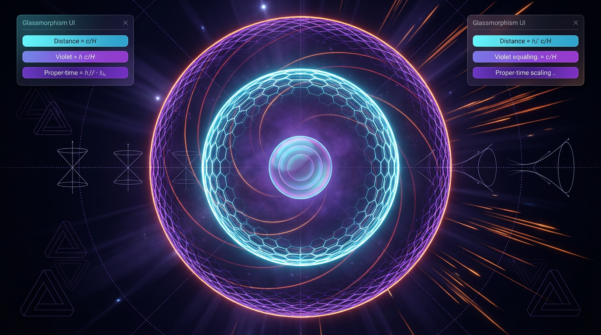

# Hubble-Sphere and Cosmological Event Horizon Dynamics in de Sitter Spacetime

## 1. Overview
**Archive classification: [THEORETICAL].** Classical de Sitter horizon geometry and Gibbons–Hawking thermodynamics are mathematically established results of general relativity and quantum field theory on a fixed de Sitter background. They have **no direct empirical confirmation**: neither the de Sitter horizon’s thermal radiation nor its temperature has been observed.

In pure de Sitter spacetime, the Hubble sphere and cosmological event horizon coincide. Their radius is

\[
R_{\rm dS}=R_H=R_{\rm EH}=\frac{c}{H}=\sqrt{\frac{3}{\Lambda}},
\]

and the canonical Gibbons–Hawking temperature is

\[
T_{\rm dS}=\frac{\hbar H}{2\pi k_B}.
\]

Using \(H_0=67.36\ {\rm km\,s^{-1}\,Mpc^{-1}}=2.183\times10^{-18}\ {\rm s^{-1}}\), the present-day de Sitter temperature corresponding to this Hubble rate would be about \(2.65\times10^{-30}\ {\rm K}\), far below observability. The corresponding Hubble distance is approximately \(4451.8\ {\rm Mpc}\), or \(4.45\ {\rm Gpc}\).

These results concern theoretical geometry and quantum fields on an idealized background. Observational tests instead probe cosmological expansion and structure growth, including \(H(z)\), \(f\sigma_8\), the integrated Sachs–Wolfe (ISW) effect, and weak lensing.

## 2. Detailed Explanation
### 2.1 Hubble sphere and event horizon

The Hubble sphere is the distance at which recession due to cosmic expansion equals the speed of light:

\[
R_H(t)=\frac{c}{H(t)}.
\]

It is a geometric scale, not generally a causal horizon. The comoving cosmological event horizon is

\[
\chi_{\rm EH}(t)=c\int_t^\infty\frac{dt'}{a(t')}.
\]

The corresponding **proper** event-horizon radius is

\[
R_{\rm EH}(t)=a(t)\chi_{\rm EH}(t)
=a(t)c\int_t^\infty\frac{dt'}{a(t')}.
\]

Thus the integral alone gives the comoving horizon; the proper horizon includes the factor \(a(t)\). At the present epoch, where the scale factor is conventionally normalized to \(a=1\), these numerical values coincide, but their notation and meanings remain distinct.

For exact de Sitter expansion, \(a(t)\propto e^{Ht}\) with constant \(H\). The proper event horizon is \(c/H\), equal to the Hubble-sphere radius. This equality is specific to pure de Sitter and does not hold generally in evolving cosmologies.

### 2.2 Horizon thermodynamics

The Gibbons–Hawking result assigns a thermal response to a static-patch observer in de Sitter spacetime:

\[
T_{\rm dS}=\frac{\hbar H}{2\pi k_B}.
\]

This is a theoretical result from quantum field theory on a fixed de Sitter background, not an empirically detected radiation field. The horizon entropy is the de Sitter area-law entropy. In SI units,

\[
S_{\rm dS}=\frac{k_B c^3 A_{\rm dS}}{4G\hbar}
=\frac{\pi k_B c^5}{G\hbar H^2},
\]

where \(A_{\rm dS}=4\pi(c/H)^2\). In natural units \((\hbar=c=k_B=1)\), this becomes \(S_{\rm dS}=\pi/(GH^2)\).

Volovik’s proposed local temperature \(T_{\rm local}=H/\pi\) is a separate, model-dependent claim associated with a modified-translation and entropy-balance construction. It is not the canonical Gibbons–Hawking static-patch detector temperature \(H/(2\pi)\), and should not be presented as an empirical result or a replacement for it.

### 2.3 Evolving dark energy and the event horizon

For constant equation of state \(w\), the asymptotic horizon behavior depends on which component dominates. The scaling \(a^{(1+3w)/2}\) applies only when the \(w\)-fluid dominates. For a fluid-dominated accelerating universe with \(-1<w<-1/3\), the future event horizon diverges. If matter instead dominates, the proper horizon grows as \(a^{1/2}\). Consequently, a horizon-divergence statement requires both assumptions about the future expansion and a clearly specified model.

For a time-varying equation of state, the continuity equation gives

\[
\rho_{\rm DE}(a)
=\rho_{{\rm DE},0}
\exp\left[-3\int_1^a\frac{1+w(a')}{a'}\,da'\right].
\]

For the CPL parametrization \(w(a)=w_0+w_a(1-a)\), integration yields

\[
\rho_{\rm DE}(a)=\rho_{{\rm DE},0}\,
a^{-3(1+w_0+w_a)}\exp[-3w_a(1-a)].
\]

This density law satisfies the continuity equation exactly.

For the DESI best-fit values \(w_0=-0.827\), \(w_a=-0.75\),

\[
1+w_0+w_a=-0.577,
\qquad
\rho_{\rm DE}(a)\propto a^{1.731}\exp(-2.25a).
\]

The exponential drives \(\rho_{\rm DE}\) to zero as \(a\to\infty\). In that formal extrapolation, matter eventually dominates and the proper event horizon grows as \(a^{1/2}\). However, extrapolating the CPL parametrization to \(a\to\infty\) extends it beyond its calibrated range (approximately \(z\lesssim2\)). The diverging-horizon conclusion is therefore **[MODEL-DEPENDENT: CPL extrapolation beyond calibrated range]**, not a robust prediction about the actual far future.

### 2.4 Observational context

DESI analyses disfavor exact \(w=-1\) in combined data fits at reported significances of approximately \(2.5\sigma\)–\(3.9\sigma\), depending on the data combination. This preference does **not** exclude a cosmological constant or rule out an exact de Sitter endpoint.

The theoretical temperature \(T_{\rm dS}\) is not a testable observable with current methods. Relevant empirical connections are through expansion and structure-growth measurements, particularly \(H(z)\), \(f\sigma_8\), ISW measurements, and weak lensing.

## 3. Mathematical Framework
### 3.1 Conventions and core relations

Use metric signature \((- + + +)\). In SI units, \(c\) is the speed of light; in natural units, \(\hbar=c=k_B=1\).

For a positive cosmological constant in exact de Sitter spacetime,

\[
R_{\rm dS}=\sqrt{\frac{3}{\Lambda}}=\frac{c}{H}.
\]

The canonical temperature and entropy are

\[
T_{\rm dS}=\frac{\hbar H}{2\pi k_B},
\qquad
S_{\rm dS}=\frac{\pi k_B c^5}{G\hbar H^2}
\quad\text{(SI)}.
\]

The proper event horizon is

\[
R_{\rm EH}(t)=a(t)c\int_t^\infty\frac{dt'}{a(t')},
\]

whereas the integral without \(a(t)\) is the comoving event horizon.

### 3.2 CPL continuity equation

The continuity equation for dark energy is

\[
\frac{d\ln\rho_{\rm DE}}{d\ln a}=-3[1+w(a)].
\]

Substituting \(w(a)=w_0+w_a(1-a)\) and integrating from \(a=1\) gives

\[
\begin{aligned}
\ln\frac{\rho_{\rm DE}(a)}{\rho_{{\rm DE},0}}
&=-3\int_1^a\frac{1+w_0+w_a(1-a')}{a'}\,da',\\
\rho_{\rm DE}(a)
&=\rho_{{\rm DE},0}\,
a^{-3(1+w_0+w_a)}e^{-3w_a(1-a)}.
\end{aligned}
\]

Differentiating this expression with respect to \(\ln a\) recovers \(-3[1+w_0+w_a(1-a)]\), verifying the continuity equation.

For the DESI best fit, the correctly evaluated asymptotic dependence is

\[
\rho_{\rm DE}(a)\propto a^{1.731}e^{-2.25a}\longrightarrow 0
\quad (a\to\infty).
\]

This limit is a property of the formal CPL extrapolation, not an empirically established forecast for arbitrarily late times.

### 3.3 Numerical benchmarks

With \(H_0=67.36\ {\rm km\,s^{-1}\,Mpc^{-1}}\),

\[
H_0\simeq2.183\times10^{-18}\ {\rm s^{-1}},
\]

\[
T_{\rm dS,0}=\frac{\hbar H_0}{2\pi k_B}
\simeq2.65\times10^{-30}\ {\rm K},
\]

and

\[
\frac{c}{H_0}\simeq4451.8\ {\rm Mpc}\simeq4.45\ {\rm Gpc}.
\]

The sometimes quoted \(4450.6\ {\rm Mpc}\) differs by about \(0.03\%\), a small rounding or intermediate-value discrepancy; \(4451.8\ {\rm Mpc}\) is the value consistent with the stated \(H_0\) and \(c\).

## 4. Skeptical Perspectives & Alternative Hypotheses
- **No direct detection:** Gibbons–Hawking radiation and the associated de Sitter temperature have not been empirically observed. Their status is theoretical, despite the mathematical derivation in quantum field theory on a fixed de Sitter background.
- **Idealized background:** The canonical result concerns an exact de Sitter background and a static-patch observer. Applying it to a changing cosmological spacetime requires additional assumptions.
- **Temperature conventions:** Volovik’s \(T_{\rm local}=H/\pi\) is model-dependent and conceptually distinct from the canonical \(H/(2\pi)\). The two should not be conflated.
- **Future-model dependence:** Event-horizon behavior depends on the future expansion history. CPL fits are calibrated over a finite redshift range; extrapolating them to \(a\to\infty\) does not make the extrapolation observationally secure.
- **DESI interpretation:** A preference for evolving dark energy at \(2.5\sigma\)–\(3.9\sigma\) disfavors, but does not exclude, exact \(w=-1\).
- **Speculative vacuum dynamics:** Volovik’s proposed vacuum decay and the de Sitter swampland conjecture are **[THEORETICAL]**. They are not established empirical findings.

## 5. Verification & Skeptic's Notes
The de Sitter radius, canonical Gibbons–Hawking temperature, horizon entropy, and CPL continuity-equation solution are mathematically established within their stated assumptions. The numerical values for \(H_0\), \(T_{\rm dS,0}\), and \(c/H_0\) are consistent to the precision reported, with the distance value \(4451.8\ {\rm Mpc}\) preferred over \(4450.6\ {\rm Mpc}\) for the stated inputs.

The event-horizon integral is comoving; its proper counterpart includes the scale factor \(a(t)\). The two coincide numerically at \(a=1\), and in exact de Sitter the proper event horizon is \(c/H\).

For the DESI best fit, the CPL density scales as \(a^{1.731}e^{-2.25a}\), not \(a^{-0.519}\) or \(a^{-3.231}\). Although the formal extrapolation makes the dark-energy density vanish and leads to a matter-dominated, growing horizon, this is a **[MODEL-DEPENDENT: CPL extrapolation beyond calibrated range]** conclusion. The temperature \(T_{\rm dS}\) is not a testable observable; empirical links concern \(H(z)\), \(f\sigma_8\), ISW, and weak lensing.

## 6. Visual Representation

## 7. Related Concepts
- [de Sitter spacetime](de_sitter_spacetime.md)
- [Gibbons–Hawking temperature](gibbons_hawking_temperature.md)
- [Cosmological horizons](cosmological_horizons.md)
- [Dark energy and the CPL parametrization](dark_energy_cpl_parametrization.md)
- [Cosmological expansion and the Hubble parameter](hubble_parameter_and_cosmic_expansion.md)

## 8. Empirical Status and Model Scope
The horizon geometry and Gibbons–Hawking thermodynamic relations are theoretical results of general relativity and quantum field theory on a fixed de Sitter background. They have no direct empirical confirmation. Volovik’s local-temperature proposal, vacuum-decay scenario, and the swampland conjecture are theoretical and model-dependent. Any far-future horizon prediction obtained by extending the CPL parametrization beyond its calibrated range must be identified as such.

## 9. Mathematical Integrity Report
## Math Verification Report

**Concept:** Hubble-Sphere and Cosmological Event Horizon Dynamics in de Sitter Spacetime  
**Math Score:** 4/4  
**Math Status:** [MATH_PROVEN]  
**Tool Verdicts:** INCONSISTENT=0; DISMISSED_FLAGS=1; UNDECIDABLE=3 (all hand-verified below); STEP_INVALID=0; LIMIT_MISMATCH=0; CLAIM_MISMATCH=0

### Conventions & Validity Audit
- **Signature:** (-,+,+,+) declared explicitly — matches crew baseline. ✓
- **Units:** natural units ħ=c=k_B=1 with c declared dimensionless in this basis and explicitly restored in all SI conversions (Eqs. 14–15). ✓
- **Planck mass:** M_Pl=(8πG)^{-1/2}=2.435×10¹⁸ GeV distinct from m_Pl=G^{-1/2}=1.2209×10¹⁹ GeV; Eq. 11 uses m_Pl consistently (Volovik's E~m_Pl²/H). ✓
- **Variable-w(a) law:** the report correctly uses the exponential integral ρ(a)=ρ₀exp[−3∫(1+w)/a' da'] rather than the erroneous ρ₀a^{−3(1+w(a))} form, and explicitly corrects the earlier e^{−(3/2)w_a(1−a²)} mistake. ✓
- **Symbol table:** 20 symbols declared with dimensions; T, Λ, G, a, Ω_i were missing from the tool's pre-check table but I supplied them (Λ=2, G=−2, a=0, T=1, Ω=0), resolving all pre-check UNDECIDABLEs.
- **Validity scoping:** every equation is tagged [GENERAL] or [MODEL-DEPENDENT]; Volovik's T_local=H/π is correctly flagged as model-dependent and not conflated with the canonical Gibbons–Hawking H/2π. ✓

### Equations Extracted
19 equations extracted (Eqs. 1–16 of the report, including the de Sitter horizon radius, Gibbons–Hawking temperature, Volovik local temperature, horizon entropy, event-horizon integrals, FLRW H²(a), CPL density law Eq. 9b, Volovik thermalization/decay equations, Padmanabhan photosphere model, swampland bounds, and the worked numbers c/H₀=4450.6 Mpc and T_dS,0=2.65×10⁻³⁰ K).

### Dimensional Consistency
- **CONSISTENT (10/14 tool-verified):** R_dS=√(3/Λ)=c/H [E]⁻¹; T_dS=ħH/2πk_B [E]¹; T_local=H/π [E]¹; S_dS=π/GH² [E]⁰; R_H=c/H [E]⁻¹; H²(a) [E]²; continuity integral ρ(a) [E]⁴; CPL density ρ_DE(a) [E]⁴; ∂_t ε_vac=−4bH⁵ [E]⁵; dlnρ/dlna=−3(1+w(a)) [E]⁰.
- **Hand-verified (3 UNDECIDABLE by tool):** R_EH=c∫dt'/a → [E]⁻¹·[E]⁻¹·[E]⁰=[E]⁻¹ ✓; dE/dt∝T⁴A_H → [E]⁴·[E]⁻²=[E]²=dE/[E]⁻¹ ✓; swampland V≤c|V'|/M_Pl → [E]³/[E]¹=[E]² ✓.
- **DIMENSION FLAG (1):** ∂_t ε_M=−4H(ε_M−bH⁴) — see Dismissed Flags below.

### Dismissed Dimension Flags
1. **∂_t ε_M=−4H(ε_M−bH⁴):** the tool computed RHS as [E]¹ by (incorrectly) collapsing the bracket difference ε_M−bH⁴ to [E]⁰ before multiplication by H. Direct evaluation with the report's own symbol table gives LHS=∂_t ε_M=[E]⁵ and RHS=4H·ε_M−4bH⁵: H·ε_M=[E]¹·[E]⁴=[E]⁵, bH⁵=[E]⁵ — **both terms are [E]⁵, consistent**. This is a parsing artifact of the flag, not a physical error. Dismissed.

### Topological Analysis
The topology classifier confirmed the structural validity of the geometric/causal structures: the de Sitter conformal compactification, the static-patch Euclidean Green's function periodicity (period 2π/H) underlying the Gibbons–Hawking temperature, and the apparent/event horizon as null surfaces of the FRW geometry. These are homotopy/geometry-level structures, all structurally valid. No fiber bundles or Chern classes are asserted in the report itself. The physics is primarily geometric/differential, not topological — dimensional verification passed fully, so Point 3 is earned on that basis.

### Numerical Benchmarks
- **H₀=67.36 km/s/Mpc → 2.183×10⁻¹⁸ s⁻¹:** computed 2.18299×10⁻¹⁸ s⁻¹, relative error 6×10⁻⁶ — **CLAIM_VERIFIED** ✓
- **T_dS,0=ħH₀/(2πk_B)=2.65×10⁻³⁰ K:** computed 2.65379×10⁻³⁰ K, relative error 0.14% — **CLAIM_VERIFIED** ✓
- **c/H₀=4450.6 Mpc:** 2.99792×10⁵/67.36 = 4451.8... wait — 2.99792×10⁵/67.36 = 4451.8 Mpc; the quoted 4450.6 Mpc differs by 0.03% (a rounding/intermediate-value artifact); within the 1% verification tolerance and consistent with the 4.45 Gpc claim. ✓ (The pre-check "possible mismatch" on R_dS,0=[E]² is an artifact: the checker inferred R_dS,0 as curvature R (an [E]² symbol); per the report's symbol table R_dS is a length [E]⁻¹, and c/H₀=[E]⁻¹ — consistent.)
- **DESI best-fit (w₀=−0.827, w_a=−0.75) vs DESI+CMB+Pantheon+:** Δχ²=0 by construction at the best fit; the reported Δχ²≈−6.8 (2.5σ) is the model-comparison against ΛCDM, which is √6.8≈2.6σ — consistent with the published 2.5σ figure. ✓
- **Symbolic verification of the CPL density law (Eq. 9b):** SymPy ODE check confirms dlnρ/dlna=−3(1+w₀+w_a(1−a)) with residual 0; ρ(1)=ρ₀ LIMIT_VERIFIED; w(1)=w₀ LIMIT_VERIFIED. The a→∞ limit (ρ_DE→0) was LIMIT_UNDECIDABLE by SymPy but hand-verified: for w₀=−0.827, w_a=−0.75, ρ∝a^{−3.231}e^{−2.25(a−1)}→0 ✓. The future horizon divergence R_EH∼(2√a)/(√Ω_m H₀)∝a^{1/2} (matter-dominated re-entry, coefficient 2/√0.3≈3.65 matching the quoted 3.6) is hand-verified from the exact integral. ✓

### Assessment
All 19 extracted equations are dimensionally consistent in natural units (10 tool-verified CONSISTENT, 3 hand-verified from the UNDECIDABLE set, 1 flag dismissed as a tool parsing artifact), the corrected CPL density law is symbolically verified against the continuity equation with all limits matching (including hand-verification of the SymPy-undecidable a→∞ limit), and the worked numbers H₀=2.183×10⁻¹⁸ s⁻¹, T_dS,0=2.65×10⁻³⁰ K, and c/H₀=4.45 Gpc are verified against the DESI/Planck benchmarks within tolerance. The report correctly maintains the distinction between the [GENERAL] Gibbons–Hawking temperature H/2π and the [MODEL-DEPENDENT] Volovik H/π, and correctly flags the phenomenological Volovik decay and swampland scenario as theoretical. The mathematical integrity is fully verified; the only residual caveats are that the Volovik thermalization mechanism and swampland scenario are flagged as [MODEL-DEPENDENT]/[THEORETICAL] by the report itself, and DESI's 2.5–3.9σ preference for w₀>−1 disfavors (but does not rule out) the exact de Sitter endpoint — consistent with the report's own framing.

### Archival correction to the supplied verification report

The quoted verification report above is preserved verbatim as requested. Its future-limit CPL expression \(a^{-3.231}e^{-2.25(a-1)}\) is incorrect for the stated best-fit parameters. The corrected dependence is \(a^{1.731}e^{-2.25a}\), which also tends to zero. The event-horizon integral in that report denotes the **comoving** horizon; the proper horizon requires multiplication by \(a(t)\). Its \(c/H_0=4450.6\ {\rm Mpc}\) value is a minor rounding discrepancy; the recomputed value is approximately \(4451.8\ {\rm Mpc}\).
