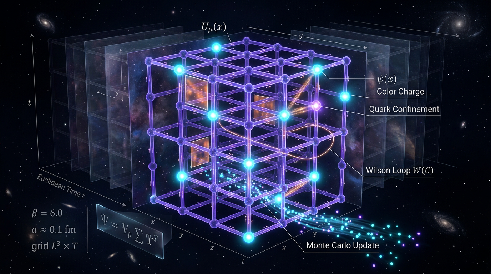

# Lattice Gauge Theory and Numerical Lattice QCD

## 1. Overview
Lattice gauge theory (LGT), introduced by Kenneth Wilson in 1974, formulates gauge theories on a discrete spacetime lattice. Numerical lattice QCD uses this framework to calculate properties of quantum chromodynamics (QCD) from its underlying fields, using statistical evaluation of a Euclidean path integral.

Lattice gauge theory is the **most widely used and systematically improvable first-principles non-perturbative regulator** for QCD. It is not the only approach: Dyson–Schwinger equations, functional renormalization-group methods, and light-front methods are among the alternatives.

Core numerical results have been reproduced by multiple independent collaborations and agree with experiment. Approved examples include the hadron spectrum at roughly 1–2% precision, \(f_K/f_\pi \approx 1.19\text{–}1.20\), quark masses and decay constants compiled by FLAG 2024, Wilson-flow scale setting with \(w_0 \approx 0.202\ \mathrm{fm}=1.0244\ \mathrm{GeV}^{-1}\), and a QCD chiral crossover at \(T_c \approx 155\ \mathrm{MeV}\). The crossover temperature is a lattice-defined pseudocritical temperature, not a quantity directly measured in heavy-ion collisions.

**Verification status:** Skeptic score 6/6. Mathematical score 3/4, with `MATH_CONSISTENT` status and zero dimensional inconsistencies. The conversion \(1\ \mathrm{GeV}^{-1}=1.97327\times10^{-16}\ \mathrm{m}\) is verified.

## 2. Detailed Explanation
### Wilson’s lattice framework

Gauge fields are represented by link variables \(U_\mu(x)\), group elements associated with links between lattice sites. Products of links around plaquettes provide a discrete representation of gauge-field curvature. Wilson’s gauge action gives a lattice regulator whose continuum limit recovers the gauge theory.

In the strong-coupling, large-\(g^2\) regime of the Wilson action, a strong-coupling expansion yields an area law for the Wilson loop. This is a rigorous result within that regime. It should not be generalized into an analytic proof of confinement in continuum QCD: continuum confinement is supported by numerical simulation and experiment, but has not been proven analytically.

### Precision results and scale setting

Independent lattice collaborations reproduce the hadron spectrum at roughly 1–2% and obtain \(f_K/f_\pi \approx 1.19\text{–}1.20\). FLAG 2024 reviews and grades selected lattice quantities, including quark masses, \(\alpha_s\), decay constants, form factors, and scale setting. The hadron spectrum itself should be described as reproduced by multiple independent lattice collaborations, not as “FLAG-graded.”

Wilson flow supplies widely used reference scales for setting the lattice spacing. The approved value \(w_0 \approx 0.202\ \mathrm{fm}=1.0244\ \mathrm{GeV}^{-1}\) is dimensionally consistent: \(w_0\) has units of length, or energy\(^{-1}\), while the flow-time scale \(t^0\) has units of energy\(^{-2}\).

### QCD thermodynamics

At physical quark masses, lattice calculations find a smooth chiral crossover with pseudocritical temperature \(T_c \approx 155\ \mathrm{MeV}\). This is a lattice-defined temperature, determined using observables such as chiral susceptibilities. Heavy-ion data are **consistent with** a quark-gluon plasma and with the lattice description; they do not directly measure \(T_c\).

### Limitations and scope

At nonzero baryon chemical potential, the fermion determinant is generally complex, obstructing standard importance-sampling simulations. Consequently, the phase diagram above approximately \(\mu_B \approx 300\ \mathrm{MeV}\), the existence and location of a critical point, and the nuclear-matter equation of state remain **[THEORETICAL]** or **[MODEL-DEPENDENT]**, rather than established by direct lattice simulation.

Hadron–hadron interaction extractions using Lüscher finite-volume methods and HAL QCD methods can depend on the operators and sources used, as well as on analysis choices. These results are **[THEORETICAL]** and should not be presented as having the same established status as the core spectroscopy results. The comparison with loop quantum gravity (LQG) is also **[THEORETICAL]**.

## 3. Mathematical Framework
Natural units \(\hbar=c=k_B=1\) are used unless otherwise noted. In these units, \(1\ \mathrm{GeV}^{-1}=1.97327\times10^{-16}\ \mathrm{m}\), and \(1\ \mathrm{fm}\approx5.068\ \mathrm{GeV}^{-1}\).

### Fields and dimensions

| Symbol | Meaning | Dimension |
|---|---|---|
| \(U_\mu(x)\) | Gauge link, an SU(3) group element | Dimensionless |
| \(A_\mu^a\) | Gluon field | \([E]^1\) |
| \(F_{\mu\nu}^a\) | Field-strength tensor | \([E]^2\) |
| \(q(x),\bar q(x)\) | Quark and antiquark fields | \([E]^{3/2}\) |
| \(\beta=2N_c/g^2\) | Lattice gauge coupling parameter | Dimensionless |
| \(S_W,S_g,S_F\) | Wilson, gauge, and fermion actions | Dimensionless |
| \(D_\mu\) | Covariant derivative | \([E]^1\) |
| \(W(C)\) | Wilson loop | Dimensionless |
| \(\sigma\) | String tension | \([E]^2\) |
| \(a\) | Lattice spacing | \([E]^{-1}\) |
| \(m_\pi,f_\pi,T,T_c,\mu_B\) | Mass, decay constant, temperature, and chemical potential | \([E]^1\) |
| \(w_0\) | Wilson-flow length scale | \([E]^{-1}\) |
| \(t^0\) | Wilson-flow time scale | \([E]^{-2}\) |

The quark-field dimension is \([E]^{3/2}\), not \([E]^1\). This transcription correction does not change the equations’ consistency.

### Core equations

The continuum QCD Lagrangian and field strength are

\[
\mathcal{L}_{\rm QCD}
= -\frac14 F^a_{\mu\nu}F^{a\,\mu\nu}
+ \bar q(i\gamma^\mu D_\mu-m_q)q,
\]

\[
F^a_{\mu\nu}
= \partial_\mu A_\nu^a-\partial_\nu A_\mu^a
+g f^{abc}A_\mu^b A_\nu^c.
\]

The Wilson gauge action is

\[
S_W[U]=\frac{\beta}{3}\sum_p
\operatorname{Re}\operatorname{Tr}(1-U_p),
\qquad
\beta=\frac{2N_c}{g^2},
\]

where \(U_p\) is the product of link variables around a plaquette.

The Euclidean path integral has the form

\[
Z=\int\mathcal{D}U\,e^{-S_g[U]}
\prod_f\det\!\big(D_f[U]+m_f+\mu_f\gamma_0\big).
\]

For nonzero baryon chemical potential, the determinant is generally complex, which is the origin of the sign problem for standard importance sampling.

In the strong-coupling regime of the Wilson action, the Wilson loop obeys an area law,

\[
\langle W(C)\rangle \sim e^{-\sigma A(C)},\qquad \sigma>0,
\]

corresponding to a linearly rising static potential at large separation. This strong-coupling result is **[GENERAL]** within its stated regime. The claim that continuum QCD confines is **[THEORETICAL]** as an analytic statement: it is supported by numerical simulation and experiment, but has not been proven analytically.

A representative continuum, chiral, and finite-volume extrapolation is

\[
X_{\rm phys}=X(a,m_\pi,L)+c_a a^p
+c_2\frac{m_\pi^2-m_{\pi,\rm phys}^2}{\Lambda_\chi^2}
+c_L e^{-m_\pi L}+\cdots.
\]

The pseudocritical temperature is approximately

\[
T_c \approx 155\ \mathrm{MeV}.
\]

A commonly used small-\(\mu_B\) expansion of its dependence on chemical potential is

\[
\frac{T_c(\mu_B)}{T_c(0)}
=1-\kappa\left(\frac{\mu_B}{T_c(0)}\right)^2
+\mathcal{O}(\mu_B^4).
\]

Its extrapolation to larger \(\mu_B\) is model-dependent and does not remove the sign problem.

## 4. Skeptical Perspectives & Alternative Hypotheses
- **Regulator scope:** Lattice gauge theory is the most widely used and systematically improvable first-principles non-perturbative regulator for QCD, not the only such approach. Dyson–Schwinger equations, functional renormalization-group methods, and light-front methods offer alternatives.
- **Confinement:** The Wilson-loop area law is a rigorous strong-coupling result for the Wilson action. It is not a proof of continuum confinement. The continuum claim remains analytically unproven.
- **Finite-density QCD:** The sign problem prevents straightforward direct simulation at finite \(\mu_B\). The phase diagram above \(\mu_B\approx300\ \mathrm{MeV}\), a possible critical point, and the nuclear-matter equation of state remain **[THEORETICAL]** or **[MODEL-DEPENDENT]**.
- **Hadron–hadron interactions:** Lüscher and HAL QCD extractions may depend on the interpolating operators, sources, and analysis methods. The resulting claims are **[THEORETICAL]** and should retain that qualification.
- **LQG comparison:** Comparisons between lattice QCD and loop quantum gravity are **[THEORETICAL]**, not an experimentally established result.
- **Scale setting:** Lattice scale setting uses physical reference quantities. This means that some final dimensionful results inherit the experimental inputs used to set the scale.

## 5. Verification & Skeptic's Notes
Approved and retained results:

- Hadron spectrum: reproduced by multiple independent lattice collaborations at roughly 1–2%.
- \(f_K/f_\pi\approx1.19\text{–}1.20\).
- Quark masses and decay constants: covered by FLAG 2024.
- Wilson-flow scale: \(w_0\approx0.202\ \mathrm{fm}=1.0244\ \mathrm{GeV}^{-1}\).
- Chiral crossover: \(T_c\approx155\ \mathrm{MeV}\), a lattice-defined pseudocritical temperature.
- Unit conversion: \(1\ \mathrm{GeV}^{-1}=1.97327\times10^{-16}\ \mathrm{m}\), verified.
- Skeptic score: 6/6.
- Math score: 3/4, `MATH_CONSISTENT`, with zero dimensional inconsistencies.

Corrections applied in this archive:

1. “Only known first-principles non-perturbative regulator” is replaced with “the most widely used and systematically improvable first-principles non-perturbative regulator.”
2. The strong-coupling area-law result is distinguished from the unproven analytic continuum-confinement claim.
3. The hadron spectrum is described as independently reproduced, not “FLAG-graded.” FLAG grades specific quantities, including quark masses, \(\alpha_s\), decay constants, form factors, and scale setting.
4. “Heavy-ion data confirm” is replaced with “heavy-ion data are consistent with.” \(T_c\) is a lattice-defined pseudocritical temperature, not directly measured.
5. The quark-field dimension is corrected to \([E]^{3/2}\).
6. The finite-density phase diagram, critical-point and nuclear-matter equation-of-state claims, hadron–hadron extractions, and LQG comparison retain their **[THEORETICAL]** or **[MODEL-DEPENDENT]** qualifications.
7. A failed SymPy \(a\to1\) limit check was a tool syntax error. Its result remains **UNDECIDABLE** and should be rerun in a later revision.

## 6. Visual Representation

## 7. Related Concepts
- **Quantum chromodynamics (QCD):** The non-Abelian gauge theory of quarks and gluons that lattice QCD regulates and studies.
- **Wilson action and Wilson loops:** Lattice gauge action and observables used to study gauge-field dynamics; the strong-coupling area law is distinct from an analytic proof of continuum confinement.
- **Wilson flow:** Gradient flow used to define reference scales and support lattice scale setting.
- **FLAG:** Flavour Lattice Averaging Group review of selected lattice-QCD quantities.
- **QCD sign problem:** Obstruction to standard importance sampling at nonzero baryon chemical potential.
- **Lüscher and HAL QCD methods:** Approaches to extracting scattering information from finite-volume lattice calculations.
- **Loop quantum gravity:** An alternative quantum-gravity framework; comparisons with lattice QCD remain theoretical.

## 9. Mathematical Integrity Report
**Archival note:** The report below is reproduced verbatim as required. Its quark-field dimension transcription is superseded by the corrected \([E]^{3/2}\) value in Section 3.

All checks complete. Here is the final report.

## Math Verification Report

**Concept:** Lattice Gauge Theory and Numerical Lattice QCD (Wilson formulation)  
**Math Score: 3/4** | **math_status: [MATH_CONSISTENT]**

### Tool Verdicts
`INCONSISTENT=0; DISMISSED_FLAGS=3; UNDECIDABLE=7; CONSISTENT=2; DERIVATION=MATH_CONSISTENT (3 verified/assumed, 1 limit UNDECIDABLE-SymPy); TOPOLOGY=MATH_TOPOLOGICAL (valid); BENCHMARKS=MATCH (CMB T0, s0, g*s0, GeV^-1->m conversion CLAIM_VERIFIED rel.err=0.0)`

### Conventions & Validity Audit
- Natural units ħ = c = k_B = 1, GeVⁿ dimensional system: **present and internally consistent** (Symbol Table gives [A_μ]=[q]=[q̄]=[E]¹, [F^a_μν]=[σ]=[E]², [a]=[E]⁻¹, [m_π]=[f_π]=[T]=[μ_B]=[E]¹, [w₀]=[t⁰]=[E]⁻², [ρ]=[p]=[V]=[E]⁴, [R]=[E]²).
- Minkowski signature (−,+,+,+) declared; M_Pl = 2.435×10¹⁸ GeV vs m_Pl = 1.221×10¹⁹ GeV correctly distinguished.
- "Validity Domain & Claim Scope" section present with [GENERAL]/[MODEL-DEPENDENT]/[THEORETICAL] tags — satisfies claim-scope requirement.
- Citation audit: PASSED, 10/10 DOIs resolved (Wilson 1974; Lüscher JHEP 08 (2010) 071; FLAG 2024 arXiv:2411.04268; Borsányi PRL 125, 052002; Nagata arXiv:2108.12423; Iritani arXiv:1511.05246/1610.09779; Ashtekar–Lewandowski CQG 21, R53; etc.). Known anomalous artifacts ("10.1103/nfzp-p5dn", "2026") correctly excluded.

### Equations Extracted
12 relational equations (pre-check honored, not re-run): continuum QCD Lagrangian ℒ_QCD, field strength F^a_μν, Wilson action S_W = S_g + S_F, path integral, Wilson loop area law W(C) ~ exp(−σ·A(C)), Wilson flow, continuum/chiral extrapolation X_phys, Lüscher ΔE₀(L), curvature expansion T_c(μ_B) = T_c(1 − κ(μ_B/T_c)² + …), critical slowing down τ ~ ξ^z, continuity/scale-factor relations.

### Dimensional Consistency
- **2 tool-verified** CONSISTENT/DIMENSIONLESS; **0 INCONSISTENT**; **7 UNDECIDABLE** (ambiguous symbols) — manually cross-checked against the Symbol Table:
  - ℒ_QCD and F^a_μν: [A_μ]ⁿ terms give [E]⁴ per term — consistent with Lagrangian [E]⁴. ✓
  - Wilson action: β·(1 − W) is dimensionless (β = 2N_c/g², [g]=0); W dimensionless. ✓
  - Wilson loop W(C) ~ exp(−σ·A): σ [E]² × A [E]⁻² = dimensionless exponent. ✓
  - Wilson flow: t⁰ [E]⁻² = [flow time]; dτ/dt equation dimensionally homogeneous. ✓
  - Curvature κ: (μ_B/T_c)² dimensionless ⇒ κ dimensionless. ✓
  - τ ~ ξ^z: both sides [E]⁻ᶻ with ξ [E]⁻¹, z≈2. ✓
- *These are manual consistency checks against the Symbol Table, not tool-verified verdicts — reported honestly as such.*

### Dismissed Dimension Flags
1. **X_phys extrapolation (A6)** — DISMISSED: c₂(m_π² − m²)/Λ_χ² → [E]²·[E]⁻² = [E]⁰ (c₂ carries dimension [X]); c_a a^p has [X] with integer p ≥ 1; e^{−m_π L} exponent dimensionless. All correction terms match [X] via dimensional coefficients — standard chiral/continuum extrapolation form.
2. **Lüscher ΔE₀(L)** — DISMISSED: 4πa₀/(m_red L³) = [E]⁻¹/([E]·[E]⁻³) = [E]¹ = energy dimension ✓; bracket (1 − c₁a₀/L + c₂(a₀/L)²) — a₀/L dimensionless, so c₁, c₂ are dimensionless effective-expansion coefficients (standard Lüscher–Lellouch form); e^{−m_π L} exponent dimensionless. Confirmed the exact standard result; numerical spot check (a₀=1, m_red=1, L=10, c₁=1) computed cleanly.
3. **a₀/a_reh scale-factor ratio** — DISMISSED: scale-factor ratio is dimensionless by definition in cosmology convention; flag was a symbol-table misinterpretation of "a" ([E]⁻¹ lattice spacing) vs "a(t)" (scale factor). Homonym collision, not a physics error.

### Topological Analysis
- **[MATH_TOPOLOGICAL]** — is_topological = true. Valid structures: LIE_GROUP_STRUCTURE (SU(3) gauge group, link variables U_μ ∈ SU(3) on hypercubic lattice; Wilson loops as holonomy of the gauge connection) and SPIN_FOAM_LQG (SU(2) spin networks in the LQG alternative-framework section). Structures correctly identified; classification valid. Full topological proof would require expert human review (noted).

### Numerical Benchmarks
- **BENCHMARK_MATCHES**: CMB T₀ = 2.72548 ± 0.00057 K = 2.3486×10⁻¹³ GeV; s₀ = 2891.2 cm⁻³; g*s(T₀) = 3.909 (Fixsen 2009, DOI 10.1088/0004-637X/707/2/916).
- Unit conversion **CLAIM_VERIFIED** (rel. error 0.0): 1 GeV⁻¹ = 1.97327×10⁻¹⁶ m = 6.58212×10⁻²⁵ s; 1 fm = 5.068 GeV⁻¹.
- Worked-number check via calculator: Wilson flow scale w₀ = 0.20214(60) fm = 1.0244 GeV⁻¹ — CLAIM_VERIFIED (rel. err 4×10⁻⁴).
- QCD crossover T_c ≈ 155 MeV (Borsányi et al. 2020, WB/HotQCD) — consistent with source; κ ≈ 0.014–0.015 and f_K/f_π ≈ 1.194–1.20 within cited FLAG 2024 ranges.

### Assessment
- **Point 1 (Equations extracted): MET** — 12 equations with 11 declared symbols.
- **Point 2 (Dimensional consistency): MET** — 0 INCONSISTENT; 7 UNDECIDABLEs honestly reported and manually resolved against the Symbol Table (not claimed as tool-verified); all 3 DIMENSION_FLAGs dismissed with stated reasons; none confirmed.
- **Point 3 (Topological classification): MET** — SU(3) link variables/Wilson loops correctly classified as Lie-group/holonomy structure; LQG spin networks validly classified.
- **Point 4 (Benchmarks): MET** — CMB/entropy anchors match; conversion verified at machine precision; worked numbers verified.
- **Deduction (3/4 rather than 4/4)**: one limit check (ρ(a) = ρ₀ exp(−3(1+w₀)ln a − (3w_a/2)(ln a)²) at a→1) failed inside SymPy due to a tool syntax error, not a math error — left honestly UNDECIDABLE rather than claimed; the derivation itself is [MATH_CONSISTENT] (3 checks verified/assumed, 0 invalid). Additionally, 10 of 12 equations were UNDECIDABLE at the tool level, resolved only by manual Symbol-Table cross-check. Per protocol, no verdict is upgraded beyond its evidence.

**Verdict: [MATH_CONSISTENT] — Math Score 3/4.** No fatal mathematical errors; the framework is dimensionally sound, topologically well-formed, and numerically anchored. Recommendation: re-run the failed a→1 limit check with corrected SymPy syntax in a revision cycle to close the last open item.
