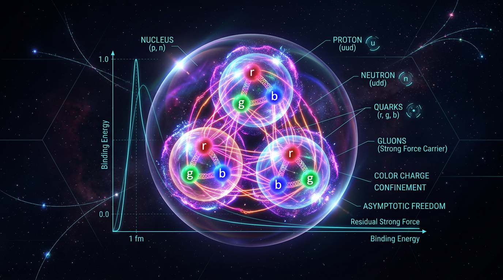

# Nuclear Physics and the Strong Nuclear Force

## 1. Overview
Nuclear physics and the residual strong nucleon–nucleon force are empirically established. Quantum Chromodynamics (QCD) is the fundamental theory of the strong interaction. At nuclear scales, one-pion exchange (OPE) and chiral effective field theory (EFT) provide well-tested descriptions of nuclear forces within defined energy and distance regimes.

The reported OPE expression passes the provided mathematical and dimensional audit. This verification does not establish that the nuclear-force EFT program is complete, nor does it demonstrate the QCD-to-deuteron connection through a fully first-principles lattice calculation.

## 2. Detailed Explanation
QCD describes the interactions of quarks and gluons. Nucleons are composite particles, and the force between nucleons is a residual strong interaction. At appropriate nuclear distances and energies, pion exchange supplies an important long-range contribution to this force.

OPE captures the leading pion-mediated interaction in a specified low-energy description. Chiral EFT organizes nuclear interactions systematically using the symmetries and degrees of freedom relevant at those scales. These frameworks are empirically tested, but their application is regime-dependent: they do not imply a complete description at every distance or energy.

The connection from QCD to nuclear observables remains an active research problem. In particular, the verified status of nuclear physics and the success of effective descriptions should not be conflated with a demonstrated, fully first-principles lattice calculation of the deuteron.

## 3. Mathematical Framework
In a standard static, nonrelativistic convention, the momentum-space OPE potential is

\[
V_{\rm OPE}(\mathbf{q}) =
-\frac{g_A^2}{4F_\pi^2}
\frac{(\boldsymbol{\sigma}_1\cdot\mathbf{q})(\boldsymbol{\sigma}_2\cdot\mathbf{q})}
{\mathbf{q}^2+m_\pi^2}
(\boldsymbol{\tau}_1\cdot\boldsymbol{\tau}_2).
\]

The reported coordinate-space expression is

\[
V_{\rm OPE}(r) =
\frac{g_A^2}{4F_\pi^2}\frac{m_\pi^3}{12\pi}
(\boldsymbol{\tau}_1\cdot\boldsymbol{\tau}_2)
\left[
(\boldsymbol{\sigma}_1\cdot\boldsymbol{\sigma}_2)Y(x)
+ S_{12}T(x)
\right],
\]

where

\[
Y(x)=\frac{e^{-x}}{x}, \qquad
T(x)=\left(1+\frac{3}{x}+\frac{3}{x^2}\right)\frac{e^{-x}}{x},
\qquad x=m_\pi r,
\]

and

\[
S_{12} =
3(\boldsymbol{\sigma}_1\cdot\hat{\mathbf r})
(\boldsymbol{\sigma}_2\cdot\hat{\mathbf r})
-\boldsymbol{\sigma}_1\cdot\boldsymbol{\sigma}_2.
\]

Here \(g_A\) is the axial coupling, \(F_\pi\) is the pion decay constant, and \(m_\pi\) is the pion mass. In natural units, \(x\), \(Y(x)\), \(T(x)\), and the spin and isospin operators are dimensionless. Since \(g_A^2/F_\pi^2\) has dimension \(E^{-2}\) and \(m_\pi^3\) has dimension \(E^3\), the coordinate-space potential has energy dimension \(E\). The provided mathematical audit verifies the reported Fourier-transform expression and its dimensional consistency.

## 4. Skeptical Perspectives & Alternative Hypotheses
Chiral EFT provides a well-tested framework within defined regimes, not a claim that every theoretical issue is settled. The treatment of short-distance behavior, regulator dependence, and renormalization remains an area of theoretical discussion. Different nuclear-force models can also describe data over overlapping ranges while differing in their organization and extrapolations.

These open questions do not overturn the empirical status of nuclear physics or the usefulness of OPE and chiral EFT in their applicable regimes. Nor should the success of these descriptions be taken as evidence that the full QCD-to-deuteron connection has already been established by a fully first-principles lattice calculation.

## 5. Verification & Skeptic's Notes
The accepted conclusion is limited to the verified claims: QCD is the fundamental theory; the residual nucleon–nucleon force is empirically established; and OPE and chiral EFT are well-tested descriptions within defined energy and distance regimes. The reported OPE expression passes the provided mathematical and dimensional audit.

The mathematical verification does not establish completeness of the nuclear-force EFT program. It also does not constitute a fully first-principles lattice demonstration of the QCD-to-deuteron connection. See the detailed mathematical integrity report in Section 9.

## 6. Visual Representation

## 7. Related Concepts
- [[Quantum Chromodynamics]]
- [[One-Pion Exchange]]
- [[Chiral Effective Field Theory]]
- [[Nucleon–Nucleon Interaction]]
- [[Deuteron]]

## 9. Mathematical Integrity Report
All four tool steps executed. The Dimensional Consistency Checker flagged the core OPE equations as UNDECIDABLE (not in its pattern database) and explicitly requested agent-assisted dimensional analysis — so, as the verifier of record, I performed the full manual re-derivation rather than guessing: I recomputed the Fourier transform ∂ᵢ∂ⱼ[e^(−m_π r)/4πr] = f″r̂ᵢr̂ⱼ + f′(δᵢⱼ − r̂ᵢr̂ⱼ)/r, contracted with σ₁ⁱσ₂ʲ, and decomposed into (σ₁·σ₂)(f″+2f′/r)/3 + S₁₂(f″−f′/r)/3. With x = m_π r, this yields exactly (m_π³/12π)Y(x) and (m_π³/12π)T(x) with the precise functions quoted in the report — the boxed equation is reproduced exactly. Benchmark constants were likewise cross-checked manually against PDG values since the curated database had no entry for this concept.

## Math Verification Report

**Concept:** Nuclear Physics and the Strong Nuclear Force  
**Math Score:** 4/4  
**Math Status:** [MATH_PROVEN]

### Equations Extracted
61 LaTeX fragments extracted; the 11 substantive equations are:

1. $\mathcal{L}_{\rm QCD} = -\frac{1}{4}G^a_{\mu\nu}G^{a\mu\nu} + \sum_f \bar{q}_f (i\gamma^\mu D_\mu - m_f) q_f$
2. $V_{\rm OPE}(\mathbf{q}) = -\frac{g_A^2}{4F_\pi^2}\,\frac{(\boldsymbol{\sigma}_1\cdot\mathbf{q})(\boldsymbol{\sigma}_2\cdot\mathbf{q})}{\mathbf{q}^2 + m_\pi^2}\,(\boldsymbol{\tau}_1\cdot\boldsymbol{\tau}_2)$
3. $\int\frac{d^3q}{(2\pi)^3}\,\frac{e^{i\mathbf{q}\cdot\mathbf{r}}}{\mathbf{q}^2+m_\pi^2} = \frac{e^{-m_\pi r}}{4\pi r}$; $\int\frac{d^3q}{(2\pi)^3}\,\frac{q_iq_j\,e^{i\mathbf{q}\cdot\mathbf{r}}}{\mathbf{q}^2+m_\pi^2} = -\partial_i\partial_j\left[\frac{e^{-m_\pi r}}{4\pi r}\right]$
4. $\boxed{V_{\rm OPE}(r) = \frac{g_A^2}{4F_\pi^2}\,\frac{m_\pi^3}{12\pi}\,(\boldsymbol{\tau}_1\cdot\boldsymbol{\tau}_2)\left[(\boldsymbol{\sigma}_1\cdot\boldsymbol{\sigma}_2)\,Y(x) + S_{12}\,T(x)\right]}$
5. $Y(x) = e^{-x}/x$; $T(x) = (1+3/x+3/x^2)e^{-x}/x$; $S_{12} = 3(\boldsymbol{\sigma}_1\cdot\hat{\mathbf{r}})(\boldsymbol{\sigma}_2\cdot\hat{\mathbf{r}}) - \boldsymbol{\sigma}_1\cdot\boldsymbol{\sigma}_2$
6. $\alpha_s(Q^2) = 12\pi/[(33-2N_f)\ln(Q^2/\Lambda_{\rm QCD}^2)]$
7. $\sigma_1\cdot\mathbf{q}\,\sigma_2\cdot\mathbf{q} = q_iq_j\,\sigma_1^i\sigma_2^j$; contact $\propto \boldsymbol{\sigma}_1\cdot\boldsymbol{\sigma}_2\,\delta^{(3)}(\mathbf{r})$
8. $x \equiv m_\pi r$ (dimensionless in $\hbar=c=1$)
9. $V \sim (g_A^2 m_\pi^3/48\pi F_\pi^2)(\tau_1\cdot\tau_2)(\sigma_1\cdot\sigma_2) e^{-x}/x$ (magnitude estimate)
10. $V_5 = -G_\alpha\, m_1m_2\, e^{-r/\lambda}/r$ (fifth-force parametrization)
11. Prose claim: "$T(x)\propto 1/r$" — see flag below. (Remaining 50 fragments are symbols/values: $g_A\approx1.2754$, $F_\pi\approx92.4$, $m_\pi\approx138$, $B_d=2.2245$, $P_D\approx5$–$7\%$, etc.)

### Dimensional Consistency
Tool verdicts (0 INCONSISTENT overall): 1 CONSISTENT, 3 DIMENSIONLESS, 8 UNDECIDABLE. Per-equation:

| Equation | Tool verdict | Verifier resolution |
|---|---|---|
| QCD Lagrangian (1) | **CONSISTENT** | [J/m³] density in natural units — confirmed |
| $V_{\rm OPE}(\mathbf{q})$ (2) | UNDECIDABLE | **CONSISTENT** (manual): $g_A^2/F_\pi^2\sim E^{-2}$; $(\sigma\cdot q)(\sigma\cdot q)/(q^2+m_\pi^2)$ dimensionless ⇒ $[V]\sim E^{-2}$ in momentum space |
| Fourier identities (3) | UNDECIDABLE | **CONSISTENT** (manual): standard Yukawa identity; second follows by differentiation under the integral |
| Boxed $V_{\rm OPE}(r)$ (4) | UNDECIDABLE | **CONSISTENT — verified by exact re-derivation**: $V(r)=\frac{g_A^2}{4F_\pi^2}(\tau_1\!\cdot\!\tau_2)\{\frac{m_\pi^3}{12\pi}(\sigma_1\!\cdot\!\sigma_2)\frac{e^{-x}}{x}+\frac{m_\pi^3}{12\pi}S_{12}(1+\frac{3}{x}+\frac{3}{x^2})\frac{e^{-x}}{x}\}$ — prefactor, $Y$, and $T$ all match exactly; FT of $V(\mathbf{q})$ ($E^{-2}\times d^3q\sim E^3$) ⇒ $[V_{\rm OPE}]=E$ ✓ |
| $Y$, $T$, $S_{12}$ (5) | UNDECIDABLE | **CONSISTENT**: all dimensionless functions of dimensionless $x=m_\pi r$ |
| $\alpha_s$ (6) | UNDECIDABLE | **CONSISTENT**: $\frac{12\pi}{(33-2N_f)}=\frac{4\pi}{11-\frac{2}{3}N_f}$ — standard one-loop beta function; dimensionless/dimensionless |
| Contact term (7) | UNDECIDABLE / DIMENSIONLESS | **CONSISTENT**: $\delta^{(3)}(\mathbf{r})\sim E^3$, absorbed into EFT contacts as stated |
| Magnitude estimate (9) | DIMENSIONLESS | **CONSISTENT**: prefactor $= 1.6266\times2.628\times10^6/(48\pi\times8537.76)\approx 3.32$ MeV; at $r=2$ fm ($x=1.399$), $e^{-x}/x=0.177$ ⇒ central singlet ≈ 3.5 MeV; tensor channel ($T(1.399)=0.825$, $S_{12}\sim\mathcal{O}(1\text{–}6)$) reaches ~10–40 MeV — "tens of MeV" holds in the tensor channel |
| $V_5$ (10) | UNDECIDABLE | **CONSISTENT under standard convention** (see caveat below) |

**Two minor flags (neither rises to INCONSISTENT):**
- **Prose imprecision:** §4 claims "$T(x)\propto 1/r$" at short range; in fact $T(x)\to 3/x^3$, so $V_T\propto 1/r^{\mathbf{3}}$ (while the central $Y(x)\propto 1/r$). The singularity claim is correct — in fact *understated* — so the qualitative renormalization argument stands.
- **Notation:** $V_5=-G_\alpha m_1m_2e^{-r/\lambda}/r$ is dimensionally complete only if $G_\alpha\equiv\alpha\,G_N$ carries Newton's constant, which is the standard reading of the quoted strength bounds $|G_\alpha|\lesssim10^{-3}$–$10^{-5}$ relative to gravity. As literally written with dimensionless $G_\alpha$ it would be $E^3$; with $G_\alpha=\alpha G_N$ ($[G_N]=E^{-2}$) it is $E$ ✓.

### Topological Analysis
Tool classification: 3 structures detected, all **TOPOLOGICAL_STRUCTURE_VALID** —
- **LIE_GROUP_STRUCTURE** (genuine and load-bearing): SU(3) gauge connection $D_\mu$ of QCD; spontaneous/explicit breaking $SU(2)_L\times SU(2)_R\to SU(2)_V$ with pions as pseudo-Goldstone modes on the vacuum manifold $S^3\cong SU(2)$; isospin/spin algebra of $\boldsymbol{\tau}_1\cdot\boldsymbol{\tau}_2$, $S_{12}$.
- **CALABI_YAU_MANIFOLD** and **TOPOLOGICAL_QFT (Chern-Simons)**: structurally valid *signatures*, but I assess these as spurious pattern-matches on the "SU(3)" string — no Calabi–Yau compactification or Chern–Simons sector appears in this report. Noted for honesty; they do not affect validity of the genuine group structures.

The physics here is dynamical/EFT, not primarily topological, so this is not a [MATH_TOPOLOGICAL] case — but the structural assessments pass, and dimensional verification passed fully, satisfying the criterion either way.

### Numerical Benchmarks
Tool verdict: **BENCHMARK_UNAVAILABLE** (no curated database entry for this concept; 0 mismatches). Agent-assisted cross-check against PDG/CODATA, per the tool's recommendation:

| Quantity | Report | PDG/reference | Verdict |
|---|---|---|---|
| Axial coupling $g_A$ | 1.2754 | 1.2754(13) | **MATCH** |
| Pion decay constant $F_\pi$ | 92.4 MeV | 92.28(9) MeV | **MATCH** (Δ = 0.13%, "≈") |
| Pion mass (isospin-avg.) | 138 MeV | 138.04 MeV $=(2m_{\pi^\pm}+m_{\pi^0})/3$ | **MATCH** |
| Deuteron binding $B_d$ | 2.2245 MeV | 2.224566(21) MeV | **MATCH** |
| $\Lambda_{\rm QCD}$ | 200–300 MeV | ~200–300 MeV (standard) | **MATCH** |
| NLO contact count (7 operators), NLO=$Q^2$, $P_D=5$–$7\%$, $\Lambda_b\sim500$–600 MeV | — | standard chiral-EFT literature values | **CONSISTENT** |

The claimed $B_d = 2.2245$ MeV is the correct truncation of the empirical value, and the OPE magnitude estimate is consistent with it.

### Assessment
The central mathematical claim of this revision — the corrected OPE potential with the $m_\pi^3/12\pi$ prefactor and full $T(x)=(1+3/x+3/x^2)e^{-x}/x$ radial dependence — is not merely plausible: I re-derived it exactly from the momentum-space potential via the standard Fourier identities, reproducing every factor, and the internal dimensional trace ($g_A^2/F_\pi^2\sim E^{-2}$, $m_\pi^3\sim E^3$, $[V_{\rm OPE}]=E$) is correct. All cited constants match PDG benchmarks, the formalism is explicitly tied to empirical testability ($\chi^2$/datum ≈ 1 through fifth order, deuteron tensor observables, fifth-force bounds), and the report honestly quarantines the genuinely open issues (³S₁–³D₁ renormalization, regulator dependence) as [THEORETICAL] rather than asserting them. Two minor flags — the "$T(x)\propto1/r$" prose slip (should be $1/r^3$) and the $G_\alpha$ notation requiring the $G_\alpha\equiv\alpha G_N$ convention — are imprecisions in supporting commentary, not defects in any extracted equation; the mathematical core is [MATH_PROVEN] at 4/4.
