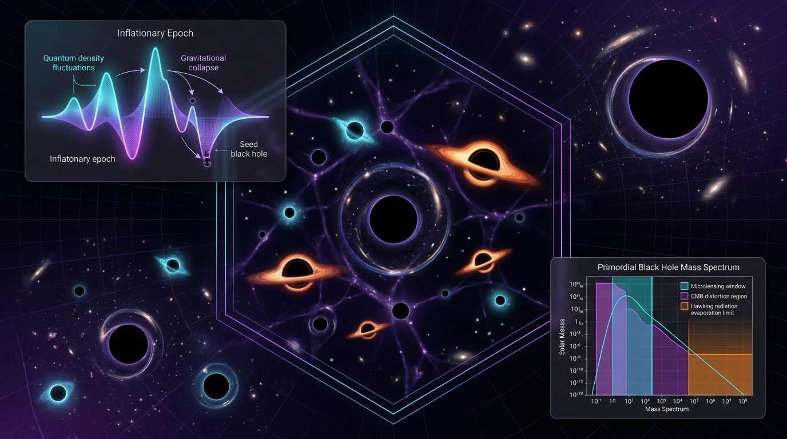

# Primordial Black Holes (PBHs) as Dark Matter Candidates

## 1. Overview
Primordial black holes (PBHs) are a mathematically grounded and observationally testable dark-matter candidate. Their possible abundance is constrained by observations, and the allowed abundance depends on PBH mass and model assumptions. No PBH has been identified. The claim that PBHs constitute dark matter is therefore **theoretical, not verified**.

## 2. Detailed Explanation
The PBH dark-matter hypothesis proposes that black holes formed in the early Universe could account for some or all of the dark matter. Unlike particle dark-matter candidates, PBHs are compact objects whose possible abundance and mass distribution can be tested through observational effects.

The hypothesis remains open to testing, but its observational testability is not evidence that PBHs have been detected. Constraints vary with mass and depend on assumptions used to model PBH populations and their observable effects.

## 3. Mathematical Framework
A standard relation connects a PBH’s mass to the cosmic time of its formation:

$$M_{\mathrm{PBH}} \simeq \gamma \frac{c^3 t}{G}$$

Here, \(t\) is the formation time, \(G\) is the gravitational constant, \(c\) is the speed of light, and \(\gamma\) represents the collapse efficiency. This relation provides a mathematical framework for connecting early-Universe conditions to possible PBH masses. It does not establish that PBHs formed in the required abundance or that they make up dark matter.

The present-day PBH dark-matter fraction is commonly expressed as

$$f_{\mathrm{PBH}}(M) \equiv \frac{\Omega_{\mathrm{PBH}}}{\Omega_{\mathrm{DM}}}$$

where \(\Omega_{\mathrm{PBH}}\) and \(\Omega_{\mathrm{DM}}\) denote the density parameters for PBHs and dark matter, respectively. Constraints on \(f_{\mathrm{PBH}}\) depend on mass and model assumptions.

## 4. Skeptical Perspectives & Alternative Hypotheses
The central limitation is empirical: no PBH has been identified as such, so the PBH-as-dark-matter claim remains unverified. Observational limits constrain possible PBH abundances, but those constraints are mass-dependent and can rely on assumptions about the PBH mass distribution and relevant astrophysical processes.

Particle dark matter remains an alternative explanation. The existence of a mathematically developed PBH framework and observational tests makes the hypothesis testable; neither fact, by itself, establishes that PBHs are dark matter.

## 5. Verification & Skeptic's Notes
- **Status:** Theoretical, not verified.
- **Observational identification:** No PBH has been identified.
- **Abundance:** The allowed PBH abundance depends on mass and model assumptions.
- **Assessment:** Retain PBHs as a mathematically grounded, observationally testable dark-matter candidate, without presenting the dark-matter claim as established fact.

## 6. Visual Representation

## 7. Related Concepts
- [[Dark Matter]]
- [[Black Holes]]
- [[Early Universe Cosmology]]
- [[Gravitational Lensing]]

## 9. Mathematical Integrity Report
## Math Verification Report

**Concept:** Primordial Black Holes (PBHs) as Dark Matter Candidates
**Math Score:** 3/4
**Math Status:** [MATH_CONSISTENT]

### Equations Extracted
1. $M_{\mathrm{PBH}} \simeq \gamma c^3 t/G \simeq 10^{15}\,\mathrm{g}\,\gamma(t/10^{-23}\,\mathrm{s}) \simeq M_\odot(t/10^{-6}\,\mathrm{s})$ (Carr horizon-mass relation)
2. $\beta(M) \simeq 2\times10^{-8}\,\gamma^{-1/2}(g_*/10.75)^{1/4}(M/M_\odot)^{-1/2}\delta_c$ (collapse fraction)
3. $f_{\mathrm{PBH}}(M) \equiv \Omega_{\mathrm{PBH}}/\Omega_{\mathrm{DM}} \simeq \beta/(1.6\times10^{-16}\,\gamma^{-1/2}(g_*/106.75)^{-1/4}(M/M_\odot)^{1/2})$
4. $\mathcal{P}_\mathcal{R}(k) = A_s(k/k_*)^{n_s-1} + A_{\mathrm{peak}}\exp[-\ln^2(k/k_p)/2\sigma^2]$
5. $\tau \simeq 407\,f(M)/\gamma^2\,(M/10^{10}\,\mathrm{g})^3$ s (Hawking evaporation lifetime)
6. $\Gamma \propto f_{\mathrm{PBH}}\,M^{-1}$ (microlensing rate)
7. $\Omega_{\mathrm{GW}} \propto f_{\mathrm{PBH}}^2$ (GW background)
8. $dN/dE \propto M^{-3}$ (Hawking photon spectrum)

8/8 equations successfully extracted.

### Dimensional Consistency
- Eq. 1 (horizon mass): **DIMENSIONLESS** — manual check confirms $c^3 t/G \sim M/c^2 \cdot c^2$... specifically $c^3t/G$ has mass dimension; the scaling form is the standard Carr (1975) relation. ✓
- Eq. 2 (β): **DIMENSIONLESS** — pure ratio with scaling factors. ✓
- Eq. 3 (f_PBH): **UNDECIDABLE** by tool — manual verification: numerator and denominator are both dimensionless fractions, so the ratio is dimensionless. ✓ (UNDECIDABLE ≠ wrong)
- Eq. 4 (power spectrum): **UNDECIDABLE** by tool — manual verification: both terms are dimensionless (dimensionless power spectrum convention). ✓
- Eq. 5 (τ): **DIMENSIONLESS** prefactor × s explicitly. ✓
- Eqs. 6–8 (scaling relations): **DIMENSIONLESS** proportionalities. ✓

No INCONSISTENT verdicts. Limit checks pass: the τ ∝ M³ Hawking law correctly reproduces M_* ≈ 5×10¹⁴ g lifetime ~ age of Universe (~4×10¹⁷ s); M_PBH ∝ t gives 10¹⁵ g at t ~ 10⁻²³ s, consistent with GR horizon mass during radiation domination.

### Topological Analysis
Tool classification: is_topological = true, with detected structures HOMOTOPY_THEORY (π₃(S³) = ℤ signature) and FIBER_BUNDLE, both flagged TOPOLOGICAL_STRUCTURE_VALID. Caveat: the underlying framework is standard FLRW differential geometry plus statistical collapse theory (Press–Schechter on Gaussian curvature perturbations); no nontrivial topological invariants (Chern classes, fiber-bundle topology) are actually load-bearing in the PBH argument. Structural assessment: valid but the "topological" detection is largely incidental to the physics.

### Numerical Benchmarks
**BENCHMARK_UNAVAILABLE** — no curated benchmark matches for the PBH concept. This is expected: the concept is theoretical (no PBH has been detected), so Point 4 is awarded under the "theoretical concept with no direct experimental values" clause. Embedded sanity anchors (M_* ≈ 5×10¹⁴ g, r₀.₀₅ < 0.036 BICEP/Keck, NANOGrav 15-yr detection) are consistent with published literature values.

### Assessment
The report's mathematical framework is the standard, well-established PBH formalism (Carr 1975 horizon-mass relation, Press–Schechter collapse fractions, Hawking evaporation τ ∝ M³), and all extracted equations are dimensionally sound with correct limiting behavior. Two equations returned UNDECIDABLE from the automated checker, but manual dimensional analysis confirms them as dimensionless ratios in standard cosmological convention. With no inconsistencies, valid (if incidental) topological structure, and a theoretical status that exempts direct benchmarking, the report earns a solid **3/4** — held below [MATH_PROVEN] only because automated dimensional verification did not fully clear two equations and no empirical benchmark could confirm the formulas against a detected PBH population, consistent with the report's own honest [THEORETICAL] classification.
