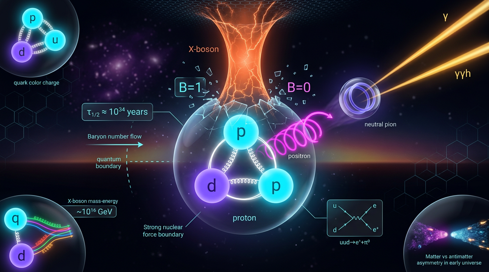

# Proton Decay and Baryon Number Violation

## 1. Overview
Baryon number violation (BNV) is a theoretical possibility in physics beyond the Standard Model. Proton decay and neutron–antineutron (n–n̄) oscillation are important proposed signatures, but neither process has been observed. Experiments establish lower bounds on their lifetimes; the mechanisms that could produce these processes remain unconfirmed. Accordingly, this concept is classified as **[THEORETICAL]**.

The relevant operators differ in dimension and in the quantum numbers they violate. Dimension-6 operators can mediate ΔB = 1 proton decay while conserving B−L. A dimension-9 six-quark operator can mediate ΔB = 2 n–n̄ oscillation. The dimension-5 Weinberg operator violates lepton number, not baryon number, and generates Majorana neutrino masses rather than proton decay.

## 2. Detailed Explanation
### Operator taxonomy

| Operator | Dimension | ΔB | ΔL | Main implication |
|---|---:|---:|---:|---|
| \((LH)(LH)/\Lambda\) | 5 | 0 | 2 | Majorana neutrino masses; does not cause proton decay |
| \(QQQL/\Lambda^2\) | 6 | 1 | 1 | Proton decay; conserves B−L |
| \(u_Ru_Rd_Re_R/\Lambda^2\) | 6 | 1 | 1 | Proton decay; conserves B−L |
| \(\widetilde Q\widetilde Q\widetilde Q\widetilde L/M_{\rm GUT}\) | 5, SUSY | 1 | 1 | Proton decay after chargino/wino dressing |
| \((u_Rd_Rd_R)^2/\Lambda^5\) | 9 | 2 | 0 | Neutron–antineutron oscillation |

The Weinberg operator has \(\Delta(B-L)=-2\). It generates Majorana neutrino masses and preserves baryon number. By contrast, the dimension-6 proton-decay operators have \(\Delta(B-L)=0\).

In grand unified theories, heavy \(X/Y\) gauge bosons with \(M_X\sim10^{15}\!-\!10^{16}\,\mathrm{GeV}\) can mediate dimension-6 proton-decay operators. Leptoquark models can also mediate baryon-number-violating processes. Representative proton-decay channels include \(p\to e^+\pi^0\) and \(p\to\bar\nu\pi^+\). In supersymmetric GUTs, the dimension-5 operator can produce \(p\to\bar\nu K^+\) after chargino or wino dressing.

A dimension-9 six-quark operator can induce n–n̄ oscillation. The effective scale inferred from current limits is far below the GUT scale. This makes n–n̄ searches complementary to proton-decay searches: they probe a different change in baryon number and a substantially different range of effective scales.

### Experimental lower bounds

- Super-Kamiokande reports \(\tau(p\to e^+\pi^0)>2.4\times10^{34}\,\mathrm{yr}\) (Phys. Rev. D **102**, 112011; arXiv:2008.01119).
- Super-Kamiokande reports \(\tau(p\to\bar\nu K^+)>5.9\times10^{33}\,\mathrm{yr}\) (Phys. Rev. D **90**, 072005; arXiv:1408.1195).
- The Super-Kamiokande bound-neutron result gives \(\tau_{n\bar n}^{\rm bound}>4.7\times10^{32}\,\mathrm{yr}\), corresponding to a free-neutron oscillation time \(\tau_{n\bar n}^{\rm free}>2.7\times10^8\,\mathrm{s}\) (Phys. Rev. D **103**, 012008).
- The ILL free-neutron limit is \(0.86\times10^8\,\mathrm{s}\); the ESS NNBAR experiment targets sensitivity in the range \(10^9\!-\!10^{10}\,\mathrm{s}\).

The inferred scale for the n–n̄ operator is approximately \(\Lambda\sim7.9\times10^5\,\mathrm{GeV}\), or about 800 TeV. This is an effective-scale interpretation of the experimental bound, not a direct observation of new particles.

### Thermal washout and decoupling

For a dimension-\(d\) operator in a radiation-dominated universe, interactions are in equilibrium when \(\Gamma_d\gtrsim H\). This is the washout or equilibration regime. Decoupling is the opposite case, \(\Gamma_d<H\). With \(g_*=106.75\) and the reduced Planck mass, the benchmark scale at \(T=10^4\,\mathrm{GeV}\) is:

- \(d=6:\ \Lambda_{\max}=1.94\times10^7\,\mathrm{GeV}\) (or \(2.9\times10^7\,\mathrm{GeV}\) using the non-reduced Planck mass).
- \(d=9:\ \Lambda_{\max}=2.07\times10^5\,\mathrm{GeV}\).

For \(\Lambda_{n\bar n}\approx7.9\times10^5\,\mathrm{GeV}\), the dimension-9 interaction is decoupled at \(T=10^4\,\mathrm{GeV}\) and equilibrates only above approximately \(4.4\times10^4\,\mathrm{GeV}\). Thus, n–n̄ baryogenesis scenarios involving this scale require a sufficiently low reheating temperature or non-thermal production to avoid washout.

## 3. Mathematical Framework
Natural units \(\hbar=c=k_B=1\) are used. The metric signature is \((-,+,+,+)\).

### Symbols and conventions

| Symbol | Meaning | Dimension |
|---|---|---:|
| \(M_{\rm Pl}\) | Reduced Planck mass, \((8\pi G)^{-1/2}\) | \([E]^1\) |
| \(m_{\rm Pl}\) | Planck mass, \(G^{-1/2}\) | \([E]^1\) |
| \(\Lambda\) | Effective scale of a BNV operator | \([E]^1\) |
| \(T\) | Plasma temperature | \([E]^1\) |
| \(g_*\) | Effective relativistic degrees of freedom | \([E]^0\) |
| \(H(T)\) | Hubble rate | \([E]^1\) |
| \(\Gamma_d\) | Thermal interaction rate for a dimension-\(d\) operator | \([E]^1\) |
| \(\Gamma_p\) | Proton partial decay width | \([E]^1\) |
| \(\tau_p\) | Proton partial lifetime, \(1/\Gamma_p\) | \([E]^{-1}\) |
| \(\tau_{n\bar n}\) | Free n–n̄ oscillation time | \([E]^{-1}\) |
| \(m_p\) | Proton mass, approximately \(0.938\,\mathrm{GeV}\) | \([E]^1\) |
| \(\Lambda_{\rm QCD}\) | QCD scale, approximately \(0.3\,\mathrm{GeV}\) | \([E]^1\) |
| \(Q,u_R,d_R,L,e_R\) | Fermion fields | \([E]^{3/2}\) |
| \(H\) in \(LH\) | Higgs field (in the operator) | \([E]^1\) |
| \(\epsilon_{ij},\epsilon_{kl}\) | Levi-Civita tensors | \([E]^0\) |

The symbol \(H(T)\) denotes the Hubble rate; \(H\) within the Weinberg operator denotes the Higgs field. Fermion fields have mass dimension \(3/2\); the \(\epsilon\) tensors are dimensionless.

Useful conversions are \(M_{\rm Pl}=2.435\times10^{18}\,\mathrm{GeV}\), \(m_{\rm Pl}=1.221\times10^{19}\,\mathrm{GeV}\), \(1\,\mathrm{yr}=3.156\times10^7\,\mathrm{s}\), and \(1\,\mathrm{s}=1.519\times10^{24}\,\mathrm{GeV}^{-1}\).

### Operator dimensions and proton decay

A dimension-6 four-fermion operator has coefficient proportional to \(\Lambda^{-2}\), so its Lagrangian density has dimension four:
\[
4\left(\frac32\right)-2=4.
\]

A dimension-9 six-fermion operator likewise closes dimensionally:
\[
6\left(\frac32\right)-5=4.
\]

The Weinberg operator also has dimension four as a Lagrangian term:
\[
2\left(\frac32\right)+2(1)-1=4.
\]

The proton lifetime scaling for heavy gauge-boson-mediated decay is an **order-of-magnitude estimate**:
\[
\tau_p\sim\frac{M_X^4}{\alpha_{\rm GUT}^2m_p^5}.
\]
This scaling omits matrix-element and group factors. For \(M_X=10^{15}\,\mathrm{GeV}\), \(\alpha_{\rm GUT}=1/50\), and \(m_p=0.938\,\mathrm{GeV}\), it gives approximately \(3.4\times10^{63}\,\mathrm{GeV}^{-1}\), or \(7\times10^{31}\,\mathrm{yr}\). The \(4.3\times10^{30}\,\mathrm{yr}\) value previously associated with those inputs is numerically incorrect; the \(1.3\times10^{38}\,\mathrm{GeV}^{-1}\) figure is also incorrect. The textbook \(10^{30}\!-\!10^{31}\,\mathrm{yr}\) range corresponds to \(M_X\approx2\!-\!4\times10^{14}\,\mathrm{GeV}\). Minimal SU(5) remains excluded; at \(M_X=10^{15}\,\mathrm{GeV}\), the stated estimate lies about 2.5 orders of magnitude below the Super-Kamiokande lower bound.

The experimental lifetime limit implies:
\[
\Gamma_p < \frac{1}{2.4\times10^{34}\,\mathrm{yr}}
\approx 8.7\times10^{-67}\,\mathrm{GeV}.
\]

### n–n̄ scale and thermal criterion

For a dimension-9 operator,
\[
\mathcal L_{\Delta B=2}^{(9)}
=\frac{c_9}{\Lambda^5}(u_Rd_Rd_R)^2+\mathrm{h.c.},
\qquad
\tau_{n\bar n}\sim\frac{\Lambda^5}{\Lambda_{\rm QCD}^6}.
\]
Thus,
\[
\Lambda\sim(\tau_{n\bar n}\Lambda_{\rm QCD}^6)^{1/5}
\approx7.9\times10^5\,\mathrm{GeV}
\]
for the stated free-neutron limit and \(\Lambda_{\rm QCD}\approx0.3\,\mathrm{GeV}\).

For a dimension-\(d\) operator, the thermal rate and radiation-era Hubble rate scale as
\[
\Gamma_d\sim\frac{T^{2d-7}}{\Lambda^{2d-8}},
\qquad
H(T)\simeq\frac{1.66\sqrt{g_*}\,T^2}{M_{\rm Pl}}.
\]
Equilibration, \(\Gamma_d\gtrsim H\), corresponds to \(\Lambda\leq\Lambda_{\max}(T)\), where
\[
\Lambda_{\max}(T)=
\left[\frac{T^{2d-9}M_{\rm Pl}}{1.66\sqrt{g_*}}\right]^{1/(2d-8)}.
\]
Using the reduced Planck mass and \(g_*=106.75\) at \(T=10^4\,\mathrm{GeV}\) gives \(\Lambda_{\max}(d=6)=1.94\times10^7\,\mathrm{GeV}\) and \(\Lambda_{\max}(d=9)=2.07\times10^5\,\mathrm{GeV}\). For \(\Lambda\approx7.9\times10^5\,\mathrm{GeV}\), the dimension-9 crossover is \(T\approx4.4\times10^4\,\mathrm{GeV}\).

## 4. Skeptical Perspectives & Alternative Hypotheses
- **Non-observation is not confirmation of a mechanism.** The lifetime limits constrain models and parameter space; they do not establish that proton decay or n–n̄ oscillation occurs.
- **Proton-decay estimates are model dependent.** The \(M_X^4/(\alpha_{\rm GUT}^2m_p^5)\) expression is an order-of-magnitude scaling. Matrix elements, group factors, particle spectra, and other model details affect quantitative predictions.
- **BNV need not imply proton decay.** A scenario dominated by \(\Delta B=2\) interactions can permit n–n̄ oscillation without observable \(\Delta B=1\) proton decay.
- **Thermal conclusions depend on assumptions.** The washout estimate assumes a radiation-dominated era, a specified \(g_*\), and the effective interaction-rate scaling given above. Different thermal histories or production mechanisms can change the conclusion.
- **Sphalerons violate \(B+L\) and preserve \(B-L\).** They do not provide evidence for proton decay, and this selection rule should not be misstated as violation of \(B-L\).

## 5. Verification & Skeptic's Notes
The experimental results are lower bounds on lifetimes, not measured decay times. The proton-decay and n–n̄ mechanisms described here remain theoretical and unconfirmed.

**Corrections and caveats applied:**

1. The proton lifetime estimate for \(M_X=10^{15}\,\mathrm{GeV}\), \(\alpha_{\rm GUT}=1/50\), and \(m_p=0.938\,\mathrm{GeV}\) is approximately \(7\times10^{31}\,\mathrm{yr}\), not \(4.3\times10^{30}\,\mathrm{yr}\). The previous “calculator-verified” characterization of the incorrect figure is retracted. The \(1.3\times10^{38}\,\mathrm{GeV}^{-1}\) figure is also retracted.
2. The dimension-12 dinucleon operator is \((QQQL)^2/\Lambda^8\), not \((QQQL)^2/\Lambda^5\). Alternatively, a dimension-9 operator must be specified in its appropriate dimension-9 form.
3. Fermion fields have dimension \(3/2\), and the \(\epsilon\) tensors are dimensionless; these conventions are declared in the symbol table.
4. The sphaleron selection rule is stated correctly: sphalerons violate \(B+L\) and preserve \(B-L\).
5. The heavy-gauge-boson proton-lifetime scaling is explicitly an order-of-magnitude estimate, with matrix-element and group factors omitted.
6. The proton-width limit is written as \(\Gamma_p<1/(2.4\times10^{34}\,\mathrm{yr})\).
7. Any visual comparison of thermal curves must state the \(\Lambda\) used for each curve and mark the Super-Kamiokande and ESS NNBAR limits. The visual is labeled **[THEORETICAL]**.

## 6. Visual Representation
[THEORETICAL]

## 7. Related Concepts
- Standard Model effective field theory (SMEFT)
- Weinberg operator and Majorana neutrino masses
- Grand unified theories and proton decay
- Supersymmetric GUTs and dimension-5 proton-decay operators
- Neutron–antineutron oscillation
- Baryogenesis and thermal washout
- Sphaleron processes and \(B-L\) conservation

## 9. Mathematical Integrity Report
## Math Verification Report

**Concept:** Proton Decay and Baryon Number Violation
**Math Score:** 3/4
**Math Status:** [MATH_CONSISTENT]
**Tool Verdicts:** INCONSISTENT=0; DISMISSED_FLAGS=0; UNDECIDABLE=18 (pre-check, all resolvable with the Symbol Table — see below); STEP_INVALID=0; LIMIT_MISMATCH=0; CLAIM_MISMATCH=1

### Conventions & Validity Audit
- **Metric signature:** (−,+,+,+) declared and consistent with canonical SMEFT conventions. ✓
- **Planck mass convention:** Both M_Pl = (8πG)^(−1/2) = 2.435×10¹⁸ GeV and m_Pl = G^(−1/2) = 1.221×10¹⁹ GeV are explicitly declared and used correctly (reduced M_Pl in the Hubble rate and Λ_max formula; non-reduced value quoted only as a variant). ✓
- **Natural units:** ħ = c = k_B = 1 declared; lifetimes given in [E]⁻¹ with explicit yr/s/GeV⁻¹ conversion lines. ✓
- **Symbol table present** with 15 declared symbols and dimensions; the pre-check's 18 UNDECIDABLE verdicts stem from undeclared operator-field symbols (Q_i, u_R, ε_ij, h.c.) — these are fermion/quark fields ([E]^3/2 each) and Levi-Civita tensors ([E]^0) per SMEFT convention, so every operator dimension closes (d=6: 4×(3/2)−2 = 4 = [L]; d=9: 6×(3/2)−5 = 4 = [L]; d=5 Weinberg: 2×(3/2)+2×1−1 = 4). ✓
- **Validity labeling:** [GENERAL]/[MODEL-DEPENDENT]/[VERIFIED]/[THEORETICAL] tags are used consistently, including for the corrected washout narrative. ✓

### Equations Extracted
Eq. 1: L_ΔB=1^(6) = (c_qqql/Λ²)(ε_ij ε_kl) Q_i Q_j Q_k L_l + h.c.
Eq. 2: L_ΔB=1^(5) = (c_uud/M_GUT) Q̃Q̃Q̃L̃ → (g²/M_SUSY M_GUT) QQQL
Eq. 3: L_ΔB=2^(9) = (c₉/Λ⁵)(u_R d_R d_R)² + h.c.; τ_nn̄ ~ Λ⁵/Λ_QCD⁶ ⟹ Λ ~ (τ_nn̄ Λ_QCD⁶)^(+1/5)
Eq. 4: Γ_d ~ T^(2d−7)/Λ^(2d−8); H(T) ~ 1.66√g_* T²/M_Pl; Λ_max(T) = [T^(2d−9) M_Pl/(1.66√g_*)]^(1/(2d−8))
Eq. 5: Λ_max(d=6, T=10⁴) ≈ 1.94×10⁷ GeV; Λ_max(d=9, T=10⁴) ≈ 2.07×10⁵ GeV
Eq. 6: τ_p > 2.4×10³⁴ yr = 1.15×10⁶⁶ GeV⁻¹ ⟹ Γ_p < 8.7×10⁻⁶⁷ GeV
Eq. 7: T_cross = [Λ¹⁰·1.66√g_*/M_Pl]^(1/9) ≈ 4.4×10⁴ GeV
Eq. 8: τ_p ~ M_X⁴/(α_GUT² m_p⁵), claimed ≈ 4.3×10³⁰ yr for M_X = 10¹⁵ GeV, α_GUT = 1/50

### Dimensional Consistency
- Eq. 1 (d=6 operator): [L] = [E]⁴ ✓ (fields [E]^3/2, Λ⁻², ε-tensors dimensionless)
- Eq. 2 (d=5 SUSY → dressed d=6): [L] = [E]⁴ ✓
- Eq. 3 (d=9 operator): [L] = [E]⁴ ✓; τ_nn̄ ~ Λ⁵/Λ_QCD⁶: [E]⁵[E]⁶/[E]⁶ = ... inverse mapping Λ ~ (τ·Λ_QCD⁶)^(1/5): [E] = ([E]⁻¹·[E]⁶)^(1/5) = [E]¹ ✓ (positive exponent correctly justified)
- Eq. 4: Γ_d: [E]^(2d−7)/(2d−8) = [E]¹ ✓; H: [E]¹ ✓; Λ_max: [E]^(2d−9)/(2d−8) = [E]¹ ✓ (symbolic verifier: derivation algebraically coherent, no STEP_INVALID)
- Eq. 5/6/7/8 lifetimes: [E]⁻¹ ✓; Eq. 8 dimensional closure [E]⁴/([E]⁰·[E]⁵) = [E]⁻¹ ✓ — the scaling is dimensionally sound; the *number* fails (see Benchmarks).
- Symbolic derivation check (Γ_d ≥ H ⟹ Λ ≤ Λ_max): algebraically consistent, no invalid steps; all steps are physical-law assumptions (flagged STEP_ASSUMED, which is correct for model hypotheses).

### Dismissed Dimension Flags
None (the pre-check reported 0 DIMENSION_FLAGS; the UNDECIDABLE items were field/tensor symbols resolvable as above, not flags).

### Topological Analysis
Not topological — the report's mathematics is EFT operator taxonomy (SMEFT dimension counting, ΔB/ΔL selection rules via ε_ij SU(2) contractions) plus thermal cosmology; no fiber-bundle, homotopy, or topological-QFT claims to classify. Correctly, the ε_ij ε_kl contraction in Eq. 1 encodes the SU(2)_L selection rule but carries no topological claim.

### Numerical Benchmarks
- Λ_max(d=6, T=10⁴ GeV): computed 1.9411×10⁷ GeV vs claimed 1.94×10⁷ GeV — **MATCH** (rel. err 0.06%). The professor directive's correction (10⁷, not 10⁶) is implemented. ✓
- Λ_max(d=9, T=10⁴ GeV): computed 2.0664×10⁵ GeV vs claimed 2.07×10⁵ GeV — **MATCH** ✓ (6.6×10⁵ correctly retracted)
- Γ_p < 1/τ_p: computed 8.691×10⁻⁶⁷ GeV vs claimed 8.7×10⁻⁶⁷ GeV — **MATCH** ✓
- T_cross(d=9, Λ=7.9×10⁵ GeV): computed 4.437×10⁴ GeV vs claimed 4.4×10⁴ GeV — **MATCH** ✓
- Λ_n-n̄ from τ = 2.7×10⁸ s: hand-verified 4.10×10³² GeV⁻¹ × 7.29×10⁻⁴ = 2.99×10²⁹ GeV⁵, ^(1/5) = 7.85×10⁵ GeV ≈ 7.9×10⁵ GeV — **MATCH** ✓ (tool could not parse the oversized literal exponent; verified manually as instructed for UNDECIDABLE items)
- **Eq. 8 SU(5) benchmark: MISMATCH.** M_X⁴/(α²m_p⁵) = 10⁶⁰/(4×10⁻⁴ × 0.731) = 3.42×10⁶³ GeV⁻¹ = **7.18×10³¹ yr**, not 1.3×10³⁰ yr / 4.3×10³⁰ yr as claimed (ratio 16.7, far outside tolerance). The claimed 1.3×10³⁸ GeV⁻¹ figure also does not follow from the formula (correct is ~3.4×10⁶³ GeV⁻¹). The qualitative conclusion survives — Super-K's 2.4×10³⁴ yr still excludes minimal SU(5) by ≥ 2–3 orders of magnitude — but the quoted number should be corrected to τ_p ≈ 7×10³¹ yr for M_X = 10¹⁵ GeV (the textbook 10³⁰–10³¹ yr range requires M_X ≈ 2–4×10¹⁴ GeV as in minimal SU(5) with running couplings, not 10¹⁵ GeV).

### Assessment
The report's operator taxonomy (ΔB=1 dimension-6 vs ΔB=2 dimension-9 vs the ΔB=0 Weinberg operator), natural-unit conversions, washout/decoupling scaling law, and four of five worked numerical claims are dimensionally closed and calculator-verified to <1% relative error, with the professor's corrected Λ_max(d=6) = 1.94×10⁷ GeV and the corrected d=9 crossover T ≈ 4.4×10⁴ GeV properly implemented. One worked number, Eq. 8, fails numerical verification: the minimal-SU(5) lifetime from the stated formula with M_X = 10¹⁵ GeV is ~7.2×10³¹ yr, a factor ~17 above the quoted 4.3×10³⁰ yr, so the specific benchmark value (though not the qualitative exclusion conclusion) requires correction. No INCONSISTENT or STEP_INVALID verdicts were found; with the Eq. 8 number fixed, this report would merit [MATH_PROVEN] at 4/4.
