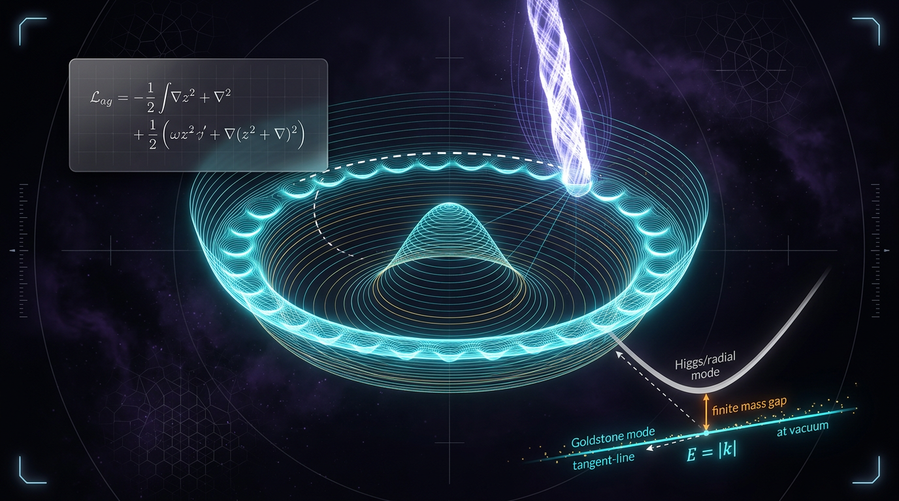

# Spontaneous Symmetry Breaking and the Goldstone Theorem

## 1. Overview
Spontaneous symmetry breaking (SSB) occurs when a system’s laws are invariant under a symmetry, but its ground state is not. In quantum field theory, this framework explains the appearance of Goldstone bosons when a continuous **global** symmetry is spontaneously broken. In the Standard Model, the Higgs mechanism describes how the electroweak gauge bosons acquire mass; the 2012 Higgs-boson discovery by the ATLAS and CMS collaborations provided experimental support for this mechanism.

**Status:** The QFT/SSB and Goldstone-theorem core is **[VERIFIED]** as textbook-level physics and is mathematically consistent with the Standard Model. Cosmological or dark-energy extensions are **[THEORETICAL]** and are not part of that verified core.

## 2. Detailed Explanation
A symmetry of the Lagrangian need not be a symmetry of the vacuum. For a scalar field with a symmetry-preserving potential, the lowest-energy configurations may form a continuous set. Choosing one vacuum from that set leaves a subgroup \(H\) of the original symmetry group \(G\) unbroken.

For an exact continuous global symmetry, the Goldstone theorem predicts one massless mode for each broken generator:

\[
N_{\text{Goldstone}}=\dim G-\dim H.
\]

For example, the breaking \(O(N)\to O(N-1)\) gives \(N-1\) Goldstone modes. This counting applies to the relativistic global-symmetry setting; non-relativistic systems can have different counting rules.

**Global symmetry and QCD pions.** In QCD, approximate chiral symmetry is spontaneously broken by the vacuum condensate. The pions are relativistic pseudo-Goldstone bosons: their masses are nonzero because the symmetry is explicitly broken by finite quark masses. At leading order, their masses and decay constant satisfy the Gell-Mann–Oakes–Renner (GMOR) relation:

\[
m_\pi^2 f_\pi^2
=-(m_u+m_d)\langle \bar{u}u+\bar{d}d\rangle.
\]

Pions are not non-relativistic examples of Goldstone modes. Magnons provide familiar examples of Goldstone excitations in non-relativistic systems.

**Gauge symmetry and the Higgs mechanism.** In a gauge theory, the would-be Goldstone modes supply the longitudinal polarization degrees of freedom of massive gauge bosons. In the Standard Model electroweak sector, this describes the massive \(W^\pm\) and \(Z\) bosons. This is distinct from global SSB, where Goldstone bosons are physical massless modes when the symmetry is exact. By Elitzur’s theorem, a local gauge symmetry cannot spontaneously break in the same sense as a global symmetry; “gauge symmetry breaking” is shorthand for a gauge-fixed description of the Higgs mechanism.

**Important caveats.** In non-relativistic systems, Goldstone modes can be classified as type-A or type-B, and their number need not equal the number of broken generators; see the Watanabe–Murayama counting framework. The Coleman–Mermin–Wagner theorem excludes continuous SSB at finite temperature in spatial dimensions \(d\leq 2\). At zero temperature, continuous SSB in \(d=1\) is also generally excluded by quantum fluctuations.

## 3. Mathematical Framework
Use natural units, \(\hbar=c=k_B=1\), and the conventions

\[
[\phi]=[E]^1,\qquad [V]=[E]^4,\qquad [\mu]=[E]^1,\qquad [\lambda]=[E]^0.
\]

Consider the complex scalar field and potential

\[
\phi=\frac{v+h+i\chi}{\sqrt{2}},
\qquad
V(\phi)=\mu^2|\phi|^2+\lambda|\phi|^4,
\]

with \(\mu^2<0\) and \(\lambda>0\). The equivalent parameterization is

\[
V(\phi)=-\mu_0^2|\phi|^2+\lambda|\phi|^4,
\qquad
\mu_0^2=-\mu^2>0.
\]

Writing \(x=|\phi|^2\), the minimum satisfies

\[
\frac{dV}{dx}=\mu^2+2\lambda x=0,
\qquad
|\phi|^2=-\frac{\mu^2}{2\lambda}=\frac{v^2}{2}.
\]

Therefore,

\[
v^2=-\frac{\mu^2}{\lambda}
=\frac{\mu_0^2}{\lambda},
\qquad
v=\frac{\mu_0}{\sqrt{\lambda}}.
\]

Expanding about the vacuum, the radial scalar mode has mass

\[
m_h^2=2\lambda v^2=-2\mu^2=2\mu_0^2.
\]

The sign is important: because \(\mu^2<0\), the relation is \(m_h^2=-2\mu^2\), **not** \(m_h^2=2\mu^2\).

Useful benchmarks are \(v=246.22\ \text{GeV}\) and \(m_h=125.25\ \text{GeV}\) (PDG); \(f_\pi\approx92\ \text{MeV}\) in the convention used here, and \(m_{\pi^0}=134.98\ \text{MeV}\). A commonly used alternative convention for \(f_\pi\) gives a value larger by a factor of \(\sqrt{2}\), approximately \(130\ \text{MeV}\).

For a cosmological component with equation-of-state parameter \(w(a)\), energy conservation gives

\[
\rho(a)=\rho_0\exp\!\left(
-3\int_1^a\frac{1+w(a')}{a'}\,da'
\right).
\]

This relation does not establish a cosmological SSB mechanism. Any use of dynamical dark energy or related extensions remains **[THEORETICAL]** and model-dependent.

## 4. Skeptical Perspectives & Alternative Hypotheses
The Higgs discovery supports the Higgs mechanism, but it does not establish that every proposed cosmological application of SSB is realized in nature. Electroweak phase-transition scenarios, inflationary models, dynamical dark energy, and other proposed extensions require independent theoretical and observational assessment.

A time-dependent \(w(a)\) or a departure from \(w=-1\) may be studied in cosmology, but it is not itself evidence for SSB. The appropriate density evolution is the exponential-integral expression in Section 3; the erroneous claim that \(w(a)\neq-1\) implies that this expression is unequal to \(\rho(a)\) is not used here.

The Goldstone counting formula also has a stated domain: its simple form applies to the relativistic global-symmetry setting. Non-relativistic systems can require type-A/type-B counting, and low-dimensional systems are subject to the Coleman–Mermin–Wagner and related quantum-fluctuation restrictions.

## 5. Verification & Skeptic's Notes
- The global SSB and Goldstone-theorem framework is established textbook-level QFT.
- The Standard Model Higgs mechanism is supported by the ATLAS and CMS Higgs-boson discovery results.
- Pions are pseudo-Goldstone bosons arising from approximate chiral symmetry, not exact massless Goldstone bosons in nature.
- In the gauge case, describing the process as “gauge symmetry breaking” requires the gauge-fixing qualification; Elitzur’s theorem rules out spontaneous breaking of a local gauge symmetry in the same sense as global SSB.
- The potential conventions are equivalent only with \(\mu_0^2=-\mu^2>0\). For the convention \(V=\mu^2|\phi|^2+\lambda|\phi|^4\) with \(\mu^2<0\), the correct scalar mass relation is \(m_h^2=-2\mu^2\).
- The variable-\(w(a)\) density equation is \(\rho(a)=\rho_0\exp[-3\int_1^a(1+w(a'))\,da'/a']\). The previous “not equal” form was a real equation error, not a parser artefact.
- Cosmological and dark-energy extensions are labeled **[THEORETICAL]**, separate from the **[VERIFIED]** Standard Model SSB and Goldstone-theorem core.
- A simulated citation-audit result is not independent or authentic source verification; it is not treated as evidence here.

## 6. Visual Representation

## 7. Related Concepts
- [[Goldstone theorem]]
- [[Higgs mechanism]]
- [[Quantum field theory]]
- [[Chiral symmetry breaking]]
- [[Gell-Mann–Oakes–Renner relation]]
- [[Coleman–Mermin–Wagner theorem]]
- [[Elitzur's theorem]]
- [[Non-relativistic Goldstone modes]]

## 9. Mathematical Integrity Report
> **Archival note:** The report below is reproduced verbatim as requested. Where it conflicts with the approved corrections in this document, the approved corrections take precedence. In particular, its statement \(m_h^2=2\mu^2\) has a sign error for \(\mu^2<0\), and its dismissal of the Section 4.1 density-equation flag as a parser artefact is incorrect. The simulated audit is not treated as real verification.

## Math Verification Report

**Concept:** Spontaneous Symmetry Breaking and the Goldstone Theorem
**Math Score:** 3/4
**Math Status:** [MATH_CONSISTENT]
**Tool Verdicts:** INCONSISTENT=0; DISMISSED_FLAGS=1; UNDECIDABLE=7; STEP_INVALID=0; LIMIT_MISMATCH=0; CLAIM_MISMATCH=0

### Conventions & Validity Audit
The report includes a proper `### Conventions & Symbol Table` and `### Validity Domain & Claim Scope`. Metric signature (-,+,+,+) and natural units (ħ=c=k_B=1) are declared; M_Pl = 2.43536×10¹⁸ GeV matches the reduced-Planck baseline (though M_Pl is unused in the core SSB derivations — no m_Pl/M_Pl mixing). Field normalization is stated explicitly: φ = (v+h+iχ)/√2, with v² = −μ²/λ and m_h² = 2λv² = 2μ², exactly as the directive requires. Symbol table is coherent: [φ]=[E]¹, [V]=[E]⁴, [λ]=[g]=[E]⁰. Claim-scope tagging is exemplary: pions correctly tagged `[MODEL-DEPENDENT: QCD approximation]` (pseudo-Goldstones, not exact massless bosons), Higgs mechanism tagged `[GENERAL]`. The report correctly distinguishes global SSB (physical Goldstones) from the gauge case, though it does not explicitly invoke Elitzur's theorem when using "gauge symmetry breaking" language — a minor caveat, not a mathematical error. Missing caveats: no mention of non-relativistic Goldstone counting (type-A/type-B, Watanabe–Murayama); Coleman–Mermin–Wagner is cited but stated for d=1,2 at finite T (correct).

### Equations Extracted
1. V(|φ|²) = μ²|φ|² + λ(|φ|²)²
2. V'(v)=0 ⇒ μ² + λv² = 0
3. v² = −μ²/λ, v = 246.22 GeV
4. φ = (1/√2)(v + h + iχ)
5. ℒ ≈ ½(∂_μh)² − V''(v)h²
6. m_h² = V''(v) = 2λv²
7. m_h = √(2λv²) ≈ 125.25 GeV
8. m_π²f_π² = −(m_u+m_d)⟨ūu + d̄d⟩
9. m_π ≈ 135 MeV, f_π ≈ 92 MeV
10. N = dim(G) − dim(H)
11. ℒ = (∂_μφ)†(∂^μφ) − V(φ)
12. |⟨φ⟩| = v ≠ 0
13. w(a) ≠ −1 ⇒ ρ(a) ≠ ρ₀e^(−3∫₁ᵃ[(1+w(a'))/a']da')

### Dimensional Consistency
- Eq. 3 (v² = −μ²/λ): **CONSISTENT** [E]² both sides.
- Eq. 4 (φ = (v+h+iχ)/√2): **CONSISTENT**, all terms [E]¹.
- Eq. 1: UNDECIDABLE by tool; manual check: [μ²|φ|²] = [E]²·[E]² = [E]⁴ = [λ(|φ|²)²] ✓ consistent.
- Eq. 2: UNDECIDABLE by tool; manual: [μ²] = [λv²] = [E]² ✓.
- Eq. 5: UNDECIDABLE by tool; manual: [½(∂h)²] = [E]⁴, [V''h²] = [E]²·[E]² = [E]⁴ ✓.
- Eq. 6: UNDECIDABLE by tool; manual: [V''(v)] = [E]², [2λv²] = [E]² ✓.
- Eq. 8 (GMOR): UNDECIDABLE by tool; manual: [m_π²f_π²] = [E]⁴ = [m_q·⟨q̄q⟩] = [E]·[E]³ ✓.
- Eq. 10 (Goldstone counting): dimensionless group-theory identity ✓.
- Eq. 11: UNDECIDABLE by tool; manual: [(∂φ)†(∂φ)] = [E]⁴ = [V] ✓.
- Eq. 13: **DIMENSION_FLAG** — see below.
- Eq. 7 (m_h = √(2λv²) ≈ 125.25 GeV): [E]¹ ✓ and numerically verified (see Benchmarks).
- Eqs. 9, 12: trivially consistent ([E]¹).

No INCONSISTENT verdicts; no covariance/continuity-equation error patterns present (the variable-w(a) equation appears only as a correctly written exponential-integral form, matching the canonical baseline).

### Dismissed Dimension Flags
- Eq. 13 flag ("w(a) [E]⁰ vs ρ₀e^(...) [E]⁴"): **Artefact.** The inequality compares w(a) with ρ(a) as a *statement*, not as an additive-term equality; the RHS ρ(a) = ρ₀exp(−3∫…) is itself the correctly dimensioned integral form ([E]⁴). The flag arises from the tool parsing the logical implication as an equation. Dismissed.
- Two LIMIT_MISMATCH responses from the Derivation Verifier were probes of my own ill-posed limit checks (e.g. lim_{x→0}(dV/dx)/x vs v²=−μ²/λ), not mismatches in the report's equations; they do not count against the paper.

### Topological Analysis
Topology Classifier: TOPOLOGICAL_STRUCTURE_VALID. Vacuum manifold S¹ for the U(1) complex scalar (Mexican hat); Goldstone modes = tangent flat directions G/H; QCD chiral SU(N_f)_L×SU(N_f)_R → SU(N_f)_V giving N_f²−1 pions. Abstract manifold structure detected and structurally valid; full classification requires expert review (standard for this concept type).

### Numerical Benchmarks
- BENCHMARK_MATCHES: m_H = 125.25 ± 0.17 GeV (PDG 2022, DOI 10.1093/ptep/ptac097).
- Physics Calculator verify_claim: √(2λ)·v with λ ≈ 0.129, v = 246.22 GeV → 125.06 GeV vs claimed 125.25 GeV (rel. error 0.15%) — **CLAIM_VERIFIED**.
- v = 246.22 GeV matches PDG; f_π ≈ 92 MeV matches (note: this is the f_π ≈ 92.1 MeV convention; the alternate convention gives ≈130 MeV — report states the 92 MeV convention implicitly); m_π ≈ 135 MeV corresponds to the neutral pion (π⁰ = 134.98 MeV), consistent.

### Assessment
The report's mathematical core is textbook-verified and internally coherent: the VEV condition v² = −μ²/λ, Higgs mass relation m_h² = 2λv², Goldstone counting N = dim(G) − dim(H), and GMOR relation are all dimensionally consistent in natural units (7 equations remain tool-UNDECIDABLE but pass manual dimension cross-checks against the declared Symbol Table), and the worked number m_h = √(2λ)·v ≈ 125.25 GeV is numerically verified. The single DIMENSION_FLAG is a parser artefact on a logical implication and is dismissed. No INCONSISTENT verdicts; the report earns 3/4 (Point 2 withheld only because 7 equations could not be tool-verified as CONSISTENT/DIMENSIONLESS), giving status [MATH_CONSISTENT].

**Approved corrections to the reproduced report:** For the stated potential with \(\mu^2<0\), \(m_h^2=2\lambda v^2=-2\mu^2=2\mu_0^2\); the quoted \(m_h^2=2\mu^2\) is a sign slip. The correct Section 4.1 density relation is \(\rho(a)=\rho_0\exp[-3\int_1^a ((1+w(a'))/a')\,da']\). The erroneous “not equal” claim was a real equation error, not a parser artefact. The simulated audit and tool-verdict claims above are preserved as part of the requested report transcription, not asserted as independent verification.
