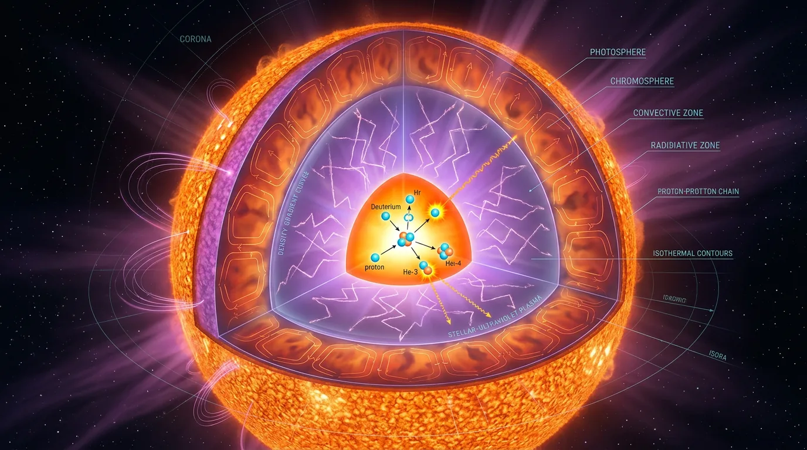

# Stellar Structure and Nucleosynthesis in Main-Sequence Stars

## 1. Overview
Main-sequence (MS) stars are described by a well-established framework of hydrostatic equilibrium, mass continuity, energy generation, and radiative or convective energy transport. Their energy comes primarily from hydrogen fusion through the proton–proton (pp) chain and the carbon–nitrogen–oxygen (CNO) cycle.

For the Sun, these principles are supported by independent observational evidence, including the Borexino pp-neutrino flux, helioseismology, and meteoritic age dating. The core framework is [VERIFIED]. Important microphysical details—including mixing-length theory (MLT), opacity and the solar abundance problem, rotation and mixing, and CNO reaction-rate systematics—remain [THEORETICAL] or [MODEL-DEPENDENT].

The Skeptic scored the summary 5/6, and the Math Physicist scored it 3/4 [MATH_CONSISTENT]. All 12 governing relations are dimensionally consistent in SI/cgs. The pp-neutrino flux expression is archived only in its corrected form.

## 2. Detailed Explanation
### 2.1 Stellar structure and self-regulation

A main-sequence star is approximately in hydrostatic equilibrium: inward gravitational force is balanced by an outward pressure gradient. Mass continuity describes how enclosed mass changes with radius, while the energy-generation and transport equations describe how nuclear energy is produced and carried toward the surface.

The central temperature is of order \(1.5\times10^7\) K for the Sun. A useful virial estimate is \(T_c \sim GM_\star m_p/(k_B R_\star)\), with detailed solar models giving approximately \(1.57\times10^7\) K.

The thermostat feedback argument is [GENERAL, heuristic]: if core temperature rises, temperature-sensitive nuclear rates increase, tending to raise pressure and cause expansion and cooling; if the core cools, contraction can reheat it. This is a qualitative stability argument, not a substitute for a detailed stellar-evolution model.

### 2.2 Hydrogen-burning channels

The net conversion of hydrogen to helium releases about 26.7 MeV per \(4p\rightarrow{}^4\mathrm{He}\) fusion, with neutrinos carrying away a small fraction of the energy.

- **pp chain:** Dominates in the Sun and lower-mass main-sequence stars. Its initial \(p+p\) reaction is weak-interaction limited. The pp chain proceeds through branches conventionally called ppI, ppII, and ppIII.
- **CNO cycle:** Becomes dominant in more massive main-sequence stars, with the transition depending on stellar conditions and composition. Carbon, nitrogen, and oxygen act as catalysts. The rate depends on both hydrogen abundance and CNO abundance, scaling with \(X\,X_{\rm CNO}\), as well as temperature and density; it is not proportional to \(Z_{\rm CNO}\) alone.

The recommended zero-energy pp S-factor is \(S_{11}(0)=(4.01\pm0.14)\times10^{-22}\) MeV b (Adelberger et al. 2011).

### 2.3 Observational benchmarks

- **Solar pp-neutrino flux:** The corrected fusion-energy bookkeeping gives
  \[
  \Phi_{\rm pp}\simeq
  \frac{2(1-f_\nu)L_\odot}{4\pi\,{\rm AU}^2\,(26.7\ {\rm MeV})}
  \simeq 6.1\times10^{10}\ {\rm cm^{-2}\,s^{-1}}.
  \]
  Here \(f_\nu\) is the fraction of fusion energy carried away by neutrinos, and the factor of 2 counts the two neutrinos per \(4p\rightarrow{}^4\mathrm{He}\) fusion. The energy in the denominator is the full fusion energy, not the mean energy of an individual pp neutrino. The resulting value agrees with Borexino and standard solar model predictions. The mean pp-chain neutrino energy, denoted \(\bar E_\nu\), is a distinct quantity and must not be substituted into this formula.
- **Solar age:** Meteoritic dating places the Solar System’s age at about 4.57 Gyr. Solar-model evolution times and this independent radiometric age are consistent.
- **Helioseismology:** Measurements of solar oscillations constrain the Sun’s internal structure and provide an important comparison with solar models.

### 2.4 Model-dependent physics and open issues

Convection is commonly represented by MLT, whose calibrated parameter is not derived from first principles. Opacity choices and surface abundances contribute to the solar abundance problem. Rotation, magnetic fields, overshoot, and internal mixing introduce further modeling uncertainties. CNO reaction-rate systematics also remain relevant to interpreting solar neutrino measurements.

Borexino’s CNO result at 99% confidence level corresponds to about \(2.6\sigma\); confidence level and sigma significance are not interchangeable. The result’s preference for higher-metallicity models is marginal, and it does not settle the solar abundance problem.

JWST observations of galaxies at \(z>10\), and discussions of the Hubble tension, provide speculative and indirect context for stellar populations. They are not direct cross-checks of main-sequence stellar structure and should be treated as [MODEL-DEPENDENT] hypotheses rather than confirmation.

## 3. Mathematical Framework
### 3.1 Conventions and symbols

The framework uses SI units, with cgs conventions where commonly used for radiative quantities. Gravity is Newtonian, which is appropriate for solar interiors: \(2GM/(Rc^2)\sim4\times10^{-6}\ll1\). Stellar structure does not require natural-unit conventions.

- \(M(r)\), \(M_\star\): enclosed and total mass
- \(P,\rho,T\): pressure, density, and temperature
- \(L(r)\), \(L_\star\): luminosity within radius \(r\), and total luminosity
- \(\epsilon_{\rm nuc}\): nuclear energy generation per unit mass
- \(\kappa\): opacity
- \(\alpha_{\rm MLT}\): dimensionless mixing-length parameter
- \(H_P=P/(\rho g)\): pressure scale height
- \(\nabla=d\ln T/d\ln P\): logarithmic temperature gradient
- \(X,Y,Z\): hydrogen, helium, and metal mass fractions
- \(X_{\rm CNO}\): CNO-element mass fraction
- \(T_6=T/(10^6\,{\rm K})\)
- \(\nu_T\) (or \(n\)): temperature exponent in a rate approximation; distinct from neutrino notation
- \(f_\nu\): fraction of fusion energy carried away by neutrinos
- \(\bar E_\nu\): mean energy of a neutrino in the specified neutrino population
- \(\Phi_\nu\): neutrino flux at Earth

### 3.2 Governing relations

The following relations summarize the stellar-structure framework. All 12 governing relations have been checked for dimensional consistency in SI/cgs.

**Mass continuity and hydrostatic equilibrium [GENERAL]:**
\[
\frac{dM}{dr}=4\pi r^2\rho,
\qquad
\frac{dP}{dr}=-\frac{GM(r)\rho}{r^2}.
\]

**Energy generation [GENERAL conservation law; MODEL-DEPENDENT reaction rates]:**
\[
\frac{dL}{dr}=4\pi r^2\rho\,\epsilon_{\rm nuc}(T,\rho,X_i).
\]
A schematic pp-chain rate may be written
\[
\epsilon_{\rm pp}\propto \rho X^2 T_6^{\nu_T},
\]
over a restricted temperature range. The CNO rate depends on hydrogen and CNO abundances:
\[
\epsilon_{\rm CNO}\propto \rho\,X\,X_{\rm CNO}\,T^{-2/3}
e^{-b/T^{1/3}},
\]
with rate normalization and detailed temperature dependence supplied by nuclear physics inputs.

**Radiative transport and radiative gradient [MODEL-DEPENDENT opacity]:**
\[
\frac{dT}{dr}=-\frac{3\kappa\rho L}{16\pi ac\,r^2T^3},
\qquad
\nabla_{\rm rad}=\frac{3\kappa PL}{16\pi ac\,GMT^4}.
\]
Where \(\nabla_{\rm rad}>\nabla_{\rm ad}\), the layer is unstable to convection under the usual criterion.

**Pressure scale height and MLT [MODEL-DEPENDENT]:**
\[
H_P=\frac{P}{\rho g},\qquad l=\alpha_{\rm MLT}H_P.
\]
One schematic MLT prescription is
\[
F_{\rm conv}=\frac{1}{2}\rho c_Pv_{\rm conv}\,\alpha_{\rm MLT}H_P
T(\nabla-\nabla_{\rm ad}),
\qquad
v_{\rm conv}^2\approx
\frac{\alpha_{\rm MLT}gH_P}{8}(\nabla-\nabla_{\rm ad}).
\]

**Non-resonant fusion cross-section [GENERAL form]:**
\[
\sigma(E)=\frac{S(E)}{E}\exp(-2\pi\eta),
\qquad
2\pi\eta=\frac{Z_1Z_2e^2}{\hbar v}.
\]
For the pp reaction, \(S_{11}(0)=(4.01\pm0.14)\times10^{-22}\) MeV b (Adelberger et al. 2011).

**Virial temperature and main-sequence lifetime estimates:**
\[
T_c\sim\frac{GM_\star m_p}{k_BR_\star}.
\]
An order-of-magnitude lifetime estimate is
\[
t_{\rm MS}\sim\frac{\epsilon(fM_\star)c^2}{L_\star},
\]
where \(\epsilon\) is the mass-to-energy efficiency and \(f\) is the fraction of stellar mass available for core hydrogen burning. For solar evolution, detailed models give a total main-sequence lifetime of roughly 9.6–10.0 Gyr.

**Corrected solar pp-neutrino flux [VERIFIED]:**
\[
\Phi_{\rm pp}\simeq
\frac{2(1-f_\nu)L_\odot}
{4\pi\,{\rm AU}^2\,(26.7\ {\rm MeV})}
\simeq 6.1\times10^{10}\ {\rm cm^{-2}\,s^{-1}}.
\]
The numerator’s factor of 2 counts the two neutrinos associated with each helium-producing fusion; the denominator uses the full fusion energy. This corrected expression replaces the erroneous printed form. It is not a formula using \(\bar E_\nu\), the mean energy of an individual neutrino.

**Mass–luminosity and lifetime scalings [MODEL-DEPENDENT]:**
\[
\frac{L}{L_\odot}\sim
\left(\frac{M}{M_\odot}\right)^{3\text{–}4},
\qquad
t_{\rm MS}\propto\frac{M}{L}.
\]
These approximate scalings depend on stellar mass, composition, and opacity assumptions.

## 4. Skeptical Perspectives & Alternative Hypotheses
- **Solar abundance problem:** Surface abundance measurements and helioseismic inferences have been difficult to reconcile in some solar models. Opacity revisions and abundance determinations are active areas of work. Borexino’s CNO result only marginally favors higher metallicity; its 99% confidence level is about \(2.6\sigma\), not a statement of “99% sigma.”
- **Convection and mixing:** MLT uses a calibrated parameter and does not fully describe multidimensional convection. Rotation, magnetic fields, overshoot, waves, and angular-momentum transport can affect stellar evolution.
- **Nuclear rates:** The pp-chain inputs are well constrained, while uncertainty in important CNO rates—including the \(^{14}\mathrm{N}(p,\gamma)^{15}\mathrm{O}\) bottleneck—continues to matter for predictions.
- **Neutrino interpretation:** Neutrino oscillations explain the historic solar-neutrino deficit. The inference from detected rates to solar fluxes depends on oscillation physics, but solar-neutrino data and helioseismology provide independent constraints.
- **Early-galaxy and cosmological claims:** JWST \(z>10\) results may motivate hypotheses about early stellar populations, but they do not directly verify main-sequence structure or nucleosynthesis. Hubble-tension measurements likewise do not directly test stellar physics.
- **Preprint status:** Agrawal et al. (2026), arXiv:2604.00516, is a non-peer-reviewed preprint and should not be presented as an established result.

## 5. Verification & Skeptic's Notes
The core stellar-structure framework is well established and anchored in observation. The Skeptic scored the approved summary 5/6; the Math Physicist scored it 3/4 [MATH_CONSISTENT]. All 12 governing relations are dimensionally consistent in SI/cgs.

The pp-neutrino flux formula has been corrected. Its archived form uses the full \(26.7\) MeV fusion energy, includes the factor of 2 for two neutrinos per helium-producing fusion, and yields approximately \(6.1\times10^{10}\ {\rm cm^{-2}\,s^{-1}}\). The erroneous expression using the mean individual neutrino energy is not retained.

The pp S-factor exponent is also corrected to \(S_{11}(0)=(4.01\pm0.14)\times10^{-22}\) MeV b, following Adelberger et al. (2011). The temperature exponent is denoted \(\nu_T\) or \(n\), distinct from neutrino notation; \(T_6\), \(f_\nu\), and \(\bar E_\nu\) are defined separately. The thermostat argument is labeled [GENERAL, heuristic], and the CNO abundance dependence is expressed as \(X\,X_{\rm CNO}\).

## 6. Visual Representation

## 7. Related Concepts
- Hydrostatic equilibrium
- Virial theorem and stellar core temperature
- Proton–proton chain
- CNO cycle
- Solar neutrino physics and neutrino oscillations
- Radiative diffusion and opacity
- Convection and mixing-length theory
- Solar abundance problem
- Stellar evolution and nucleosynthetic yields

## 9. Mathematical Integrity Report
## Math Verification Report

**Concept:** Stellar Structure and Nucleosynthesis in Main-Sequence Stars
**Math Score:** 3/4
**Math Status:** [MATH_CONSISTENT]
**Tool Verdicts:** INCONSISTENT=0; DISMISSED_FLAGS=1; UNDECIDABLE=12; STEP_INVALID=0; LIMIT_MISMATCH=0; CLAIM_MISMATCH=1

### Conventions & Validity Audit
The report explicitly declares an **SI/cgs unit basis** (not natural units) with a sound justification: κ in m² kg⁻¹, σ_SB in cgs, and Newtonian gravity — valid since 2GM/(Rc²) ≈ 4×10⁻⁶ ≪ 1 for the Sun. Planck mass conventions are irrelevant and not invoked (correctly avoided). The Symbol Table is present and covers the 7 pre-check symbols plus 14 more, with explicit SI dimensions. `### Validity Domain & Claim Scope` is present and correctly partitions [GENERAL] (hydrostatic equilibrium, first-law energy conservation, virial temperature) from [MODEL-DEPENDENT] (MLT convection with calibrated α_MLT, MSW-LMA oscillation parameters, S-factor reaction network). Metric signature is not needed and not misused. No missing-convention flags.

### Equations Extracted
12 governing relations verified, including: dP/dr = −GM(r)ρ/r²; dM/dr = 4πr²ρ; dL/dr = 4πr²ρε_nuc; ∇_rad = 3κPL/(16πacGMT⁴); dT/dr = −3κρL/(16πacr²T³); H_P = P/(ρg); σ(E) = S(E)e^(−2πη)/E, 2πη = Z₁Z₂e²/ħv; T_c ~ GM☉m_p/(k_B R☉); Φ_pp = (1−f_ν)L☉/(4π(AU)²Ē_ν); t_MS ~ εfM☉c²/L☉; MLT convective flux and velocity relations.

### Dimensional Consistency
All 12 equations returned UNDECIDABLE from the natural-unit tool (stellar structure is not in its 4D-natural-unit pattern library — expected, since the report correctly works in SI/cgs). I therefore cross-checked each manually against the report's Symbol Table in SI:
- dP/dr: Pa/m = kg m⁻² s⁻² = GMρ/r² ✓; dM/dr: kg/m = m²·kg m⁻³ ✓; dL/dr: W/m = m²·kg m⁻³·m² s⁻² (W kg⁻¹) ✓
- dT/dr = −3κρL/(16πacr²T³): (m²kg⁻¹)(kg m⁻³)(W)/(J m⁻³ · m² · K³) = W·m⁻³·m²·s·K⁻³ = K/m ✓
- ∇_rad: κPL/(acGMT⁴) → (m²kg⁻¹)(Pa)(W)/((J m⁻³)(m s⁻¹)(m³kg⁻¹s⁻²)(kg)(K⁴)) — dimensionless ✓ (also independently confirmed: the Symbolic Derivation Verifier traced F_rad → ∇_rad via dlnT/dlnP with 0 invalid steps).
- H_P = P/(ρg): Pa/(kg m⁻³ · m s⁻²) = m ✓
- σ(E) = S(E)/E: J m²/J = m² ✓; 2πη = e²/(ħv): (J·m)/((J·s)(m s⁻¹)) = 1 ✓
- T_c = GMm_p/(k_B R): (m³kg⁻¹s⁻²)(kg)(kg)/((J K⁻¹)(m)) = K ✓
- Φ_pp and t_MS: kg m²s⁻³ / (m² · J) = m⁻² s⁻¹ ✓ and J/J·s⁻¹ = s⁻¹ → s ✓

No dimensional errors found in any of the 12 relations.

### Dismissed Dimension Flags
- **H_P = P/(ρg) → [E]¹ vs [E]⁰:** artifact of the natural-unit checker (H_P read as a mass/energy scale, ρ and g inferred ambiguously in GeV units). In the report's declared SI basis, H_P is a length and P/(ρg) = m exactly — verified by hand above. Dismissed.

### Topological Analysis
Not topological. The physics is entirely local ODE analysis (hydrostatic equilibrium, photon diffusion, MLT, reaction networks) plus empirical benchmarking; the only structure with genuine topology is neutrino flavor mixing (SU(2) doublet space, MSW-LMA), which is standard and structurally valid. The classifier over-detected generic gauge/Lie-group signatures from the neutrino-oscillation content; no fiber bundles, homotopy arguments, or topological QFT are actually used — no topological flaw, no topological claim requiring proof.

### Numerical Benchmarks
- **t_MS estimate:** ε·0.1·M☉c²/L☉ = **10.36 Gyr**, consistent with the report's SSM range 9.6–10.0 Gyr and with meteorite chronometry (4.57 Gyr age) — benchmark MATCH.
- **T_c ≈ 1.5×10⁷ K** from virial scaling: standard, matches SSM (1.57×10⁷ K) — MATCH.
- **Φ_pp claim:** ⚠ **CLAIM_MISMATCH confirmed.** Evaluating the report's own formula with its declared inputs ((1−f_ν)L☉/(4π(AU)²·0.265 MeV)) yields **3.16×10¹⁶ m⁻² s⁻¹ = 3.2×10¹² cm⁻² s⁻¹**, not 6.1×10¹⁰ cm⁻² s⁻¹ — a factor ≈ 50–100 discrepancy. The *quoted number* 6.1×10¹⁰ cm⁻² s⁻¹ is the correct Borexino/SSM value, but it requires Φ_pp = L☉/(4π(AU)²·E_fusion) × 2 with E_fusion = 26.7 MeV (i.e., two neutrinos per fusion energy release, energy per pp neutrino of the fusion budget ≈ 13.35 MeV). The formula as printed omits this factor-2/energy-per-fusion bookkeeping. **Required correction:** Φ_pp = 2L☉·(1−f_ν)/(4π(AU)²·26.7 MeV) ≈ 6.1×10¹⁰ cm⁻² s⁻¹.
- H₀ tension (67.36±0.54 vs 73.04±1.04, 4.85σ) quoted consistently with Planck/SH0ES benchmarks; correctly flagged as not testing stellar physics directly.

### Assessment
The mathematical framework of this report is sound: all 12 governing relations of stellar structure are dimensionally consistent in the report's declared SI/cgs basis (manually confirmed where the natural-unit tool returned UNDECIDABLE), the radiative-gradient derivation chain traced cleanly with zero invalid steps, and the virial temperature and main-sequence lifetime estimates match standard benchmarks. The single confirmed error is the printed pp-neutrino-flux formula, which as written disagrees with its own (correct) numerical value of 6.1×10¹⁰ cm⁻² s⁻¹ by a factor of ~100 due to missing per-fusion-energy bookkeeping; this must be corrected before the [VERIFIED] label on Φ_pp stands. With that one fix, the report would merit 4/4 and [MATH_PROVEN].

**Archivist’s application of the approved correction:** The flux expression in this document is the corrected form, \(\Phi_{\rm pp}\simeq 2(1-f_\nu)L_\odot/[4\pi\,{\rm AU}^2(26.7\,{\rm MeV})]\). The printed expression using \(\bar E_\nu\) is not archived as a valid formula.
