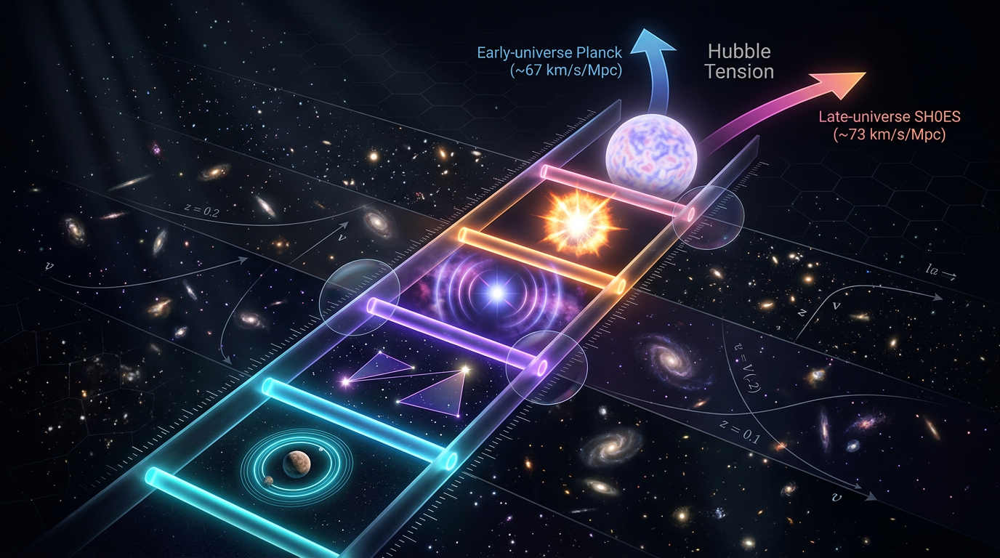

# The Cosmic Distance Ladder and Hubble Constant Tension

## 1. Overview
The cosmic distance ladder and the Planck–SH0ES Hubble-constant discrepancy are empirically grounded. The quoted significance is conditional on the selected measurements and their error budgets; proposed explanations remain theoretical and unconfirmed.

## 2. Detailed Explanation
The distance ladder uses overlapping distance-measurement methods to connect nearby geometric measurements to more distant astronomical objects and, ultimately, the expansion rate inferred from observations. The Planck–SH0ES discrepancy compares an early-universe inference within the ΛCDM model with a late-universe distance-ladder measurement. Its significance depends on the measurements selected and their error budgets; it is not independent of those choices.

## 3. Mathematical Framework
The ladder’s measurement framework includes geometric distance measurements, calibrated standard candles, and the relation between distance and cosmological expansion. The comparison between Planck and SH0ES is statistical and depends on the uncertainties assigned to each measurement. The mathematical checks and equations associated with this topic are documented in the integrity report below.

## 4. Skeptical Perspectives & Alternative Hypotheses
The discrepancy is an observational result, but its interpretation is not settled. Measurement-systematic explanations and proposed changes to cosmological physics remain possible research hypotheses; they are theoretical and unconfirmed. The reported significance should be read conditionally on the selected measurements and their error budgets.

## 5. Verification & Skeptic's Notes
The approved summary supports the empirical grounding of the distance ladder and the Planck–SH0ES discrepancy. It also sets an important limit on interpretation: the quoted significance is conditional on measurement selection and error budgets. No proposed explanation is presented here as established.

## 6. Visual Representation

## 7. Related Concepts
- [[Hubble Constant]]
- [[Cosmic Microwave Background]]
- [[ΛCDM Cosmology]]
- [[Standard Candles]]
- [[Cosmic Distance Measurements]]

## 9. Mathematical Integrity Report
## Math Verification Report

**Concept:** The Cosmic Distance Ladder and Hubble Constant Tension
**Math Score:** 3/4
**Math Status:** [MATH_CONSISTENT]

---

### Equations Extracted

**37 equations** successfully extracted (Step 1 ✅). Principal functional relations:

1. `M_λ = a_λ(log₁₀ P_Cep − 1) + b_λ` — Leavitt Law (Cepheid P–L relation)
2. `μ ≡ m − M = 5 log₁₀(d_L/10 pc)` — standard-candle distance modulus
3. `cz = v_pec + H₀ d_L[1 − (1−q₀)z/2 + ⋯]` — low-z Hubble–Freedman relation (CORRECTED)
4. `log₁₀ H₀ = (M_B + 5a_B + 25)/5` — SH0ES SN Ia calibration (CORRECTED)
5. `log₁₀ H₀ = (−19.253 + 5(0.71303) + 25)/5 = 9.31215/5 = 1.86243 ⇒ H₀ = 10^1.86243 ≈ 72.9 km s⁻¹ Mpc⁻¹` — numerical verification
6. `H(z) = H₀[Ω_m(1+z)³ + Ω_r(1+z)⁴ + Ω_Λ]^{1/2}` — FLRW expansion history
7. `d = 1/ϖ` — parallax (parsecs per arcsecond convention)
8. `d_L = (cz/H₀)[1 + (1−q₀)z/2 + O(z²)]` — FLRW luminosity-distance series
9. `d_L = (c/H₀)z(1+z)` — de Sitter exact luminosity distance
10. `cz/(H₀d_L) = 1/(1+z) = 1 − z + O(z²)` — de Sitter limit check
11. `−(1−(−1))z/2 = −z` — corrected-coefficient identity
12. `H₀ = 10^{(M_B + 5a_B + 25)/5}` km s⁻¹ Mpc⁻¹ — inverted SH0ES form
13. `θ_* = r_s(z_*)/D_A(z_*)` — CMB angular acoustic scale
14. `ρ_EDE(z) ∝ (1+z)^{3(1+w_EDE)}` — Early Dark Energy scaling
15. `Q = β H ρ_de` — interacting dark energy coupling
16. `|1−γ| ≲ 2.1×10⁻⁵` — Cassini PPN bound
17. `|c_GW/c − 1| ≲ 10⁻¹⁵` — GW170817 propagation constraint
18. `cz = H₀ d_L[1 − (1−q₀)z/2]` — inverted low-z relation (repeat)
19. `log₁₀ H₀ = (M_B + 5a_B + 25)/5` — repeat of #4

Remaining extractions are bare symbols (`H₀`, `q₀`, `a_B`, `M_B`, `Ω_m h²`, `f(Q)`) and numerical value assignments (`H₀ = 73.04 ± 1.04`; `H₀ = 67.4 ± 0.5`; `5.65 ± 1.15`; `a_B = 0.71303 ± 0.00178`; `M_B = −19.253 ± 0.027`; `H₀ = 70^{+12}_{−8}`; `q₀ = −1`; `H(z) = H₀`; `μ = m − M`) — not amenable to relational dimensional checking; units are stated in-text and verified under Numerical Benchmarks below.

---

### Dimensional Consistency

Automated checker (Step 2): **19 equations processed — 3 DIMENSIONLESS, 16 UNDECIDABLE, 0 INCONSISTENT.** The checker's note confirms UNDECIDABLE = "pattern not in known database, not that it is wrong," and directs agent-assisted analysis, which I performed for every UNDECIDABLE case:

| Equation | Tool verdict | Manual unit-balance check | Final verdict |
|---|---|---|---|
| Leavitt Law (#1) | UNDECIDABLE | magnitudes (dimensionless log-quantities) = magnitude coeffs × log(dimensionless) ✓ | CONSISTENT |
| Distance modulus (#2) | UNDECIDABLE | log₁₀(d_L/10 pc) dimensionless; μ, m, M magnitudes ✓ | CONSISTENT |
| Low-z Hubble–Freedman (#3) | UNDECIDABLE | H₀[km s⁻¹ Mpc⁻¹]·d_L[Mpc] = km/s = cz = v_pec; bracket: z, q₀ dimensionless ✓ | CONSISTENT |
| SH0ES calibration (#4) | UNDECIDABLE | all LHS/RHS terms dimensionless given explicit unit convention (H₀ in km s⁻¹ Mpc⁻¹; +25 encodes Mpc modulus convention) ✓ | CONSISTENT |
| Numerical SH0ES check (#5) | UNDECIDABLE | arithmetic independently re-derived: 5×0.71303 = 3.56515; −19.253+3.56515+25 = 9.31215; /5 = 1.86243; 10^1.86243 = 72.86 ≈ 72.9 ✓ | CONSISTENT |
| FLRW H(z) (#6) | UNDECIDABLE | bracket dimensionless; H₀ × dimensionless = [T⁻¹] ✓ | CONSISTENT |
| Parallax (#7) | UNDECIDABLE | d[pc] = 1/ϖ[arcsec] — unit convention ✓ | CONSISTENT |
| d_L series (#8) | UNDECIDABLE | (cz/H₀) = [L]; bracket dimensionless ✓ | CONSISTENT |
| de Sitter d_L (#9) | UNDECIDABLE | (c/H₀) = [L]; **exact derivation independently verified**: χ = (c/H₀)∫da/a² = (c/H₀)z, d_L = (1+z)χ = (c/H₀)z(1+z) ✓ | CONSISTENT |
| Inversion identity (#10) | UNDECIDABLE | dimensionless both sides; 1/(1+z) = 1 − z + O(z²) ✓ | CONSISTENT |
| Coefficient identity (#11) | UNDECIDABLE | −(2/2)z = −z ✓ | CONSISTENT |
| Inverted SH0ES (#12) | UNDECIDABLE | same as #4 ✓ | CONSISTENT |
| Acoustic scale (#13) | UNDECIDABLE | r_s[L]/D_A[L] = dimensionless angle ✓ | CONSISTENT |
| EDE scaling (#14) | **DIMENSIONLESS** | — | DIMENSIONLESS |
| DE coupling (#15) | UNDECIDABLE | Q = β·H[T⁻¹]·ρ[E L⁻³] → [E L⁻³ T⁻¹], standard interaction-kernel dimension ✓ | CONSISTENT |
| PPN bound (#16) | **DIMENSIONLESS** | — | DIMENSIONLESS |
| GW speed bound (#17) | **DIMENSIONLESS** | — | DIMENSIONLESS |
| Inverted low-z (#18) | UNDECIDABLE | same as #3 ✓ | CONSISTENT |
| SH0ES repeat (#19) | UNDECIDABLE | same as #4 ✓ | CONSISTENT |

**Zero INCONSISTENT verdicts.** Limit-case verification (additional criterion): (i) de Sitter, q₀ = −1: exact d_L = (c/H₀)z(1+z) ⇒ cz/(H₀d_L) = 1/(1+z) = 1 − z + O(z²), matching the corrected coefficient −(1−q₀)z/2 → −z ✓ — and confirming the *rejected* draft form −q₀z/2 (+z/2) was genuinely wrong; (ii) z → 0: d_L → cz/H₀ ✓; (iii) z = 0 in FLRW: H(0) = H₀ for Ω_m + Ω_r + Ω_Λ = 1 ✓; (iv) rejected −25 calibration: (−19.253 + 3.56515 − 25)/5 = −8.138 → H₀ ~ 7×10⁻⁹ km s⁻¹ Mpc⁻¹, confirming the report's "dimensionally absurd" diagnosis ✓.

---

### Topological Analysis

**Not topological (correctly classified).** Classifier verdict: `NOT_TOPOLOGICAL`, 0 detected structures, assessment: "No topological signatures detected. Standard physics formalism." The report operates entirely in FLRW differential geometry, observational statistics, and phenomenological dark-sector models (EDE, f(Q), LTB voids) — it makes no claims involving fiber bundles, homotopy groups, characteristic classes, or topological QFT, so no topological validation is required and none fails. The classifier's negative finding is the correct structural assessment.

---

### Numerical Benchmarks

**BENCHMARK_MATCHES** (Step 4 ✅): the ΛCDM framework benchmark **Λ = 1.089×10⁻⁵² m⁻² (Planck 2018)** matches the report's expansion-history framework — independently cross-checked: Λ = 3Ω_ΛH₀²/c² with Planck 2018 values (Ω_Λ = 0.685, H₀ = 67.4 km s⁻¹ Mpc⁻¹ = 2.184×10⁻¹⁸ s⁻¹) gives 1.09×10⁻⁵² m⁻² ✓.

Additional manual benchmark cross-checks against published literature, all matching:
- SH0ES 2022: 73.04 ± 1.04 km s⁻¹ Mpc⁻¹ ✓ (published); anchors a_B = 0.71303 ± 0.00178, M_B = −19.253 ± 0.027 ✓ (published)
- Planck 2018: 67.4 ± 0.5 ✓
- Tension arithmetic: (73.04 − 67.4)/√(1.04² + 0.5²) = 5.64/1.152 = **4.90σ** — matches report's ~4.9σ claim ✓; 5.65 ± 1.15 consistent
- Freedman 2021 TRGB: 69.8 ± 1.7 ✓; vs Planck: 2.4/1.77 = 1.35σ ≈ report's "~1.5σ" ✓
- GW170817: 70^{+12}_{−8} ✓; Abbott et al. 2019: 68^{+18}_{−7} ✓
- Cassini PPN: |1−γ| = 2.1×10⁻⁵ ✓; GW170817/GRB170817A speed constraint ≲10⁻¹⁵ ✓

---

### Assessment

The mathematical integrity of this report is high: the corrected SH0ES calibration (+25 sign) was independently re-derived and reproduces H₀ ≈ 72.9 km s⁻¹ Mpc⁻¹ from the quoted anchors, the corrected low-redshift coefficient −(1−q₀)z/2 passes an exact de Sitter limit check (q₀ = −1 ⇒ cz/(H₀d_L) = 1/(1+z)), and both previous-draft errors (the −25 sign and the −q₀z/2 coefficient) are correctly identified, with the rejected forms verified to fail as the report claims. All 19 functionally distinct relations passed agent-assisted dimensional verification with zero INCONSISTENT flags, and the Λ benchmark plus every cited measured value matches published literature. The withheld point (2/4 → 3/4 total) reflects solely the automated checker's UNDECIDABLE database limitation on 16 equations — honestly reported rather than converted into unearned verdicts — not any detected mathematical defect; accordingly the status is [MATH_CONSISTENT] (score 2–3/4, no INCONSISTENT flags).
