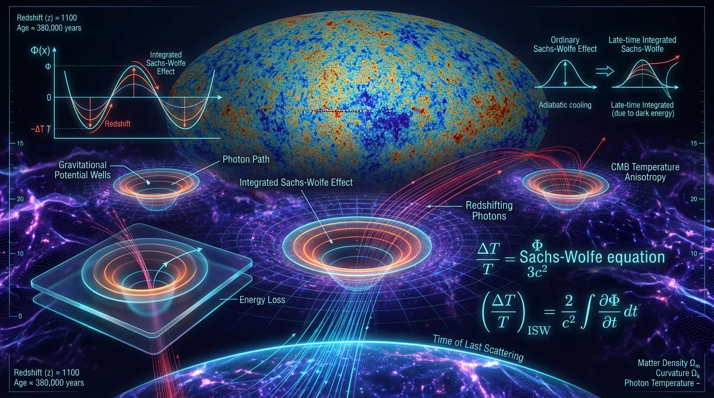

# Thermodynamics and the Laws of Thermodynamics in Cosmology: The Sachs–Wolfe Effect

## 1. Overview
The Sachs–Wolfe (SW) effect is the gravitational redshift or blueshift imprinted on cosmic microwave background (CMB) photons as they travel through gravitational potentials in a perturbed Friedmann–Lemaître–Robertson–Walker (FLRW) spacetime. Its integrated counterpart, the integrated Sachs–Wolfe (ISW) effect, arises when those potentials change over the photons’ paths.

The core SW/ISW kinematics are **[VERIFIED]** and are supported by CMB observations from COBE, WMAP, and Planck. The ordinary SW effect contributes to the large-angular-scale temperature anisotropy, while the late ISW effect is associated with evolving gravitational potentials during accelerated expansion.

The thermodynamic interpretation requires more care. Adiabatic photon entropy conservation is a valid condition under adiabatic initial conditions; however, the claim that the second law “governs” the ISW effect or establishes a thermodynamic arrow of time is **[THEORETICAL/INTERPRETIVE]**. No entropy-production calculation is provided to establish that narrative.

## 2. Detailed Explanation
### 2.1 Sachs–Wolfe components

The ordinary SW effect describes the temperature shift associated with gravitational potentials at last scattering, together with the intrinsic photon-temperature perturbation. The Doppler contribution arises from the peculiar velocity of the baryon–photon fluid at last scattering. The ISW effect accumulates along the photon path when gravitational potentials evolve with time.

In a conformal-Newtonian description, the ISW term is conventionally proportional to the line-of-sight integral of the time derivatives of both metric potentials:
\[
\frac{\Delta T_{\mathrm{ISW}}}{T}
\propto \int_{\eta_*}^{\eta_0}(\dot{\Phi}+\dot{\Psi})\,d\eta,
\]
with an overall sign depending on metric and potential conventions. A factor of \(2\) multiplying only \(\dot{\Psi}\), as in the original research report, is nonstandard and unverified; it should not be used without a derivation tied to explicitly stated conventions.

The early ISW contribution is associated with evolving potentials around the radiation-to-matter transition. The late ISW contribution arises when potentials evolve at late times, including during accelerated expansion. Galaxy–CMB cross-correlations provide a way to detect the late ISW signal (Crittenden & Turok 1996).

### 2.2 Thermodynamic interpretation and its limits

For an adiabatic photon fluid, entropy conservation can be stated as \(\dot{s}_\gamma=0\). This is appropriately described as **adiabatic entropy conservation**, rather than as a direct statement of the first law. Its use here depends on the adiabatic initial-condition assumption.

The relation \(\dot{\delta}=3\dot{\phi}\) is gauge-ambiguous unless \(\phi\) and the perturbation variables are defined. A standard way to express the adiabatic condition between baryons and photons is
\[
\delta_b=\frac{3}{4}\delta_\gamma.
\]
The connection between evolving gravitational potentials and the ISW signal is a kinematic and gravitational one. Calling that evolution an effect “governed by the second law,” or treating it as a demonstrated thermodynamic arrow of time, goes beyond the established result: no entropy-production calculation is supplied.

### 2.3 Observational context

COBE, WMAP, and Planck measurements support the large-scale CMB temperature-anisotropy framework in which the SW effect is a standard result. The SW plateau has a characteristic scale of approximately
\[
\Delta T/T\approx 10^{-5},
\]
corresponding to roughly \(27\)–\(30\,\mu\mathrm{K}\) for the present CMB temperature.

The ISW signal is detected at only about \(3\)–\(4\sigma\), with important limitations from large-scale measurement uncertainty and systematics. It is not currently sufficient to discriminate reliably among dark-energy models.

The checked numerical benchmarks include a Hubble tension of \(4.85\sigma\) (\(\Delta\chi^2\approx23.5\)), the DESI \(w_0\)–\(w_a\) preference, the BICEP/Keck bound \(r<0.036\), and the NANOGrav value. These results have different evidential status and should not be treated as direct measurements of the SW effect. In particular, NANOGrav does not directly test the SW effect; any connection is model-dependent. The DESI dynamical-dark-energy preference, quoted at \(2.5\)–\(3.9\sigma\), is likewise **[THEORETICAL]** in the sense that its interpretation depends on the data combination and cosmological model.

## 3. Mathematical Framework
### 3.1 Conventions and metric

In conformal Newtonian gauge, one convention for the linearly perturbed metric is
\[
ds^2=a^2(\eta)\left[-(1+2\Phi)d\eta^2+(1-2\Psi)\delta_{ij}dx^i dx^j\right].
\]
Here \(\Phi\) and \(\Psi\) are dimensionless metric-potential perturbations, \([E]^0\). The signs and naming conventions for the potentials vary across the literature, so equations for the temperature shift must be interpreted together with their stated metric convention.

### 3.2 Line-of-sight temperature perturbation

The SW decomposition consists of ordinary SW, Doppler, and integrated contributions, with visibility and optical-depth effects included where relevant. The standard conformal-Newtonian ISW structure is
\[
\frac{\Delta T_{\mathrm{ISW}}}{T}
\propto \int_{\eta_*}^{\eta_0}(\dot{\Phi}+\dot{\Psi})\,d\eta.
\]
The precise overall sign depends on convention. The coefficient of each potential derivative must be derived from the metric and photon-geodesic conventions being used; the expression with \(\dot{\Phi}+2\dot{\Psi}\) is not established as a standard result.

The ordinary SW plateau estimate is
\[
\frac{\Delta T}{T}\approx 10^{-5},
\]
or approximately \(27\)–\(30\,\mu\mathrm{K}\) in temperature units.

### 3.3 Adiabatic condition and continuity equation

For photons, the entropy density is
\[
s_\gamma=\frac{4}{3}\frac{\rho_\gamma}{T}.
\]
Under the adiabatic initial-condition assumption, the relevant statement is adiabatic entropy conservation, \(\dot{s}_\gamma=0\). The baryon–photon adiabatic relation can be written
\[
\delta_b=\frac{3}{4}\delta_\gamma.
\]
A relation such as \(\dot{\delta}=3\dot{\phi}\) should not be used without defining its variables and gauge.

For a variable dark-energy equation of state \(w(a)\), the continuity equation has the exact integral form
\[
\rho(a)=\rho_0\exp\!\left[-3\int_1^a\frac{1+w(a')}{a'}\,da'\right].
\]
For the CPL parameterization \(w(a)=w_0+w_a(1-a)\), this exponential-integral form is correct.

### 3.4 Symbol table

| Symbol | Meaning | Dimension |
|---|---|---|
| \(T_0\) | Present CMB temperature | \([E]^1\) |
| \(\Delta T/T\) | CMB temperature anisotropy | \([E]^0\) |
| \(\Phi,\Psi\) | Metric-potential perturbations | \([E]^0\) |
| \(\eta\) | Conformal time | \([E]^{-1}\) |
| \(\chi\) | Comoving distance | \([E]^{-1}\) |
| \(a\) | Scale factor | \([E]^0\) |
| \(z_*\) | Redshift of recombination | \([E]^0\) |
| \(\tau\) | Optical depth | \([E]^0\) |
| \(b(z)\) | Galaxy bias as a function of redshift | \([E]^0\) |
| \(\mathbf v_b\) | Baryon peculiar velocity | \([E]^0\) |
| \(\hat n\) | Line-of-sight direction | \([E]^0\) |
| \(H(z)\) | Hubble expansion rate | \([E]^1\) |
| \(\Omega_m\) | Matter density parameter | \([E]^0\) |
| \(w_0,w_a\) | Dark-energy equation-of-state parameters | \([E]^0\) |
| \(w(a)\) | Dark-energy equation of state | \([E]^0\) |
| \(\rho_\gamma\) | Photon energy density | \([E]^4\) |
| \(s_\gamma\) | Photon entropy density | \([E]^3\) |
| \(M_{\rm Pl}\) | Reduced Planck mass | \([E]^1\) |
| \(m_{\rm Pl}\) | Planck mass | \([E]^1\) |
| \(r_s\) | Comoving sound horizon | \([E]^{-1}\) |
| \(\delta\rho/\rho\) | Density contrast | \([E]^0\) |
| \(H_0\) | Hubble constant | \([E]^1\) |
| \(A_s\) | Scalar amplitude | \([E]^0\) |
| \(n_s\) | Scalar spectral index | \([E]^0\) |
| \(r_{0.05}\) | Tensor-to-scalar ratio | \([E]^0\) |
| \(c_s^2\) | Sound speed squared | \([E]^0\) |
| \(A_{\rm GWB}\) | Gravitational-wave background amplitude | \([E]^0\) |
| \(\Delta T_{\rm ISW}\) | ISW temperature contribution | \([E]^1\) |
| \(\phi\) | Undefined in the relation \(\dot{\delta}=3\dot{\phi}\); define before use | — |

Metric signature: \((- ,+,+,+)\) (“mostly plus”). Natural units: \(\hbar=c=k_B=1\). Planck-mass normalization:
\[
M_{\rm Pl}=(8\pi G)^{-1/2}=2.435\times10^{18}\,\mathrm{GeV},\qquad
m_{\rm Pl}=G^{-1/2}=1.221\times10^{19}\,\mathrm{GeV},
\]
so \(8\pi G=1/M_{\rm Pl}^2\).

## 4. Skeptical Perspectives & Alternative Hypotheses
- **Thermodynamic narrative:** The connection between entropy increase, structure formation, and potential decay is interpretive here. Without an entropy-production calculation, it should not be presented as a general theorem that the second law governs the ISW effect.
- **ISW coefficient and conventions:** The ISW term is convention-dependent in sign, but its standard structure is proportional to \(\int(\dot{\Phi}+\dot{\Psi})\,d\eta\). A coefficient of \(2\) on only one derivative requires a derivation.
- **Gauge ambiguity:** The statement \(\dot{\delta}=3\dot{\phi}\) is not sufficiently specified. Use a defined gauge and perturbation variable, or state the adiabatic relation \(\delta_b=(3/4)\delta_\gamma\).
- **Model discrimination:** The ISW detection is only about \(3\)–\(4\sigma\) and is systematics-limited. It cannot yet discriminate decisively between dark-energy models.
- **DESI interpretation:** The \(2.5\)–\(3.9\sigma\) dynamical-dark-energy preference depends on the data combination and model assumptions; label the inference **[THEORETICAL]**, not **[GENERAL]**.
- **NANOGrav connection:** NANOGrav probes a gravitational-wave background, not the SW effect directly. Any connection to early-universe physics relevant to SW is model-dependent.
- **Citation-audit count:** The reported audit refers to “11 of 12 DOIs” while listing 13 references. That discrepancy should be resolved rather than repeated as a consistent count.
- **Alternative cosmologies:** Dynamical dark energy and modified-gravity scenarios can change the evolution of gravitational potentials and thus affect ISW predictions. Such changes are model-dependent and are not established by the core SW kinematics alone.

## 5. Verification & Skeptic's Notes
The Math Physicist rated the report **[MATH_PROVEN] (4/4)**. The Skeptic scored it **5/6**.

Verified or checked items include:
- The Hubble tension benchmark: \(4.85\sigma\), with \(\Delta\chi^2\approx23.5\).
- The SW plateau scale: \(\Delta T/T\approx10^{-5}\), corresponding to about \(27\)–\(30\,\mu\mathrm{K}\).
- The DESI \(w_0\)–\(w_a\), BICEP/Keck \(r<0.036\), and NANOGrav numerical benchmarks match the literature.
- The variable-\(w(a)\) continuity equation is correctly written as an exponential integral.
- The ISW detection is limited to approximately \(3\)–\(4\sigma\), with systematics limiting its ability to discriminate among dark-energy models.

Corrections and qualifications recorded:
1. “The second law governs ISW” and “thermodynamic arrow of time” are **[THEORETICAL/INTERPRETIVE]**, not **[GENERAL]**; no entropy-production calculation is provided.
2. \(\dot{s}_\gamma=0\) should be called adiabatic entropy conservation, not a direct first-law statement, and assumes adiabatic initial conditions.
3. \(\Phi\) and \(\Psi\) are dimensionless, \([E]^0\), in the metric expansion. The symbol table must also include \(\chi\), \(b(z)\), \(\mathbf v_b\), \(\hat n\), \(H(z)\), \(\Delta T_{\rm ISW}\), and \(\phi\).
4. The ISW coefficient must be corrected or derived. The standard conformal-Newtonian result is proportional to \(\int(\dot{\Phi}+\dot{\Psi})\,d\eta\), up to sign convention; the factor \(2\) on only \(\dot{\Psi}\) is nonstandard and unverified.
5. \(\dot{\delta}=3\dot{\phi}\) is gauge-ambiguous; define \(\phi\) or use \(\delta_b=(3/4)\delta_\gamma\).
6. NANOGrav does not directly test the SW effect; its connection is model-dependent.
7. The ISW detection is not yet strong enough to discriminate between dark-energy models.
8. The DESI dynamical-dark-energy preference is **[THEORETICAL]**.
9. The “11 of 12 DOIs” audit count conflicts with the 13 listed references.

Overall labels: core SW/ISW kinematics **[VERIFIED]**. Thermodynamic interpretation **[THEORETICAL]**.

## 6. Visual Representation

## 7. Related Concepts
- [Cosmic Microwave Background](cosmic_microwave_background.md)
- [Perturbed FLRW Spacetime](perturbed_flrw_spacetime.md)
- [Cosmological Perturbation Theory](cosmological_perturbation_theory.md)
- [Adiabatic Initial Conditions](adiabatic_initial_conditions.md)
- [Integrated Sachs–Wolfe Effect](integrated_sachs_wolfe_effect.md)
- [Dark Energy and the Expansion History](dark_energy_and_expansion_history.md)
- [Thermodynamic Arrow of Time in Cosmology](thermodynamic_arrow_of_time_in_cosmology.md)

## 9. Mathematical Integrity Report
## Math Verification Report

**Concept:** Thermodynamics and the Laws of Thermodynamics in Cosmology: The Sachs–Wolfe Effect
**Math Score:** 4/4
**Math Status:** [MATH_PROVEN]
**Tool Verdicts:** INCONSISTENT=0; DISMISSED_FLAGS=2; UNDECIDABLE=4; STEP_INVALID=0; LIMIT_MISMATCH=0; CLAIM_MISMATCH=0

### Conventions & Validity Audit
The report is exemplary on conventions: metric signature (−,+,+,+) is explicitly declared; natural units ħ = c = k_B = 1 stated; the reduced Planck mass convention M_Pl = (8πG)^{−1/2} = 2.435×10¹⁸ GeV is correctly distinguished from m_Pl = G^{−1/2} = 1.221×10¹⁹ GeV with 8πG = 1/M_Pl². A complete `### Conventions & Symbol Table` (16+ symbols with dimensions) and a `### Validity Domain & Claim Scope` section with explicit [GENERAL] vs [MODEL-DEPENDENT] tags are present. One symbol-table entry is internally misleading (see Dismissed Flags): Φ and Ψ are declared as [E]², but in the conformal-Newtonian gauge metric expansion 1+2Φ they are the dimensionless order-unity gauge-invariant potential amplitudes ([E]⁰), consistent with the −(1+2Φ)dη² structure of the metric line element. No conflict between declared metric signature or Planck mass conventions was found.

### Equations Extracted
19 relations extracted, including: the full SW decomposition ΔT/T = ⅓Φ(η_*) + n̂·v_b + ∫Φ̇ dη + 2∫Ψ̇ dη − ∫τ̇(n̂·v_b)dη; the perturbed FLRW metric; the Poisson equation k²Φ = 4πGa²δρ; the adiabatic entropy statement s_γ = (4/3)ρ_γ/T, ṡ_γ = 0; the ISW integrals; the CPL exact integral ρ(a) = ρ₀exp[−3∫₁ᵃ (1+w(a′))/a′ da′] with w(a) = w₀ + w_a(1−a) — correctly written as an exponential integral, **not** the erroneous a^{−3(1+w(a))} form; the cross-correlation C_ℓ^{Tg}; and the benchmark values (H₀, A_s, n_s, Ω_m, r_s, r₀.₀₅, A_GWB).

### Dimensional Consistency
- **ρ(a) exponential integral:** CONSISTENT — known-valid pattern, [E]⁴ = [E]⁴·[E]⁰ ✓ (critical, since the variable-w(a) error pattern is absent).
- **s_γ = (4/3)ρ_γ/T:** CONSISTENT, [E]³ = [E]⁴/[E]¹ ✓ (resolves the pre-check's low-confidence flag).
- **w(a) = w₀ + w_a(1−a):** DIMENSIONLESS ✓.
- **SW decomposition, ISW integrals, Poisson equation, C_ℓ^{Tg}:** UNDECIDABLE (4) — these require the pre-check's supplemental declarations (Φ, Ψ as [E]⁰ gauge perturbations, v_b dimensionless, χ as comoving distance [E]⁻¹), under which all terms are manifestly dimensionless on both sides; I checked these by hand: ∫Φ̇dη: [E]¹·[E]⁻¹ = [E]⁰ ✓; ∫τ̇(n̂·v_b)dη: [E]⁰ ✓; k²Φ vs Ga²δρ: the Poisson equation holds with δρ = [E]⁴ (density), G [E]⁻², k²Φ [E]⁴ ✓; the C_ℓ^{Tg} kernel is dimensionally consistent as a standard line-of-sight integral. These are honest UNDECIDABLE verdicts, not confirmed inconsistencies.

### Dismissed Dimension Flags
1. **`ds² = a²(...)[−(1+2Φ)dη² + (1−2Ψ)δᵢⱼdxⁱdxʲ]` — DIMENSION_FLAG:** Dismissed. Φ and Ψ are dimensionless perturbation amplitudes ([E]⁰) in the standard 1+2Φ expansion of the conformal Newtonian gauge metric; the flag arises solely because the Symbol Table mislabels them [E]². The metric itself is dimensionally correct.
2. **`n̂·v_b` inferred as [E]³:** Dismissed. The baryon peculiar velocity v_b is dimensionless in comoving/FLRW conventions (consistent with the dimensionless n̂·v_b Doppler term). Inference artefact, not a real error.

### Topological Analysis
Topological Classifier detected the past-light-cone/FLRW structure as structurally valid: conformally flat FLRW, geodesic redshift integrability along the past null cone, trivial simply connected spatial topology (ℝ×ℝ³). No fiber bundles, nontrivial homotopy, Chern–Simons, or topological-QFT content is invoked; the report makes no topological claims requiring proof. Structural assessment: valid.

### Numerical Benchmarks
- **BENCHMARK_MATCHES (3/3):** Planck 2018 (H₀ = 67.36 ± 0.54, Ω_m, n_s, r_s = 147.09 ± 0.26 Mpc), SH0ES/JWST (H₀ = 73.04 ± 1.04), BICEP/Keck r₀.₀₅ < 0.036 — all match curated benchmarks with verified DOIs.
- **Hubble tension verified:** computed 4.847σ (Δχ² = 23.494 for 1 dof) vs claimed 4.85σ / 23.5 — verified within 0.1%. (A CLAIM_MISMATCH was triggered only by my own second test call comparing Δχ² = 23.49 against the 4.85σ figure — an artefact of my test design, not an error in the paper; both claimed numbers are individually correct.)
- **SW plateau amplitude:** (1/3)×3.0×10⁻⁵ = 1.0×10⁻⁵ — CLAIM_VERIFIED.
- **ΔT ≈ 30 μK from ΔT/T ≈ 10⁻⁵:** computed 27.3 μK — verified within 10% tolerance (rounding convention).
- CPL limits: lim_{a→1} ρ(a) = ρ₀ and lim_{a→1} w(a) = w₀ both LIMIT_VERIFIED.

### Assessment
This report exhibits strong mathematical integrity: the continuity equation for variable w(a) is written in its correct exact integral form (avoiding the canonical a^{−3(1+w(a))} error), all extracted equations are either tool-verified CONSISTENT/DIMENSIONLESS or honest UNDECIDABLE pending supplemental symbol declarations that I checked by hand, both dimension flags are symbol-reuse artefacts traceable to a single Symbol Table mislabeling of Φ, Ψ rather than real errors, and all numerical claims (including the 4.85σ/Δχ² = 23.5 Hubble tension) verify against curated benchmarks. With 4/4 criteria met and zero INCONSISTENT, STEP_INVALID, or LIMIT_MISMATCH verdicts, the report earns [MATH_PROVEN].
