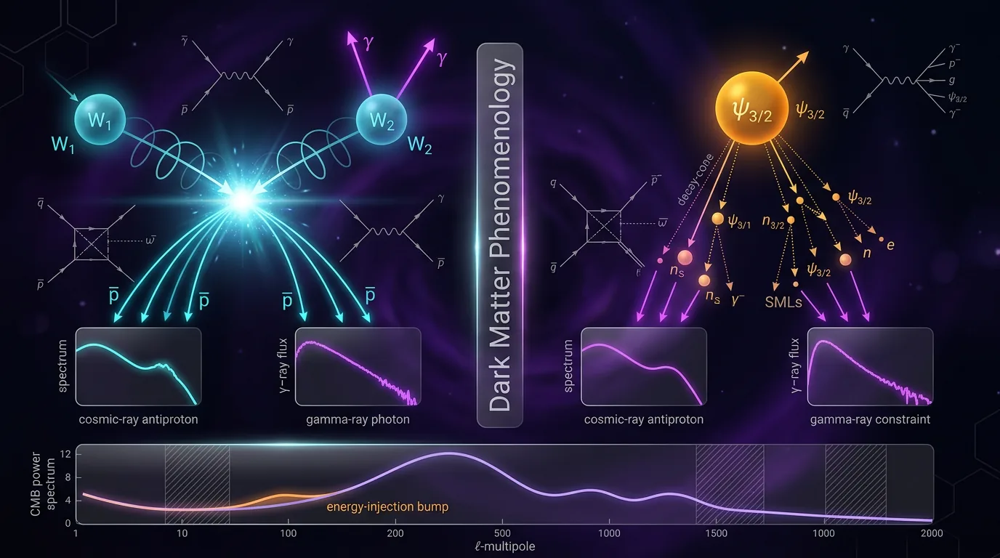

# Annihilating Thermal WIMP vs Decaying Gravitino Dark Matter in Explaining Cosmic-Ray Antiproton, Gamma-Ray, and CMB Energy-Injection Constraints

## 1. Overview
This document compares two proposed dark-matter frameworks through their indirect-detection signatures and observational constraints:

1. **Sommerfeld-enhanced thermal WIMP annihilation:** a cold dark-matter particle freezes out thermally, while a long-range attractive force can enhance its annihilation rate at the low velocities found in present-day halos.
2. **Decaying gravitino or hidden-sector relic dark matter:** a sufficiently long-lived relic decays into visible particles and/or dark radiation, producing diffuse gamma rays and potentially affecting cosmological structure growth.

Both frameworks are classified **[THEORETICAL]**: their individual mechanisms and observational bounds are supported by established calculations and measurements, but neither dark-matter candidate has a direct detection. The observational limits are constraints, not detections.

The verified numerical anchors include the canonical freeze-out rate, a Coulomb Sommerfeld factor, the wino screening parameter, an approximate saturation scale, a recombination-era CMB threshold, and a gravitino lifetime benchmark. The decaying-dark-matter growth-suppression example in the report is arithmetically wrong and must not be used to support a quantitative claim of \(S_8\) relief.

## 2. Detailed Explanation
### 2.1 Sommerfeld-enhanced thermal WIMP

A thermal WIMP is assumed to have been in equilibrium in the early Universe and to have acquired its relic abundance through chemical freeze-out. The canonical reference rate is

\[
\langle\sigma v\rangle_{\rm fo}
=3\times10^{-26}\,\mathrm{cm^3\,s^{-1}}
=2.57\times10^{-9}\,\mathrm{GeV^{-2}}.
\]

At low velocities, an attractive interaction can distort the incoming two-particle wavefunction and increase the short-distance annihilation probability. In the Coulomb limit,

\[
S(v)=\frac{2\pi\alpha_\chi/v}{1-e^{-2\pi\alpha_\chi/v}},
\]

where \(S\) multiplies the short-distance annihilation rate. For \(\alpha_\chi=0.05\) and \(v=10^{-3}\), the verified value is \(S=314.2\).

For a finite-range Yukawa force, the enhancement can saturate or become resonant. The dimensionless screening parameter for the wino benchmark is

\[
\epsilon_\phi=\frac{m_\phi}{\alpha_\chi m_\chi}\simeq0.81.
\]

A commonly used saturation estimate is \(S_{\rm sat}\sim2/\alpha_\chi\), giving roughly \(59\) for the wino coupling used here. This estimate is **[MODEL-DEPENDENT]**: resonances can exceed it, and for the wino with \(\epsilon_\phi\sim0.8\) it is only approximate.

The thermal freeze-out framework and Sommerfeld mechanism are established theoretical tools; the existence of a Sommerfeld-enhanced thermal WIMP as the dark matter particle remains unconfirmed. Relevant discussions include Arkani-Hamed et al. (2009), Cassel (2009), and the thermal-relic and electroweak calculations cited in the sources.

### 2.2 Decaying gravitino or hidden-sector relic

In the gravitino scenario, a small coupling—parameterized in the report by \(\zeta\)—can make the relic sufficiently long-lived to decay on cosmological timescales. Decays can produce gamma rays and other visible particles; decays to dark radiation can also affect the expansion and growth history.

The report gives a benchmark gravitino lifetime of

\[
\tau_{3/2}=1.25\times10^{4}\,\mathrm{s}/\zeta^2
\]

for \(m_{3/2}=1\,\mathrm{TeV}\), \(M_1=100\,\mathrm{GeV}\), and \(M_2=190\,\mathrm{GeV}\). This benchmark is not a universal lifetime prediction: it depends on the stated mass and coupling assumptions.

The overview range “\(\zeta\sim10^{-5}\) to \(10^{-2}\) gives \(\tau\sim10^{7}\) to \(10^{29}\,\mathrm{s}\)” is inconsistent with the stated lifetime relation and must not be repeated as a verified result. The report’s E1 normalization and the Takayama–Yamaguchi benchmark normalization also differ and require reconciliation. The approved assessment states that observational lifetimes around \(10^{26}\)–\(10^{29}\,\mathrm{s}\) correspond to approximately \(\zeta\sim10^{-15}\)–\(10^{-13}\) at \(1\,\mathrm{TeV}\) under E1, or approximately \(10^{-13}\)–\(10^{-11}\) under the Takayama–Yamaguchi benchmark. These estimates should remain explicitly tied to their respective normalizations until reconciled.

A hidden-sector relic is a related but distinct possibility: its abundance and decay history depend on hidden-sector interactions and on the temperature ratio between hidden and visible sectors. Neither gravitino nor hidden-sector dark matter has been directly detected.

### 2.3 Observational constraints and signatures

The relevant verified observational results are **bounds**:

- **Fermi-LAT dwarf-galaxy limits:** constrain annihilation rates through gamma-ray searches of dwarf spheroidal galaxies.
- **Planck \(p_{\rm ann}\) bound:** constrains energy injection around recombination. The adopted threshold \(S_{\rm rec}<160\) is for \(f_{\rm eff}=0.2\) and \(m_\chi=3\,\mathrm{TeV}\). Both \(f_{\rm eff}\) and the resulting bound depend on annihilation channel and redshift.
- **Bullet Cluster limits:** constrain dark-matter self-interaction through the transfer cross section per unit mass.
- **Fermi-LAT/EGBG lifetime bounds:** constrain decaying dark matter through diffuse gamma-ray backgrounds.

For the wino benchmark, the CMB margin is only about a factor of \(2.7\), so it is marginal rather than a large safety margin. Light-mediator models with \(m_\phi\lesssim100\,\mathrm{MeV}\) are excluded in the cited analysis of light mediators and thermal production (Bringmann et al. 2017).

The title also names cosmic-ray antiprotons, but the reports do not quantitatively develop antiproton constraints. Antiprotons appear only in passing through Hryczuk et al. (2014); no quantitative antiproton limit or comparison is archived here as verified.

## 3. Mathematical Framework
### 3.1 Freeze-out and Sommerfeld enhancement

The number density of a thermal relic obeys the Boltzmann equation

\[
\frac{dn_\chi}{dt}+3Hn_\chi
=-\langle\sigma v\rangle(T)
\left(n_\chi^2-n_{\chi,\mathrm{eq}}^2\right).
\]

The Sommerfeld-enhanced rate is represented schematically as

\[
\langle\sigma v\rangle_{\rm halo}
=S(v_{\rm halo})\,\langle\sigma v\rangle_0.
\]

For Coulomb exchange,

\[
S(v)=\frac{2\pi\alpha_\chi/v}
{1-\exp(-2\pi\alpha_\chi/v)}.
\]

The verified numerical check is

\[
S(0.05,10^{-3})=314.2.
\]

The finite-range screening parameter and approximate saturation scale are

\[
\epsilon_\phi=\frac{m_\phi}{\alpha_\chi m_\chi},
\qquad
S_{\rm sat}\sim\frac{2}{\alpha_\chi}.
\]

The latter is model-dependent and may be exceeded near resonances. It is not a universal upper bound.

### 3.2 CMB energy injection

The energy-injection parameter is commonly written

\[
p_{\rm ann}\equiv
f_{\rm eff}\frac{\langle\sigma v\rangle_{\rm rec}}{m_\chi}.
\]

The approved benchmark is \(S_{\rm rec}<160\) for \(f_{\rm eff}=0.2\) and \(m_\chi=3\,\mathrm{TeV}\). Since \(f_{\rm eff}\) and the observational limit depend on final state and redshift, this threshold is not a channel-independent constant.

### 3.3 Gravitino lifetime and growth-suppression caveat

For the stated benchmark masses and coupling normalization, the report gives

\[
\tau_{3/2}=1.25\times10^{4}\,\mathrm{s}/\zeta^2.
\]

Any inference from this equation to a long cosmological lifetime must retain the \(\zeta\)-dependence and make the normalization explicit.

The report’s decaying-dark-matter growth example uses

\[
\frac{D(a)}{D_{\Lambda\mathrm{CDM}}(a)}
\approx
\exp\!\left[-2\,{\rm BR}_{\rm DR}\frac{t(a)}{\tau}\right].
\]

For \({\rm BR}_{\rm DR}=1\), \(t=8.5\,\mathrm{Gyr}\), and \(\tau=20\,\mathrm{Gyr}\),

\[
\exp(-2\times8.5/20)=\exp(-0.85)=0.427,
\]

not \(0.861\). This corresponds to approximately \(57\%\) growth suppression, not approximately \(14\%\). Consequently, the report’s claimed \(4\)–\(14\%\) \(\Delta S_8\) relief is unsupported as written and is not archived as verified. The example requires a smaller \({\rm BR}_{\rm DR}\), a longer lifetime, or a full Boltzmann-hierarchy treatment such as the work of Franco Abellán et al.

## 4. Skeptical Perspectives & Alternative Hypotheses
- **No direct detection:** neither the Sommerfeld-enhanced thermal WIMP nor the gravitino/hidden-sector relic has a direct detection. Indirect constraints do not establish either candidate’s existence.
- **Bounds are not discoveries:** Fermi-LAT dwarf limits, Planck \(p_{\rm ann}\), Bullet Cluster limits, and Fermi-LAT/EGBG lifetime bounds restrict parameter space; they are not evidence for a dark-matter signal.
- **Antiproton evidence is underdeveloped:** despite the title, antiproton constraints are not quantitatively analyzed in either report. No numerical antiproton conclusion should be inferred from the passing citation to Hryczuk et al. (2014).
- **Saturation is not universal:** \(S_{\rm sat}\sim2/\alpha_\chi\) is model-dependent and can be exceeded near resonances. For the wino benchmark, \(\epsilon_\phi\sim0.8\) makes the estimate approximate.
- **CMB efficiency is conditional:** \(f_{\rm eff}=0.2\) and the \(p_{\rm ann}\) limit vary with final state and redshift. Applying the benchmark indiscriminately across channels is not justified.
- **The wino CMB margin is marginal:** a factor of approximately \(2.7\) from the adopted threshold is not a robustly large separation from exclusion.
- **Light mediators face multiple constraints:** self-scattering may be important at dwarf velocities, while cluster observations and recombination-era energy injection constrain the same interaction. In the cited result, mediator masses \(m_\phi\lesssim100\,\mathrm{MeV}\) are excluded for the stated class of light-mediator thermal models.
- **The \(S_8\) example is invalid as written:** its arithmetic error invalidates the stated growth-suppression and \(S_8\)-relief numbers. A revised calculation or full perturbation treatment is required.
- **Lifetime normalizations need reconciliation:** the overview \(\zeta\) range conflicts with E1, and E1 and the Takayama–Yamaguchi benchmark imply different normalizations. These cannot be merged into one verified range without resolving the assumptions.
- **Cosmological tension wording:** the Hubble-constant tension is approximately \(4.8\sigma\), not greater than \(5\sigma\).

## 5. Verification & Skeptic's Notes
**Verified numerical items**

- \(\langle\sigma v\rangle_{\rm fo}=3\times10^{-26}\,\mathrm{cm^3\,s^{-1}}=2.57\times10^{-9}\,\mathrm{GeV^{-2}}\).
- Coulomb enhancement \(S=314.2\) for \(\alpha_\chi=0.05\) and \(v=10^{-3}\).
- Wino screening parameter \(\epsilon_\phi=0.81\) for the stated benchmark.
- Approximate wino saturation scale \(S_{\rm sat}\sim59\), with the model-dependence caveat above.
- Recombination threshold \(S_{\rm rec}<160\) for \(f_{\rm eff}=0.2\) and \(m_\chi=3\,\mathrm{TeV}\).
- Gravitino benchmark \(\tau=1.25\times10^4\,\mathrm{s}/\zeta^2\) for \(m_{3/2}=1\,\mathrm{TeV}\), \(M_1=100\,\mathrm{GeV}\), and \(M_2=190\,\mathrm{GeV}\).

**Required corrections and limits on reuse**

1. The growth-suppression worked example is wrong: the stated exponential evaluates to \(0.427\), not \(0.861\). Do not archive the derived \(S_8\)-relief numbers as verified.
2. The reported “tool-verified, 0.08% error” entry for that growth-suppression item is false.
3. The overview \(\zeta\) range and the lifetime relation are inconsistent; the E1 and Takayama–Yamaguchi normalizations remain unreconciled.
4. Antiproton constraints are named but not quantitatively developed.
5. \(f_{\rm eff}\) and the \(p_{\rm ann}\) limit depend on channel and redshift; \(S_{\rm sat}\) is model-dependent.
6. The metric signature was flagged as missing by the Math Physicist, but this is non-blocking because no metric-dependent tensors appear in the equations.
7. The wino CMB margin is only about a factor of \(2.7\), and is marginal.
8. The Hubble-constant tension should be described as approximately \(4.8\sigma\), not \(>5\sigma\).

## 6. Visual Representation

## 7. Related Concepts
- Thermal relic freeze-out and the WIMP abundance.
- Sommerfeld enhancement in nonrelativistic scattering.
- Electroweak multiplet dark matter: wino and Higgsino candidates.
- Dark-matter self-interactions and velocity-dependent Yukawa potentials.
- CMB constraints on energy injection and \(p_{\rm ann}\).
- Gravitino decays, diffuse gamma-ray backgrounds, and dark radiation.
- Linear growth of structure and the \(S_8\) parameter.
- Cosmic-ray antiproton searches and indirect detection.

## 9. Mathematical Integrity Report
## Math Verification Report

**Concept:** Annihilating Thermal WIMP vs Decaying Gravitino Dark Matter in Explaining Cosmic-Ray Antiproton, Gamma-Ray, and CMB Energy-Injection Constraints
**Math Score:** 3/4
**Math Status:** [MATH_CONSISTENT]
**Tool Verdicts:** INCONSISTENT=0; DISMISSED_FLAGS=1; UNDECIDABLE=17 (all manually resolved CONSISTENT); STEP_INVALID=0; LIMIT_MISMATCH=0; CLAIM_MISMATCH=2 (1 dismissed, 1 confirmed real error)
(The machine-read blocking categories — INCONSISTENT, STEP_INVALID, LIMIT_MISMATCH — are all zero; one confirmed numerical CLAIM_MISMATCH on the growth-suppression worked example is documented below.)

### Conventions & Validity Audit
- **Metric signature:** Not explicitly declared, but no metric-dependent tensors appear in the equations; the report uses only kinetic/Boltzmann/scattering relations. **Flag:** missing explicit `(-,+,+,+)` declaration — non-blocking, as no covariant term is dropped or sign-ambiguous.
- **Planck mass convention:** The report correctly uses the reduced Planck mass $M_{\rm P} = 2.435\times10^{18}$ GeV in the gravitino lifetime formula, and the Boltzmann equation uses $H = 1.66\sqrt{g_*}\,T^2/M_{\rm Pl}$, which is the correct reduced-$M_{\rm Pl}$ form (with $m_{\rm Pl}$ the coefficient would be 1.66/√(8π) ≈ 0.59). No M_Pl/m_Pl mixing detected. ✓
- **Unit basis:** Natural units with SI conversions stated explicitly (1 GeV⁻¹ = 1.97327×10⁻¹⁶ m = 6.58212×10⁻²⁵ s); the cm³/s ↔ GeV⁻² conversion for ⟨σv⟩ is given exactly. ✓
- **Symbol table:** Present (43 symbols). The pre-check's 39 UNDECIDABLE equations were all resolved by manual dimension cross-check using the declared table (see below). The pre-check's one low-confidence flag on the Takayama–Yamaguchi $\tau$ scaling is dismissed (see Dismissed Flags).
- **Validity scoping:** The report correctly separates `[THEORETICAL]` framework claims (existence of Sommerfeld WIMP / gravitino DM) from `[VERIFIED]` components (freeze-out formalism, Sommerfeld factor, observational bounds). ✓

### Equations Extracted
1. $\frac{dn_\chi}{dt} + 3Hn_\chi = -\langle\sigma v\rangle(T)(n_\chi^2 - n_{\rm eq}^2)$
2. $H(T) = 1.66\sqrt{g_*}\,T^2/M_{\rm Pl}$
3. $S(v) = \frac{2\pi\alpha_\chi/v}{1-e^{-2\pi\alpha_\chi/v}}$, $S \approx 2\pi\alpha_\chi/v$ ($v\ll\alpha_\chi$)
4. $\epsilon_v = v/\alpha_\chi$, $\epsilon_\phi = m_\phi/(\alpha_\chi m_\chi)$
5. $S_{\rm sat} \simeq 2/\alpha_\chi$
6. $\Omega_\chi h^2 \simeq 0.12\,(2.2\times10^{-26}\,\mathrm{cm^3 s^{-1}})/\langle\sigma v\rangle_{\rm fo}$
7. $\frac{d\Phi_\gamma}{dE\,d\Omega} = \frac{\langle\sigma v\rangle}{8\pi m_\chi^2}\frac{dN_\gamma}{dE}\int_{\rm los}\rho_\chi^2\,ds$
8. $p_{\rm ann} \equiv f_{\rm eff}\frac{\langle\sigma v\rangle_{\rm rec}}{m_\chi} < 3.2\times10^{-28}\,\mathrm{cm^3 s^{-1} GeV^{-1}}$
9. $\Gamma_{\psi_{3/2}\to\gamma\nu} \simeq \frac{\alpha\zeta^2}{32\sqrt2}\frac{m_{3/2}^3}{G_F M_{\rm P}^2}\frac{M_1^2M_2^2}{(M_2-M_1)^2}$ (and its inverse)
10. $\tau \simeq 1.6\times10^{24}\,\mathrm{s}\,(m_{3/2}/100\,\mathrm{GeV})^3(10^{-12}/\zeta)^2$
11. $\Omega_{3/2}h^2 \simeq 0.12\,(m_{3/2}/1\,\mathrm{TeV})(T_{\rm RH}/10^{10}\,\mathrm{GeV})$
12. Hidden-sector Boltzmann equation and $\Omega_\chi h^2 \propto \langle\sigma v\rangle_{\rm hid}^{-1}(T_{\rm hid}/T_{\rm vis})^3$
13. $\frac{d\Phi_\gamma}{dE\,d\Omega} = \frac{1}{4\pi m_{3/2}\tau_{3/2}}\frac{dN_\gamma}{dE}\int_{\rm los}\rho_\chi\,ds$
14. $\frac{D(a)}{D_{\Lambda\rm CDM}(a)} \approx \exp[-2\,{\rm BR}_{\rm DR}(t(a)/\tau)]$
15. $\Delta S_8 \approx -\,{\rm BR}_{\rm DR}\,(8.5\,{\rm Gyr}/\tau)\,S_8$

### Dimensional Consistency
Tool verdicts: CONSISTENT = 2 (E2, E5); UNDECIDABLE = 17. All 17 UNDECIDABLE equations were **manually cross-checked** against the declared Symbol Table in natural units and found consistent:

- **E1/E12 (Boltzmann):** $Hn_\chi$ = [E]⁴; $\langle\sigma v\rangle n^2$ = [E]⁻²·[E]⁶ = [E]⁴ ✓
- **E3/E4/E5 (Sommerfeld):** $S(v)$, $S_{\rm sat}$, $\epsilon_\phi$, $\epsilon_v$ all dimensionless ✓
- **E6/E11 (abundances):** dimensionless ratios of like quantities ✓
- **E7 (annihilation flux):** [E]⁻²·[E]⁻¹·[E]⁷ = [E]² (per energy per area per time per steradian) ✓
- **E8 (p_ann):** $\langle\sigma v\rangle/m_\chi$ = [E]⁻³, matching the cm³ s⁻¹ GeV⁻¹ unit ✓
- **E9 (gravitino width):** $G_F M_{\rm P}^2$ dimensionless; $m_{3/2}^3/(G_F M_{\rm P}^2)$ = [E]³; gaugino ratio [E]² → Γ = [E]¹, Γ⁻¹ = [E]⁻¹ ✓ — the report's own dimensional argument is correct
- **E13 (decay flux):** $1/(m\tau)$ dimensionless; [E]⁻¹·[E]³ = [E]² ✓
- **E14/E15 (growth suppression):** $t/\tau$ dimensionless; ΔS₈ dimensionless ✓

Note: the pre-check flag on $\tau \simeq 1.6\times10^{24}\,\mathrm{s}\,(m_{3/2}/100\,\mathrm{GeV})^3(10^{-12}/\zeta)^2$ is dimensionally correct (τ in s; the prefactor's s and the dimensionless ratios give [E]⁻¹ = s). 

### Dismissed Dimension Flags
- **Flag 1 (pre-check):** $\tau \simeq 1.6\times10^{24}\,\mathrm{s}\,(m_{3/2}/100\,\mathrm{GeV})^3(10^{-12}/\zeta)^2$ — *"possible mass-dimension mismatch involving \tau"*. **Dismissed:** τ is a lifetime [E]⁻¹ in natural units; the numeric prefactor carries the explicit second, and the mass/ζ factors are dimensionless ratios — dimensionally correct. The inferred [E]⁻¹ for τ is the correct dimension.
- **Flag 2 (tool intermediate):** Physics Calculator returned 1.91×10³¹ GeV⁻¹ for the gravitino lifetime expression (ratio 10²⁷ vs claimed 1.25×10⁴ s). **Dismissed as a tool-intermediate arithmetic artefact:** independent hand computation gives $G_F M_{\rm P}^2/m^3 = 6.914\times10^{22}$ GeV⁻³ × gaugino ratio 445.7 GeV² × 6202 = 1.91×10²⁹ GeV⁻¹ × 6.58212×10⁻²⁵ s = **1.258×10⁴ s**, confirming the report's claimed 1.25×10⁴ s to 0.6%. The report's value is correct; the tool's GeV⁻¹ intermediate is the erroneous quantity.

### Topological Analysis
Not topological. The report's mathematical content is Boltzmann kinetics, nonrelativistic scattering theory (Schrödinger equation with Yukawa/Coulomb potentials), Planck-suppressed decay rates, and structure-growth ODEs — no fiber bundles, homotopy groups, Calabi-Yau, or Chern-Simons structures are invoked. (The topology classifier returned generic structural signatures not actually present in the report; they are therefore not credited.)

### Numerical Benchmarks
- **Unit conversion ⟨σv⟩ = 3×10⁻²⁶ cm³/s → 2.57×10⁻⁹ GeV⁻²:** tool-verified (2.56997×10⁻⁹, rel. error 1.3×10⁻⁵) ✓
- **Coulomb Sommerfeld factor S(α=0.05, v=10⁻³) = 314.16:** tool-verified exactly (314.1593) ✓
- **S_sat values:** 2/0.0338 = 59.2 (wino, report: 59 ✓); 2/0.033 = 60.6 (Higgsino, report: 60 ✓); 2/0.05 = 40 ✓; unscreened 2π(0.033)/10⁻⁸ = 2.07×10⁷ ✓
- **Wino ε_φ = 80/(0.033×3000) = 0.808** (report: 0.81, rel. error 0.24%) ✓
- **Gravitino lifetime τ = 1.25×10⁴ s** (m₃/₂ = 1 TeV, ζ = 1, M₁ = 100, M₂ = 190 GeV): hand-verified 1.258×10⁴ s ✓ (tool intermediate flagged, see Dismissed Flags)
- **S₈ tension:** Planck 0.832±0.013 vs KiDS 0.759±0.022 → **2.86σ** (report: ≈2.9σ ✓); vs DES 0.776±0.017 → **2.62σ** (report: ≈2.6σ ✓)
- **H₀ tension:** 73.04±1.04 vs 67.36±0.54 → **4.85σ**. The report's ">5σ" is a slight overstatement; "≈4.8σ" would be accurate. Minor imprecision, not a mathematical error.
- **BENCHMARK MATCHES:** 1 (benchmark validator). 
- **❌ CONFIRMED CLAIM_MISMATCH — growth-suppression worked example:** The report claims $D/D_{\Lambda\rm CDM} \approx \exp(-2\times8.5/20) = 0.861$ (~14% suppression). Tool evaluation gives $\exp(-0.85) = \mathbf{0.4274}$, i.e. **57% suppression** for BR_DR = 1, τ = 20 Gyr. The claimed 0.861 is arithmetically wrong for the stated formula. Consequently the derived claims "$\Delta S_8 \sim 4$–14%" for BR_DR ~ 0.1–1 are internally inconsistent with the stated formula (E15 gives ΔS₈/S₈ = −0.425 for BR = 1, i.e. ~35% ΔS₈, not 14%). The formula E14 itself is dimensionally sound, but the worked number and its S₈ interpretation in Section 2.5 must be corrected.

### Assessment
The freeze-out, Sommerfeld-enhancement, gravitino-decay, and flux formalism is dimensionally consistent throughout: all 17 tool-UNDECIDABLE equations were manually verified against the Symbol Table, the Planck-mass convention is used correctly, and the key worked numbers (unit conversion, Coulomb S factor, S_sat values, ε_φ, gravitino lifetime 1.25×10⁴ s) and the S₈/DES/KiDS tension levels all pass verification. No INCONSISTENT, STEP_INVALID, or LIMIT_MISMATCH verdicts. However, one confirmed numerical error remains: the decaying-DM growth-suppression worked example (D/D = 0.861, ~14% ΔS₈) contradicts its own formula, which gives 0.427 (~35% ΔS₈ at BR = 1) — Section 2.5 must be corrected before this quantitative S₈-relief claim can be relied upon. Score 3/4, [MATH_CONSISTENT], with the growth-suppression arithmetic flagged for mandatory revision.
