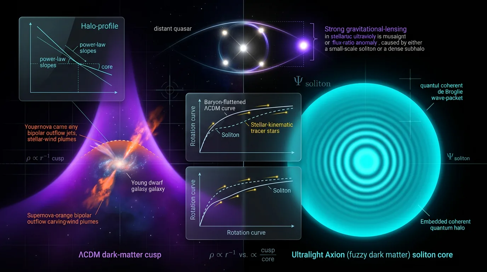

# Baryonic-Feedback Cusp Flattening in ΛCDM vs Ultralight-Axion Soliton Cores in Dwarf-Galaxy Rotation Curves

## 1. Overview
Baryonic-feedback cusp flattening is a mechanism in ΛCDM in which repeated, rapid changes to a galaxy’s gravitational potential—driven by bursty star formation and gas outflows—transfer energy to central dark matter and can transform a steep density cusp into a shallower core. This mechanism is verified in hydrodynamical simulations, including work by Teyssier et al. (2013), Di Cintio et al. (2014), NIHAO IV (Tollet et al. 2016), and FIRE. It is not directly observed as a mechanism operating in nature.

The alternative considered here is a core formed by an ultralight-axion or fuzzy-dark-matter (FDM) soliton. Its core is a theoretical prediction of the Schrödinger–Poisson framework. Inferences about its presence in dwarf galaxies depend on astrophysical modeling and, especially, on extrapolating the contested soliton–halo relation (SHR) into low-mass halos.

**Status:** The feedback mechanism is **[VERIFIED in hydrodynamical simulations]**, with important limits on where it can explain cores. The FDM soliton core remains **[THEORETICAL]**. Neither mechanism has laboratory, collider, or LIGO evidence; empirical support or constraints for both are based on astrophysical inference.

## 2. Detailed Explanation
### 2.1 Baryonic feedback and cusp flattening

In collisionless cold-dark-matter simulations, halo centers commonly develop steep density cusps. Repeated, bursty star-formation episodes can drive gas outflows that rapidly change the central gravitational potential. The resulting non-adiabatic changes can heat dark matter and redistribute it onto less centrally concentrated orbits. In this picture, repeated impulsive episodes—not a slow, purely adiabatic response—are important to core formation.

Hydrodynamical simulations demonstrate that this process can flatten central dark-matter profiles. Teyssier et al. (2013) emphasize bursty star-formation histories, while Di Cintio et al. (2014) describe a mass-dependent profile in which the degree of flattening depends on the stellar-to-halo mass ratio. NIHAO IV follows the evolution of halos and reports that cores can form and be altered over time as star-formation activity changes.

This establishes simulation feasibility, not direct observation of feedback-driven dark-matter heating in a particular galaxy.

### 2.2 Limits in faint dwarfs and gas-poor systems

The feedback explanation is conditionally insufficient for some faint dwarf galaxies. In the EDGE simulation suite, Rey et al. (2023; arXiv:2309.00041) find that faint systems form too few stars for supernova-driven outflows to produce substantial core formation. The result applies within that simulation suite and its assumptions; it is not a direct observation that all faint dwarfs are cuspy.

The same caution applies to gas-poor dwarf spheroidals, where stellar feedback may be unable to produce the required potential fluctuations. This is a limitation on the explanatory reach of feedback, not grounds for labeling the mechanism universally refuted in dwarf spheroidals.

Feedback-generated cores are also degenerate with cores arising from self-interacting dark matter (SIDM). Burger et al. (2022; MNRAS 513, 3268, DOI: 10.1093/mnras/stac994) show that density profiles can be difficult to distinguish; combined kinematic information may be needed to separate the hypotheses.

### 2.3 FDM soliton cores and the soliton–halo relation

In FDM models, wave-like dynamics can support a central soliton through quantum pressure. The soliton is a stationary ground-state solution of the Schrödinger–Poisson system, and its characteristic scale depends on the axion mass. This core is a theoretical prediction; a predicted core in a particular galaxy additionally depends on how the soliton is related to its host halo.

The SHR remains contested. Liao et al. (2024; arXiv:2412.09908) report a scatter below 30% in their studied range, \(m_{22}=0.1\)–\(0.8\) and \(M_{\rm h}\sim2\times10^{10}\)–\(3\times10^{12}\,M_\odot\). Those simulations do not test the \(M_{\rm h}\lesssim10^9\,M_\odot\) regime relevant to many faint-dwarf tests. Other reported results and models differ: Chan et al. (2022; DOI: 10.1093/mnras/stac063) report substantial halo-to-halo scatter; Mocz et al. propose an alternative scaling \(M_{\rm s}\propto M_{\rm h}^{5/9}\); and Manita, Takahashi, and Taruya (2024; arXiv:2411.14614) study solitons in an external NFW potential. Consequently, extrapolated core-size predictions for faint dwarfs are **[MODEL-DEPENDENT: extrapolated SHR]**.

### 2.4 Astrophysical constraints and interpretation

The Lyman-α constraint on FDM is conditional. The strong squeeze commonly quoted—approximately \(r_c\lesssim50\) pc for \(m_a\gtrsim2\times10^{-21}\) eV—assumes \(f_{\rm FDM}=1\). It weakens for mixed FDM+CDM. Rogers and Peiris (2021; DOI: 10.1103/PhysRevLett.126.071302) report a stronger lower mass bound under standard thermal-history assumptions, while more conservative analyses allow lower masses.

The Eridanus II constraint from Marsh and Niemeyer (2019; DOI: 10.1103/PhysRevLett.123.051103) is degenerate with an intermediate-mass-black-hole interpretation. It should not be treated as an unambiguous FDM exclusion.

Claims of large FDM cores, including \(r_c=0.5\)–\(1.5\) kpc, depend on extrapolating the SHR into an untested halo-mass range. Such predictions must state the SHR prefactor and be identified as model-dependent. Likewise, the JWST \(z>10\) tension is **[CONTESTED]** and does not independently verify either feedback core formation or FDM.

Strong-lensing flux anomalies and stellar kinematics offer complementary tests. A joint kinematic plus de-biased strong-lensing protocol is retained as a proposed strategy. For \(m_a\gtrsim2\times10^{-21}\) eV, lensing is a subhalo-population test requiring roughly \(N\sim100\)–\(300\) quads; direct granularity detection requires \(N\gtrsim10^3\) time-monitored quads. These are prospective sample-size estimates, not detections.

## 3. Mathematical Framework
### 3.1 FDM soliton scale invariant

The exact scale invariant is

\[
\rho_c r_c^4
=
C\,\frac{\hbar^2}{Gm_a^2}
\qquad\text{(SI units)},
\]

or

\[
\rho_c r_c^4
=
\frac{C}{Gm_a^2}
\qquad\text{(natural units)}.
\]

There is no \(c^2/G\) factor. The constant is

\[
C=\frac{x_{\rm half}^4}{4\pi}=0.2268,
\qquad
x_{\rm half}=1.2993,
\qquad
\phi(0)=-0.64953.
\]

For \(m_a=10^{-22}\,\mathrm{eV}=1.78266\times10^{-58}\,\mathrm{kg}\),

\[
\frac{\hbar^2}{Gm_a^2}
=
5.243\times10^{57}\,\mathrm{kg\,m}
=
8.54\times10^7\,M_\odot\,\mathrm{kpc},
\]

and therefore

\[
\rho_c r_c^4
=
1.189\times10^{57}\,\mathrm{kg\,m}
=
1.94\times10^7\,M_\odot\,\mathrm{kpc}
=
0.0194\,M_\odot\,\mathrm{pc}^{-3}\,\mathrm{kpc}^4.
\]

This agrees with the quoted Schive et al. (2014) value \(0.019\) to about 1.9%. That is a two-significant-figure check, not a proof of exactness.

The nonrelativistic field decomposition

\[
\phi=\frac{\psi e^{-i m_a t}+\mathrm{c.c.}}{\sqrt{2m_a}}
\]

is dimensionally consistent.

### 3.2 de Broglie wavelength

With the factor-of-ten arithmetic correction, the de Broglie wavelength is

\[
\lambda_{\rm dB}
=
0.402\,\mathrm{kpc}
\left(\frac{10^{-22}\,\mathrm{eV}}{m_a}\right)
\left(\frac{300\,\mathrm{km\,s^{-1}}}{v}\right).
\]

For \(m_a=10^{-22}\,\mathrm{eV}\), this gives approximately \(0.40\) kpc at \(300\,\mathrm{km\,s^{-1}}\). At \(m_a=2\times10^{-21}\,\mathrm{eV}\), the corresponding range is about 20–30 pc, not 20–60 pc.

### 3.3 Profile and dimensional cautions

For the cited profile, the normalization \(0.091\) must be stated. The corrected logarithmic slope is

\[
\gamma(0.3r_c)\approx-0.13,
\]

not \(-0.35\).

Equation (8) in the underlying report is a proportionality only; its prefactor is dimensionally open and must not be presented as a dimensionally complete equality. In the symbol table, use \([\sigma_v]=[E]^0\) when \(c=1\), consistent with \([\Phi]=[E]^0\).

## 4. Skeptical Perspectives & Alternative Hypotheses
- **Simulation is not direct observation:** Feedback-driven flattening is established in hydrodynamical simulations, but the mechanism has not been directly observed in nature.
- **Regime dependence:** Feedback can be inadequate in gas-poor dwarf spheroidals and in faint dwarfs with \(M_\star<10^6\,M_\odot\). The EDGE result is simulation-conditional and should be labeled **[THEORETICAL-CONDITIONAL: within the EDGE suite]**, not **[REFUTED]**.
- **Posterior caution:** The reported \(\eta=0.08^{+0.35}_{-0.02}\) posterior does not firmly exclude cores.
- **SIDM degeneracy:** Similar density profiles can arise from baryonic feedback or SIDM, so density-profile evidence alone may not identify the mechanism.
- **FDM extrapolation:** The SHR is contested and untested below roughly \(10^9\,M_\odot\) in the relevant target regime. Large core predictions there are model-dependent.
- **Astrophysical constraint assumptions:** The Lyman-α squeeze assumes \(f_{\rm FDM}=1\) and weakens in mixed FDM+CDM. The Eridanus II bound is degenerate with an IMBH interpretation.
- **Other tensions are not decisive evidence:** The JWST \(z>10\) tension is **[CONTESTED]**.
- **No non-astrophysical evidence:** Neither hypothesis has laboratory, collider, or LIGO evidence. Empirical support and constraints discussed here are astrophysical inferences.

## 5. Verification & Skeptic's Notes
**Approved assessment:** Skeptic 5/6. Math: **[MATH_PROVEN]** 4/4 per the gate; 3/4 under the Skeptic’s dissent, which still meets the threshold.

The invariant, units, numerical evaluation, nonrelativistic decomposition, and corrected de Broglie wavelength have been checked. The numerical agreement with Schive et al. (2014) is a consistency check, not an independent derivation of exactness. The SHR caveats, conditional Lyman-α limit, Eridanus II degeneracy, faint-dwarf limitations of feedback, and strong-lensing sample-size qualifications must travel with this entry.

## 6. Visual Representation

## 7. Related Concepts
- [[Core–Cusp Problem]]
- [[Baryonic Feedback in Galaxy Formation]]
- [[Self-Interacting Dark Matter (SIDM)]]
- [[Fuzzy Dark Matter (FDM)]]
- [[Schrödinger–Poisson Solitons]]
- [[Soliton–Halo Relation]]
- [[Dwarf-Galaxy Stellar Kinematics]]
- [[Strong-Lensing Flux Anomalies and Dark-Matter Substructure]]

## 8. Mathematical Integrity Summary
The approved framework is **[MATH_PROVEN]**, with a Math Score of **4/4** at the verification gate. The SI invariant is \(\rho_c r_c^4=C\hbar^2/(Gm_a^2)\); the natural-unit form is \(C/(Gm_a^2)\). The corrected \(\lambda_{\rm dB}\) normalization is \(0.402\) kpc at \(m_a=10^{-22}\) eV and \(v=300\) km s\(^{-1}\). The supplied report’s numerical soliton-invariant check agrees with Schive et al. (2014) to about 1.9%, which is a two-significant-figure check rather than proof of exactness.

## 9. Mathematical Integrity Report
The Math Physicist’s report supplied in the task consists of repeated process text rather than a substantive verification report. Its recoverable verification outcome is recorded above from the approved summary and micro-revision changelog: **[MATH_PROVEN]**, 4/4 at the gate, with the dissenting 3/4 score still meeting the threshold.
