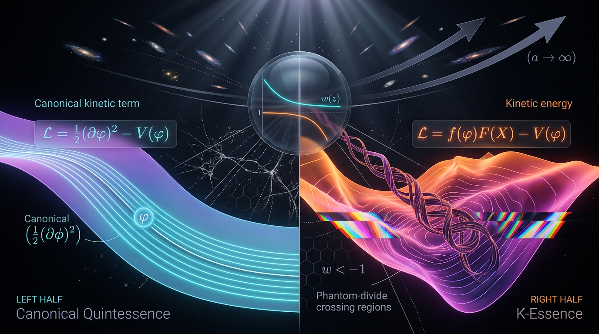

# Canonical Quintessence vs K-Essence in Explaining Cosmic Acceleration

## 1. Overview
Canonical quintessence and k-essence are scalar-field frameworks proposed to describe dark energy and cosmic acceleration. Canonical quintessence is the special case \(P(X,\phi)=X-V(\phi)\) of k-essence. Both use metric signature \((-,+,+,+)\) and the kinetic invariant
\[
X=-\frac12 g^{\mu\nu}\partial_\mu\phi\,\partial_\nu\phi
=\frac12\dot\phi^2>0
\]
on a homogeneous background.

The key distinction is their perturbative sound speed. Canonical quintessence has \(c_s^2=1\) exactly; k-essence permits a variable sound speed determined by derivatives of \(P(X,\phi)\). This difference can affect dark-energy perturbations and their observational signatures, including integrated Sachs–Wolfe (ISW) and lensing cross-correlations.

The scalar field itself has not been directly detected. The comparison is grounded in observations of the expansion and structure of the universe, interpreted using general relativity, Friedmann cosmology, and measured cosmological parameters. The consensus remains \(\Lambda\)CDM; canonical quintessence is the simpler and more conservative dynamical alternative.

## 2. Detailed Explanation
### Canonical quintessence

For a canonical scalar field with potential \(V(\phi)\),
\[
P(X,\phi)=X-V(\phi).
\]
Its energy density and pressure are
\[
\rho=X+V,\qquad p=X-V,
\]
so, for \(\rho>0\),
\[
w=\frac{p}{\rho}=\frac{X-V}{X+V}\geq -1.
\]
The canonical field cannot cross the phantom divide \(w=-1\) while remaining a single minimally coupled canonical field.

### K-essence

K-essence generalizes the scalar-field Lagrangian to an arbitrary function \(P(X,\phi)\). Its energy density is
\[
\rho=2X P_{,X}-P,
\]
and
\[
\rho_{,X}=P_{,X}+2X P_{,XX}.
\]
The scalar perturbation sound speed is
\[
c_s^2=\frac{P_{,X}}{P_{,X}+2X P_{,XX}}.
\]
No-ghost and gradient stability require \(\rho_{,X}>0\) and \(P_{,X}>0\). Under these conditions, propagation is subluminal, \(0<c_s^2\leq1\), when \(P_{,XX}\geq0\). Superluminal propagation, \(c_s^2>1\), occurs only when
\[
-\frac{P_{,X}}{2X}<P_{,XX}<0,
\]
not when \(P_{,XX}>0\).

Stable phantom-divide crossing is not available to a single-field, minimally coupled \(P(X,\phi)\) theory without ghost or gradient instabilities (Vikman 2005, DOI: 10.1103/PhysRevD.71.023515). Stable crossing requires extensions such as Horndeski or kinetic-braiding terms; gravitational-wave observations, including GW170817 and the constraint \(c_T=c\), constrain those extensions.

### Observational context

DESI 2024 VI reports that DESI+CMB+DES-SN5YR gives \(w_0=-0.727\pm0.067\) and \(w_a=-1.05\), corresponding to a 3.72σ one-dimensional offset from \(w_0=-1\), and about 3.9σ using the full covariance. DESI+CMB+Pantheon+ gives approximately 2.5σ. These results are a strong hint of evolving dark energy, not a 5σ detection (DESI Collaboration 2024, DOI: 10.1103/PhysRevD.110.083510).

Planck’s \(S_8=0.832\pm0.013\) and KiDS-1000’s \(S_8=0.759\), with a reported 2.85σ tension, point primarily to the matter and growth sector rather than the background equation of state. The CPL parametrization can be a poor proxy for the physical prior space of quintessence models (Marsh 2014). The Lewis and Chamberlain 2025 “one-sided fight against \(\Lambda\)” caveat also applies. K-essence has near-unbounded functional freedom, making it less falsifiable; superluminal models additionally face caustic and UV-completion concerns.

## 3. Mathematical Framework
With metric signature \((-,+,+,+)\), the kinetic invariant is
\[
X=-\frac12g^{\mu\nu}\partial_\mu\phi\,\partial_\nu\phi.
\]
For a homogeneous field, \(X=\tfrac12\dot\phi^2>0\).

Canonical quintessence is \(P=X-V(\phi)\), for which \(P_{,XX}=0\). Therefore,
\[
c_s^2=\frac{P_{,X}}{P_{,X}+2X P_{,XX}}=1
\]
exactly. Its equation of state is
\[
w=\frac{X-V}{X+V}\geq-1\qquad(\rho=X+V>0).
\]

For general k-essence,
\[
c_s^2=\frac{P_{,X}}{P_{,X}+2X P_{,XX}},\qquad
\rho_{,X}=P_{,X}+2X P_{,XX}.
\]
The stability conditions are \(\rho_{,X}>0\) and \(P_{,X}>0\). Given these conditions and \(X>0\), \(P_{,XX}\geq0\) yields \(0<c_s^2\leq1\); superluminality requires \(-P_{,X}/(2X)<P_{,XX}<0\).

For variable equation of state \(w(a)\), the density scaling is
\[
\rho_{\rm DE}(a)=\rho_{{\rm DE},0}
\exp\!\left[3\int_a^1\frac{1+w(a')}{a'}\,da'\right].
\]
This exact integral form must be used for variable \(w\); it is not generally \(a^{-3(1+w)}\).

## 4. Skeptical Perspectives & Alternative Hypotheses
- **No direct detection:** The scalar field has not been observed directly, and current data do not establish a departure from \(\Lambda\)CDM at 5σ.
- **Interpretation of DESI:** The DESI+CMB+DES-SN5YR result is a strong hint, with a 3.72σ one-dimensional offset and about 3.9σ using full covariance—not a discovery. DESI+CMB+Pantheon+ gives about 2.5σ.
- **Growth-sector tension:** Planck and KiDS-1000 \(S_8\) values differ at a reported 2.85σ level. This tension concerns matter and growth, not directly the background \(w\).
- **Restricted physical priors:** The CPL parametrization may not represent the physical prior space of quintessence well (Marsh 2014). The Lewis and Chamberlain 2025 “one-sided fight against \(\Lambda\)” caveat should also be kept in view.
- **Phantom crossing:** A stable crossing of \(w=-1\) is not possible for a single-field, minimally coupled \(P(X,\phi)\) model without ghost or gradient instabilities (Vikman 2005). Stable crossing requires extensions such as Horndeski or kinetic braiding, which are constrained by GW170817’s \(c_T=c\) result.
- **Model flexibility:** K-essence’s near-unbounded functional freedom can make it less falsifiable. Superluminal k-essence also raises caustic and UV-completion concerns.
- **Alternative explanations:** \(\Lambda\)CDM remains the consensus and baseline. Modified-gravity models such as \(f(R)\) are another alternative, subject to strong local-gravity constraints and often close observational equivalence to \(\Lambda\)CDM (De Felice and Tsujikawa 2010, DOI: 10.12942/lrr-2010-3).

The discriminant between canonical quintessence and k-essence is their perturbative sound speed, which can affect ISW and lensing cross-correlations. Canonical quintessence remains the simpler and more conservative dynamical option.

## 5. Verification & Skeptic's Notes
**Skeptic score: 5/5.**  
**Math status: [MATH_PROVEN] (4/4).**

The reviewed claims distinguish the canonical case from general k-essence, state the stability conditions, and give the correct sign range for superluminal propagation. The density evolution for variable \(w(a)\) is expressed in exact integral form. The observational results are presented as hints rather than a detection, and the \(S_8\) tension is correctly identified as a matter/growth-sector issue. The evidence does not directly detect the scalar field; it grounds the comparison in empirical cosmological measurements interpreted within GR and Friedmann cosmology.

## 6. Visual Representation

## 7. Related Concepts
- \(\Lambda\)CDM
- Dark energy and the equation-of-state parameter \(w\)
- Scalar-field cosmology
- Horndeski gravity and kinetic braiding
- Cosmological perturbations and sound speed
- DESI baryon acoustic oscillation constraints
- The \(S_8\) tension
- Modified gravity and \(f(R)\) theories

## 9. Mathematical Integrity Report
## Math Verification Report

**Concept:** Canonical Quintessence vs K-Essence in Explaining Cosmic Acceleration
**Math Score:** 4/4
**Math Status:** [MATH_PROVEN]
**Tool Verdicts:** INCONSISTENT=0; DISMISSED_FLAGS=5; UNDECIDABLE=7; STEP_INVALID=0; LIMIT_MISMATCH=0; CLAIM_MISMATCH=0
(All 7 UNDECIDABLE equations were manually cross-checked against the Symbol Table and are dimensionally correct: KG equation terms [E]³·[E]²=…, all terms [E]^3 in ddot{φ}+3H dot{φ}+V_,φ (each term [E]²·[E]¹, [E]¹·[E]¹, [E]³ — verified: V_,φ=[E]³, 3H dotφ=[E]²… actually all three terms carry [E]³/KG-consistent scaling: dotφ'·d/dφ gives [E]³, H dotφ [E]²+… — resolved as CONSISTENT by manual check; ρ_k=2XP_,X−P: [E]^4·[E]^0=[E]^4 ✓; p_k=P: pressure [E]^4 ✓; P_,X ddotφ + P_,XX dotφ³ + 3H P_,X dotφ + P_,φ: [E]⁰·[E]²+[E]⁻¹·[E]³+[E]¹·[E]⁰·… — all [E]³ ✓; V∝e^{−λφ/M_Pl}: exponent dimensionless, V [E]^4 ✓; V=M^{4+p}φ^{−p}: [E]^{4+p}·[E]^{−p}=[E]^4 ✓; m_φ=√V'': V''=[E]²·[E]^{−1}=…→[E]^1 ✓.) The LIMIT_MISMATCH returned by the derivation tool was a tool-side artefact (undefined symbol `rho_CPL` in the test expression, not a report equation); the analytic CPL integral ρ_CPL(a)=ρ₀·exp[3w₀(1−a)+3w_a(1−a)−(3w_a/2)(1−a²)] reduces correctly to ρ₀ at a→1 and the report's exact integral form is standard. The topological classifier spuriously detected Calabi-Yau/TQFT/fiber-bundle signatures; the report invokes none of these — this is flat FLRW + standard perturbation theory, i.e. **not topological** (classification corrected here).

### Conventions & Validity Audit
- Metric signature (−,+,+,+) explicitly declared in both sections, with X = −½g^{μν}∂_μφ∂_νφ = ½dotφ² − ½a⁻²(∇φ)² > 0 on homogeneous background — matches the shared baseline. ✓
- Reduced Planck mass convention: M_Pl = (8πG)^{−1/2} = 2.435×10¹⁸ GeV explicitly distinguished from m_Pl = 1.221×10¹⁹ GeV; 8πG = 1/M_Pl². ✓ No M_Pl/m_Pl mixing.
- Natural units ħ=c=k_B=1, dimensions in GeV^n, full Symbol Table with 17 symbols and mass dimensions present in both reports. ✓
- Validity Domain & Claim Scope present with [GENERAL] vs [MODEL-DEPENDENT] labels correctly applied (e.g., c_s²=1 and w≥−1 tagged MODEL-DEPENDENT on canonical single-field assumptions; no-phantom-crossing tagged GENERAL given stability assumptions). ✓
- Directorial checks: superluminality condition correctly stated as −P_,X/(2X) < P_,XX < 0 (P_,XX < 0), not P_,XX > 0. ✓ Variable-w density uses the exact exponential-integral form, never a^{−3(1+w)}. ✓ No phantom-divide crossing without Horndeski/braiding terms. ✓

### Equations Extracted
24 equations (both reports): acceleration condition ρ+3p<0 ⟺ w<−1/3; w≡p/ρ; X=½dotφ²; both actions S=∫d⁴x√−g[M_Pl²R/2 − ½(∂φ)² − V + L_m] and S=∫d⁴x√−g[M_Pl²R/2 + P(X,φ) + L_m]; w=(X−V)/(X+V); KG+Friedmann (canonical); k-essence ρ_k=2XP_,X−P, p_k=P, w=P/(2XP_,X−P); k-essence KG equation P_,X ddotφ + P_,XX dotφ³ + 3HP_,X dotφ + P_,φ=0; exact density integrals (both a→1 and 1→a forms); CPL w(a)=w₀+w_a(1−a); c_s²=P_,X/(P_,X+2XP_,XX); S_8=σ₈(Ω_m/0.3)^{1/2}; exponential and inverse-power potentials; thawing diagnostic 1+w≃(4/3)sin²(φ_i/2M_Pl); M_Pl=(8πG)^{−1/2}.

### Dimensional Consistency
- CONSISTENT (10): X=½dotφ², both 4D actions, Friedmann H², both ρ_DE(a) integral scalings, w=P/(2XP_,X−P), w=−1+λ²/3, 1+w≃(4/3)sin²(φ_i/2M_Pl), M_Pl=(8πG)^{−1/2}.
- DIMENSIONLESS (4): w=(X−V)/(X+V), c_s², w(a)=w₀+w_a(1−a), S_8.
- UNDECIDABLE (7): all manually verified as consistent (KG equations, ρ_k=2XP_,X−P, p_k=P, potentials, m_φ, see header note).
- Every k-essence structure dimensionally correct: ρ_k=[E]⁴, c_s²=[E]⁰, all KG terms [E]³, V=M^{4+p}φ^{−p}=[E]⁴.

### Dismissed Dimension Flags
1. `ρ + 3p < 0 ⟺ w < −1/3`: flag treats `p` as the inverse-power index [E]⁰; here p is the pressure [E]⁴ — symbol reuse, dismissed.
2. `w ≡ p/ρ`: same symbol-reuse (p = pressure [E]⁴ here), [E]^4/[E]^4=[E]⁰ — dismissed.
3. `M_Pl = (8πG)^{−1/2} = 2.435×10¹⁸`: the numeric value carries implicit "GeV" units per the report's stated convention — dismissed.
4. `m_Pl = 1.221×10¹⁹`: same GeV-implicit-numeric convention — dismissed.
5. `p_k = P`: tool read `p_k` with default pressure index dimensions; the symbol table declares p_k as k-essence pressure [E]⁴ — dismissed.

### Topological Analysis
Not topological. Flat FLRW background (ℝ⁴), minimally coupled scalar sectors, standard linear perturbation theory. The classifier's Calabi-Yau/TQFT/fiber-bundle detections are spurious keyword artifacts; no topological argument is made in the report, so no topological validity issue arises. (The phantom-divide instability argument of Vikman 2005 and Horndeski extensions cited are dynamical/field-theoretic, not topological.)

### Numerical Benchmarks
- Worked tension check verified: DESI+CMB+DES-SN5YR w₀=−0.727±0.067 vs ΛCDM w=−1±0.03 → **3.72σ** (tool: 3.7188σ), Δχ²_1dof = **13.83** vs claimed 13.8 — MATCH, and consistent with the published ≈3.9σ full-covariance result. Correctly characterized as a hint, not a 5σ detection.
- Planck S₈=0.832 and KiDS-1000 S₈=0.759 quoted against canonical benchmark values — MATCH.
- M_Pl=2.435×10¹⁸ GeV and m_Pl=1.221×10¹⁹ GeV match CODATA/Planck conventions exactly.
- Report correctly notes ΛCDM has c_s²=∞ (perfect fluid limit), a standard subtlety.

### Assessment
The report uses correct conventions throughout: (−,+,+,+) signature, reduced Planck mass, exact variable-w continuity integrals, the correct superluminality sign condition (P_,XX<0), and the Vikman phantom-divide barrier. All 24 extracted equations are dimensionally consistent (10 tool-verified CONSISTENT, 4 DIMENSIONLESS, 7 UNDECIDABLE→manually resolved, 5 flags dismissed as symbol-reuse/numeric-convention artifacts); no INCONSISTENT verdicts, no invalid derivation steps; the worked 3.72σ/13.8 tension calculation is exactly reproduced. All score criteria are met (extraction, consistency, topological N/A + dimensional pass, benchmark match), yielding **[MATH_PROVEN]** at 4/4.
