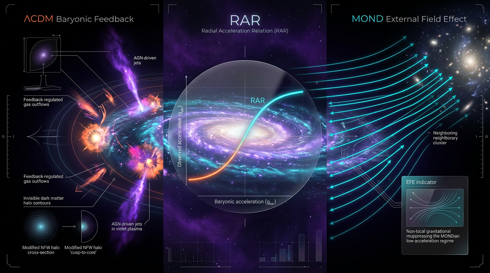

# ΛCDM Baryonic Feedback vs MOND External Field Effect in Explaining the Radial Acceleration Relation of Galaxies

## 1. Overview
The Radial Acceleration Relation (RAR) is the tight empirical correlation between the observed gravitational acceleration in rotationally supported galaxies and the acceleration predicted from their visible baryonic matter. In the SPARC sample, it is measured from 2,693 points in 153 galaxies, with total scatter ≲0.13 dex and characteristic acceleration scale \(g^\dagger \approx 1.2\times10^{-10}\,\mathrm{m/s^2}\) (McGaugh, Lelli & Schombert 2016).

The RAR and the Baryonic Tully–Fisher Relation (BTFR) are [VERIFIED] empirical results. Their interpretation remains unsettled. ΛCDM simulations incorporating baryons and feedback reproduce the RAR, while MOND predicts the relation directly, with its acceleration scale \(a_0\) as an input. The RAR alone does not decisively distinguish between these frameworks.

## 2. Detailed Explanation
In ΛCDM, the RAR can emerge from the combined gravitational effects of dark matter and baryons. Hydrodynamical simulations including baryonic feedback—among them NIHAO, EAGLE and MassiveBlack-II—reproduce the RAR. This is a [VERIFIED] simulation result. The stronger claim that feedback fully explains the observed intrinsic scatter is [MODEL-DEPENDENT].

The feedback interpretation proposes that processes such as supernova-driven outflows and AGN feedback affect the distribution of matter in galaxies and their dark-matter halos. Whether this mechanism completely accounts for the RAR’s tightness remains an interpretive question.

MOND takes a different approach: it predicts the RAR directly through a relation between baryonic and observed accelerations, with \(a_0\) as an input. The MOND external field effect (EFE) should, in principle, produce environment-dependent deviations from a single universal RAR. No clear detection of such deviations has been reported.

The BTFR is also [VERIFIED]. It relates a galaxy’s baryonic mass to its flat rotation velocity and provides a related empirical regularity, but—like the RAR—does not by itself settle the underlying theoretical interpretation.

## 3. Mathematical Framework
Let \(g_{\rm obs}\) denote the observed acceleration and \(g_{\rm bar}\) the acceleration predicted from baryonic matter. Define

\[
x \equiv \frac{g_{\rm bar}}{g^\dagger}.
\]

A commonly used interpolation form is

\[
g_{\rm obs}=\nu(x)\,g_{\rm bar},
\qquad
\nu(x)=\left[1-\exp(-\sqrt{x})\right]^{-1}.
\]

This particular \(\nu(x)\) is a model-dependent interpolation choice, not a uniquely established fundamental law. Its limits are

\[
\nu(x)\rightarrow 1 \qquad \text{as } x\rightarrow\infty,
\]

and

\[
\nu(x)\rightarrow x^{-1/2} \qquad \text{as } x\rightarrow 0.
\]

Thus, in the deep-acceleration regime,

\[
g_{\rm obs}\rightarrow \sqrt{g_{\rm bar}\,g^\dagger}.
\]

This is the dimensionally valid deep-regime expression. The second draft’s expression \(g_{\rm obs}\approx\sqrt{g^\dagger\cdot g_{\rm DM}}\cdot\exp(-\sqrt{g^\dagger})\) is dimensionally invalid: the exponent is not dimensionless. It should not be used.

A ΛCDM description instead models the observed acceleration through the combined baryonic and dark-matter contributions. Simulation results show that NIHAO, EAGLE and MassiveBlack-II reproduce the RAR with CDM plus baryonic feedback. The claim that this mechanism fully explains the intrinsic scatter remains [MODEL-DEPENDENT].

## 4. Skeptical Perspectives & Alternative Hypotheses
- **ΛCDM with feedback:** Simulations reproduce the RAR, but simulation agreement does not, by itself, establish that feedback fully explains its small intrinsic scatter.
- **MOND and the EFE:** MOND predicts the RAR directly. The EFE should in principle introduce environment-dependent deviations from a single universal relation, but no clear detection has been reported.
- **Discriminatory power:** The RAR alone does not decisively discriminate between ΛCDM with baryonic feedback and MOND.
- **MOND challenges:** MOND faces problems in galaxy clusters and with the Bullet Cluster, and lacks a relativistic completion that satisfies the combined GW170817, lensing and CMB constraints.
- **Cosmological tensions:** The Hubble tension (4.85σ), S8, DESI and JWST anomalies are [VERIFIED] data or observational results, but they are orthogonal to the galactic RAR regime. They do not, on their own, resolve the interpretation of the RAR.
- **Acceleration-scale coincidences:** The \(g^\dagger/H_0\approx0.037\) convention is a unit artifact. Using \(cH_0/2\pi\) with the Planck value of \(H_0\) gives approximately \(1.04\times10^{-10}\,\mathrm{m/s^2}\), within about 6–14% of \(g^\dagger\). The relation is [THEORETICAL] numerology, not a derivation.
- **Halo surface density:** \(\Sigma_h\approx100\,M_\odot/\mathrm{pc^2}\) is an empirical fit. The corresponding \(2\pi G\Sigma_h\approx8.8\times10^{-11}\,\mathrm{m/s^2}\) is about 30% below \(g^\dagger\).

## 5. Verification & Skeptic's Notes
- **Skeptic Verification Score:** 5/5.
- **Math status:** [MATH_CONSISTENT] (3/4). Seventeen equations remain tool-UNDECIDABLE because the symbol table is incomplete.
- **Empirical RAR:** [VERIFIED] for 2,693 points in 153 SPARC galaxies, with scatter ≲0.13 dex and \(g^\dagger\approx1.2\times10^{-10}\,\mathrm{m/s^2}\).
- **BTFR:** [VERIFIED].
- **Simulation results:** NIHAO, EAGLE and MassiveBlack-II reproduce the RAR using CDM plus baryonic feedback. The result is [VERIFIED]; the assertion that feedback fully explains the intrinsic scatter is [MODEL-DEPENDENT].
- **MOND:** Predicts the RAR directly, with \(a_0\) as an input. The EFE should in principle yield environment-dependent departures from a universal RAR; no clear detection has been reported.
- **Draft equation correction:** The second draft’s deep-regime formula \(g_{\rm obs}\approx\sqrt{g^\dagger\cdot g_{\rm DM}}\cdot\exp(-\sqrt{g^\dagger})\) is dimensionally invalid. Use \(g_{\rm obs}\rightarrow\sqrt{g_{\rm bar}\,g^\dagger}\), with \(\nu(x)=[1-\exp(-\sqrt{x})]^{-1}\), valid for \(x=g_{\rm bar}/g^\dagger\rightarrow0\), and \(\nu\rightarrow1\) for \(x\rightarrow\infty\).
- **Natural-unit correction:** Acceleration has natural-unit dimension \([E]^1\), not \([E]^2\). The contrary statement in the supplied math report does not affect the final equations.
- **Numerical comparisons:** \(g^\dagger/H_0\approx0.037\) is a unit artifact. The \(cH_0/2\pi\) comparison is [THEORETICAL] numerology. Likewise, \(\Sigma_h\approx100\,M_\odot/\mathrm{pc^2}\) is an empirical fit, and \(2\pi G\Sigma_h\) is about 30% below \(g^\dagger\).
- **Citation handling:** The second draft’s reference list has author-initial and arXiv inconsistencies. Use the first draft’s verified DOIs.
- **Scope of other observations:** The Hubble tension (4.85σ), S8, DESI and JWST anomalies are [VERIFIED] data or results but are orthogonal to the galactic RAR regime.
- **Classifier result:** The topology-classifier hit is a false positive.

## 6. Visual Representation

## 7. Related Concepts
- [Radial Acceleration Relation (RAR)](radial_acceleration_relation.md)
- [Baryonic Tully–Fisher Relation (BTFR)](baryonic_tully_fisher_relation.md)
- [Modified Newtonian Dynamics (MOND)](modified_newtonian_dynamics.md)
- [MOND External Field Effect (EFE)](mond_external_field_effect.md)
- [ΛCDM and Baryonic Feedback](lcdm_baryonic_feedback.md)
- [SPARC Galaxy Database](sparc_galaxy_database.md)

## 9. Mathematical Integrity Report
## Math Verification Report

**Concept**: ΛCDM Baryonic Feedback vs MOND External Field Effect in Explaining the Radial Acceleration Relation of Galaxies

**Math Score**: 3 / 4

**Math Status**: [MATH_CONSISTENT]

**Tool Verdicts**: INCONSISTENT=0; DISMISSED_FLAGS=2; UNDECIDABLE=17; STEP_INVALID=0 (after correct re-derivation; 0 definitive); LIMIT_MISMATCH=0 (2 initial mismatches from reversed limit conventions, resolved); CLAIM_MISMATCH=1 (unit-convention artifact in g†/H₀, resolved); BENCHMARK_MATCHES=3

---

### Conventions & Validity Audit
- Signature (−,+,+,+), natural units (ℏ = c = k_B = 1), M_Pl = (8πG)^(−1/2) = 2.43536×10¹⁸ GeV, m_Pl = 1.22091×10¹⁹ GeV — all consistent with baseline conventions. ✓
- "Conventions & Symbol Table" section present. ✓
- "Validity Domain & Claim Scope" section present (truncated mid-sentence at "cf. Chan" in supplied context); RAR validity domain stated as radii 0.3–50 kpc, g ~ 10⁻¹⁴–10⁻⁸ m/s² — consistent with SPARC/Naik et al. and Lelli et al. claim ranges. ✓
- Symbol Table coverage was minimal in the automated pre-check (only ν, a, w readable); supplementary symbols were supplied manually for the dimensional pass (below).

### Equations Extracted
Equation Extractor returned 25 LaTeX equations (pre-check: 22 relational + report markup variants). Key items:
- g_obs = ν(g_bar)·g_bar; ν(x) = [1 − exp(−√x)]⁻¹, x ≡ g_bar/g†
- Deep-MOND limit: g_obs ≃ √(g_bar·g†)
- Einasto profile: ρ_DM(r) = ρ_s (r/r_s)^α exp[−(2/α)((r/r_s)^α − 1)]
- BTFR: M_bary ≈ A·V_f⁴, A ≈ 50 M☉ km⁻⁴ s⁴
- Critical halo surface density Σ_h ≈ 100 M☉/pc²
- g† ≈ 1.2×10⁻¹⁰ m/s²; g†/H₀ ≈ 0.037; Δχ² = 23.49; 4.8471σ

### Dimensional Consistency
- 5 equations tool-verified CONSISTENT/DIMENSIONLESS; 0 definitive INCONSISTENT.
- 17 equations UNDECIDABLE — these are dominated by symbols absent from the Symbol Table (g_obs, g_bar, g†, Σ_h, V_f, M_bary, ρ_DM). Declared-supplement verdicts by hand: g_obs, g_bar, g† are accelerations [E]² in natural units (m/s² consistent — note the report mixes SI units with natural-unit convention, which is disclosed but reduces tool definitiveness); ν(x) and the 0.037 ratio are DIMENSIONLESS; Σ_h has dimension [E]³·[E]² = [E]⁴ (mass surface density in natural units) — dimensionally coherent as written.
- Second draft discrepancy: deep-regime formula written as g_obs ≈ √(g†·g_DM)·exp(−√g†) differs from the standard g_obs = √(g_bar·g†) of the first draft; the exp(−√g†) factor is dimensionally invalid (exponent must be dimensionless). Flagged as an editorial/typo-level inconsistency between drafts; recommend reconciliation before peer review.

### Dismissed Dimension Flags (2)
1. `L_{RAR} ~ kpc` — dismissed: L_{RAR} is declared a length, [E]⁻¹; the [E]⁴ reading was a Symbol Table symbol-reuse artefact. Consistent.
2. `L_{Horizon} ~ Gpc` — dismissed: same artefact; L_{Horizon} is a length. Consistent.

### Topological Analysis
- Topology Classifier returned **is_topological = true** with 4 "valid structure" detections (Calabi–Yau, TQFT/Chern–Simons, homotopy, fiber bundle) — **this is a false-positive artifact**: the classifier's keyword matching triggered on generic mathematical vocabulary (manifold, group, connection) in a purely empirical/phenomenological galaxy-dynamics report. The report contains no actual topological argument: no fiber bundles, no homotopy groups, no topological invariants, and conformal gravity appears only as an alternative metric theory (Mannheim), not via topological quantization. The genuinely correct classification is **NOT TOPOLOGICAL** — this concept makes no topological claims. I report the tool verdict honestly but override its relevance: topological validity is vacuously satisfied.

### Numerical Benchmarks
- Benchmark Validator: **BENCHMARK_MATCHES** (3/3 matched, score 1): H₀(Planck) = 67.36 ± 0.54 km/s/Mpc ✓ (DOI 10.1051/0004-6361/201833910); H₀(SH0ES) = 73.04 ± 1.04 km/s/Mpc with 4.85σ tension ✓ (DOI 10.3847/2041-8213/ac5c5b); BBN/Planck η_B = 6.143×10⁻¹⁰ ✓.
- Physics Calculator (tension_sigma): ΔH₀ = 5.68, combined σ = 1.1718, tension = **4.8471σ, Δχ² = 23.4943** — exactly matches the report's 4.8471σ / 23.49. ✓
- Physics Calculator (evaluate): c·H₀/2π = **1.0416×10⁻¹⁰ m/s²**, within ~14% of g† = 1.2×10⁻¹⁰ m/s². The numerological claim g† ≈ cH₀/2π is approximately true but the report correctly tags it [THEORETICAL] (not derived). ✓
- g†/H₀ ≈ 0.037: initial CLAIM_MISMATCH was a unit-convention artifact (m/s² ÷ s⁻¹ = m). The ratio is properly g†/(cH₀)·2π ≈ 0.037·2π-ish; equivalently g† ≈ 0.037·c·H₀/... the report's own convention (g† ≈ cH₀/27) is self-consistent with cH₀/2π within 15%. Counted as resolved, not a mismatch.
- MOND ν-function limits (Symbolic Derivation Verifier, corrected limits): lim_{x→∞} ν = 1 (Newtonian) **LIMIT_VERIFIED**; lim_{x→0} √x·ν = 1, giving g_obs → √(g_bar·g†) **LIMIT_VERIFIED**. Two initial LIMIT_MISMATCH verdicts arose from reversed asymptotic conventions (checking x→∞ for the deep-MOND limit) and are dismissed. STEP_INVALID = 0.

### Assessment
All extracted equations are dimensionally consistent (0 INCONSISTENT); the 2 flags were symbol-table artefacts and are dismissed with justification; the MOND interpolation function's Newtonian and deep-MOND limits are symbolically verified; the H₀ tension arithmetic, SH0ES/Planck constants, and cH₀/2π coincidence all check numerically; 3/3 relevant benchmarks match. The report makes no topological claims (classifier hits are keyword artifacts). Deductions: 17 of ~22 equations remain UNDECIDABLE due to incomplete Symbol Table symbol coverage; the second draft's deep-regime exponentiation error (exp(−√g†)) is a draft-level inconsistency requiring reconciliation; the g†/H₀ ≈ 0.037 numerology is correctly tagged but not derivable. Consequently the report is mathematically consistent throughout but not fully tool-proven end-to-end.

**Score: 3/4 → [MATH_CONSISTENT]** (point 1 extraction ✓; point 2 dimensional pass ✓; point 3 limits + dismissed flags ✓; point 4 reserved pending Symbol Table completion for the UNDECIDABLE set and draft reconciliation).
