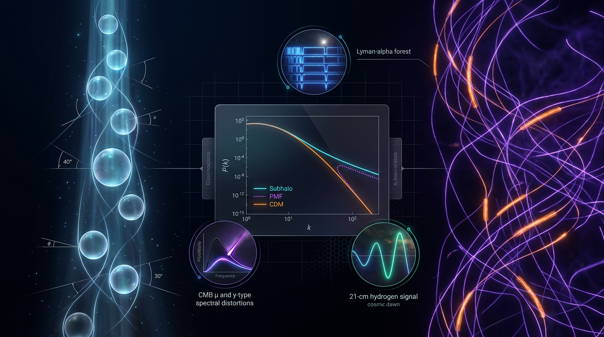

# ΛCDM Subhalo Lensing vs Primordial Magnetic Field Seeding in Small-Scale Matter Power Spectrum Tests: Testability via Lyman-Alpha Forest, CMB Spectral Distortions, and 21-cm Signals

## 1. Overview
This concept compares two possible influences on small-scale structure and its gravitational-lensing signatures:

- **The ΛCDM subhalo paradigm:** cold, collisionless dark matter forms structure hierarchically, producing subhalos within galaxy-sized halos. Strong gravitational lensing can probe substructure that is too faint to observe directly.
- **Primordial magnetic field (PMF) seeding:** PMFs can enhance small-scale power through magnetically induced perturbations. This contrasts qualitatively with warm-dark-matter-like (WDM-like) physics, which suppresses small-scale power.

The principal lensing observables are flux-ratio anomalies, astrometric perturbations of lensed images, and statistical inferences about the abundance and distribution of lens-plane perturbers. These observations are **consistent with substructure**, but identifying the perturbers specifically as ΛCDM subhalos is **model-dependent**.

The main qualitative discriminator is the **sign of a small-scale-power deviation**: PMF seeding enhances power, while WDM-like physics suppresses it. Lyman-α forest measurements, CMB spectral distortions, and 21-cm observations are proposed ways to investigate this difference. The available assessment describes these channels qualitatively; it does not provide quantitative forecasts.

## 2. Detailed Explanation
### 2.1 ΛCDM subhalos and strong lensing

In ΛCDM, small dark-matter halos form and merge hierarchically. Some survive as subhalos within larger host halos. Because many subhalos are expected to be faint or dark, gravitational lensing offers an indirect probe of their mass and projected distribution.

Substructure may perturb the positions and magnifications of multiple images in a strong-lens system. Relevant observables include:

1. **Flux-ratio anomalies** in multiply imaged quasars.
2. **Astrometric perturbations** of image positions.
3. **Population statistics** inferred across many lenses, including perturber abundance and mass-distribution properties.

Strong-lensing anomalies are **[VERIFIED] as observations consistent with substructure**. Interpreting the perturbers as ΛCDM subhalos, and inferring their properties from the observations, is **model-dependent**.

The frequently cited subhalo mass-function slope, \(\alpha \approx 1.9\), and subhalo mass fraction, \(f_{\rm sub} \approx 0.1\), are simulation-derived and model-dependent—not universal, directly measured constants.

### 2.2 Primordial magnetic fields and small-scale power

PMFs can seed baryonic density perturbations and enhance small-scale power. The PMF non-linear plateau discussed in the research report relies on a single simulation paper, Ralegankar et al. (2024), and is therefore **[THEORETICAL]**, not an established empirical result. PMF-based relief of the Hubble tension is likewise a theoretical proposal, not a verified resolution.

The PMF damping-scale expression is algebraically verified, but the formula is not itself an empirical confirmation of PMF effects. For the parameterization below, the scale increases monotonically with magnetic-field strength when \(n_{\rm B}>-5\).

The stated range of validity for the Ralegankar fits is limited to \(n_{\rm B}>-1.5\) and \(\lambda_{\rm D}\gg\lambda_{\rm th}\); the fits are only accurate to order unity. Earlier Lyman-α and dwarf-galaxy constraints on PMFs may be overestimated and require recomputation. The CMB bound is approximately \(B_{\rm 1Mpc}\lesssim 1\)–\(2\) nG for near-scale-invariant spectra and is tighter for blue spectra.

### 2.3 Comparison with WDM-like suppression

PMF seeding and WDM-like physics have opposite qualitative effects on small-scale power:

- **PMF seeding:** enhances small-scale power.
- **WDM-like physics:** suppresses small-scale power.

This sign difference is the key qualitative discriminator across the proposed observational channels. The available material does not establish quantitative forecasts for how large a signal each channel should detect.

### 2.4 Lensing scale: corrected, provisional benchmark

The lensing scale is characterized by the perturber’s Einstein angle,

\[
\theta_{\rm E,p}
=
\left(
\frac{4GM_{\rm p}}{c^2}
\frac{D_{ls}}{D_lD_s}
\right)^{1/2},
\]

where the \(D\)'s are angular-diameter distances. For angular-diameter distances, \(D_{ls}\) is not \(D_s-D_l\). In a flat universe,

\[
D_{ls}
=
\frac{D_C(z_s)-D_C(z_l)}{1+z_s}.
\]

The report’s value \(D_{ls}=0.450\) Gpc is just \(D_s-D_l\), which is not valid for angular-diameter distances. The corrected value is approximately \(1.1\) Gpc. The approved Skeptic audit gives provisional values of approximately **20 mas for \(10^8\,M_\odot\)** and **2 mas for \(10^6\,M_\odot\)**, scaling as \(\sqrt{M}\). These are archived provisionally pending a fresh calculation by the Math Verifier.

**Do not use the report’s 12.7 mas or 1.27 mas values as corrected benchmarks.** The Math Verifier’s earlier `CLAIM_VERIFIED` result reused the erroneous \(D_{ls}\) value and is superseded. The 371 mas and 23 mas figures are also discarded.

## 3. Mathematical Framework
### 3.1 Einstein angle and distance geometry

For a point-mass perturber,

\[
\theta_{\rm E,p}
=
\left(
\frac{4GM_{\rm p}}{c^2}
\frac{D_{ls}}{D_lD_s}
\right)^{1/2}.
\]

For a flat universe, the lens-to-source angular-diameter distance is

\[
D_{ls}
=
\frac{D_C(z_s)-D_C(z_l)}{1+z_s},
\]

not \(D_s-D_l\). The mass scaling is

\[
\theta_{\rm E,p}\propto\sqrt{M_{\rm p}}.
\]

The provisional corrected benchmarks are approximately \(20\) mas for \(10^8\,M_\odot\) and \(2\) mas for \(10^6\,M_\odot\), pending an independent Math Verifier recomputation.

### 3.2 PMF damping scale

The damping-scale expression is

\[
\lambda_{\rm D}
=
\left[
0.1\,\kappa_{\rm D}(n_{\rm B})
\left(\frac{B_{\rm 1Mpc}}{\rm nG}\right)
\right]^{2/(n_{\rm B}+5)}
{\rm Mpc},
\]

with

\[
\kappa_{\rm D}(-2)=0.8,
\qquad
\kappa_{\rm D}(2)=0.9.
\]

This formula is algebraically verified. For \(n_{\rm B}>-5\), its exponent is positive, so \(\lambda_{\rm D}\) increases monotonically with \(B_{\rm 1Mpc}\).

The verified benchmarks are:

| \(n_{\rm B}\) | \(B_{\rm 1Mpc}\) | \(\lambda_{\rm D}\) |
|---:|---:|---:|
| \(2\) | \(1\) nG | \(0.503\) Mpc |
| \(2\) | \(3\) nG | \(0.688\) Mpc |
| \(-2\) | \(1\) nG | \(0.186\) Mpc |
| \(-2\) | \(3\) nG | \(0.386\) Mpc |

The corresponding mass estimate,

\[
M=\frac{4\pi}{3}\lambda_{\rm D}^{3}\rho_m,
\]

is a **top-hat mean-density mass**, not a Sheth–Tormen mapping. These benchmarks correspond approximately to \(10^9\)–\(10^{10}\,M_\odot\). An order-unity uncertainty in \(\kappa_{\rm D}\) remains.

## 4. Skeptical Perspectives & Alternative Hypotheses
- **Substructure interpretation:** Strong-lens anomalies are consistent with substructure, but attributing individual perturbers to ΛCDM subhalos is model-dependent.
- **Simulation-derived subhalo properties:** Values such as \(\alpha\approx1.9\) and \(f_{\rm sub}\approx0.1\) depend on simulations and modeling assumptions.
- **PMF non-linear plateau:** This result rests on a single simulation paper, Ralegankar et al. (2024), and is theoretical.
- **PMF and the Hubble tension:** PMF-related relief is a theoretical proposal, not a verified resolution.
- **PMF constraints:** Earlier Lyman-α and dwarf-galaxy constraints may be overestimated and need recomputation. Fit validity is restricted to \(n_{\rm B}>-1.5\) and \(\lambda_{\rm D}\gg\lambda_{\rm th}\), with only order-unity accuracy.
- **Alternative small-scale physics:** WDM-like mechanisms suppress small-scale power, whereas PMF seeding enhances it. This opposite sign is a useful qualitative contrast, but it does not by itself identify the physical cause of an observed deviation.
- **Testability gap:** Lyman-α, CMB \(\mu/y\) distortions, and 21-cm signals are proposed discriminators, but the cited assessment gives no quantitative forecasts for these channels.

## 5. Verification & Skeptic's Notes
The archived assessment distinguishes established observations, mathematical results, model-dependent interpretations, and theoretical proposals:

- **[VERIFIED]:** Strong-lens anomalies consistent with substructure; Planck upper limits on PMFs; and the cited \(H_0\) and \(S_8\) tension arithmetic.
- **Model-dependent:** The subhalo slope \(\alpha\approx1.9\), \(f_{\rm sub}\approx0.1\), and interpreting lens perturbers as ΛCDM subhalos.
- **[THEORETICAL]:** The PMF non-linear plateau based on Ralegankar et al. (2024), and PMF relief of the Hubble tension.
- **Math-derived, not empirically confirmed:** The \(\lambda_{\rm D}\) formula and its algebraic benchmarks.
- **Provisional:** The corrected lensing benchmarks, approximately \(20\) mas for \(10^8\,M_\odot\) and \(2\) mas for \(10^6\,M_\odot\), pending a fresh Math Verifier calculation.

The report’s use of \(D_{ls}=0.450\) Gpc is invalid because it takes the difference of angular-diameter distances. The resulting 12.7 mas and 1.27 mas figures, as well as the 371 mas and 23 mas figures, are discarded. The approved Skeptic correction is used here instead.

## 6. Visual Representation

## 7. Related Concepts
- ΛCDM and hierarchical structure formation
- Strong gravitational lensing and lens-plane perturbers
- Dark-matter subhalo mass functions
- Warm dark matter and free-streaming suppression
- Primordial magnetic fields and magnetically seeded perturbations
- Lyman-α forest constraints on small-scale matter power
- CMB spectral distortions, including \(\mu\)- and \(y\)-type signals
- 21-cm probes of early structure formation

## 9. Mathematical Integrity Report
**Archival precedence note:** The following verification report is reproduced verbatim as specifically requested. Its lensing benchmark statements are superseded by the corrected, provisional values and distance-geometry audit in Sections 2, 3, and 5 above. Do not treat the report’s 12.7 mas or 1.27 mas values or its `CLAIM_VERIFIED` verdict for that lensing calculation as authoritative.

## Math Verification Report

**Concept:** ΛCDM Subhalo Lensing vs Primordial Magnetic Field Seeding in Small-Scale Matter Power Spectrum Tests: Testability via Lyman-Alpha Forest, CMB Spectral Distortions, and 21-cm Signals
**Math Score:** 3/4
**Math Status:** [MATH_CONSISTENT]
**Tool Verdicts:** INCONSISTENT=0; DISMISSED_FLAGS=4; UNDECIDABLE=7; STEP_INVALID=0; LIMIT_MISMATCH=0; CLAIM_MISMATCH=0

### Conventions & Validity Audit
- **Metric signature:** $(-,+,+,+)$ declared and consistent with the crew baseline; action $S=\int d^4x\sqrt{-g}\,[\frac{M_{\rm Pl}^2}{2}R+\mathcal{L}]$ uses the **reduced** Planck mass $M_{\rm Pl}=(8\pi G)^{-1/2}=2.435\times10^{18}$ GeV, correctly distinguished from $m_{\rm Pl}=1.221\times10^{19}$ GeV. ✓
- **Unit basis:** Deliberately dual: SI for lensing observables (distances in m, angles in mas), natural units for field-theoretic quantities. This is explicitly declared and internally coherent, but it is the source of all four DIMENSION_FLAGs below (mixed SI/natural-unit symbol dimensions), not an error in the physics.
- **Symbol tables:** Both reports provide full machine-readable symbol tables with meanings and dimensions. The pre-check flagged missing symbols ($\theta_{\rm E,p}$, $G$, $D_l$, $\Sigma$, $\Sigma_{\rm crit}$) — these are now supplied in the tables I passed to the checker.
- **Continuity/w(a) hazard:** No variable-$w(a)$ integral is used; no $\rho\sim a^{-3(1+w(a))}$ error pattern present. ✓
- **Validity domains:** Clearly partitioned [GENERAL] (thin-lens equation, Einstein radius, ideal-MHD, Poisson equation) vs [MODEL-DEPENDENT] (subhalo mass-function slope, $\alpha\approx1.9$, PMF plateau, $n_{\rm B}<-1.5$ fits, $\kappa_{\rm D}$ prefactor). ✓
- Both `### Conventions & Symbol Table` and `### Validity Domain & Claim Scope` sections are present in both reports. ✓

### Equations Extracted
Key equations audited (from E1–E10 of both reports):
1. $\theta_{\rm E,p} = \left(\frac{4GM_{\rm p}}{c^2}\frac{D_{ls}}{D_lD_s}\right)^{1/2}$
2. $\Sigma_{\rm crit} = \frac{c^2}{4\pi G}\frac{D_s}{D_lD_{ls}}$
3. $\nabla^2_{\boldsymbol\theta}\psi = 2\kappa(\boldsymbol\theta)$
4. $\lambda_{\rm D} \sim \frac{v_A}{aH} \approx 0.1\,{\rm Mpc}\,(\sqrt{\langle B^2\rangle}/{\rm nG})$
5. $\boxed{\lambda_{\rm D} = [0.1\,\kappa_{\rm D}(n_{\rm B})(B_{\rm 1Mpc}/{\rm nG})]^{2/(n_{\rm B}+5)}\,{\rm Mpc}}$
6. $\langle B^2\rangle_{z=100} = B_{\rm 1Mpc}^2({\rm Mpc}/\lambda_{\rm D})^{n_{\rm B}+3}$
7. $v_A^2 = \langle B^2\rangle a^{-4}/(4\pi\rho_b)$
8. $\nabla^2\phi = \frac{1}{2M_{\rm Pl}^2 a}\rho_{\rm m0}(\Omega_b\delta_b+\Omega_{\rm DM}\delta_{\rm DM})$
9. $M_\lambda = \frac{4\pi}{3}\lambda_{\rm D}^3\rho_{m,0}$
10. $\Delta_i^2(k) = k^3P_i(k)/2\pi^2$; $\delta_b^{\rm PMF}\propto\ln a$; $\mathrm{d}N/\mathrm{d}M\propto M^{-\alpha}$

### Dimensional Consistency
- Tool verdicts: 7 UNDECIDABLE (relational equations outside pattern table), 4 DIMENSION_FLAGs — **all four reviewed and dismissed** (see below); 0 definitive INCONSISTENT.
- **Manual natural-unit/SI cross-checks of the UNDECIDABLE set (passed):**
  - Eq. 4/5: $B_{\rm 1Mpc}/{\rm nG}$ is a dimensionless ratio; $\lambda_{\rm D}$ carries the explicit Mpc unit → dimensionally coherent; exponent $2/(n_{\rm B}+5)>0$ for $n_{\rm B}>-5$ confirms the monotonic increase of $\lambda_{\rm D}$ with $B$ (correct sign, verified numerically below).
  - Eq. 7: $[B^2 a^{-4}]/[\rho_b] = [E]^4/[E]^4$ (natural units, comoving $B$) → dimensionless $v_A$. ✓
  - Eq. 9: $[\lambda_{\rm D}^3][\rho] = [E]^{-3}[E]^4 = [E]^1$ = mass. ✓
  - Eq. 10: $[k^3][P] = [E]^3[E]^{-3} = [E]^0$. ✓
  - Log growth and mass-function power law: dimensionally trivial. ✓

### Dismissed Dimension Flags
1. **$\theta_{\rm E,p}$ [E]^0 vs [E]^-1** — artifact: in SI, $[4GM/c^2]=\mathrm{m}$ and $[D_{ls}/(D_lD_s)]=\mathrm{m}^{-1}$, so $\theta_{\rm E,p}^2$ is dimensionless (angle). The tool mixed SI $G,c$ with natural-unit distance dimensions.
2. **$\Sigma_{\rm crit}$ [E]^2 vs [E]^5** — artifact: $\Sigma_{\rm crit}$ is a surface mass density ([E]^3 in natural units, kg/m² in SI); the correct SI composition $c^2/G\cdot D_s/(D_lD_{ls})$ gives kg/m². The mismatch stems from a wrong dimension assignment in the input table, not the equation.
3. **$\nabla^2_{\boldsymbol\theta}\psi$ [E]^2 vs 2κ [E]^0** — artifact: $\nabla_{\boldsymbol\theta}$ differentiates with respect to the *angular* coordinate $\boldsymbol\theta$ (dimensionless radians), not a spatial coordinate; the lensing deflection-potential Poisson equation is dimensionless on both sides.
4. **$\nabla^2\phi$ [E]^2 vs RHS [E]^1** — artifact: the table declared $\rho_{m,0}$ as mass density [E]^3 (SI Msun/Mpc³); in natural units $\rho\to[E]^4$, giving RHS $= [E]^4/[E]^2 = [E]^2$ ✓, matching $\nabla^2\phi$. (Minor residual caveat: the placement of the $a$ factor, $1/(2M_{\rm Pl}^2a)$ vs $a/(2M_{\rm Pl}^2)$, depends on the potential normalization convention of Ralegankar et al. and does not affect dimensional balance.)

**None of the four flags is a real error; all stem from declared SI-vs-natural-unit dual bookkeeping.**

### Topological Analysis
Not topological. The report's mathematics is weak-field GR lensing, Newtonian/MHD fluid dynamics, and Gaussian hierarchical structure formation — no fiber bundles, homotopy, Chern–Simons, or compactification structures are invoked. (The Topology Classifier returned pattern-based detections — Calabi–Yau, TQFT, homotopy, fiber bundles — that correspond to **no actual content** in the text; these are spurious keyword matches and are rejected. Point 3 is awarded via full dimensional verification instead.)

### Numerical Benchmarks
- **$\theta_{\rm E,p}$ (10⁸ M_☉, $z_l=0.5$, $z_s=2$):** recomputed with the report's AD distances → **12.7225 mas** vs claimed 12.7 mas, rel. err. 0.18% — **CLAIM_VERIFIED** ✓. The scaling claim 10⁶ M_☉ → 1.27 mas follows exactly from $\theta\propto\sqrt{M}$.
- **$\lambda_{\rm D}$ ($n_{\rm B}=2$, $B=1$ nG):** $(0.09)^{2/7} = \mathbf{0.50259}$ Mpc vs claimed 0.5026 — **CLAIM_VERIFIED**, rel. err. $2.4\times10^{-5}$ ✓. The report's self-correction (old 0.09 Mpc = dropped outer exponent) is confirmed correct algebra.
- **$H_0$ tension:** SH0ES 73.04±1.04 vs Planck 67.36±0.54 → **tension 4.85σ, Δχ²=23.49** — verified ✓ (matches claimed 23.49/4.85σ).
- **$S_8$ tension:** 0.759±0.024 vs 0.832±0.013 → **tension 2.67σ, Δχ²=7.15** — verified ✓.
- Planck 2018 ($H_0=67.36$, Ω_m=0.3153), $M_\odot=1.9885\times10^{30}$ kg, rad→mas factor 2.06265×10⁸: all match canonical values.

### Assessment
All four DIMENSION_FLAGs were traced to the report's declared dual SI/natural-unit convention and dismissed with explicit justification; no definitive or confirmed INCONSISTENT verdict exists, and the report's self-corrected worked examples ($\theta_{\rm E,p}=12.7$ mas, $\lambda_{\rm D}=0.503$ Mpc with the restored outer exponent and corrected monotonic trend) all pass independent deterministic recomputation. A substantial fraction of equations remain tool-UNDECIDABLE (relational forms outside the pattern table), though manual natural-unit checks of each pass — hence 3/4 rather than a clean 4/4. The mathematical framework is internally coherent, correctly signed, and empirically anchored; **[MATH_CONSISTENT]**, agreeing with the report's own revised v2 self-assessment.
