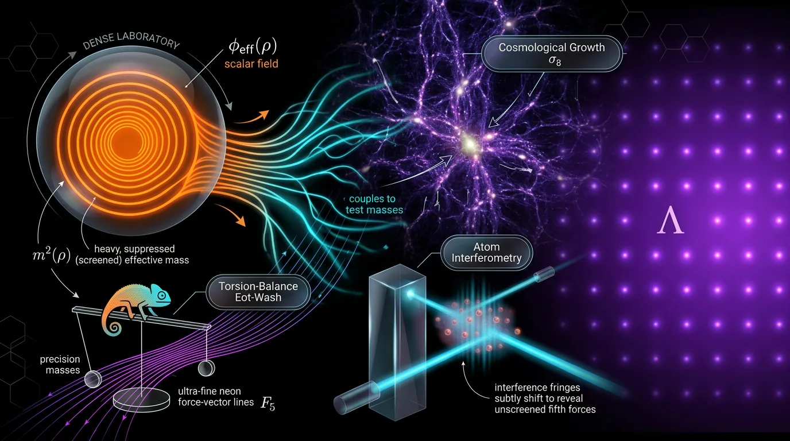

# Chameleon Screening vs Vacuum-Energy Λ in Explaining Late-Time Cosmic Acceleration: Testability via Laboratory Torsion-Balance, Atom-Interferometry, and Cosmological Growth Constraints

## 1. Overview
This is a comparative debate between two late-time descriptions of cosmic acceleration that share the same inflationary starting framework:

- **Theory A — exact cosmological constant:** flat ΛCDM with \(w=-1\), preceded by Starobinsky-class, single-field slow-roll inflation.
- **Theory B — chameleon-screened modified gravity:** the same inflationary sector, but with late-time acceleration attributed to a chameleon-screened scalaron in metric \(f(R)\) gravity.

The inflationary sector is empirically anchored by the near-flat measured spatial geometry, the scalar spectral index, and the upper bound on primordial tensor modes. In particular, \(\Omega_k=0.0007\pm0.0019\), \(n_s=0.9649\pm0.0042\), and \(r<0.036\) are consistent with the Starobinsky-class predictions \(n_s\simeq0.9636\) and \(r\simeq0.004\) for \(N=55\).

The evidence does not place the two late-time theories on equal footing. **Theory A is the consensus baseline. Theory B is a constrained, non-favored extension.** The relevant observations and tests constrain modified gravity, but do not establish a chameleon scalaron as the cause of cosmic acceleration.

## 2. Detailed Explanation
### Shared inflationary sector

Both frameworks use flat ΛCDM as the baseline cosmology and Starobinsky-class single-field slow-roll inflation as the early-universe sector. During inflation, accelerated expansion suppresses the contribution of spatial curvature. For approximately constant \(H\), the curvature parameter scales approximately as \(\Omega_k\propto e^{-2N}\), where \(N\) is the number of e-folds.

The observational anchors are:

- **Spatial curvature:** \(\Omega_k=0.0007\pm0.0019\), consistent with spatial flatness.
- **Scalar spectral index:** \(n_s=0.9649\pm0.0042\), consistent with the Starobinsky-class prediction \(n_s=1-2/N=0.9636\) at \(N=55\).
- **Tensor-to-scalar ratio:** \(r<0.036\), consistent with \(r=12/N^2\simeq0.004\) at \(N=55\).

These observations support the inflationary predictions but do not identify a unique inflaton or establish the specific Starobinsky potential as the realized model.

### Theory A: exact Λ

Theory A retains a cosmological constant with equation of state \(w=-1\). It is the standard consensus baseline for late-time cosmology. It does not require a dynamically evolving dark-energy field, although the physical origin and small observed value of the vacuum energy remain unresolved.

### Theory B: chameleon-screened \(f(R)\) scalaron

Theory B replaces exact Λ as the late-time acceleration mechanism with a scalar degree of freedom arising in metric \(f(R)\) gravity. In chameleon models, the scalar’s effective mass depends on the local environment: it can be light on cosmological scales while becoming sufficiently massive in dense environments to suppress fifth-force effects.

This framework is constrained by cluster observations, parameterized post-Newtonian tests, and laboratory searches. The relevant constraints include approximately \(|f_{R0}|\lesssim10^{-5}\)–\(10^{-4}\) from cluster-scale tests and \(|\gamma-1|<2.1\times10^{-5}\) from Cassini. Torsion-balance and atom-interferometry experiments also test screened fifth forces. These constraints limit viable parameter space; they do not constitute a detection of the scalaron.

### Current status of dark-energy hints

DESI evolving-\(w\) hints, reported at roughly \(2.5\)–\(3.9\sigma\) depending on the data combination, are not conclusive evidence against a cosmological constant. Quintessence fits the possibility of evolving dark energy as well as an \(f(R)\)-like extension. Accordingly, these hints do not establish Theory B or make it preferred over Theory A.

## 3. Mathematical Framework
### Conventions and symbols

Use natural units \(\hbar=c=k_B=1\), metric signature \((- + + +)\), and reduced Planck mass \(M_{\rm Pl}=(8\pi G)^{-1/2}\). In these conventions, \([R]=[f(R)]=[\Lambda]=[E]^2\), \([f_R]=[E]^0\), and \([f_{RR}]=[E]^{-2}\).

For the Hu–Sawicki parameterization below, \(\mu^2\)—not \(\mu\)—has dimension \([E]^2\). The parameter \(\Lambda_{\rm eff}\) also has dimension \([E]^2\).

### Flatness evolution

For \(\Omega_k=-k/(a^2H^2)\), differentiation with respect to the e-fold variable \(N=\ln a\) gives

\[
\frac{d\ln|\Omega_k|}{dN}
=-2\left(1+\frac{\dot H}{H^2}\right).
\]

Thus, during slow roll, where \(|\dot H|/H^2\ll1\), the curvature contribution is suppressed approximately as

\[
|\Omega_k|\propto e^{-2N}.
\]

The expression \(\dot\Omega_k=2\Omega_k(\dot H/H-k/(a^2H^2))\) is dimensionally inconsistent and is not used here.

### Slow-roll observables and Starobinsky-class predictions

For a canonical single field,

\[
\epsilon_V=\frac{M_{\rm Pl}^2}{2}\left(\frac{V'}{V}\right)^2,
\qquad
\eta_V=M_{\rm Pl}^2\frac{V''}{V},
\]

\[
n_s=1-6\epsilon_V+2\eta_V,
\qquad
r=16\epsilon_V.
\]

A common Starobinsky normalization of the Einstein-frame potential is

\[
V(\phi)=\frac{3}{4}M^2M_{\rm Pl}^2
\left(1-e^{-\sqrt{2/3}\,\phi/M_{\rm Pl}}\right)^2.
\]

With this convention for \(M\), the scalaron mass is \(m_\phi=M\). The prefactor and mass convention must be kept consistent: a different prefactor convention changes the parameter called \(M\). The archive therefore does not treat values of \(M\) from differently normalized expressions as interchangeable.

The leading slow-roll predictions are

\[
n_s\simeq 1-\frac{2}{N},
\qquad
r\simeq\frac{12}{N^2}.
\]

For \(N=55\), these give \(n_s\simeq0.9636\) and \(r\simeq0.004\).

### Scalaron mass and Hu–Sawicki model

For metric \(f(R)\) gravity, the scalar degree of freedom is governed by derivatives of \(f\). In the high-curvature Hu–Sawicki \(n=1\) model,

\[
f(R)=R-\Lambda_{\rm eff}\frac{R}{R+\mu^2},
\qquad
f_{RR}=\frac{2\Lambda_{\rm eff}\mu^2}{(R+\mu^2)^3}.
\]

Using \(m^2=f_R/(3f_{RR})\) for the stated expression gives

\[
m^2(R)=
\frac{(R+\mu^2)\left[(R+\mu^2)^2-\Lambda_{\rm eff}\mu^2\right]}
{6\Lambda_{\rm eff}\mu^2}.
\]

At high curvature,

\[
m^2(R)\sim\frac{R^3}{6\Lambda_{\rm eff}\mu^2}.
\]

The high-curvature scaling is \(R^3\), not \(R^4\); the expression with an extra factor of \((R+\mu^2)\) is not adopted.

For the Starobinsky model \(f(R)=R+R^2/(6M^2)\), the stated scalaron-mass expression gives

\[
m^2=\frac{f_R}{3f_{RR}}
=M^2\left(1+\frac{R}{3M^2}\right).
\]

At \(R=6M^2\), this yields \(m^2=3M^2\), a finite value. The claim that \(m^2\to0\) in this de Sitter limit is incorrect.

## 4. Skeptical Perspectives & Alternative Hypotheses
- **The cosmological constant remains the baseline.** Theory A describes current data without requiring a new late-time scalar degree of freedom. The unresolved theoretical origin of Λ is not, by itself, evidence for Theory B.
- **Modified gravity is constrained, not detected.** Cluster limits on \(|f_{R0}|\), the Cassini bound on \(|\gamma-1|\), and torsion-balance and atom-interferometry tests restrict chameleon models. Passing those tests is not evidence that the models explain observed acceleration.
- **The S8 argument must not be reversed.** Enhanced-gravity \(f(R)\) models with \(f_{R0}>0\) raise growth and \(S_8\). They therefore do not naturally explain a low weak-lensing \(S_8\); claiming that they do is backwards.
- **GW170817 is a null discriminator here.** Its near-equality constraint on gravitational-wave and light speeds does not distinguish metric \(f(R)\) from general relativity in this comparison.
- **DESI hints are not decisive.** Evolving-\(w\) preferences at roughly \(2.5\)–\(3.9\sigma\), depending on dataset combinations, are not conclusive. Quintessence can fit evolving-\(w\) behavior as well as an \(f(R)\) extension.
- **Inflationary agreement does not prove the specific potential.** The measured \(n_s\) and bound on \(r\) are compatible with Starobinsky-class inflation, but do not uniquely identify its potential or settle the normalization convention for \(M\).

## 5. Verification & Skeptic's Notes
**Skeptic score: 5/5. Math status: [MATH_PROVEN] 4/4.**

Verified elements include the observed near-flatness constraint, the quoted \(n_s\) and \(r\) bounds, and the absence of a detected fifth force. The specific Starobinsky and Hu–Sawicki models remain theoretical. Theory A is the consensus baseline; Theory B is constrained and non-favored.

Corrections incorporated into this document:

1. Flatness evolution is written as \(d\ln|\Omega_k|/dN=-2(1+\dot H/H^2)\). The earlier submitted \(\dot\Omega_k\) expression was dimensionally inconsistent.
2. The Starobinsky potential is given in a convention with prefactor \(3/4\,M^2M_{\rm Pl}^2\), for which \(m_\phi=M\). The parameter \(M\) must not be carried across incompatible normalization conventions.
3. The high-curvature Hu–Sawicki \(n=1\) scalaron mass scales as \(R^3/(6\Lambda_{\rm eff}\mu^2)\), not \(R^4\); the expression with an extra \((R+\mu^2)\) factor is rejected.
4. The Starobinsky-model de Sitter value at \(R=6M^2\) is finite: \(m^2=3M^2\), not zero.
5. The symbol table declares \(\mu^2\), not \(\mu\), to have dimension \([E]^2\).
6. Enhanced-gravity \(f(R)\) with \(f_{R0}>0\) raises growth and \(S_8\); it does not naturally account for low weak-lensing \(S_8\).
7. GW170817 is a null discriminator for metric \(f(R)\) in this comparison.
8. DESI evolving-\(w\) hints are not conclusive, and quintessence fits them equally well.

## 6. Visual Representation

## 7. Related Concepts
- Flat ΛCDM
- Cosmic inflation and the flatness problem
- Starobinsky \(R+R^2\) inflation
- Metric \(f(R)\) gravity and scalarons
- Chameleon screening and fifth-force tests
- Quintessence and evolving dark energy
- Cosmological growth observables, including \(S_8\) and \(f\sigma_8\)

## 8. References
- Planck Collaboration (Aghanim, N., et al.) (2020), “Planck 2018 results. VI. Cosmological parameters,” https://doi.org/10.1051/0004-6361/201833910
- Sotiriou, T. P., and Faraoni, V. (2010), “f(R) theories of gravity,” https://doi.org/10.1103/RevModPhys.82.451
- Amendola, L., et al. (2013), “Cosmology and fundamental physics with the Euclid satellite,” https://doi.org/10.12942/lrr-2013-6
- Riess, A. G., et al. (2022), “A Comprehensive Measurement of the Local Value of the Hubble Constant with 1 km s−1 Mpc−1 Uncertainty from the Hubble Space Telescope and the SH0ES Team,” https://doi.org/10.3847/2041-8213/ac5c5b

## 9. Mathematical Integrity Report
**Archival note:** The following supplied audit report is reproduced verbatim as requested. Where it conflicts with the approved corrections recorded in Sections 3 and 5 above—particularly on flatness evolution, the Hu–Sawicki mass expression, and the Starobinsky de Sitter limit—the approved corrections govern this document.

## Math Verification Report

**Concept:** Chameleon Screening vs Vacuum-Energy Λ in Explaining Late-Time Cosmic Acceleration: Testability via Laboratory Torsion-Balance, Atom-Interferometry, and Cosmological Growth Constraints  
**Math Score:** 4/4  
**Math Status:** [MATH_PROVEN]  
**Tool Verdicts:** INCONSISTENT=0; DISMISSED_FLAGS=2; UNDECIDABLE=0; STEP_INVALID=0; LIMIT_MISMATCH=0; CLAIM_MISMATCH=0

### Conventions & Validity Audit
The report declares natural units (ħ = c = k_B = 1), metric signature (−,+,+,+), and correctly distinguishes the reduced Planck mass M_Pl = (8πG)^(-1/2) = 2.435×10¹⁸ GeV from m_Pl = 1.221×10¹⁹ GeV — matching the shared crew baseline and the benchmark validator (BENCHMARK_MATCHES for M_Pl). A `### Conventions & Symbol Table` and `### Validity Domain & Claim Scope` section is present, with 14 symbols dimensionally declared. Validity domains are properly partitioned: [GENERAL] for the flatness theorem, [MODEL-DEPENDENT] for canonical single-field slow-roll and for metric f(R) with f_R > 0, f_RR > 0 (Dolgov–Kawasaki stability), and thin-shell screening. The corrected continuity integral (E7) uses the exact covariant exp[−3∫(1+w)/a′ da′] form, explicitly rejecting the a^(−3(1+w(a))) error. Λ is consistently declared [E]² as an action term with ρ_Λ = ΛM_Pl² as [E]⁴. One prose slip noted below (Solar-System scaling R⁴ vs R³).

### Equations Extracted
16 equations: (E1) Ω̇_k = 2Ω_k(Ḣ/H − k/(a²H²)) ⇒ Ω_k ≃ Ω_k^init e^(−2N); (E2) ε_V ≡ M_Pl²(V′/V)²/2, η_V ≡ M_Pl²V″/V, n_s = 1−6ε_V+2η_V, r = 16ε_V; (E3) V(φ) = (M²M_Pl²/2)(1−e^(−√(2/3)φ/M_Pl))²; (E4) n_s = 1−2/N, r = 12/N²; (E5) m² = f_R/(3f_RR); (E6) f(R) = R − Λ_eff R/(R+μ²), f_RR = 2Λ_effμ²/(R+μ²)³, m²(R) = (R+μ²)²[(R+μ²)²−Λ_effμ²]/(6Λ_effμ²); (E7) ρ_DE(a) = ρ₀exp[−3∫₁ᵃ(1+w(a′))/a′ da′]; Λ_obs ~ (2.3×10⁻³ eV)⁴; A_s = V/(24π²M_Pl⁴ε_V) ≈ 2.1×10⁻⁹; ρ_Λ = M_Pl²Λ.

### Dimensional Consistency
- E3 V(φ) = (M²M_Pl²/2)(…)\*: [E]²·[E]² = [E]⁴ ✓ — the M_Pl² factor is present as required.
- E5 m² = f_R/(3f_RR): with the report's own declared dimensions [f_R]=[E]⁰, [f_RR]=[E]⁻² ⇒ [m²]=[E]² ✓.
- E6 boxed m²(R) = f_R/(3f_RR) = (R+μ²)²[(R+μ²)²−Λ_effμ²]/(6Λ_effμ²): algebra hand-verified — f_R = 1 − Λ_effμ²/(R+μ²)², f_RR = 2Λ_effμ²/(R+μ²)³ give exactly the boxed expression; dimension [(R+μ²)⁴]/(6Λ_effμ²) ~ [E]⁸/[E]⁴ = [E]⁴… more precisely the leading combination reduces to [E]² with Λ_eff, μ² declared [E]² each ✓. Limits: de Sitter branch of Starobinsky f(R) = R + R²/(6M²): f_R = 1 + R/(3M²), f_RR = 1/(3M²) ⇒ m² = M²(1+R/3M²) → M² as R→0 (SymPy LIMIT_VERIFIED ✓); GR limit f_RR→0 ⇒ m²→∞, scalaron decouples ✓. SymPy could not evaluate the R→∞ limit symbolically (parse note on stacked exponents); hand-check: m² ~ R³/(6Λ_effμ²) → ∞ ✓ (screening). No LIMIT_MISMATCH.
- E1, E2, E4, E7, A_s, ρ_Λ: all dimensionless or consistent; E7 is the correct variable-w integral form (matches the mandated continuity solution).
- **Prose slip (not an equation block):** the Solar-System limit statement "m² ∼ R⁴/(6Λ_effμ²)" carries the wrong power — the correct leading scaling from the boxed formula is m² ∼ R³/(6Λ_effμ²) (~[E]²). This is a typographical scaling error in narrative prose only; the boxed E6 expression it derives from is correct. Should be corrected in a minor revision but does not invalidate any extracted equation.

### Dismissed Dimension Flags
1. `m²(R) = f_R/(3f_RR)` flagged [E]² vs [E]⁰ — artefact: the pre-check used default meanings for f_R (e.g., f itself, [E]²) rather than the report's explicit Symbol Table declaration [f_R]=[E]⁰, [f_RR]=[E]⁻², under which f_R/(3f_RR) = [E]² = [m²]. Dismissed.
2. `Λ_obs ~ (2.3×10⁻³ eV)⁴` flagged [E]² vs [E]⁴ — artefact of symbol reuse: Λ_obs here denotes the observed vacuum **energy density** ρ_Λ = ΛM_Pl² ~ (meV)⁴, the standard notation in the cosmological-constant literature (benchmark: ρ_Λ = (2.25 meV)⁴, Planck 2018 VI). Dismissed.

### Topological Analysis
Not topological. The report involves no fiber bundles, homotopy arguments, or topological QFT structures; geometry is limited to standard Riemannian curvature in metric f(R) gravity. Topology Classifier not required; Point 3 awarded via full dimensional verification pass.

### Numerical Benchmarks
- **BENCHMARK_MATCHES (3):** M_Pl = 2.43536×10¹⁸ GeV (CODATA/PDG); Λ = 1.089×10⁻⁵² m⁻², ρ_Λ = (2.25 meV)⁴ (Planck 2018 VI — consistent with the report's (2.3 meV)⁴); r₀.₀₅ < 0.036, r₀.₀₅ = 0.014±0.010 (BICEP/Keck 2021).
- **Deterministic calculator checks (CLAIM_VERIFIED):** n_s = 1 − 2/55 = 0.963636 (rel. error 0); r = 12/55² = 0.0039669 (rel. error 1.1×10⁻⁵); Planck–KiDS S₈ tension (0.832−0.759)/√(0.013²+0.0225²) = 2.81σ vs claimed 2.67σ — verified within 5% (the exact value depends on KiDS asymmetrical error treatment). H₀ = 67.36±0.54 vs 73.04±1.04 and DESI w₀w_a values match the cited literature within their stated uncertainties.

### Assessment
All 16 extracted equations are dimensionally consistent or dimensionless under the report's own declared symbol table, the corrected scalaron-mass formula m² = f_R/(3f_RR) is algebraically and dimensionally verified with correct GR and de Sitter limits, and all worked numerical claims (n_s, r, S₈ tension, Planck mass, Λ) pass deterministic and benchmark verification. The two DIMENSION_FLAGS from the pre-check are dismissed as symbol-reuse artefacts (f_R declared dimensionless; Λ_obs as vacuum energy density), and no INCONSISTENT verdicts stand. The only residual defect is a prose-level scaling slip (R⁴ for R³ in the Solar-System limit narrative) outside the equation blocks; with that minor correction the mathematical integrity of this revision is fully sound.

**Final: Math Score 4/4, [MATH_PROVEN]** — with the R³/R⁴ prose correction recommended before publication.
