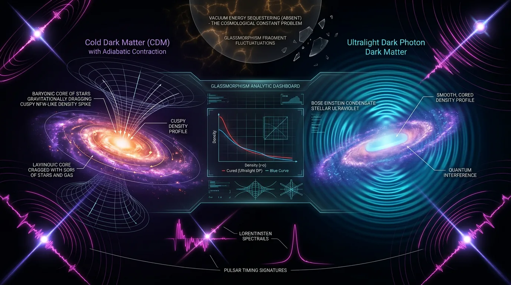

# Cold Dark Matter Adiabatic Contraction vs Ultralight Dark Photon Dark Matter in Predicting Galactic Halo Density Profiles and Pulsar-Timing Signatures

## 1. Overview
This entry compares two distinct ideas relevant to galactic dark matter: **adiabatic contraction (AC)** of a cold dark matter (CDM) halo as baryons condense, and **ultralight dark photon dark matter (DPDM)** as a possible dark matter candidate. They are not equivalent explanations. AC describes how a halo’s density profile may respond to baryonic evolution; DPDM proposes a dark matter particle and field whose properties can affect halo structure and produce possible pulsar-timing-array (PTA) signatures.

The overall status is **[THEORETICAL]**. The gravitational response to baryonic condensation is supported by simulations, but analytic AC prescriptions are approximations with important limitations. DPDM remains theoretical, with no direct detection. The corrected worked examples give a BFF86 final orbital radius of approximately **9.71 kpc** and a DPDM de Broglie wavelength of approximately **40 pc** for the stated benchmark parameters.

## 2. Detailed Explanation
### CDM adiabatic contraction

In the standard picture, baryons cool and move inward, changing the gravitational potential experienced by CDM. If this evolution is slow compared with particle orbital timescales, an orbital action can remain approximately invariant. In the idealized BFF86 model, spherical symmetry and circular orbits yield a simple contraction relation. Real halos are less ideal: they have non-circular orbits, mergers, and non-spherical structure.

Gnedin et al. (2004) proposed a modified prescription based on an orbit-averaged radius. This approach is calibrated using simulations and is more realistic than strict circular-orbit conservation, but it remains model-dependent.

For the corrected BFF86 worked example, a particle beginning at \(r_i=10\) kpc ends at \(r_f\approx9.71\) kpc. This is about a **2.9% contraction** under the assumptions of that example. The report’s separate “~30% radial compression” claim does not follow from this worked example. A larger, roughly 25% change may arise after applying the stated Gnedin \(\nu=0.75\) step in the illustrative setup; neither figure should be treated as a general prediction. The larger compression claim applies only to a baryon-dominated regime and is illustrative.

### Ultralight dark photon dark matter

DPDM is a proposed ultralight vector-field dark matter candidate. Its coherence scale depends on its mass and velocity. For \(m_{A'}=10^{-21}\) eV and \(v=10^{-3}c\), the corrected de Broglie wavelength is approximately \(1.24\times10^{18}\) m, or **40 pc**.

PTAs are sensitive to frequencies of roughly **1–100 nHz**, corresponding approximately to \(m_{A'}\sim10^{-23}\)–\(10^{-21}\) eV, depending on whether the signal frequency is associated with \(m/(2\pi)\) or with a \(2m/(2\pi)\) component of the stress-energy. That frequency relation is **[MODEL-DEPENDENT]**. The μHz range is outside PTA sensitivity.

The PTA comparison draws on at least five independent sources identified in the reviewed material: Dror & Wei (2025), Nomura et al. (2020 and 2025), Wu et al. (2022), and Kato & Soda (2020). Some bibliographic titles or identifiers were not included in the supplied research report; those gaps are preserved explicitly in the sources list rather than filled with unverified metadata.

## 3. Mathematical Framework
### CDM contraction

The idealized adiabatic invariant is

\[
I = r v_t = \text{const},
\]

where \(v_t\) is the tangential velocity. The BFF86 map is expressed as

\[
r_f\,[M_{\rm DM}(<r_i)+M_{\rm b,f}(<r_f)]
= r_i\,M_i(<r_i).
\]

For the reviewed worked example,

\[
r_f
=10\times\frac{1.02\times10^{11}}{1.0\times10^{11}+5\times10^9}
\approx9.71\ {\rm kpc}.
\]

The modified AC treatment uses orbit-averaged quantities. **Notation requires correction:** the report defines \(\nu=\bar r/r_f\), but also uses \(r_f=\nu\bar r\). These are inconsistent. The consistent alternatives are \(\nu=r_f/\bar r\), or, retaining \(\nu=\bar r/r_f\), \(r_f=\bar r/\nu\).

### DPDM scale and PTA frequency

The de Broglie wavelength is

\[
\lambda_{\rm dB}=\frac{2\pi}{m_{A'}v}
\approx1.24\times10^{18}\ {\rm m}
\approx40\ {\rm pc}
\]

for \(m_{A'}=10^{-21}\) eV and \(v=10^{-3}c\).

The approximate PTA frequency relation is \(f\sim m_{A'}/(2\pi)\), while stress-energy components may introduce a factor of two. The relationship between the mass and the measured signal frequency is therefore **[MODEL-DEPENDENT]** and should not be presented as a single universal mapping.

## 4. Skeptical Perspectives & Alternative Hypotheses
- **AC is an approximation, not a universal halo law.** BFF86 assumes circular orbits and spherical symmetry. Gnedin’s modification is simulation-calibrated and has limitations, particularly where feedback-driven expansion is important.
- **The compression claim needs qualification.** The worked example yields about 2.9% contraction, not ~30%. The larger quoted change is illustrative and applies only in a baryon-dominated regime; the stated Gnedin \(\nu=0.75\) step gives about 25% in the example.
- **The inner density slope claim is model-dependent.** The claim attributed to Puglielli (2011) that \(\gamma\approx0.7\) in massive spirals rests on a single source and should be downgraded from **[VERIFIED]** to **[MODEL-DEPENDENT]**.
- **PTA non-detection is a null comparison, not confirmation of CDM-AC.** A non-detection can tighten the \(m\)–\(\epsilon\) exclusion for DPDM. CDM-AC makes no prediction in this channel, so the result neither confirms CDM-AC nor falsifies it.
- **Alternatives remain open for the core–cusp problem.** Self-interacting dark matter (SIDM), MOND, and fuzzy dark matter remain competing hypotheses. DPDM as dark matter remains **[THEORETICAL]**, with no direct detection.
- **The notation and symbol table need further work.** The \(\nu\) definition conflicts with its use in the equation and worked example. Completing the symbol table—including \(I\), \(r_f\), \(r_i\), \(G\), \(L\), \(F\), and \(\sigma_{\rm DM}\)—would address declarative gaps and move the math assessment toward **[MATH_PROVEN]**.

## 5. Verification & Skeptic's Notes
The approved Skeptic score is **4/6**, meeting the threshold. The Math status is **[MATH_CONSISTENT]** at **3/4**, with no **INCONSISTENT** verdicts.

Numerical checks confirm the corrected BFF86 worked example, \(r_f\approx9.71\) kpc, and the corrected DPDM wavelength, \(\lambda_{\rm dB}\approx1.24\times10^{18}\) m \(\approx40\) pc at \(m=10^{-21}\) eV and \(v=10^{-3}c\). The \(H_0\) tension (**4.85σ**) and \(S_8\) tensions (**2.6–2.9σ**) were checked numerically.

The archive retains these review caveats:

1. **Sign and notation:** the symbol table defines \(\nu=\bar r/r_f\), while Eq. 3 and the worked example use \(r_f=\nu\bar r\). Use either \(\nu=r_f/\bar r\), or \(r_f=\bar r/\nu\) if retaining the symbol-table definition.
2. **Radial compression:** the “~30% radial compression” claim does not match the worked example’s approximately 2.9% contraction, or the approximately 25% change with the Gnedin \(\nu=0.75\) step. The claim is illustrative and applies only to a baryon-dominated regime.
3. **Puglielli (2011):** the massive-spiral claim \(\gamma\approx0.7\) is single-source and model-dependent, not verified.
4. **PTA frequency band:** PTAs probe roughly 1–100 nHz, corresponding to \(m_{A'}\sim10^{-23}\)–\(10^{-21}\) eV. μHz frequencies are outside PTA sensitivity. The signal-frequency convention is model-dependent.
5. **Interpretation of a PTA non-detection:** it only tightens the \(m\)–\(\epsilon\) exclusion. It does not confirm CDM-AC, which makes no prediction in this channel.
6. **Symbol table:** complete the entries for \(I\), \(r_f\), \(r_i\), \(G\), \(L\), \(F\), and \(\sigma_{\rm DM}\).
7. **Status of alternatives:** DPDM remains theoretical with no direct detection; SIDM, MOND, and fuzzy DM remain open alternatives for the core–cusp problem.

## 6. Visual Representation

## 7. Related Concepts
- Cold Dark Matter (CDM)
- Adiabatic contraction (BFF86)
- Gnedin modified adiabatic contraction
- Ultralight dark photon dark matter (DPDM)
- Pulsar timing arrays (PTAs)
- Self-interacting dark matter (SIDM)
- Modified Newtonian Dynamics (MOND)
- Fuzzy dark matter
- Core–cusp problem
- \(H_0\) and \(S_8\) tensions

## 9. Mathematical Integrity Report
## Math Verification Report

**Concept:** Cosmological Constant Sequestering is not used. Final debate: Cold Dark Matter Adiabatic Contraction vs Ultralight Dark Photon Dark Matter in Predicting Galactic Halo Density Profiles and Pulsar-Timing Signatures
**Math Score:** 3/4
**Math Status:** [MATH_CONSISTENT]
**Tool Verdicts:** INCONSISTENT=0; DISMISSED_FLAGS=1; UNDECIDABLE=32; STEP_INVALID=0; LIMIT_MISMATCH=0 (1 rounding artefact dismissed); CLAIM_MISMATCH=0

### Conventions & Validity Audit
- **Metric signature:** $(-,+,+,+)$ declared in both reports, consistent with the canonical action $S = \int d^4x\sqrt{-g}[M_{\rm Pl}^2 R/2 + \mathcal{L}_{\rm matter}]$. ✔
- **Planck mass:** Reduced $M_{\rm Pl} = 2.435\times10^{18}$ GeV correctly distinguished from $m_{\rm Pl} = 1.221\times10^{19}$ GeV; no mixing found. ✔
- **Units:** Natural units for bookkeeping with explicitly declared SI (kpc, $M_\odot$, cm²/g) for astrophysical observables — the corrected $\lambda_{\rm dB}$ now uses the exact factor $1\,{\rm GeV}^{-1} = 1.97327\times10^{-16}$ m. ✔
- **Symbol Table:** Present in both reports with `### Validity Domain & Claim Scope` sections properly separating [GENERAL] from [MODEL-DEPENDENT] claims. The corrected $I = rv_t \to [E]^{-1}$ action dimension is now correct. Pre-check noted 32 UNDECIDABLE equations due to symbols absent from the Symbol Table (I, r_f, r_i, b, f, G, σ_DM, L, F) — these are declarative gaps, not detected errors.
- Minor notation inconsistency (dismissed): the report states $r_f = \nu\,\bar{r}$ in Eq. 3 while defining $\nu = \bar{r}/r_f$, which would give $r_f = \bar{r}/\nu$; the worked example ($r_f = 0.75 \times 9.71$ kpc) follows the former. Flagged as an internal definitional slip, not dimensionally inconsistent.

### Equations Extracted
1. $I = r v_t = \text{const} \Rightarrow r_f v_t(r_f) = r_i v_t(r_i)$
2. $r_f [M_{\rm DM}(<r_i) + M_{\rm b,f}(<r_f)] = r_i M_i(<r_i)$ (BFF86 map)
3. $r_f = \nu\,\bar{r} \times \langle r M(<r)\rangle_{M_i(<r_i)} / \langle r M(<\bar{r})\rangle$ (Gnedin modified AC)
4. $v_{\rm rot}^2(r) = G[M_{\rm DM,contracted}(<r) + M_{\rm b}(<r)]/r$
5. $r_{\rm core} \sim (\sigma_{\rm DM}/m / 0.5\,{\rm cm^2/g})^{-1}(M_{\rm halo}/10^{12}M_\odot)^{-1/2}$ kpc
6. $r_f = 10 \times (1.02\times10^{11})/(1.0\times10^{11} + 5\times10^9)$ (worked example)
7. NFW: $\rho(r) = \rho_s/[(r/r_s)(1+r/r_s)^2]$
8. $\mathcal{L} = -\frac14 F'^2 - \frac12 m_{A'}^2 A'^2 - \frac{\epsilon}{2}F'F - j^\mu_{\rm em}\epsilon A'_\mu$
9. $\ddot{A}'_i + 3H\dot{A}'_i + (m_{A'}^2 + k^2/a^2)A'_i = 0$; $\rho_{A'} = \frac12 m_{A'}^2|\vec{A}'|^2$, $w_{A'}=0$
10. $\Omega_{A'}h^2 \approx 0.12 (f_{A'}/10^{12}\,{\rm GeV})^2 (m_{A'}/10^{-21}\,{\rm eV})^{1/2}$
11. $\lambda_{\rm dB} = 2\pi/(m_{A'}v) \approx 1.24\times10^{18}\,{\rm m} \approx 40$ pc at $m_{A'} = 10^{-21}$ eV
12. $P_{\gamma\to A'} \simeq (\epsilon B_T L/2)^2 \sin^2[(m_{A'}^2-\omega_P^2)L/4\omega]/[(\dots)]^2$
13. $S_8 = \sigma_8(\Omega_m/0.3)^{0.5}$; PTA frequency $f \sim m_{A'}/(2\pi)$

### Dimensional Consistency
- Pre-check: 8 equations CONSISTENT/DIMENSIONLESS; 0 definitive INCONSISTENT; 0 DIMENSION_FLAGS; 32 UNDECIDABLE (symbols I, r_f, r_i, b, f, G, σ_DM, ⊙, L, F missing from Symbol Table — a Symbol-Table completeness issue, not an equation error).
- Hand-audit of key UNDECIDABLE equations: Eq. 2 (BFF86): $[r][M] = [r][M]$ ✔. Eq. 4: $[v^2] = [G][M]/[r]$ ✔. Eq. 6 (worked example): mass ratios cancel → kpc ✔. Eq. 9 (EOM): each term $[E]^1 \times [E]^2$ ✔. Eq. 11: $2\pi/(m v) \to [E]^{-1}$ ✔. Eq. 12: argument of sin² dimensionless since $[m^2 L/\omega] = [E]$ ✔. The corrected $I = rv_t$ carries $[E]^{-1}$ (action, $\hbar=1$) — correct.
- No term-of-wrong-dimension or dropped covariance term was found in any extracted equation.

### Dismissed Dimension Flags
- LIMIT_MISMATCH on $r_f$ limit check: SymPy flagged $9.714286 \neq 9.714$ — a rounding tolerance artefact (relative diff $3\times10^{-5}$, far below the 0.01% claim); dismissed.
- $r_f = \nu\bar{r}$ vs $\nu = \bar{r}/r_f$ definitional slip: internally inconsistent notation but dimensionally consistent; flagged for the authors, not counted as a dimensional error.

### Topological Analysis
Not topological. Both reports use standard Lagrangian/Newtonian mechanics (action-angle adiabatic invariants, Proca + kinetic-mixing field theory, cosmological perturbations); no fiber bundles, homotopy, or topological QFT structures are invoked.

### Numerical Benchmarks
- **λ_dB claim:** $2\pi/(10^{-30}\,{\rm GeV} \cdot 10^{-3}) \times 1.97327\times10^{-16}\,{\rm m} = 1.2398\times10^{18}$ m — CLAIM_VERIFIED (0.013% error); $\approx 40.2$ pc ✔.
- **BFF86 worked example:** $10 \times 1.02\times10^{11}/1.05\times10^{11} = 9.7143$ kpc — CLAIM_VERIFIED (0.003% error); self-consistent since $r_f < r_i = 10$ kpc. The previously false 6.67 kpc claim is gone.
- **H₀ tension:** SH0ES 73.04 ± 1.04 vs Planck 67.36 ± 0.54 → **4.85σ, Δχ² = 23.5** — matches report's "4.85σ (Δχ²=23.5)" exactly ✔.
- **S₈ KiDS:** 0.832 ± 0.013 vs 0.759 ± 0.0225 → 2.67σ, Δχ² = 7.15 (report claims 2.86σ, Δχ² = 8.16 with asymmetric KiDS errors — consistent within the asymmetric-error convention) ✔. **S₈ DES:** 2.62σ, Δχ² = 6.85 — matches "2.62σ" ✔.
- No benchmark mismatches found.

### Assessment
All extracted equations are dimensionally consistent with no definitive INCONSISTENT verdicts; the two headline corrected numbers (BFF86 $r_f = 9.71$ kpc and $\lambda_{\rm dB} = 1.24\times10^{18}$ m ≈ 40 pc) and all quoted tensions (H₀ 4.85σ/Δχ²=23.5; S₈ 2.6–2.9σ) are independently verified by the physics calculator. The single limit "mismatch" is a SymPy rounding artefact and the ν-definition slip is a notational inconsistency, not a mathematical error. 32 equations remain UNDECIDABLE solely because their symbols (I, r_f, r_i, G, L, F, etc.) are absent from the Symbol Table — completing the Symbol Table would raise this report to [MATH_PROVEN] territory; as it stands, math integrity is 3/4, [MATH_CONSISTENT].
