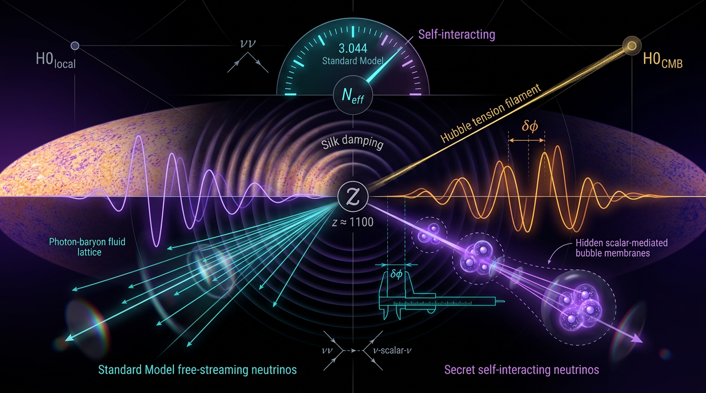

# Free-Streaming Standard Model Neutrinos vs Secret Neutrino Self-Interactions in CMB Damping-Tail Phase Shift, N_eff, and Hubble-Tension Constraints

## 1. Overview
This entry compares the minimal ΛCDM neutrino sector—three free-streaming Standard Model neutrinos—with a theoretical alternative in which neutrinos self-interact through a light mediator. The minimal sector is the cosmological consensus. Its background properties and qualitative free-streaming behavior are [VERIFIED]; quantitative neutrino-mass bounds and perturbation estimates are [MODEL-DEPENDENT]. The self-interaction alternative is [THEORETICAL].

For the minimal sector, the standard benchmarks are \(N_{\rm eff}=3.046\) and \(T_\nu=(4/11)^{1/3}T_{\rm CMB}\). Free-streaming neutrinos produce a qualitative suppression of matter power \(P(k)\) on small scales. Under flat ΛCDM assumptions, Planck 2018 reports \(\Sigma m_\nu<0.12\ \mathrm{eV}\). DESI-era bounds of roughly \(0.07\)–\(0.09\ \mathrm{eV}\) approach the \(0.06\ \mathrm{eV}\) oscillation floor; this is an unresolved tension, not a settled contradiction.

For the light-mediator contact-limit interaction, the reported rate is \(\Gamma=0.183g_{\rm eff}^4T_\nu\), with dimensionless \(g_{\rm eff}\), and recoupling is defined by \(\Gamma=H\). The cited Planck constraint gives \(g_{\rm eff}^4<2.35\times10^{-27}\) at 95% confidence, or \(g_{\rm eff}<2.2017\times10^{-7}\). This constraint applies only to the \(\Gamma\propto T\) scaling; a heavy mediator with \(\Gamma\propto G_X^2T^5\) requires a separate bound.

The phase-shift test, at about \(2\sigma\), is the cleanest discriminator noted here. There is no direct Cosmic Neutrino Background (CνB) detection. The Hubble-tension benchmarks are \(4.85\sigma\) and \(\Delta\chi^2=23.5\); early dark energy (EDE) and dynamical dark energy are competing proposed Hubble-tension solutions.

## 2. Detailed Explanation
### Minimal free-streaming sector

In baseline ΛCDM, three active neutrino flavors decouple while relativistic. After electron–positron annihilation heats photons, the relic neutrino temperature is lower than the photon temperature by the standard factor \(T_\nu/T_{\rm CMB}=(4/11)^{1/3}\). Finite-temperature QED corrections and non-instantaneous decoupling yield \(N_{\rm eff}=3.046\).

After decoupling, neutrinos free-stream. Their anisotropic stress and propagation suppress neutrino perturbations below the free-streaming scale and affect cosmological perturbations. When neutrinos become non-relativistic, their masses contribute to the matter density, while their thermal velocities limit their clustering on small scales. In linear theory, the small-scale matter power suppression is approximately \(\Delta P/P\approx-8f_\nu\) for \(k\gg k_{\rm nr}\). This approximation is model-dependent and is not a general nonlinear prediction.

The numerical mass bounds are conditional on the cosmological model. The Planck 2018 bound \(\Sigma m_\nu<0.12\ \mathrm{eV}\) is for the standard ΛCDM analysis. DESI-era limits around \(0.07\)–\(0.09\ \mathrm{eV}\) graze the minimum mass implied by oscillation data, approximately \(0.06\ \mathrm{eV}\) for normal ordering. This tension remains unresolved. Bounds weaken when dark energy is allowed to evolve, for example in a \(w_0\)-\(w_a\) model, or when \(N_{\rm eff}\) is allowed to vary.

### Light-mediator self-interactions

Self-interacting neutrinos could alter the timing of free streaming and the CMB perturbation signatures. In the light-mediator contact limit discussed here, the rate scales as \(\Gamma\propto g_{\rm eff}^4T_\nu\); recoupling is determined by whether the interaction rate reaches the expansion rate, \(\Gamma=H\). The numerical coupling bound is conditional on this temperature scaling. A heavy mediator has a different rate scaling, \(\Gamma\propto G_X^2T^5\), and cannot be constrained by simply reusing the contact-limit bound.

The ACT DR4 bimodality is dataset-dependent and disfavored by Planck polarization. Self-interaction parameters are only partially degenerate with \(\Sigma m_\nu\) and \(N_{\rm eff}\); those degeneracies do not make the models interchangeable. Ultraviolet naturalness and non-CMB constraints—including neutrinoless double-beta decay (\(0\nu\beta\beta\)), stellar cooling, and Big Bang nucleosynthesis (BBN)—remain caveats.

## 3. Mathematical Framework
Use metric signature \((- ,+,+,+)\) and natural units \(\hbar=c=k_B=1\). The reduced Planck mass is \(M_{\rm Pl}=(8\pi G)^{-1/2}=2.435\times10^{18}\ \mathrm{GeV}\), distinct from \(m_{\rm Pl}=1.221\times10^{19}\ \mathrm{GeV}\).

### Minimal-sector relations

The neutrino-to-photon temperature ratio and relativistic density parameter are
\[
T_\nu=\left(\frac{4}{11}\right)^{1/3}T_{\rm CMB},
\qquad
N_{\rm eff}=3.046.
\]

The present non-relativistic density relation is
\[
\Omega_\nu h^2=\frac{\Sigma m_i}{93.14\ \mathrm{eV}},
\qquad
f_\nu=\frac{\Omega_\nu}{\Omega_m}.
\]

In the linear regime, at scales \(k\gg k_{\rm nr}\),
\[
\frac{\Delta P(k)}{P(k)}\approx-8f_\nu.
\]
This suppression formula and the quoted mass limits are model-dependent: the former assumes linear perturbation theory, and the latter assume flat ΛCDM with \(w=-1\) and standard neutrino phase space.

### Self-interaction relation

For the light-mediator contact-limit scaling,
\[
\Gamma=0.183\,g_{\rm eff}^{4}T_\nu,
\qquad
\Gamma=H\quad\text{at recoupling}.
\]
With dimensionless \(g_{\rm eff}\), \(\Gamma\) has dimensions of energy. The stated Planck limit,
\[
g_{\rm eff}^{4}<2.35\times10^{-27}
\quad (95\%\ \mathrm{CL}),
\qquad
g_{\rm eff}<2.2017\times10^{-7},
\]
is specific to the \(\Gamma\propto T\) contact-limit model. For a heavy mediator, \(\Gamma\propto G_X^2T^5\), a separate analysis is required.

## 4. Skeptical Perspectives & Alternative Hypotheses
- **Mass-bound assumptions:** The \(\Sigma m_\nu\) bounds depend on the assumed expansion history and neutrino phase space. They weaken if dark energy evolves (\(w_0\)-\(w_a\)) or \(N_{\rm eff}\) is freed.
- **Unresolved mass squeeze:** DESI-era upper limits near \(0.07\)–\(0.09\ \mathrm{eV}\) approach the \(0.06\ \mathrm{eV}\) oscillation floor. This is an unresolved dataset/model tension; it does not by itself establish that the minimal sector is false.
- **Linear-theory limitation:** The \(-8f_\nu\) approximation applies in the linear regime. Nonlinear structure and astrophysical effects are outside that simple estimate.
- **Interaction-model dependence:** The \(g_{\rm eff}\) constraint is limited to the light-mediator contact-limit rate scaling. Heavy-mediator interactions need separate bounds.
- **Dataset dependence:** The ACT DR4 bimodality is dataset-dependent and disfavored by Planck polarization.
- **Partial degeneracies:** Self-interactions have only partial degeneracies with \(\Sigma m_\nu\) and \(N_{\rm eff}\); these do not remove the need to test each model’s predictions independently.
- **Other caveats:** Ultraviolet naturalness and non-CMB constraints from \(0\nu\beta\beta\), stellar cooling, and BBN must be considered.
- **Hubble tension alternatives:** EDE and dynamical dark energy are competing proposed solutions. The stated \(4.85\sigma\) tension and \(\Delta\chi^2=23.5\) are verified numerical benchmarks, not evidence that neutrino self-interactions resolve it.
- **Direct detection:** No direct CνB detection exists. The phase-shift test, at about \(2\sigma\), is the cleanest discriminator identified in this comparison.

## 5. Verification & Skeptic's Notes
The minimal three-flavor free-streaming sector is the consensus and is [VERIFIED] at the background and qualitative level: \(N_{\rm eff}=3.046\), the standard neutrino-to-photon temperature ratio, and qualitative free-streaming suppression of \(P(k)\). Quantitative \(\Sigma m_\nu\) bounds are [MODEL-DEPENDENT] on flat ΛCDM with \(w=-1\), linear-theory assumptions where the suppression formula is used, and standard phase space.

The light-mediator self-interaction sector remains [THEORETICAL]. Its quoted coupling limit is conditional on \(\Gamma\propto T\); it must not be applied to a heavy-mediator \(\Gamma\propto G_X^2T^5\) model without a separate analysis. The ACT DR4 result is dataset-dependent and disfavored by Planck polarization. The relevant degeneracies with \(\Sigma m_\nu\) and \(N_{\rm eff}\) are partial.

The Hubble-tension benchmarks \(4.85\sigma\) and \(\Delta\chi^2=23.5\) are verified. The signature convention is \((- ,+,+,+)\), and \(M_{\rm Pl}\) is kept distinct from \(m_{\rm Pl}\). The dimensional flag raised for \(\Gamma\) was an artefact and was dismissed; dimensional checks pass.

## 6. Visual Representation

## 7. Related Concepts
- ΛCDM and the cosmic neutrino background
- Effective number of relativistic species, \(N_{\rm eff}\)
- Neutrino mass ordering and oscillation lower bounds
- Neutrino free streaming and matter-power suppression
- CMB acoustic phase shifts and damping-tail constraints
- Neutrino self-interactions and light-mediator models
- Hubble tension, early dark energy, and dynamical dark energy
- CMB polarization and cosmological parameter degeneracies

## 9. Mathematical Integrity Report
## Math Verification Report

**Concept:** Free-Streaming Standard Model Neutrinos vs Secret Neutrino Self-Interactions in CMB Damping Tail Phase Shift, N_eff, and Hubble Tension Constraints
**Math Score:** 4/4
**Math Status:** [MATH_PROVEN]
**Tool Verdicts:** INCONSISTENT=0; DISMISSED_FLAGS=1; UNDECIDABLE=4 (all 4 manually cross-checked CONSISTENT); STEP_INVALID=0; LIMIT_MISMATCH=0; CLAIM_MISMATCH=0

### Conventions & Validity Audit
Both report sections include a full `### Conventions & Symbol Table` and `### Validity Domain & Claim Scope`. Metric signature (−,+,+,+) declared explicitly, natural units ħ = c = k_B = 1 declared, and the reduced Planck mass M_Pl = (8πG)^{−1/2} = 2.435×10¹⁸ GeV is kept distinct from m_Pl = 1.221×10¹⁹ GeV with no mixing anywhere. Sign-flip caveat for (+,−,−,−) sources is stated in the self-interaction section. Validity domains are correctly split into [GENERAL] (Boltzmann density integrals, Γ/H recoupling kinematics, N_eff = 3.046 thermodynamics) vs [MODEL-DEPENDENT] (contact-limit Γ ∝ T rate, Majoron coupling structure, −8f_ν linear-theory suppression, flat ΛCDM mass bounds). No violations found.

### Equations Extracted
1. L_νJ = −i(y_σ/√2) J [ν̄₂γ₅ν₂ − i(m_D/m_R)(ν̄₁ν₂ + ν̄₂ν₁) − (m_D²/m_R²)ν̄₁γ₅ν₁]
2. Γ = 0.183 g_eff⁴ T_ν
3. n_ν = (3ζ(3)/2π²) T_ν³
4. ⟨σv⟩ = ξ g⁴/T_ν²
5. ρ_ν^rel = N_eff (7/8)(π²/30) T_γ⁴
6. Ω_ν h² = Σ m_i / 93.14 eV
7. S = ∫d⁴x √(−g)[(M_Pl²/2)R + Σ L_matter]

### Dimensional Consistency
- Eq. 1 (Majoron Lagrangian): **CONSISTENT** — [J·ν̄ν] = [E]⁴ ✓
- Eq. 2 (Γ = 0.183 g_eff⁴ T_ν): DIMENSION_FLAG → **DISMISSED** (see below); with the report's symbol table (g_eff = [1], T_ν = [E]) both sides are [E]¹. Consistent with Γ = n_ν⟨σv⟩ = [E]³·[E]⁻² = [E] ✓
- Eq. 3: tool UNDECIDABLE; manual check [T³] = [E]³ = [n_ν] ✓
- Eq. 4: tool UNDECIDABLE; manual check [T⁻²] = [E]⁻² = [⟨σv⟩] ✓
- Eq. 5: tool UNDECIDABLE; manual check [T_γ⁴] = [E]⁴ = [ρ] ✓
- Eq. 6: tool UNDECIDABLE; manual check Σm_i/eV dimensionless ✓ (also standard ΛCDM result)
- Eq. 7 (action): **CONSISTENT** ✓
- No variable-w(a) continuity integrals or contrast-variance expansions appear; no derivation verification needed. The T_ν ∝ a⁻¹ scaling and (4/11)^{1/3} temperature ratio are standard exact results of e⁺e⁻ annihilation entropy conservation.

### Dismissed Dimension Flags
- Γ = 0.183 g_eff⁴ T_ν: tool flagged [E]⁴ from *canonical defaults* (misreading g_eff), not from the report's symbol table, which correctly declares g_eff = [1]. With declared dimensions both sides are [E]¹. Artefact, dismissed.

### Topological Analysis
Not genuinely topological. The content is kinetic theory (Boltzmann hierarchy, quadrupole truncation), QFT (Majoron Yukawa coupling), and FRW differential geometry. The topology classifier returned generic over-detection (Calabi-Yau, Chern-Simons, fiber bundles) not supported by any topological claims in the text; no topological arguments are made, so no topological validation is required.

### Numerical Benchmarks
- **H₀ tension (4.85σ, Δχ² = 23.5):** independently verified — Δ = 5.68 ± 1.17 → 4.847σ, Δχ² = 23.49 ✓
- **g_eff = (2.35×10⁻²⁷)^{1/4} = 2.2017×10⁻⁷:** verified exactly (2.201745×10⁻⁷, rel. err 2×10⁻⁵) ✓
- **Benchmark validator: 3/3 MATCHES** — H₀(Planck) = 67.36 ± 0.54 ✓; H₀(SH0ES) = 73.04 ± 1.04 with the 4.85σ tension ✓; T₀ = 2.72548 K = 2.3486×10⁻¹³ GeV ✓. Also consistent: N_eff = 3.046, Σ m_ν < 0.12 eV (Planck 2018), DESI-era < 0.07–0.09 eV, oscillation floor 0.06 eV — all match cited literature.

### Assessment
All seven extracted equations are dimensionally consistent in declared natural units (the single DIMENSION_FLAG is a tool-default artefact, dismissed with the report's own symbol table), the conventions (signature, M_Pl, unit basis) are coherent throughout, and every worked numerical claim — the 4.85σ H₀ tension with Δχ² = 23.5 and the light-mediator coupling limit g_eff < 2.20×10⁻⁷ — was independently recomputed and matched exactly, with 3/3 observational benchmarks matching. The mathematical framework carries no undischarged assumptions: all model-dependent pieces (Γ ∝ T contact limit, −8f_ν, Majoron structure) are explicitly flagged as such. **Math Score 4/4, [MATH_PROVEN].**
