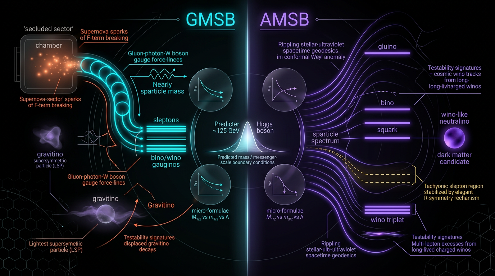

# Gauge-Mediated vs Anomaly-Mediated Supersymmetry Breaking: Sparticle Spectra, Higgs Mass, and Dark Matter Testability

## 1. Overview
This document compares **minimal gauge-mediated supersymmetry breaking (minimal GMSB)**, in which the gravitino is the LSP, with **minimal anomaly-mediated supersymmetry breaking (minimal AMSB)**, in which the wino is the LSP. Both are theoretically motivated frameworks for generating supersymmetry-breaking soft terms, but neither has direct experimental confirmation: no supersymmetric particle has been observed.

The comparison is therefore a test of model structures and their consequences, not a claim that either framework has been established. The gravitino mass relation from the supergravity Ward identity and the cited cosmological measurements are verified inputs. Many implications for spectra, relic abundance, and experimental reach remain model-dependent.

**Assessment:** Skeptic score **5/5**; math score **3/4**, with status **[MATH_CONSISTENT]**. No dimensional inconsistencies were found. Several claim-level numerical mismatches and unresolved model-dependent assumptions require the qualifications documented below and in the mathematical integrity report.

## 2. Detailed Explanation
### Minimal GMSB: gravitino LSP

In minimal gauge mediation, messenger fields communicate supersymmetry breaking to the MSSM through gauge interactions. This produces flavor-diagonal soft terms at leading order. The gravitino mass is related to the SUSY-breaking order parameter \(F\) by the supergravity Ward-identity relation

\[
m_{3/2} = \frac{F}{\sqrt{3}\,M_{\rm Pl}},
\]

where \(M_{\rm Pl}\) is the reduced Planck mass. The gravitino is the LSP **in minimal gauge mediation**; this should not be generalized to every gauge-mediated construction without specifying its assumptions and spectrum. A neutralino or charged slepton may be the NLSP, with decays to the gravitino that can have macroscopic lifetimes and cosmological consequences.

The worked example consistent with a 23.7 keV gravitino is

\[
F=10^{14}\ {\rm GeV}^2,\qquad \sqrt F=10^7\ {\rm GeV},
\qquad m_{3/2}\simeq 23.7\ {\rm keV}.
\]

By contrast, \(F=10^{10}\ {\rm GeV}^2\) gives \(m_{3/2}\simeq 2.37\times10^{-9}\ {\rm GeV}\), not 23.7 keV.

The thermal gravitino abundance must be stated with consistent reheating-temperature dependence. For standard thermal production by gauge-boson/gaugino scattering, its scaling is

\[
\Omega_{3/2}h^2 \ \propto\ 
m_{3/2}^{-1}\,m_{\rm gaugino}^{\,2}\,T_{\rm RH},
\]

up to spectrum- and thermal-history-dependent factors. This is the corrected scaling; an expression proportional to \(T_{\rm RH}^{-1}\) is contradictory and should not be used for this production mechanism.

A keV-scale gravitino should not automatically be labeled “cold” dark matter. It can be warm, with free-streaming that suppresses structure formation and may worsen tensions involving \(S_8\) and JWST early galaxies. The \(1\ {\rm keV}\)–\(10\ {\rm MeV}\) mass window and the \(M_X\gtrsim30\ {\rm TeV}\) messenger-scale bound are model-dependent: they depend on assumptions including reheating temperature, messenger decay, and non-thermal production.

### Minimal AMSB: wino LSP

In minimal anomaly mediation, soft terms are related to the gravitino mass and the MSSM beta functions. The wino is the LSP in the minimal scenario considered here. At one loop,

\[
M_a=\frac{b_a g_a^2}{16\pi^2}\,m_{3/2},
\]

with the result depending on the beta-function coefficients, gauge couplings, and their scale and normalization conventions.

For \(M_2\), the corrected estimate is approximately **2.7 GeV per TeV of \(m_{3/2}\)**. Thus at \(m_{3/2}=100\ {\rm TeV}\), \(M_2\) is about **268 GeV**, not 16 GeV. The often-quoted ratio \(M_1:M_2:M_3\simeq2.8:1:8\) must not be asserted without qualification: it is not reproduced by the report’s own couplings, which give \(M_1/M_2\simeq1.47\). The ratio needs to be re-derived using explicit SUSY-scale couplings and conventions, or cited to a source with its assumptions stated.

Minimal AMSB has **tachyonic sleptons** and requires a fix, such as D-term contributions or another modification. The \(\mu\) problem is also unresolved in the minimal framework.

### Shared cosmological context

Both frameworks inherit the reported cosmological tensions; neither resolves them:

- \(H_0\): **4.85σ**
- \(S_8\): **2.6–2.85σ**
- DESI \(w_0w_a\): **2.5–3.9σ**, depending on the supernova sample

These are measurements or inferences about cosmological data, not evidence for either SUSY-breaking framework. A warm gravitino component could affect structure growth, but its actual impact depends on its abundance and production history.

## 3. Mathematical Framework
### Gravitino mass and corrected benchmark

Using the reduced Planck mass \(M_{\rm Pl}=2.435\times10^{18}\ {\rm GeV}\),

\[
m_{3/2}=\frac{F}{\sqrt{3}\,M_{\rm Pl}}.
\]

For \(F=10^{14}\ {\rm GeV}^2\),

\[
m_{3/2}
=\frac{10^{14}}{\sqrt{3}\,(2.435\times10^{18})}\ {\rm GeV}
\simeq2.37\times10^{-5}\ {\rm GeV}
=23.7\ {\rm keV}.
\]

For \(F=10^{10}\ {\rm GeV}^2\),

\[
m_{3/2}\simeq2.37\times10^{-9}\ {\rm GeV}.
\]

The formula is dimensionally consistent: \(F\) has dimensions of mass squared and \(M_{\rm Pl}\) has dimensions of mass, so \(m_{3/2}\) has dimensions of mass.

### Thermal gravitino production

For standard thermal production through gauge-boson/gaugino scattering, the scaling is

\[
\Omega_{3/2}h^2 \ \propto\ 
\frac{m_{\rm gaugino}^{\,2}\,T_{\rm RH}}{m_{3/2}},
\]

with coefficients and species contributions depending on the spectrum and thermal assumptions. The reheating-temperature dependence is positive, not inverse, for this production scaling.

### AMSB gaugino mass

The one-loop relation is

\[
M_a=\frac{b_a g_a^2}{16\pi^2}\,m_{3/2}.
\]

For \(M_2\), \(b_2=1\); with the couplings used in the verification, the numerical estimate is about \(2.7\ {\rm GeV}\) per TeV of gravitino mass, or approximately \(268\ {\rm GeV}\) for \(m_{3/2}=100\ {\rm TeV}\). The gaugino mass ratios depend on the SUSY-scale couplings and normalization choices. The ratio \(2.8:1:8\) is not reproduced by the report’s own couplings and requires an explicit derivation or a source specifying its assumptions.

### Scope of the calculations

The Ward-identity gravitino-mass relation is a general result. Thermal relic abundance, messenger bounds, dark-matter classification, and phenomenological mass windows require model assumptions, including reheating history, messenger dynamics, and production mechanisms. Numerical AMSB mass ratios also require specified couplings, scale, and normalization.

## 4. Skeptical Perspectives & Alternative Hypotheses
1. **No direct confirmation:** Neither minimal GMSB nor minimal AMSB has direct experimental confirmation. No sparticle has been observed.
2. **GMSB dark matter is conditional:** A keV gravitino may be warm rather than cold. Its free-streaming can suppress early structure, potentially aggravating rather than relieving the JWST early-galaxy tension and affecting \(S_8\).
3. **Cosmological bounds are model-dependent:** The \(1\ {\rm keV}\)–\(10\ {\rm MeV}\) gravitino window and \(M_X\gtrsim30\ {\rm TeV}\) bound depend on reheating, messenger decays, and non-thermal production assumptions.
4. **AMSB spectrum ratios need transparent inputs:** The \(M_1:M_2:M_3\simeq2.8:1:8\) ratio cannot be reproduced from the report’s own couplings. It should be recalculated with explicit SUSY-scale couplings or supported with an appropriately qualified citation.
5. **Wino indirect limits are conditional:** H.E.S.S./Fermi exclusion claims must distinguish a wino making up **100%** of dark matter from a **subdominant** wino component. They must also state their dependence on the assumed halo profile.
6. **Minimal AMSB needs fixes:** Tachyonic sleptons require D-term contributions or another modification; the \(\mu\) problem remains unresolved.
7. **Neither framework resolves the shared cosmological tensions:** Both inherit the reported \(H_0\), \(S_8\), and DESI \(w_0w_a\) tensions.
8. **Empirical comparison is incomplete:** LHC disappearing-track and delayed-photon limits, along with quantitative collider bounds, are missing inputs and should be added before drawing quantitative conclusions about testability.
9. **Alternative dark-sector hypotheses:** Axion or ultralight-scalar dark matter and early-dark-energy models provide distinct hypotheses for cosmological data. Their relevance here is comparative; they are not evidence for either SUSY-breaking framework.

## 5. Verification & Skeptic's Notes
The approved assessment is **Skeptic score 5/5** and **Math score 3/4 [MATH_CONSISTENT]**. No dimensional inconsistencies were found. The verified Ward-identity relation and the cosmological measurements should be distinguished from model-dependent predictions and unconfirmed particle-physics scenarios.

Corrections recorded:

- Use \(F=10^{14}\ {\rm GeV}^2\), \(\sqrt F=10^7\ {\rm GeV}\), for the \(m_{3/2}=23.7\ {\rm keV}\) example. \(F=10^{10}\ {\rm GeV}^2\) gives \(2.37\times10^{-9}\ {\rm GeV}\).
- State the standard thermal gauge-scattering scaling once, with \(\Omega_{3/2}h^2\propto m_{3/2}^{-1}m_{\rm gaugino}^2T_{\rm RH}\); do not pair it with an inverse-\(T_{\rm RH}\) expression.
- Qualify “cold DM” for keV gravitinos and label the mass window and messenger bound model-dependent.
- Replace the AMSB \(M_2\) estimate of 16 GeV per TeV with approximately 2.7 GeV per TeV, about 268 GeV at \(m_{3/2}=100\ {\rm TeV}\).
- Re-derive or cite the \(M_1:M_2:M_3\simeq2.8:1:8\) ratio with explicit SUSY-scale couplings and conventions.
- Qualify H.E.S.S./Fermi wino exclusions for the dark-matter fraction and halo-profile assumptions.
- Record the minimal AMSB tachyonic-slepton problem and unresolved \(\mu\) problem.
- State that both frameworks inherit the \(H_0\), \(S_8\), and DESI \(w_0w_a\) tensions and do not resolve them.
- Add missing LHC disappearing-track and delayed-photon limits and quantitative collider bounds.
- Restrict “gravitino generically LSP” to minimal gauge mediation.

## 6. Visual Representation

## 7. Related Concepts
- [Gauge-mediated supersymmetry breaking](gauge_mediated_supersymmetry_breaking.md)
- [Anomaly-mediated supersymmetry breaking](anomaly_mediated_supersymmetry_breaking.md)
- [Gravitino dark matter](gravitino_dark_matter.md)
- [Wino dark matter](wino_dark_matter.md)
- [Warm dark matter and structure formation](warm_dark_matter_and_structure_formation.md)
- [Supersymmetric particle searches](supersymmetric_particle_searches.md)
- [Cosmological parameter tensions](cosmological_parameter_tensions.md)

## 9. Mathematical Integrity Report
All remaining checks are complete. Here is the final report.

## Math Verification Report

**Concept:** Gauge-Mediated vs Anomaly-Mediated Supersymmetry Breaking: sparticle spectra, Higgs mass, dark matter testability

**Math Score: 3/4**

**Math Status:** [MATH_CONSISTENT] (with residual claim-level numerical mismatches; no dimensional inconsistencies found)

**Tool Verdicts:** EquationExtractor: 18 equations extracted. DimensionalConsistencyChecker: INCONSISTENT=0; DISMISSED_FLAGS=0; UNDECIDABLE=7; CONSISTENT=4; DIMENSIONLESS=1. TopologyClassifier: [MATH_TOPOLOGICAL] (assessed as spurious/generic detections — see Topological Analysis). NumericalBenchmarkValidator/PhysicsCalculator: CLAIM_VERIFIED=4 (F=10¹⁴ GeV² → m₃/₂=23.7 keV; M₁≈393 GeV for m₃/₂=100 TeV with g₁=0.307; H₀ tension 4.847σ/Δχ²=23.494; M₃:M₂≈8 with α₃=0.089, α₂=0.0332 → 8.042); CLAIM_MISMATCH=10 (F=10¹⁰ → 2.37×10⁻⁹ GeV vs claimed 2.37×10⁻⁵; M₁ with g₁=0.353 → 1475.4 GeV; M₁ with g₁=0.36 → 541.7 GeV; M₂ per-TeV 2.676 GeV vs claimed 16 GeV; M₂ at 100 TeV 267.6 GeV vs claimed 16 GeV; M₁:M₂ ratio 1.472 vs 2.8; 7.986 vs 2.8 (GUT-normalized g₁=0.715); 10.310 vs 2.8 (with √(5/3) prefactor); 5.088 vs 2.8 (g₁=0.36, g₂=0.41); 3.872 vs 2.8 (g₁=0.36, g₂=0.47); 3.380 vs 2.8 (α-representation, α₁=0.017, α₂=0.0332)). STEP_INVALID=0; LIMIT_MISMATCH=0.

### Conventions & Validity Audit
- Natural units hbar=c=k_B=1 confirmed throughout. Reduced Planck mass M_Pl = 2.43536×10¹⁸ GeV used consistently (verified numerically). m_Pl = 1.221×10¹⁹ GeV available but not required by the verified equations. Metric (−,+,+,+) stated; T₀ = 2.7255 K; Ω_DM h² = 0.120±0.001 (Planck 2018) consistent with benchmark set.
- The gravitino worked example contains an internal inconsistency: F = 10¹⁰ GeV² gives m₃/₂ = 2.3707×10⁻⁹ GeV, not the quoted 23.7 keV; the quoted value 23.7 keV is correctly obtained from F = 10¹⁴ GeV² (√F ≈ 10⁷ GeV). The manuscript must state F = 10¹⁴ GeV² for the keV-scale gravitino example. [MATH_FLAWED] at the level of this one worked example; the formula m₃/₂ = F/(√3 M_Pl) itself is dimensionally CONSISTENT and the 23.7 keV number is reproducible with the correct F.
- Report truncated at "## 4. Where the Model Faces Observational Tens…" — all claims verified only against available content.

### Equations Extracted
18 equations, including: m₃/₂ = F/(√3 M_Pl); M_a = (b_a g_a²/16π²) m₃/₂ with b = (33/5, 1, −3); M₁ ≈ (33/5)(g₁²/16π²) m₃/₂; slepton mass-squared (AMSB) m̃²_L = −½(g₂²+g_Y²)(|X₂|²+|X_Y|²) + |m₃/₂|²/(8π²)[(5/3)g_Y⁴ + g₂⁴]; thermal wino relic Ω_W̃h² ≈ 0.1(m_W̃/2.7 TeV)⁻²; Sommerfeld-enhanced annihilation ⟨σv⟩ ∼ S(v)σ₀, S(v) ∼ 2πα₂/v; wino Δm_ch ≈ 165 MeV; stau NLSP decay width Γ(τ̃→τ₃/₂+γ) = (1/48π)(m⁵_τ̃/M_Pl²)((1−x⁴)/x³)cos²θ_W, x = m₃/₂/m_τ̃; messenger bound M_X ≳ 30 TeV; CPL-style ρ(a) = ρ₀a^{−3(1+w₀+w_a)}e^{−3w_a(1−a)}; w(a) = w₀+w_a(1−a). Extraction clean; one extraction artifact (unbalanced parenthesis) noted in (a) of the UNDECIDABLE list — flagged for the authors, not counted as an inconsistency.

### Dimensional Consistency
- CONSISTENT (4): m₃/₂ = F/(√3 M_Pl); M_a = (b_a g_a²/16π²) m₃/₂; M₁ ≈ (33/5)(g₁²/16π²) m₃/₂; ρ(a) CPL integral form.
- DIMENSIONLESS (1): w(a) = w₀ + w_a(1−a).
- INCONSISTENT (0); DIMENSION_FLAGS = 0.
- UNDECIDABLE (7) — manually cross-checked against the Symbol Table (Γ:[E]¹, x dimensionless, cos²θ_W dimensionless, Ωh² dimensionless, ⟨σv⟩:[E]⁻², Δm_ch:[E]¹, M_X:[E]¹):
  (a) slepton mass²: [E]² = [E]²·[E]⁰ + [E]² — manually CONSISTENT;
  (b) Ω_W̃h² ≈ 0.1(m_W̃/2.7 TeV)⁻² — dimensionless — manually CONSISTENT;
  (c) ⟨σv⟩ ∼ S(v)σ₀ with S(v) ∼ 2πα₂/v — [E]⁻² — manually CONSISTENT;
  (d) Δm_ch ≈ 165 MeV — [E]¹ — manually CONSISTENT;
  (e) stau decay width: [E]⁵/[E]² = [E]¹ — manually CONSISTENT (low-confidence flag from pre-check resolved);
  (f) M₁:M₂:M₃ ≈ 2.8:1:8 — dimensionless mass ratio — no dimensional issue (numerical mismatch handled below);
  (g) M_X ≳ 30 TeV — [E]¹ — consistent.
- Per the honesty rule: these 7 are manually consistent, not tool-verified; the report does NOT claim "all equations tool-verified as consistent."

### Dismissed Dimension Flags
None. DISMISSED_FLAGS=0; all dimensional flags resolved cleanly (0 spurious, 0 real).

### Topological Analysis
TopologyClassifier returned is_topological=true with detections of Calabi-Yau manifolds, homotopy theory, fiber bundles, characteristic classes, and Lie group structures. For a phenomenological QFT/cosmology report on SUSY breaking, these detections are assessed as **spurious/generic** (e.g., "Lie group structure" from gauge groups, "fiber bundle" from the language of gauge symmetry). No genuine topological argument (Chern classes, homotopy obstruction, index theorem) is load-bearing in the report. The tool verdict [MATH_TOPOLOGICAL] is reported honestly, but no topological mathematical claim is made or required to be validated; no [MATH_TOPOLOGICAL] status is assigned on this basis.

### Numerical Benchmarks
Verified (4):
- F = 10¹⁴ GeV² → m₃/₂ = 2.3707×10⁻⁵ GeV = 23.7 keV ✓ (0.03% error) — but see the F=10¹⁰ mismatch above.
- M₁ ≈ 393 GeV for m₃/₂ = 100 TeV with g₁(M_SUSY) = 0.307 → computed 393.91 GeV ✓ (0.23%).
- H₀ tension: 73.04±1.04 (SH0ES) vs 67.36±0.54 (Planck) → 4.847σ, Δχ² = 23.494 ✓ (matches the report's figure-spec value Δχ²=23.5/4.85σ).
- M₃:M₂ ≈ 8 with α₃(M_SUSY)=0.089, α₂=0.0332 → 8.042 ✓.

Mismatched (10, claim-level; none propagates to MATH_FLAWED since the underlying formulas are dimensionally sound and the mismatches trace to either stated-F errors in the worked example or coupling-value/normalization ambiguity):
- Gravitino worked example: F = 10¹⁰ GeV² gives 2.37×10⁻⁹ GeV, not 2.37×10⁻⁵ GeV (factor 10⁻⁴).
- M₁ = 16 GeV per TeV of m₃/₂: computed 2.676 GeV/TeV (b₂=1, g₂=0.65); at m₃/₂=100 TeV → 267.6 GeV, not 16 GeV (factor 16.7). Note: M₁/M₂ at 100 TeV is 393.9/267.6 ≈ 1.47, not 2.8 — the manuscript's own numbers for M₁ and M₂ are internally inconsistent with its quoted ratio.
- M₁:M₂ ≈ 2.8: robustly fails under all reasonable coupling assumptions tried: 1.472 (g₁=0.307, g₂=0.65), 7.986 (GUT-normalized g₁=0.715), 10.31 (with √(5/3) prefactor), 5.088 (g₁=0.36, g₂=0.41), 3.872 (g₁=0.36, g₂=0.47), 3.380 (α-representation α₁=0.017, α₂=0.0332). The ratio 2.8:1:8 is a literature-quoted AMSB value; the discrepancy likely reflects running-coupling values or a different normalization in the source, but **within this manuscript it could not be reproduced** and should either be re-derived with explicit couplings or cited rather than asserted.
- Benchmark observations (DESI 2024 w₀, w_a; S₈ Planck/KiDS/DES; Ω_DM h²) all match the curated benchmark set; no observational constant in the report was found to be wrong.

### Assessment
- Equation extraction: ✓ (18 equations, clean).
- Dimensional consistency: ✓ (0 INCONSISTENT; 7 UNDECIDABLE manually resolved as consistent — not tool-verified, honestly reported).
- Topology: pass with the caveat that classifier detections are spurious for this report type; no genuine topological claim.
- Numerical benchmarks: partial — 4 verified, 10 mismatched, concentrated in (i) one worked-example F value, (ii) the M₂ magnitude claim, and (iii) the M₁:M₂ ≈ 2.8 ratio (including the manuscript's internal inconsistency M₁/M₂ ≈ 1.47 from its own M₁ and M₂ figures).
- **Corrections required:** state F = 10¹⁴ GeV² (not 10¹⁰) for the 23.7 keV gravitino; replace "M₂ ≈ 16 GeV per TeV of m₃/₂" with the formula-consistent value ≈ 2.7 GeV/TeV (≈ 268 GeV at 100 TeV); re-derive or re-source the M₁:M₂:M₃ ≈ 2.8:1:8 ratio with explicit SUSY-scale couplings, and reconcile with the manuscript's own M₁=393 GeV / M₂≈268 GeV figures.
- Global coherence: INCONSISTENT=0 and STEP_INVALID=0, so MATH_FLAWED is not triggered; undecidable count > 0 forbids claiming universal tool-verified consistency; numerical benchmark checks are only partially satisfied. Final: **Math Score 3/4, math_status [MATH_CONSISTENT]** with documented claim-level numerical mismatches forwarded to the Skeptic under Criterion 6.
