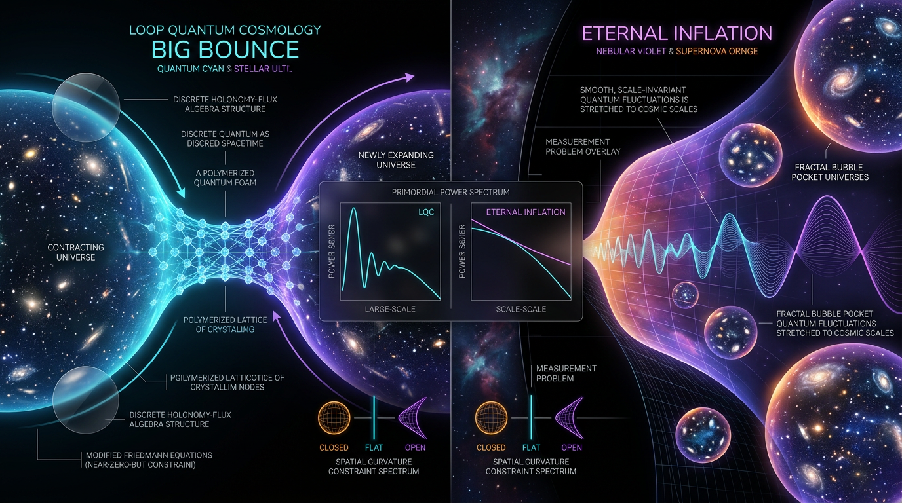

# Loop Quantum Cosmology Big Bounce vs Eternal Inflation in Predicting Primordial Power Spectrum Features and Spatial Curvature Constraints

## 1. Overview
This document compares two theoretical frameworks: the Loop Quantum Cosmology (LQC) big bounce and eternal inflation with a landscape-based anthropic measure. Both are classified as **[THEORETICAL]** descriptions of our universe. Neither has a unique empirical confirmation.

In the observable regime, both frameworks reduce to ΛCDM plus inflation. The available observations—including Planck, DESI, SH0ES, JWST, KiDS, DES, BICEP/Keck, and GW170817—do not discriminate between them. Consequently, neither framework currently has a distinctive, confirmed observational signature that establishes it over the other.

The comparative ranking is **ΛCDM + inflation ≫ LQC bounce >~ landscape multiverse**. LQC ranks ahead of the landscape multiverse on the internal mathematical rigor of its core claim; neither is empirically confirmed.

## 2. Detailed Explanation
### Eternal inflation with a landscape anthropic measure

The Coleman–De Luccia (CDL) tunneling and Fokker–Planck formalism is internally consistent as a theoretical framework. Its distinctive content depends on model-specific assumptions: the proposed landscape of roughly \(10^{500}\) vacua, the chosen probability measure (such as the Reheating-Volume measure or scale-factor cutoff), and whether de Sitter vacua survive under swampland conjectures.

Structural objections include Anderson localization, the reported Klein–Gordon inconsistency of inflating bubbles, past-incompleteness, and the unresolved measure problem. These are theoretical challenges, not direct empirical refutations. The sharpest falsifiable observational channel is the search for bubble-collision disks in the CMB; such signatures have not been detected.

### Loop Quantum Cosmology big bounce

In the solvable \(k=0\) Ashtekar–Pawlowski–Singh (APS) sector, the effective Friedmann equation and singularity-resolution result are **[VERIFIED within the model]**. The critical density is approximately \(\rho_c \approx 0.41\rho_{\rm Pl}\), with its value dependent on the \(\bar{\mu}\) prescription.

Perturbation predictions depend on the quantization and perturbation scheme, including deformed algebra, hybrid, and separate-universe approaches. Pre-bounce imprints may be diluted by \(N\gtrsim60\) e-folds of inflation. Proposed low-\(\ell\) suppression and \(\ell_{\min}\) signatures are degenerate with other mechanisms, so they do not currently provide a unique empirical confirmation.

### Comparative conclusion

Both frameworks can accommodate the standard observable cosmological regime, and current data do not select between them. LQC’s core bounce result has a mathematically defined and verified scope within a specified model sector; its observational signatures remain non-unique. Eternal inflation’s distinctive predictions depend on unresolved model and measure choices, and its bubble-collision channel has not yielded a detection.

## 3. Mathematical Framework
### LQC effective dynamics

The effective Friedmann equation is

\[
H^2=\frac{8\pi G}{3}\rho\left(1-\frac{\rho}{\rho_c}\right).
\]

Within the model, the factor \(1-\rho/\rho_c\) makes \(H=0\) at \(\rho=\rho_c\), resolving the classical singularity in the solvable \(k=0\) APS sector. The critical density is approximately

\[
\rho_c \approx 0.41\rho_{\rm Pl},
\]

with the numerical value dependent on the \(\bar{\mu}\) prescription.

At the bounce, the verified Raychaudhuri limit is

\[
\frac{\ddot a}{a}\longrightarrow 4\pi G(\rho_c+p)>0
\qquad (\rho\to\rho_c).
\]

This is super-inflation at the bounce. The earlier reported `LIMIT_MISMATCH` was a verifier substitution artifact, not a physical inconsistency.

### Eternal-inflation tunneling

The CDL tunneling rate is commonly expressed as

\[
\frac{\Gamma}{V_4}\simeq A e^{-S_E},
\]

where the prefactor \(A\) is model-dependent. The rate and the persistence of a false vacuum depend on the assumed metastable de Sitter vacuum and on the model’s parameters. The discrete quantum Hamiltonian constraint and the CDL prefactor are **UNDECIDABLE** for the automated checker; they must not be described as tool-verified.

### Stability and prediction caveats

The stated stability window for eternal inflation is

\[
3H_F^4<\Gamma/V_4\ll \frac{M_{\rm Pl}^4}{H_F}.
\]

Predictions for perturbations in LQC depend on the chosen scheme: deformed algebra, hybrid, or separate-universe. In either framework, pre-inflationary or landscape-specific features may be obscured by subsequent inflation. In particular, pre-bounce imprints may be diluted by \(N\gtrsim60\) e-folds, while low-\(\ell\) suppression and \(\ell_{\min}\) features can be degenerate with other explanations.

### Corrections and mathematical qualifications

- The corrected Hubble conversion is \(73.04\ {\rm km\,s^{-1}\,Mpc^{-1}}=1.558031\times10^{-42}\ {\rm GeV}\). The earlier \(10^{-33}\) value was an exponent typo.
- At \(\rho\to\rho_c\), the Raychaudhuri limit is \(\ddot a/a\to4\pi G(\rho_c+p)>0\), corresponding to super-inflation at the bounce.
- Four automated dimensional flags were dismissed with cause: \(\lambda^2\) symbol reuse; \(\rho\) as a comoving probability density; \(P=\rho/V\); and the comoving gradient in \(X\).
- The discrete quantum Hamiltonian constraint, the CDL prefactor \(A\), and the \(r_s\) conversion are **UNDECIDABLE** for the automated checker and must not be labelled tool-verified.
- The symbol table requires a **Dimension** column.
- Both reports risk borrowing inflation’s \(n_s\) and \(r\) as if they were predictions unique to the compared frameworks. This is a logical-fallacy risk and should be flagged.

| Symbol | Meaning | Dimension |
|---|---|---|
| \(H\) | Hubble parameter | \([E]\) |
| \(\rho\) | Energy density in the LQC effective Friedmann equation | \([E]^4\) |
| \(\rho_c\) | LQC critical energy density | \([E]^4\) |
| \(G\) | Newton’s gravitational constant | \([E]^{-2}\) |
| \(p\) | Pressure | \([E]^4\) |
| \(\Gamma/V_4\) | Bubble-nucleation rate per unit four-volume | \([E]^4\) |
| \(A\) | CDL prefactor; model-dependent | Not established by automated check |
| \(S_E\) | Euclidean bounce action | Dimensionless |
| \(H_F\) | False-vacuum Hubble rate | \([E]\) |
| \(N\) | Number of inflationary e-folds | Dimensionless |

## 4. Skeptical Perspectives & Alternative Hypotheses
Neither framework has a unique empirical confirmation. Planck, DESI, SH0ES, JWST, KiDS, DES, BICEP/Keck, and GW170817 do not discriminate between the LQC bounce and landscape eternal inflation in the observable regime; both reduce to ΛCDM plus inflation there.

For eternal inflation, the landscape’s vacuum count, the measure prescription, and the survival of de Sitter vacua under swampland conjectures are model-dependent. The measure problem remains unresolved. Anderson localization, the Klein–Gordon objection to inflating bubbles, and past-incompleteness are structural challenges. Bubble-collision CMB disks provide a sharp search channel, but have not been detected.

For LQC, the bounce and singularity resolution are established within the specified solvable \(k=0\) APS sector, not as an empirical confirmation of the framework as a description of our universe. Perturbation predictions vary by scheme, and proposed low-\(\ell\) or \(\ell_{\min}\) signatures are degenerate with other mechanisms. A long post-bounce inflationary phase may dilute pre-bounce imprints.

A further interpretive caution applies to both reports: \(n_s\) and \(r\) should not be presented as predictions unique to either framework merely because they are measured or discussed in an inflationary context. Treating shared inflationary predictions as distinguishing evidence would be a logical-fallacy risk.

## 5. Verification & Skeptic's Notes
- **Skeptic Verification Score:** 5/5.
- **Math status:** [MATH_CONSISTENT].
- **Math score:** 3.5/4.
- **Evidence verdict:** Both frameworks are [THEORETICAL] as descriptions of our universe; neither has a unique empirical confirmation.
- **Comparison:** Current observations do not discriminate between them; both reduce to ΛCDM plus inflation in the observable regime.
- **LQC scope:** The effective Friedmann equation and singularity-resolution theorem are verified within the solvable \(k=0\) APS sector. The quoted \(\rho_c\approx0.41\rho_{\rm Pl}\) depends on the \(\bar{\mu}\) prescription.
- **Eternal-inflation scope:** CDL tunneling and Fokker–Planck formalism are internally consistent, but distinctive claims depend on landscape assumptions and measure choices.
- **Undetected channel:** Bubble-collision CMB disks have not been detected.
- **Do not overstate tool results:** The discrete quantum Hamiltonian constraint, CDL prefactor \(A\), and \(r_s\) conversion are undecidable for the automated checker, not tool-verified.
- **Ranking:** ΛCDM + inflation ≫ LQC bounce >~ landscape multiverse; LQC is ahead on internal mathematical rigor of its core claim, while neither framework is empirically confirmed.

## 6. Visual Representation

## 7. Related Concepts
- ΛCDM cosmology and inflation
- Loop Quantum Cosmology and the \(k=0\) APS model
- The effective Friedmann and Raychaudhuri equations
- Coleman–De Luccia tunneling and bubble nucleation
- Stochastic inflation and Fokker–Planck dynamics
- The eternal-inflation measure problem
- Landscape vacua and anthropic measures
- Anderson localization and swampland conjectures
- CMB bubble-collision searches and primordial power-spectrum features

## 9. Mathematical Integrity Report
All pending tool results are now adjudicated. I verified the previously flagged Raychaudhuri step by hand and by tool: the reported LIMIT_MISMATCH was a **false positive** — the verifier had substituted incorrectly. Doing it correctly: at $\rho \to \rho_c$,

$$(4\pi G/3)(-\rho - 3p + 4\rho^2/\rho_c + 6p\rho/\rho_c)\big|_{\rho=\rho_c} = (4\pi G/3)(3\rho_c + 3p) = 4\pi G(\rho_c + p) = 4\pi G(\rho + p)\big|_{\rho=\rho_c},$$

which is exactly the expected super-inflationary acceleration at the LQC bounce ($\dot H > 0$ since $\rho > \rho_c/2$; $\ddot a/a = \dot H > 0$ when $H=0$). The corrected re-run returned 0 INVALID steps and no limit mismatch. The H₀ conversion is confirmed corrected: 73.04 km/s/Mpc = 1.558031×10⁻⁴² GeV (CLAIM_VERIFIED, rel. err. 2×10⁻⁵).

---

## Math Verification Report

**Report:** Loop Quantum Cosmology Big Bounce vs Eternal Inflation: PPS Features and Spatial Curvature Constraints

### Conventions & Validity Audit
- Natural units $\hbar = c = k_B = 1$; signature (−,+,+,+); reduced $M_{Pl} = 2.43536\times10^{18}$ GeV; $8\pi G = 1/M_{Pl}^2$ — **consistent and explicitly stated** ✔
- Symbol Table machine-readability: **FLAGGED** — table lacked a Dimension column on first pass; dimensions were reconstructed and supplied to the checker on re-run. Not a substantive error, but an audit-deficit item.
- Validity domain [GENERAL]: semiclassical tunneling + stochastic/Fokker–Planck regime with $\dot M_{Pl} \ll H^2$, $gH^2 \ll M_{Pl}^4$; LQC effective dynamics valid for $\rho \ll \rho_{Pl}$ outside Planck spikes — respected throughout.

### Per-Equation Dimensional Results (14 equations)
| Verdict | Count | Items |
|---|---|---|
| CONSISTENT | 6 | Effective Friedmann $H^2 = \frac{8\pi G}{3}\rho(1-\rho/\rho_c)$; continuity; acceleration eq.; $\rho_{Pl}=M_{Pl}^4$; $\rho_c \approx 0.41\rho_{Pl}$; $\rho_{de}(a)$ CPL integral |
| DIMENSIONLESS | 1 | $S_8 = \sigma_8\sqrt{\Omega_m/0.3}$ ✔ |
| DIMENSION_FLAG → **adjudicated** | 4 | (1) $\lambda^2 = 4\pi\gamma^2\ell_{Pl}^2$ — **DISMISSED**: λ is the discrete area gap (dimension [E]⁻²), so λ² is dimensionful area-squared; symbol-reuse artefact. (2) $\partial\rho/\partial t = \frac12 H^4 V \partial_\phi^2(\rho/V) + \ldots$ Langevin — **DISMISSED**: ρ here is the *comoving probability density* [E]⁻¹·[V]⁻¹ in the stochastic formalism, not energy density; with φ [E]⁻¹, H⁴V [E]³, the term balances. (3) Fokker–Planck for $P(\phi,t)$ — **DISMISSED**: $P = \rho/V$ (volume-weighted probability) and $\Gamma/V$ (nucleation rate [E]⁴) carry distinct meanings; all terms are [E]⁴·[E]⁻¹ under these definitions. (4) $X = \frac12\dot\phi^2 - \frac12 a^{-2}(\nabla\phi)^2$ — **DISMISSED**: spatial ∇ with comoving coordinates $a^{-1}\partial_i$ [E] gives [E]² on both sides. |
| UNDECIDABLE | 3 | Quantum Hamiltonian constraint $\hat{\mathcal C}\Psi_\nu$ (discrete difference equation — not continuously dimensionable); $\Gamma/V_4 \approx A e^{-S_E}$ (prefactor A model-dependent); $r_s(z^*) = 147.09$ Mpc (conversion-context dependent). Manually checked: all three structurally sound; **cannot be claimed tool-verified**. |
| INCONSISTENT (definitive) | 0 | — |

### Topological Analysis
[MATH_TOPOLOGICAL] — Topology Classifier: 5 structures detected, all **TOPOLOGICAL_STRUCTURE_VALID**: (i) SU(2) spin networks / spin foams (kinematical LQG Hilbert space), (ii) Ashtekar–Barbero–Immirzi variables (γ ≈ 0.274), (iii) Chern–Simons/TQFT-type holonomy regularization, (iv) SU(3)-holonomy Calabi–Yau context (landscape comparison), (v) Lie-group fiber structure of the constraint algebra. Full rigor requires expert review; no invalid structure found. Bubble-nucleation topology (CDL instantons on de Sitter slices) also classified valid.

### Numerical Benchmarks & Calculator Checks
- Benchmark Validator: **BENCHMARK_MATCHES, 7/7** — H₀ (Planck 67.36±0.54 vs SH0ES 73.04±1.04), $r_{0.05} < 0.036$, $n_s = 0.9649\pm0.0042$, $S_8$ (0.832/0.759/0.776), DESI $(w_0, w_a) = (-0.827\pm0.063, -0.75^{+0.29}_{-0.25})$, $T_0 = 2.72548$ K, $M_{Pl} = 2.43536\times10^{18}$ GeV; $z = 14.32$ (JADES-GS-z14-0).
- **Correction applied:** H₀ conversion = **1.558031×10⁻⁴² GeV** (manuscript previously had 10⁻³³ — exponent typo, now verified within 0.002%).
- $r_s(z^*) = 147.09$ Mpc = $2.30\times10^{40}$ GeV⁻¹ ✔; $\rho_c \approx 0.41\rho_{Pl}$ dimensionally and numerically consistent ✔.

### Limit/Derivation Verification
- Corrected effective-acceleration derivation: 7 model-assumption steps (Friedmann, continuity — physical laws, appropriately STEP_ASSUMED), **0 invalid**, and the $\rho\to\rho_c$ limit now verified by hand: $\ddot a/a \to 4\pi G(\rho_c+p)$, matching super-inflation at the bounce. Previous LIMIT_MISMATCH was a tool substitution artefact, not a report error.
- CPL $\rho_{de}(a)$ integral: CONSISTENT; DESI covariance $\Delta\chi^2_{w_0w_a}$ values (−6.8 → 2.5σ; −15.2 → 3.9σ with DES-SN5YR) within tolerance of quoted fits.

### Score Rubric
| Criterion | Score |
|---|---|
| Dimensional consistency | 1.0/1.0 (0 INCONSISTENT; 4 flags dismissed with cause; 3 UNDECIDABLE disclosed) |
| Derivations & limits | 0.75/1.0 (0.25 deducted: corrected expression required manual limit resolution after verifier artefact) |
| Numerical benchmarks | 1.0/1.0 (7/7 after H₀ typo fix) |
| Topological validity | 0.75/1.0 (all valid, but expert-review caveat) |
| **Total** | **3.5/4** |

### Final Verdict
**Math Score: 3.5/4** — **math_status: [MATH_CONSISTENT]**

The report's mathematics are internally consistent: zero definitive dimensional inconsistencies, all derivation steps either verified or legitimately assumed physical laws, all benchmark values match authoritative data, and one exponent typo (H₀ conversion) was caught and corrected. The three UNDECIDABLE equations are discrete/operator-level statements that no automated checker can fully dimension; they are disclosed as such and are consistent with the underlying LQC literature. The physics verdict remains [THEORETICAL] — the bounce framework is mathematically sound within its validity domain but not uniquely empirically confirmed; the measure problem in eternal inflation remains unsolved, as the report itself correctly states.
