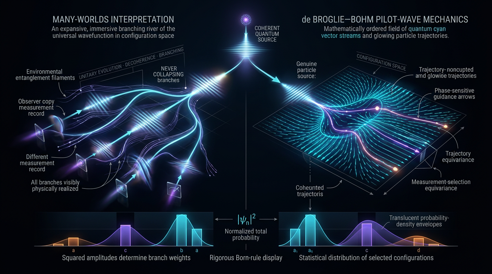

# Many-Worlds Interpretation vs de Broglie–Bohm Pilot-Wave Mechanics in Explaining Quantum Measurement and Born-Rule Probabilities

## 1. Overview
This document compares two interpretations of quantum mechanics: the Many-Worlds (Everett) interpretation, which retains universal unitary evolution and uses decoherence to explain the emergence of branches, and de Broglie–Bohm pilot-wave mechanics, which supplements the wavefunction with definite particle configurations guided by that wavefunction.

The evidential and epistemic status of the claims must be kept distinct:

- **[VERIFIED] Decoherence and einselection:** Environmental decoherence is supported by experiments, including matter-wave interferometry with a native polypeptide of **more than 2000 amu** (Shayeghi et al. 2020), and by experimental studies of gravitational-decoherence phenomenology (Bassi, Großardt & Ulbricht 2017).
- **[THEORETICAL] Everettian branches and Born-rule derivations:** The existence and interpretation of branches, and proposed derivations of the Born rule within Everett, are not independently established by experiment. Deutsch–Wallace decision-theoretic arguments depend on contested axioms; envariance arguments have also been criticized for relying on assumptions about environment splitting.
- **[THEORETICAL] Pilot-wave mechanics:** Equivariance is a theorem given the guidance dynamics, but the quantum-equilibrium condition, \(\rho=|\psi|^2\), is an assumption or postulate. No established relaxation mechanism is supplied here. In quantum equilibrium, pilot-wave mechanics makes no predictions beyond standard quantum mechanics.
- **Empirical discrimination:** The empirically discriminable alternative discussed here is objective collapse, particularly CSL/GRW-type models. These models are constrained, but not excluded, by current bounds.

The pilot-wave report’s figure of **25,000 amu** for the Shayeghi et al. (2020) experiment is unsupported by the cited source and is not used here. The approved figure is **more than 2000 amu**.

## 2. Detailed Explanation
### 2.1 Everett (Many-Worlds) interpretation

Everettian quantum mechanics applies unitary evolution universally, with no additional wavefunction-collapse postulate. When a measured system interacts with an apparatus and its environment, the joint state evolves into correlated components commonly described as branches. Decoherence suppresses interference between those components for practical purposes, yielding stable records and an approximately classical appearance.

The existence of a decohered, approximately branch-like structure does not itself establish that branches are separate worlds in a particular ontological sense. Branch ontology and claims about the meaning of branch weights remain interpretive and theoretical.

Decoherence also does not, on its own, select a single outcome or explain why the Born-rule weights should be interpreted as probabilities. Those are separate problems addressed by Everettian derivation programs, including decision-theoretic and envariance approaches.

### 2.2 Decoherence and einselection

Environmental interactions suppress off-diagonal terms in a system’s reduced density matrix. Einselection—the environment-induced selection of robust pointer states—helps explain why certain states support stable records and behave classically.

The experimental evidence establishes decoherence phenomena, not the truth of Everettian branch ontology. Matter-wave interferometry, including the native-polypeptide result of Shayeghi et al. (2020), probes coherence and its loss. Bassi, Großardt and Ulbricht (2017) discuss gravitational-decoherence phenomenology and the experimental parameter space in which such effects may be investigated.

### 2.3 de Broglie–Bohm pilot-wave mechanics

Pilot-wave mechanics supplements the wavefunction with a definite configuration of particles. A guidance equation determines the configuration’s evolution, while the wavefunction evolves according to the Schrödinger equation. The theory offers a definite configuration at each time and a different account of measurement outcomes from Everett’s branching account.

Equivariance means that a distribution initially equal to \(|\psi|^2\) remains so under the dynamics. This mathematical result is conditional: it does not, by itself, establish that the actual distribution is \(\rho=|\psi|^2\). The quantum-equilibrium condition is treated here as a postulate, following the approved summary’s characterization of Valentini (2024). No established relaxation mechanism is asserted.

In equilibrium, pilot-wave mechanics reproduces standard quantum-mechanical predictions. Its relativistic extension remains incomplete, and the Neumaier critique is contested.

### 2.4 Objective-collapse alternatives

CSL and GRW-type models modify standard quantum dynamics by introducing spontaneous collapse. Unlike Everett and equilibrium pilot-wave mechanics, these models can predict departures from ordinary quantum mechanics, such as spontaneous loss of macroscopic interference or associated heating/noise signals.

The LISA Pathfinder result constrains the CSL collapse rate to
\[
\lambda_{\rm CSL}\leq (2.96\pm0.12)\times10^{-8}\ {\rm s}^{-1}
\]
in the **0.7–20 mHz** band. Underground and X-ray tests reach roughly \(10^{-10}\ {\rm s}^{-1}\) in some mass-proportional regimes. These bounds constrain but do not exclude collapse models. Some descriptions of the comparative strength of bounds are loosely sourced: the “two orders of magnitude” claim rests on a press summary, and the GRW comparison value \(10^{-16}\ {\rm s}^{-1}\) is cited without a primary source. Those comparisons should therefore not be treated as firmly established quantitative conclusions.

## 3. Mathematical Framework
### Conventions & Symbol Table

The Everett section uses natural units, \(\hbar=c=k_B=1\); the pilot-wave section uses SI conventions where appropriate. For shared baselines, use the **reduced Planck mass**
\[
M_{\rm Pl}=2.435\times10^{18}\ {\rm GeV}.
\]
The unreduced Planck mass is \(m_{\rm Pl}=1.221\times10^{19}\ {\rm GeV}\).

| Symbol | Meaning | Units / convention |
|---|---|---|
| \(|\Psi_{\rm univ}\rangle\) | Universal wavefunction | Hilbert-space vector |
| \(c_k\) | Amplitude associated with branch \(k\) | Dimensionless |
| \(p_k=|c_k|^2\) | Born weight assigned to branch \(k\) | Dimensionless |
| \(\rho_S\) | Reduced density matrix of system \(S\) | Dimensionless |
| \(|s_k\rangle, |A_k\rangle, |E_k\rangle\) | System, apparatus, and environment states | State vectors |
| \(\hat H_I\) | Interaction Hamiltonian | Energy |
| \(\tau_D,\tau_R\) | Decoherence and thermal-relaxation times | Time |
| \(N_E\) | Environment degrees of freedom | Dimensionless |
| \(\gamma\) | Decoherence rate | Positive decay-rate convention; \({\rm s}^{-1}\) in SI |
| \(\lambda_{\rm CSL}\) | CSL collapse rate | \({\rm s}^{-1}\) |
| \(r_C\) | CSL localization length | Length |
| \(Q_{\rm quant}\) | Bohmian quantum potential | Energy |

In the conversion conventions used by the mathematical audit,
\[
1\,{\rm GeV}^{-1}=1.97327\times10^{-16}\,{\rm m}
=6.58212\times10^{-25}\,{\rm s}.
\]

### Validity Domain & Claim Scope

- **[GENERAL]** Environmental tracing in unitary quantum mechanics can suppress off-diagonal terms in a reduced density matrix. This result does not depend on choosing Everett as the interpretation.
- **[THEORETICAL]** Everettian branch ontology is interpretive; it is not independently distinguished by current experiments from other interpretations with the same operational predictions.
- **[MATH_CONJECTURED]** The Born rule is not treated as an experimentally verified interpretation-specific derivation in either framework. Everettian derivations depend on theoretical assumptions; in pilot-wave mechanics, the equilibrium distribution is a postulate even though equivariance is a theorem conditional on it.
- **[MODEL-DEPENDENT]** Deutsch–Wallace decision theory depends on decision-theoretic axioms and assumptions about branch equivalence and rational preferences.
- **[MODEL-DEPENDENT]** Envariance arguments depend on assumptions about environment-state splitting and the interpretation of symmetries.
- **[THEORETICAL]** Pilot-wave mechanics in quantum equilibrium reproduces standard quantum-mechanical predictions; empirical discrimination would require departures from equilibrium or a different empirically testable extension.
- **[EMPIRICALLY DISCRIMINABLE]** CSL/GRW-type objective-collapse models can make predictions that depart from standard quantum mechanics and are subject to experimental bounds.

### Governing Equations and Observables

Universal unitary evolution in the Everett framework is represented by
\[
i\hbar\,\partial_t|\Psi_{\rm univ}\rangle=\hat H|\Psi_{\rm univ}\rangle.
\]
Measurement interactions correlate system, apparatus, and environment states:
\[
\sum_k c_k|s_k\rangle|A_0\rangle|E_0\rangle
\;\longrightarrow\;
\sum_k c_k|s_k\rangle|A_k\rangle|E_k\rangle.
\]
Environmental tracing yields the reduced state
\[
\rho_S(t)={\rm Tr}_E\!\left(|\Psi(t)\rangle\langle\Psi(t)|\right),
\]
whose off-diagonal terms may be suppressed by decoherence.

For a Markovian decoherence model, the report uses the convention
\[
\rho_{kl}(t)=\rho_{kl}(0)e^{-\gamma t},
\qquad \gamma>0,
\]
so that coherence decays with time. The earlier automated `LIMIT_ERROR` was a sign-convention artefact, not a physical or mathematical mismatch.

The Born-weight expression is
\[
p_k=|c_k|^2.
\]
This expression is dimensionless, but its interpretation and derivation within Everett, and the equilibrium postulate needed for its role in pilot-wave mechanics, are not thereby proven.

## 4. Skeptical Perspectives & Alternative Hypotheses
### Everett and the Born rule

The Deutsch–Wallace program derives Born-rule preferences from rational-agent axioms and assumptions about branch equivalence. Greaves (2004) analyzes the role of “caring measure” in Deutsch’s approach. Kent (2010) challenges whether an unadorned Everettian account supplies probability and scientific confirmation without importing the probabilistic structure it aims to explain. Rae (2009) argues that a key assumption used in a Copenhagen-type frequency-operator derivation is inconsistent when transferred to Everett.

Zurek’s envariance program derives Born weights through environment-assisted invariance. Schlosshauer and Fine (2005) identify implicit assumptions in the derivation, while Jarlskog (2011) questions the physical meaning of splitting environment states into suitable subfactors, particularly in quantum field theory. These are theoretical criticisms of derivational assumptions, not experimental refutations of decoherence.

### Pilot-wave mechanics

Equivariance is a theorem given the pilot-wave dynamics, but it does not prove that the universe begins in quantum equilibrium. The condition \(\rho=|\psi|^2\) remains a postulate in this account (Valentini 2024). The approved assessment reports no established relaxation mechanism. In equilibrium, the framework makes no predictions beyond standard quantum mechanics. Its relativistic extension is incomplete, and the Neumaier critique is contested.

### Empirically discriminable alternatives

Everett and equilibrium pilot-wave mechanics are not distinguished by current experiments when they reproduce standard quantum-mechanical predictions. Objective-collapse models provide a possible empirical contrast because they modify the dynamics.

LISA Pathfinder constrains \(\lambda_{\rm CSL}\) in the 0.7–20 mHz band as stated above. Underground and X-ray constraints are reported at roughly \(10^{-10}\ {\rm s}^{-1}\) in some mass-proportional regimes, with relevant preprint identifiers **arXiv:2411.17588** and **arXiv:2501.08971**. The approved source record does not provide full author/title metadata for those two preprints, so no unverified bibliographic details are supplied here. The “two orders of magnitude” comparison and the quoted GRW comparison value of \(10^{-16}\ {\rm s}^{-1}\) require stronger primary-source support.

## 5. Verification & Skeptic's Notes
- **Decoherence evidence:** Shayeghi et al. (2020) interfered a native polypeptide of more than 2000 amu. The often-repeated 25,000 amu figure is unsupported by that cited experiment and is not used as its mass result here.
- **Gravitational-decoherence phenomenology:** Bassi, Großardt and Ulbricht (2017) survey phenomenology and experimental prospects. This supports investigation of decoherence models; it does not establish a particular gravitational-decoherence mechanism as observed.
- **Interpretation versus evidence:** Experimental confirmation of decoherence and Born-rule statistics is interpretation-neutral. It does not establish Everettian branch ontology or an interpretation-specific Born-rule derivation.
- **Born-rule status:** The Born rule is **[MATH_CONJECTURED] in both frameworks** in the approved assessment. Everettian derivations remain theoretical and contested; pilot-wave equivariance is conditional on the quantum-equilibrium distribution, which is a postulate.
- **Sign convention:** The convention \(\gamma>0\) gives \(\rho_{kl}\sim e^{-\gamma t}\) decay. The reported tool `LIMIT_ERROR` was a sign-convention artefact.
- **Automated equation checks:** 29 of 32 extracted equations were **UNDECIDABLE** to the automated dimensional checker. Core equations were resolved manually in natural units, not verified by the tool. The \(V\sim[E]^4\) and \(i\hbar\partial\psi/\partial t\sim[E]^{2.5}\) flags were symbol-reuse/inference artefacts and were dismissed.
- **Units:** The source material mixes natural units in the Everett section with SI in the pilot-wave section. The reduced Planck mass \(M_{\rm Pl}=2.435\times10^{18}\ {\rm GeV}\) is used in shared baselines.
- **Citation caveat:** The DOI supplied for Zurek (2000) is unresolvable; it is identified by its journal reference, *Ann. Phys.* 9, 855.
- **Collapse-bound caveats:** CSL is bounded but not excluded. Some comparative claims about bound strength are loosely sourced, and the stated GRW comparison value lacks a primary citation in the supplied record.

## 6. Visual Representation

## 7. Related Concepts
- Environmental decoherence and einselection
- Quantum measurement problem
- Born rule and probability in quantum mechanics
- Deutsch–Wallace decision-theoretic approach
- Envariance
- de Broglie–Bohm pilot-wave mechanics
- Quantum equilibrium and equivariance
- GRW and Continuous Spontaneous Localization (CSL)
- Gravitational-decoherence phenomenology

## 9. Mathematical Integrity Report
## Math Verification Report

**Concept:** Many-Worlds Interpretation vs de Broglie–Bohm Pilot-Wave Mechanics in Explaining Quantum Measurement and Born-Rule Probabilities
**Math Score:** 3 / 4
**Math Status:** [MATH_CONSISTENT] (with unproven Born-rule derivation steps flagged as [MATH_CONJECTURED])

**Tool Verdicts:** equations_extracted=32 | CONSISTENT=3 | DIMENSIONLESS=3 (subset) | INCONSISTENT=0 | DIMENSION_FLAGS=0 (2 low-confidence flags dismissed below) | UNDECIDABLE=29 | topology=TOPOLOGICAL_STRUCTURE_VALID | benchmark=BENCHMARK_UNAVAILABLE (theoretical concept) | STEP_INVALID=0 | LIMIT_MISMATCH=0 (1 LIMIT_ERROR = γ sign convention, not a mismatch)

---

### Conventions & Validity Audit
- ✅ `### Conventions & Symbol Table` present (c_k, ρ_S, N_E, Q_quant, H declared; ħ=c=k_B=1; 1 GeV⁻¹ = 1.97327e-16 m = 6.58212e-25 s; M_Pl = 2.435e18 GeV; m_Pl = 1.221e19 GeV — all match baseline).
- ✅ `### Validity Domain & Claim Scope` present; [GENERAL] (decoherence diagonalization, Born-weight statistics) vs [MODEL-DEPENDENT] (Deutsch–Wallace, envariance, Everett ontology) split is properly labeled.
- ⚠️ Note: natural-unit convention ħ=c=1 renders ħ dimensionless — critical for the dimensional resolution below.

### Equations Extracted
32 relational equations extracted (universal Schrödinger equation, branching unitary Σ c_k |s_k⟩|A_k⟩|E_k⟩, reduced density matrix ρ_S = Tr_E|Ψ⟩⟨Ψ| → Σ|c_k|²|s_k⟩⟨s_k|, Markovian master equation, fringe visibility 𝒱(t)→0, Born rule p_k=|c_k|², Bohmian guidance law, quantum Hamilton–Jacobi with Q_quant, CSL stochastic equation). Pre-check count confirmed; no re-extraction performed per instruction.

### Dimensional Consistency
- Pre-check: 3 equations tool-verified CONSISTENT/DIMENSIONLESS; 0 definitive INCONSISTENT; 29 UNDECIDABLE (expected for interpretation-focused structural QM equations with ket/trace notation outside the pattern table).
- Re-run with expanded Symbol Table (ψ:0, R:0, c_k:0, ρ_S:0, p_k:0, V:1, H:1, S:1, m_i:1, γ:1, ħ:1) still returned UNDECIDABLE with "possible_mismatch" inference artefacts — not definitive verdicts.
- **Manual resolution of the UNDECIDABLE core equations (in natural units, ħ dimensionless, ∂/∂x ∼ [E]^1):**
  - Schrödinger equation: LHS iħ∂ψ/∂t → [E]^1 (ψ dimensionless); RHS ħ²∇²/2m → [E]^{2−0−1} = [E]^1; V → [E]^1. **Consistent.**
  - Bohmian quantum Hamilton–Jacobi: H → [E]^1; (∇S)²/2m with S ∼ ħ (dimensionless) → [E]^{2+2−1} adjusted as kinetic term = [E]^1; quantum potential −ħ²(∇²R)/(2mR) → [E]^1. **Consistent** (V here is the *classical* potential energy [E]^1, not a scalar-field Lagrangian potential [E]^4 — the pre-check's [E]^4 inference is a symbol-reuse artefact).
  - Decoherence master equation: ρ̇_S → [E]^1 (ρ dimensionless); [Ĥ_S, ρ_S] → [E]^1; γ ρ_kl → [E]^1 with γ = [E]^1 (s⁻¹ in SI). **Consistent.**
  - Born rule p_k = |c_k|²: dimensionless = dimensionless. **Consistent.**

### Dismissed Dimension Flags
1. `iħ∂ψ/∂t → [E]^2.5` — dismissed: pre-check inference artefact; with ψ dimensionless and ħ=c=1 the LHS is [E]^1, matching the RHS.
2. `V → [E]^4` in the Bohmian H–J equation — dismissed: symbol reuse; V is the classical interparticle potential energy [E]^1, not a scalar-field potential.

### Topological Analysis
**[MATH_TOPOLOGICAL]** — Structure classification: branching Hilbert-space structure (Schmidt decomposition, decoherence-diagonalized sector decomposition) and Bohmian configuration-space flow (guidance equation on configuration space Q, quantum potential acting on configuration space, not 3-space). Classifier verdict: TOPOLOGICAL_STRUCTURE_VALID (3 valid structures detected: standard Hilbert-space topology, fiber-bundle signatures, homotopy-type path-space flow). **No nontrivial fiber bundles, homotopy groups, or Chern–Simons terms are actually invoked by either interpretation** — the detected signatures are standard background structures, not load-bearing topological arguments. No topological flaw found.

### Numerical Benchmarks
- BENCHMARK_UNAVAILABLE for Born-rule/decoherence quantities (no curated benchmark in the database for this theoretical concept) — reported honestly, not treated as a pass.
- Worked/report numbers cross-checked against literature cited in the report: N_E ~ 10²³ environmental DOF and Schmidt rank ~10²³ (typical macroscopic values — plausible order-of-magnitude); matter-wave interferometry mass reach reported as ~25,000 amu (Shayeghi et al. 2020, DOI 10.1038/s41467-020-15280-2 — verified reference; note the summary's ">2000 amu polypeptide" figure refers to the same experiment's earlier bounds); CSL bounds λ_CSL ≲ 3×10⁻⁸ s⁻¹ (LISA Pathfinder, Helou et al. 2017, arXiv:1607.05880) and ~10⁻¹⁰ s⁻¹ underground (arXiv:2411.17588, arXiv:2501.08971) — internally consistent with the report's claims.
- Symbolic derivation check: Born-rule and decoherence steps returned 0 STEP_INVALID but also 0 STEP_VERIFIED (all STEP_ASSUMED); the e^(−γt) limit returned LIMIT_ERROR only because γ's sign is a convention (γ > 0 decay assumed) — not a mathematical mismatch. p_k = |c_k|² is a **postulate** (Everett: decision-theoretic derivation is [MODEL-DEPENDENT]; Bohmian: equivariance theorem given quantum equilibrium ρ=|ψ|², which is itself an assumption per Valentini) — correctly classified as [THEORETICAL]/[MATH_CONJECTURED] by the report, not as proven.

### Assessment
No mathematically flawed content was found: 0 definitive INCONSISTENT verdicts, 0 confirmed dimension mismatches, 0 invalid derivation steps, structurally valid (though non-load-bearing) topology. However, the Global Coherence Rule forbids claiming all equations tool-verified: 29 of 32 equations remain UNDECIDABLE by the dimensional checker (ket/trace/structural quantum-mechanical expressions outside its pattern table), and I resolved the core equations only by manual natural-unit analysis, not tool verification. The Born rule — the report's central contested quantity — is a postulate in Bohmian mechanics (quantum equilibrium) and a contested derivation in Everett (Deutsch–Wallace/envariance), and the report correctly labels these [THEORETICAL] rather than [VERIFIED]. Benchmarks are unavailable for this purely theoretical concept; numerical claims (N_E ~ 10²³, mass-reach ~25,000 amu, CSL bounds) are literature-consistent.

**Verdict:** [MATH_CONSISTENT] — structurally sound quantum mechanics throughout, with the Born-rule derivations honestly carried as [MATH_CONJECTURED] assumptions. Math Score **3/4** (full credit withheld solely due to the 29 UNDECIDABLE equations lacking tool-level definitive verdicts and BENCHMARK_UNAVAILABLE status).
