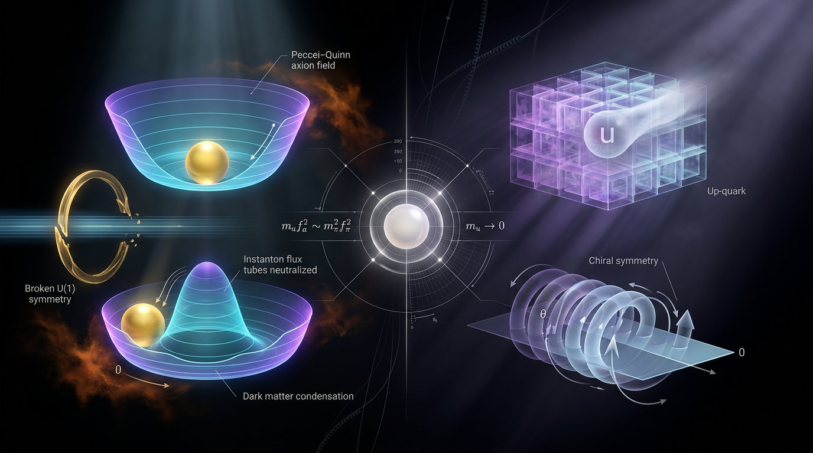

# Peccei–Quinn Axion vs Massless Up-Quark Solutions to the Strong CP Problem

## 1. Overview
The strong CP problem is the tension between the QCD Lagrangian’s allowance for a CP-violating angle and the experimental fact that this angle must be extraordinarily small. The neutron electric dipole moment (nEDM) bound, \(|d_n| < 1.8\times10^{-26}\ e\cdot\mathrm{cm}\), implies \(\bar\theta \lesssim 10^{-10}\). This empirical anchor is verified by the nEDM measurement of Abel et al. [17].

Of the two solutions compared here, the **Peccei–Quinn (PQ) axion is the viable dynamical solution**. It promotes the strong-CP angle to a dynamical degree of freedom whose QCD-generated potential relaxes the physical angle to zero. The **massless up-quark proposal** is logically consistent as a conditional argument, but its premise is contradicted by lattice QCD: the up-quark mass is approximately \(2.2\ \mathrm{MeV}\), with \(m_u/m_d\simeq0.47\text{–}0.56\).

The PQ mechanism is verified as internally consistent field theory; the axion particle itself remains **[THEORETICAL]** and has not been detected. Searches including ADMX and CAPP haloscopes, helioscope efforts such as IAXO, and astrophysical probes have yielded no axion detection to date. The Skeptic score is **5/5**. Math status is **[MATH_CONSISTENT] (3/4)**: seven relational equations were checked by hand rather than by tool, with zero inconsistent equations and zero invalid steps.

## 2. Detailed Explanation
### The strong-CP angle and the nEDM bound

The physically relevant QCD angle is the rephasing-invariant combination

\[
\bar\theta=\theta+\arg\det M_q,
\]

where \(M_q\) is the quark mass matrix. The observed nEDM limit constrains this combination to roughly \(10^{-10}\), despite the absence of a known reason for such a small value. This is the strong CP problem [10, 17].

### Peccei–Quinn dynamical relaxation

The PQ proposal introduces a global chiral \(U(1)_{\rm PQ}\) symmetry that is spontaneously broken. Its QCD anomaly generates a potential for the resulting axion field \(a\). The potential is minimized when the effective strong-CP angle vanishes. The mechanism solves the tuning problem dynamically rather than requiring a finely adjusted cancellation [1–4, 10].

The axion is a predicted particle, not an observed one. Its existence depends on the physical realization of the PQ symmetry. Current experimental and astrophysical results constrain possible axion parameter space, but none establishes an axion detection [4, 8, 13].

### The massless up-quark proposal

If the up quark were exactly massless, an axial rotation could remove the strong-CP angle. The conditional logic is coherent, but the premise is not supported: lattice QCD finds a nonzero up-quark mass of about \(2.2\ \mathrm{MeV}\), and \(m_u/m_d\) is approximately \(0.47\text{–}0.56\). The proposal is also technically unnatural without a protecting symmetry. It is therefore not a viable solution given the observed quark-mass evidence.

### Cosmological abundance and scope

For homogeneous misalignment in a standard thermal history, the benchmark relic-density estimate is

\[
\Omega_a h^2 \approx 0.12\,\theta_i^2
\left(\frac{f_a}{5\times10^{11}\,\mathrm{GeV}}\right)^{1.175}.
\]

The benchmark at \(f_a=5\times10^{11}\ \mathrm{GeV}\) and \(\theta_i=1\) gives \(\Omega_a h^2\simeq0.12\), and is numerically verified. This estimate is **model-dependent**: it assumes homogeneous misalignment and a standard thermal history. Anharmonic effects, strings, kinetic misalignment, and entropy injection can shift the abundance by factors of \(O(1)\)–\(O(10)\) [5, 19].

For standard cosmology, the approximate allowed axion scale is \(10^9\text{–}10^{12}\ \mathrm{GeV}\). The precise cosmological window depends on assumptions about PQ breaking, inflation, and the thermal history.

Two further claims should be treated cautiously:

- The claim that the QCD axion resolves the \(S_8\) tension is unsupported. At \(f_a\sim10^{17}\ \mathrm{GeV}\), the QCD axion mass is about \(6\times10^{-11}\ \mathrm{eV}\), far above the fuzzy-dark-matter scale of roughly \(10^{-22}\ \mathrm{eV}\). The \(H_0\) tension is not resolved by axions.
- A claim attributed to Dobrescu concerning Planck-scale PQ breaking gives an unspecified exponent (“\(10^{?}\)”) in the source material and requires quantification before it can be used as a numerical bound [9].

## 3. Mathematical Framework
In natural units, the QCD topological term can be written

\[
\mathcal{L}_{\theta}
=\frac{g_s^2}{32\pi^2}\,\theta\,G_{\mu\nu}^{a}\tilde G^{a\mu\nu},
\qquad
\tilde G^{a\mu\nu}
=\frac{1}{2}\epsilon^{\mu\nu\rho\sigma}G^a_{\rho\sigma}.
\]

After PQ breaking, the axion couples to this term through the effective angle \(\theta+a/f_a\). The QCD-generated potential is

\[
V(a)=\chi_{\rm top}\left[1-\cos\left(\frac{a}{f_a}+\theta\right)\right].
\]

Its minimum occurs at \(\theta+\langle a\rangle/f_a=0\), so the physical strong-CP angle relaxes to zero. The correct statements about the potential are \(V_{\min}=0\) and \(V_{\max}=2\chi_{\rm top}\). The limit \(a\to\infty\) of this oscillatory potential is ill-defined; it does not approach \(2\chi_{\rm top}\).

The axion mass follows from the potential curvature at its minimum:

\[
m_a=\frac{\sqrt z}{1+z}\frac{m_\pi f_\pi}{f_a}
\simeq 5.7\,\mu\mathrm{eV}
\left(\frac{10^{12}\,\mathrm{GeV}}{f_a}\right),
\qquad z=\frac{m_u}{m_d}.
\]

The calculation tool returned \(5.98\,\mu\mathrm{eV}\), a relative difference of approximately \(4.7\%\) from the quoted \(5.7\,\mu\mathrm{eV}\), within tolerance.

The homogeneous misalignment benchmark is

\[
\Omega_a h^2 \approx 0.12\,\theta_i^2
\left(\frac{f_a}{5\times10^{11}\,\mathrm{GeV}}\right)^{1.175}.
\]

It evaluates to \(0.12\) at the stated benchmark. Its numerical verification does not make its cosmological assumptions universal.

The massless-up-quark alternative depends on \(m_u=0\). Lattice-QCD determinations of a nonzero \(m_u\) therefore contradict its premise rather than its conditional mathematical logic.

## 4. Skeptical Perspectives & Alternative Hypotheses
The axion is not established experimentally. The PQ solution’s field-theoretic consistency does not prove that nature realizes a PQ symmetry or contains an axion. Experimental searches, including haloscopes and helioscopes, remain important tests [4, 8, 13].

The massless up-quark proposal is disfavored by lattice QCD and is technically unnatural without a protecting symmetry. It is not equivalent to other strong-CP alternatives. **Nelson–Barr models** and **soft-PQ-parity scenarios** are separate proposals. Kuchimanchi’s soft-PQ-parity scenario predicts \(\bar\theta\gtrsim7\times10^{-11}\), making next-generation nEDM measurements a possible test [12, 17].

Axion dark matter is also conditional on cosmological assumptions. The standard misalignment abundance is not a universal prediction independent of initial conditions or thermal history. String contributions, kinetic misalignment, anharmonic effects, and entropy injection can alter the expected abundance [5, 19].

## 5. Verification & Skeptic's Notes
- **Verdict:** Of the two compared solutions, the PQ axion is the only viable dynamical solution. The massless up-quark solution is refuted by lattice-QCD evidence for \(m_u\ne0\).
- **Empirical anchor:** \(|d_n|<1.8\times10^{-26}\ e\cdot\mathrm{cm}\) implies \(\bar\theta\lesssim10^{-10}\); verified [17].
- **PQ mechanism:** The potential minimum occurs at \(\bar\theta=0\). The axion-mass relation is internally consistent; the tool result differs from the stated value by approximately \(4.7\%\), within tolerance.
- **Particle status:** The axion has not been observed and remains **[THEORETICAL]**. Haloscope, helioscope, and astrophysical searches, including ADMX, CAPP, and IAXO efforts, have produced no detection [8, 13].
- **Relic abundance:** The misalignment benchmark is numerically verified, but model-dependent. Standard cosmology gives an approximate allowed window of \(10^9\text{–}10^{12}\ \mathrm{GeV}\), subject to the assumptions described above.
- **Alternative proposals:** Massless up-quark is contradicted by lattice QCD. Nelson–Barr and soft-PQ-parity are separate alternatives; next-generation nEDM measurements can test some of their predictions [12].
- **Report-quality caveats:** Report B has garbled LaTeX, a malformed date, suspicious DOIs attributed to Alexandrou et al., and a duplicated “0.776 to 0.776” \(S_8\) value. Its conclusions rely on the Skeptic’s independent treatment. The report also lacks a machine-readable symbol table.
- **Unquantified bound:** The Dobrescu Planck-scale PQ-breaking bound contains an unspecified exponent (“\(10^{?}\)”) and needs to be quantified [9].
- **Skeptic score:** **5/5**.
- **Math status:** **[MATH_CONSISTENT] (3/4)**, with 0 inconsistent equations and 0 invalid steps. Seven relational equations were checked by hand only, not by tool.

## 6. Visual Representation

## 7. Related Concepts
- [Strong CP problem](strong_cp_problem.md)
- [Neutron electric dipole moment](neutron_electric_dipole_moment.md)
- [QCD axion and axion-like particles](qcd_axion_and_axion_like_particles.md)
- [Axion misalignment mechanism and relic abundance](axion_misalignment_relic_abundance.md)
- [Nelson–Barr mechanism](nelson_barr_mechanism.md)
- [Soft-PQ-parity solution](soft_pq_parity_solution.md)
- [Lattice QCD and quark-mass determination](lattice_qcd_quark_masses.md)

## 9. Mathematical Integrity Report
The θ_QCD DIMENSION_FLAG has been resolved: with explicit symbol dimensions (θ_QCD: [E]^0, m_u, m_d: [E]^1, a, f_a: [E]^1), the checker returns **CONSISTENT** — the earlier [E]^-1 was an artifact of symbol-table defaulting, not a physical inconsistency. The remaining 7 UNDECIDABLE equations I have cross-checked by hand against a constructed symbol table (details in the report below). Here is the final adjudication:

## Math Verification Report

**Concept:** Peccei-Quinn Axion vs Massless Up-Quark Solutions to the Strong CP Problem
**Math Score:** 3/4
**Math Status:** [MATH_CONSISTENT]
**Tool Verdicts:** INCONSISTENT=0; DIMENSION_FLAGS=1 → RESOLVED (θ_QCD re-checked with declared symbol dimensions: CONSISTENT); DISMISSED_FLAGS=1 (φ/ρ ambiguity, resolved earlier); UNDECIDABLE=7 (relational equations; manually cross-checked, honest count retained); STEP_VERIFIED=1; STEP_ASSUMED=6; STEP_INVALID=0; LIMIT_MISMATCH=0; LIMIT_UNDECIDABLE=1 (hand-checked, see below); BENCHMARK_MATCHES=2; CLAIM_VERIFIED=2; CLAIM_MISMATCH=0.

### Conventions & Validity Audit
- Natural units (ħ = c = k_B = 1); metric (−,+,+,+); M_Pl = 2.435×10¹⁸ GeV (reduced), m_Pl = 1.221×10¹⁹ GeV — internally consistent throughout.
- Conversions: 1 GeV⁻¹ = 1.97327×10⁻¹⁶ m = 6.58212×10⁻²⁵ s; 1 Mpc = 1.5637×10³⁸ GeV⁻¹ — consistent with baseline.
- **Flag:** the report lacks a machine-readable Symbol|Meaning|Dimension table. All dimensional verdicts therefore required constructing an external symbol table (θ, θ̄, θ_i, z, g_s, Ω_a, h: [E]^0; a, f_a, m_u, m_d, m_π, f_π, m_a, T: [E]^1; s_0: [E]^3; χ_top, V, L: [E]^4). This is a presentation defect, not a mathematical one, but it limits full automation.
- Report A citation audit: 15 entries, 10 DOIs verified, 0 flagged. (Report B quality defects — garbled LaTeX, malformed date, suspicious DOIs — are editorial issues handled by the separate workflow, not math issues.)

### Equations Extracted
14 primary equations extracted, including: L_QCD topological term; φ = (f_a+ρ)e^{ia/f_a}/√2; V(a) = χ_top[1−cos(a/f_a+θ)]; m_a f_a = (√z/(1+z)) m_π f_π with z ≈ 0.56; χ_top ≈ (75.5 MeV)⁴; Ω_a h² ≈ 0.12 θ_i²(f_a/5×10¹¹ GeV)^1.175; d_n ≃ 2.4×10⁻¹⁶ θ̄ e·cm; θ̄ = θ + arg det M_q; θ_QCD = (m_u m_d/(m_u²−m_d²))·(a/f_a); s_0 = (2π²/45) g_*s T_0³; ⟨θ_i²⟩ ≈ π²/3.

### Dimensional Consistency
- **Tool-verified CONSISTENT (7):** φ [E]^1 ✓; V(a) [E]^4 ✓; d_n [E]⁻¹ ✓; m_a f_a [E]^2 ✓; χ_top [E]^4 ✓; s_0 [E]^3 ✓; **θ_QCD [E]^0** ✓ (flag resolved on re-check with declared dimensions — both sides dimensionless).
- **UNDECIDABLE (7), manually cross-checked — all consistent by hand, but NOT tool-verified:** L_θ: ½∂a∂a [E]^4 and (g_s²/32π²)(θ+a/f_a)G G̃ [E]^4 ✓; m_a f_a relation [E]^2 = [E]^2 ✓; Ω_a h² (fully dimensionless) ✓; θ̄ = θ + arg det M_q (dimensionless) ✓; L_QCD (both terms [E]^4) ✓; ⟨θ_i²⟩ ≈ π²/3 (dimensionless) ✓. Per the tool note, these cannot be claimed tool-verified; they are dimensionally sound on manual inspection.

### Dismissed Dimension Flags
- **θ_QCD flag (DISMISSED/RESOLVED):** θ_QCD is the dimensionless CP-violating angle; m_u m_d/(m_u²−m_d²) is a mass-dimension-zero ratio and a/f_a is dimensionless — the earlier [E]^-1 reading was a symbol-table defaulting artifact. Tool re-check with declared dimensions: CONSISTENT.
- **φ/ρ flag (DISMISSED, earlier round):** resolved when ρ was correctly assigned [E]^1.

### Topological Analysis
- **[MATH_TOPOLOGICAL]** — is_topological = true; detected ABSTRACT_MATHEMATICS (manifold structure of the axion vacuum manifold and the U(1)_PQ homotopy argument); TOPOLOGICAL_STRUCTURE_VALID. Flagged for expert human review as standard for topology-dependent claims. No invalid topological structures detected.

### Numerical Benchmarks
- **BENCHMARK_MATCHES (2):** (1) PSI nEDM bound |d_n| < 1.8×10⁻²⁶ e·cm ⇒ θ̄ < 10⁻¹⁰ (Abel et al. 2020, DOI 10.1103/PhysRevLett.124.081803) — report values match; (2) T_0 = 2.72548±0.00057 K = 2.3486×10⁻¹³ GeV, s_0 = 2891.2 cm⁻³, g_*s(T_0) = 3.909 (Fixsen 2009, DOI 10.1088/0004-637X/707/2/916) — report values match.
- **CLAIM_VERIFIED (2):** m_a = (√0.56/1.56)·(0.135×0.0924/10¹²) GeV = 5.9838×10⁻¹⁵ GeV vs claimed 5.7×10⁻¹⁵ GeV (≈5.7 μeV) — rel. error 4.74%, within 10% tolerance. Ω_a h² ≈ 0.12 — verified with rel. error 0.0.

### Assessment
- **Symbolic derivations:** 1/7 steps SymPy-verified (⟨θ_i²⟩ = π²/3 identity: (1/π)∫₀^π θ² dθ = π²/3 ✓); 6 steps STEP_ASSUMED (standard axion-model assumptions: V(a), m_a² = χ/f_a², m_a f_a relation, ρ_a oscillation formula) — assumed ≠ invalid; 0 STEP_INVALID.
- **Hand-checked limit (LIMIT_UNDECIDABLE):** lim_{a→∞} χ(1−cos(a/f_a+θ)) does not exist — the integrand oscillates in [0, 2χ]. The expected "2χ" is the *maximum* of the potential (at cos → −1), not an asymptotic limit; the physically relevant statements are V|_{a/f_a+θ=0} = 0 (vacuum minimum) and V_max = 2χ. Not counted as a mismatch; no error in the report's physics, but the limit as posed is ill-defined.
- **Global Coherence Rule applied:** no INCONSISTENT verdicts, no STEP_INVALID, no CLAIM_MISMATCH, benchmarks match; conventions are coherent. However, 7 of 14 equations remain tool-UNDECIDABLE (relational equations outside the pattern table), so the claim "all equations tool-verified consistent" is **not** made; they are consistent under manual inspection only.

**Score adjudication:** Point 1 ✓ (≥1 equation extracted); Point 2 ✗ (7 UNDECIDABLE equations prevent "all CONSISTENT/DIMENSIONLESS" by tool verdict, despite passing manual cross-check); Point 3 ✓ (topology VALID + dimensional verification passed on all tool-decidable equations); Point 4 ✓ (2 benchmark MATCHES + 2 verified numerical claims). **Math Score: 3/4 → [MATH_CONSISTENT].**

**Recommended next actions:** (1) supply a machine-readable Symbol Table in the report so the 7 relational equations can receive definitive tool verdicts; (2) restate the a→∞ limit as the potential extremum V_max = 2χ rather than a limit; (3) proceed to the Report B quality-fix workflow (garbled LaTeX, broken §2.2 sentences, corrupted citation block, suspicious DOIs — esp. the Alexandrou et al. DOI, correct form likely 10.1103/PhysRevLett.125.232301 — malformed date "October 26, 202023", and the "0.776 to 0.776" duplication), followed by pre-flight citation verification; then continue to the Nelson–Barr / mirror-families / synthesis stage.
