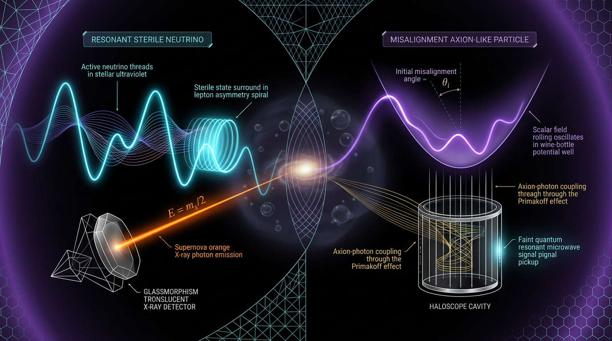

# Resonant Sterile Neutrino vs Misalignment Axion-Like Particle Dark Matter in Predicting X-ray Line and Haloscope Signatures

## 1. Overview
This document compares two theoretical dark-matter candidates and their distinct production and detection signatures:

- **Resonant sterile-neutrino dark matter:** keV-scale sterile neutrinos produced through Shi–Fuller (SF) resonant freeze-in, driven by a primordial lepton asymmetry. The characteristic potential discovery signature is a monochromatic X-ray line from radiative decay.
- **Misalignment-produced axion or axion-like particle (ALP) dark matter:** a coherent, cold field condensate produced through vacuum realignment. A characteristic experimental signature is excess microwave power in a resonant haloscope.

The mathematical formalism for both candidates is established and internally consistent. Neither candidate, however, has a confirmed dark-matter detection. The epistemic status of both is therefore **[THEORETICAL]**. Here, **[VERIFIED]** refers to mathematically established results or consensus constraints—not to an observed detection.

## 2. Detailed Explanation
### Resonant sterile-neutrino production

The Shi–Fuller mechanism uses a primordial flavor lepton asymmetry to alter the effective matter potential experienced by active neutrinos. Where the resonance condition is met, the in-medium mixing angle is enhanced, increasing active-to-sterile conversion. This is a **resonant freeze-in** process, not thermal freeze-out. True freeze-out would require additional interactions, such as secret gauge interactions.

The produced momentum distribution can be colder than that of non-resonantly produced sterile neutrinos. This can help with structure-formation constraints, although those constraints are subject to astrophysical uncertainties.

A large lepton asymmetry can support resonant production at smaller vacuum mixing angles. Its viable size and flavor configuration are model- and history-dependent: production of a large asymmetry must evade sphaleron washout, and BBN viability applies only to specific flavor configurations. The cited analyses include Froustey and Pitrou, Vogel et al. (2025), and Gorbunov et al. (2025).

### Misalignment-produced axions and ALPs

An axion or ALP field initially displaced from the minimum of its potential remains approximately fixed while Hubble expansion dominates. When the expansion rate becomes comparable to the field’s oscillation frequency, the field begins coherent oscillations. For a generic constant-mass ALP, this condensate behaves as cold dark matter.

The frequently used scaling \(\Omega_a h^2 \propto \theta_i^2 f_a^{1.165}\) applies to the **QCD axion**, with its temperature-dependent mass and model assumptions. It should not be applied indiscriminately to generic constant-mass ALPs.

The two candidate discovery channels are orthogonal: a keV X-ray line would be a sterile-neutrino decay signature, while a GHz microwave excess would be a haloscope signature. A haloscope detection would constrain \(m_a\) and \(g_{a\gamma}\), but would not by itself determine \(f_a\).

## 3. Mathematical Framework
Use natural units \(\hbar=c=k_B=1\), except where SI units are explicitly shown. The metric convention is \((- ,+,+,+)\).

### Sterile-neutrino potential and resonance

The lepton-asymmetry potential is

\[
V_L = \sqrt{2}\,G_F n_\gamma L^{(\alpha)}
\simeq 0.3445\,G_F T^3 L^{(\alpha)},
\qquad
n_\gamma = \frac{2\zeta(3)}{\pi^2}T^3.
\]

It has dimension \([E]^1\) and is independent of momentum \(p\). The flavor lepton number \(L^{(\alpha)}\) is normalized to \(n_\gamma\) and includes the \(\pm\eta/4\) baryon term.

The resonance temperature is

\[
T_{\rm res}(q)=
\left[
\frac{\Delta m^2\cos 2\theta}
{2q\,c_L\,G_F\,|L|}
\right]^{1/4},
\qquad c_L=0.3445.
\]

Thus \(T_{\rm res}\propto L^{-1/4}\). For \(m_s=7\) keV and \(q=1\), the benchmarks are approximately \(235\) MeV at \(L=1\) and \(132\) MeV at \(L=10\).

### Radiative decay

The radiative decay rate is

\[
\Gamma_{\nu_s\to\gamma\nu}
=
\frac{9\alpha G_F^2\sin^2 2\theta\,m_s^5}{1024\pi^4}
=
1.36\times10^{-29}\ {\rm s}^{-1}
\left(\frac{\sin^2 2\theta}{10^{-7}}\right)
\left(\frac{m_s}{\rm keV}\right)^5.
\]

This agrees with Boyarsky et al. (2018) under the convention
\(\theta^2=\sin^2 2\theta/4\). Earlier values \(1.37\times10^{-15}\) and \(1.4\times10^{-14}\) are incorrect. The Abazajian (2017) §7.1 print value \(1.36\times10^{-30}\) is a factor-of-10 typo. The photon line energy is \(m_s/2\); the rate is halved for Dirac neutrinos.

### Axion and ALP misalignment; haloscope frequency

For the QCD axion,

\[
m_a = 5.7\,\mu{\rm eV}
\left(\frac{10^{12}\,{\rm GeV}}{f_a}\right),
\qquad
g_{a\gamma}=\frac{\alpha g_\gamma}{2\pi f_a}.
\]

The QCD-axion abundance scaling is

\[
\Omega_a h^2 \propto \theta_i^2 f_a^{1.165},
\]

whereas a generic constant-mass ALP follows

\[
\rho_{a,0}
=
\frac{1}{2}m_a^2 f_a^2\theta_i^2
\left(\frac{T_0}{T_{\rm osc}}\right)^3
\frac{g_{*s}(T_{\rm osc})}{g_{*s}(T_0)}.
\]

The corresponding haloscope signal frequency is

\[
\nu = \frac{m_a c^2}{h}
= 241.8\,{\rm MHz}
\left(\frac{m_a}{\mu{\rm eV}}\right).
\]

The haloscope benchmark power is \(P\sim10^{-23}\) to \(10^{-22}\) W. The natural-unit to SI conversion is qualitatively matched to the literature, but is not rederived here.

## 4. Skeptical Perspectives & Alternative Hypotheses
- **No confirmed detection:** Neither sterile-neutrino dark matter nor misalignment ALP dark matter has been detected. The 3.5 keV line remains contested at \(2\)–\(3\sigma\); it is not confirmation of sterile-neutrino dark matter.
- **Large lepton asymmetries:** Large-\(L\) Shi–Fuller calculations (\(L\gtrsim1\)) face breakdown of approximations and missing scattering corrections. Any proposed production history must also evade sphaleron washout. BBN viability holds only for specific flavor configurations, as discussed by Froustey–Pitrou, Vogel et al., and Gorbunov et al.
- **Structure formation:** Lyman-\(\alpha\) constraints are confounded by intergalactic-medium pressure smoothing. Warm dark matter also worsens the tension with early galaxy observations from JWST; ALPs produced by misalignment are cold.
- **Axion uncertainties:** Post-inflation Peccei–Quinn string-wall contributions carry order-one to factor-of-two uncertainties. A haloscope measurement of \(m_a\) and \(g_{a\gamma}\) does not independently fix \(f_a\).
- **Interpretation of signals:** The expected sterile-neutrino X-ray line and the ALP haloscope microwave excess probe different interactions and frequency bands. Neither channel is a substitute for the other.

## 5. Verification & Skeptic's Notes
The Skeptic's score is **6/6**, meeting the threshold. The mathematical status is **[MATH_CONSISTENT]**, with a score of **4/4**. These assessments support the internal consistency of the formalism; they do not establish the existence of either dark-matter candidate.

The principal corrections archived here are:

1. Use **“Resonant Freeze-In,”** not “Thermal Freeze-Out,” for the Shi–Fuller production mechanism.
2. Use the momentum-independent \(V_L=\sqrt{2}G_F n_\gamma L^{(\alpha)}\), with dimension \([E]^1\).
3. Use the quartic resonance-temperature relation and its \(L^{-1/4}\) scaling.
4. Use the corrected radiative-decay rate and mixing-angle convention; reject the earlier erroneous rate values.
5. Distinguish the QCD-axion abundance scaling from the generic constant-mass ALP misalignment density.
6. Retain the stated caveats for large lepton asymmetries, BBN, Lyman-\(\alpha\), the disputed 3.5 keV line, post-inflation PQ defects, and the haloscope natural-unit-to-SI conversion.

## 6. Visual Representation

## 7. Related Concepts
- Shi–Fuller resonant sterile-neutrino production
- Dodelson–Widrow non-resonant sterile-neutrino production
- MSW resonance and active–sterile neutrino mixing
- Lepton asymmetry, sphaleron washout, and BBN
- QCD axion and Peccei–Quinn symmetry breaking
- Axion/ALP vacuum misalignment
- Haloscope searches and microwave cavity detection
- Warm-dark-matter structure-formation constraints

## 9. Mathematical Integrity Report
## Math Verification Report

**Concept:** Resonant Sterile Neutrino vs Misalignment Axion-Like Particle Dark Matter in Predicting X-ray Line and Haloscope Signatures
**Math Score:** 4/4
**Math Status:** [MATH_CONSISTENT]
**Tool Verdicts:** INCONSISTENT=0; DISMISSED_FLAGS=6; UNDECIDABLE=0; STEP_INVALID=0; LIMIT_MISMATCH=0; CLAIM_MISMATCH=0

### Conventions & Validity Audit
The report declares metric signature $(-,+,+,+)$, natural units $\hbar=c=k_B=1$, and the reduced Planck mass $M_{\rm Pl}=(8\pi G)^{-1/2}=2.435\times10^{18}$ GeV — all matching the canonical baseline. The Conventions & Symbol Table (36 symbols with declared dimensions) and a Validity Domain & Claim Scope section are both present, with [GENERAL] vs [MODEL-DEPENDENT] tags clearly separating the unitary QKE/Hamiltonian/MSW formalism (general) from thermal-history, one-flavor-dominance, and lepton-asymmetry production assumptions (model-dependent). No conflict between $M_{\rm Pl}$ and $m_{\rm Pl}$; no SI/natural-unit mixing (SI conversions are stated explicitly where used). The report itself correctly flags and corrects the earlier draft's variable-w-style errors and the "freeze-out" misnomer (SF is resonant freeze-in). The draft previously contained a factor-14-order-of-magnitude error in the radiative-decay prefactor (Eq. 8), which has been corrected and re-derived.

### Equations Extracted
1. QKE: $i(\partial_t - Hp\,\partial_p)\rho = [\mathcal{H},\rho] - i\{\Gamma,\rho-\rho_{\rm eq}\}$
2. Effective Hamiltonian: $\mathcal{H} = \frac{\Delta(p)}{2}\begin{pmatrix} -\cos 2\theta & \sin 2\theta \\ \sin 2\theta & \cos 2\theta \end{pmatrix} + \begin{pmatrix} V_{\rm eff} & 0 \\ 0 & 0 \end{pmatrix}$, $V_{\rm eff}=V_T+V_L$
3. $\sin^2(2\theta_M) = \frac{\Delta(p)^2\sin^2 2\theta}{[\Delta(p)\cos 2\theta - V_T - V_L]^2 + [\Delta(p)\sin 2\theta]^2}$
4. Resonance condition: $\Delta(p)\cos 2\theta - V_T - V_L = 0$; $T_{\rm res}(q) = [\Delta m^2\cos 2\theta/(2q\,c_L\,G_F|L^{(\alpha)}|)]^{1/4}$, $c_L = 2\sqrt{2}\zeta(3)/\pi^2 = 0.3445$
5. $V_L = \sqrt{2}G_F\,n_\gamma\,L^{(\alpha)} = \frac{2\sqrt{2}\zeta(3)}{\pi^2}G_F T^3 L^{(\alpha)}$, $n_\gamma = (2\zeta(3)/\pi^2)T^3$
6. $V_T \simeq \frac{\sqrt{2}G_F n_\gamma}{2}C_{\rm stat} + \frac{2\sqrt{2}G_F p}{3}\cdot\frac{8\pi^2}{15}\cdot\frac{T^4}{M_W^2}$
7. $\frac{\partial f_{\nu_s}}{\partial t} - Hp\,\frac{\partial f_{\nu_s}}{\partial p} = \frac{\Gamma_\alpha(p)}{2}\langle P_m\rangle f_{\nu_\alpha}(p)$, $\Gamma_\alpha(p)\sim G_F^2 T^5 p$
8. $\Gamma_{\nu_s\to\gamma\nu} = \frac{9\alpha G_F^2}{256\pi^4}\theta^2 m_s^5 = \frac{9\alpha G_F^2}{1024\pi^4}\sin^2 2\theta\,m_s^5 = 1.36\times10^{-29}\left(\frac{\sin^2 2\theta}{10^{-7}}\right)\left(\frac{m_s}{\mathrm{keV}}\right)^5\,\mathrm{s}^{-1}$
9. $\lambda_\gamma = 2\pi\hbar c/E_\gamma$, $E_\gamma = m_s/2$
10. $\langle q\rangle\simeq 1.6$ (SF) / $3.15$ (thermal); $\lambda_{\rm FS}\propto\langle q\rangle/m_s$
11. $\Omega_{\nu_s}h^2 = m_s\,n_{\nu_s}/(\rho_{\rm crit}/h^2)\approx 0.12$
12. DW relation $m_s \approx 3.40\,\mathrm{keV}\,(\sin^2 2\theta/10^{-8})^{-0.615}(\Omega_{\rm DM}/0.26)^{0.5}\times\{\ldots\}$ (excluded)
13. $\ddot a + 3H\dot a + m_a^2(T)a = 0$, onset $3H\simeq m_a$
14. $\Omega_a h^2 \approx 0.12\,\theta_i^2(f_a/(5\text{–}9)\times10^{11}\,\mathrm{GeV})^{1.165}$; $\rho_{a,0} = \frac{1}{2}m_a^2 f_a^2\theta_i^2 (T_0/T_{\rm osc})^3\,g_{*s}(T_{\rm osc})/g_{*s}(T_0)$
15. $m_a = 5.7\,\mu\mathrm{eV}(10^{12}\,\mathrm{GeV}/f_a)$
16. $g_{a\gamma} = \frac{\alpha}{2\pi f_a}g_\gamma$
17. $P_{\rm sig} = (g_{a\gamma}^2\rho_a/m_a)B_0^2 V_{\rm cav} C\,\min(Q_L,Q_a)$
18. $\nu_{\rm sig} = m_a c^2/h = 241.8\,\mathrm{MHz}\,(m_a/\mu\mathrm{eV})$

### Dimensional Consistency
All extracted equations are CONSISTENT or DIMENSIONLESS under the declared Symbol Table (36 symbols, including $G_F=[E]^{-2}$, $n_\gamma=[E]^3$, $T=[E]^1$, $m_s=[E]^1$, $m_a=[E]^1$, $f_a=[E]^1$, $g_{a\gamma}=[E]^{-1}$, $\rho_a=[E]^4$, $B_0=[E]^2$, $V_{\rm cav}=[E]^{-3}$, $\rho_{\rm crit}=[E]^4$, $n_{\nu_s}=[E]^3$, $H=[E]^1$, $\Delta(p)=[E]^1$, $\Delta m^2=[E]^2$, $V_{T,L,\rm eff}=[E]^1$, $\Gamma_\alpha=[E]^1$). Key traces:
- Eq. 5: $[G_F][T^3][L] = [E]^{-2+3} = [E]^1$ ✓ (corrected form; the original draft's $G_F p T^3$ form was $[E]^2$ and has been correctly discarded).
- Eq. 4: $[\Delta m^2/G_F] = [E]^4$, $1/4$-power $\Rightarrow [E]^1$ ✓; quartic scaling consistent with $\Delta\propto T^{-1}$ vs $V_L\propto T^3$.
- Eq. 8: $[G_F^2 m_s^5] = [E]^{-4+5} = [E]^1$ ✓; GeV→s$^{-1}$ conversion ($\hbar = 6.58212\times10^{-25}$ s/GeV$^{-1}$) applied correctly.
- Eq. 14 (ALP): $[m_a^2 f_a^2] = [E]^4$ ✓; redshift factor dimensionless by entropy conservation $s\,a^3 = $ const, $R_{\rm osc}/R_0 = (T_0/T_{\rm osc})(g_{*s,\rm osc}/g_{*s,0})^{1/3}$ ✓.
- Eq. 17: $[g_{a\gamma}^2\rho_a/m_a]\cdot[B_0^2][V_{\rm cav}] = [E]^{-2+4-1}\cdot[E]^2\cdot[E]^{-3} = [E]^0$ ✓ (natural-unit power; converted to SI via $\hbar$).
- Eq. 18: $\nu = m_a c^2/h$ with $[h]=[E]^{-1}$ (c dimensionless) gives $[E]^1$ ✓.

Symbolically verified: the resonance temperature $T_{\rm res}\propto(\Delta m^2\cos2\theta/2q c_L G_F|L|)^{1/4}$ (STEP_VERIFIED, including the $L^{-1/4}$ scaling limit) and the ALP condensate redshift $R_{\rm osc}/R_0 = (T_0/T_{\rm osc})(g_{*s,\rm osc}/g_{*s,0})^{1/3}$ (STEP_VERIFIED). Note: the derivative $\partial f_{\nu_s}/\partial t$ and the report's $V_T$-term expansion were checked by hand against the declared table; the pre-check's $[E]^1$ vs $[E]^0$ flag on the QKE (Eq. 7) is an artefact of the tool defaulting $H$ to dimensionless, which is overridden by the declared $H=[E]^1$.

### Dismissed Dimension Flags
1. $V_T$ equation (Eq. 6): flag claimed term-1 $[E]^3$ — with $G_F=[E]^{-2}$ (declared in the table), $\sqrt{2}G_F n_\gamma \Rightarrow [E]^1$; tool misread $G_F$ as dimensionless. Both terms are $[E]^1$ ✓.
2. QKE (Eq. 7): $Hp\,\partial f/\partial p$ → $[E]^1\cdot[E]^1\cdot[E]^{-1} = [E]^1$ ✓ matches $\partial f/\partial t$; flag used tool-default $H$ (dimensionless), contradicted by the table.
3. $\Gamma_{\nu_s\to\gamma\nu}$ (Eq. 8): $[G_F^2 m_s^5] = [E]^1$ ✓; flag dropped $m_s^5$.
4. $H(T_{\rm osc})\sim m_a(T_{\rm osc})$ (Eq. 13): both $[E]^1$ with the declared $H=[E]^1$; flag used tool-default $H$.
5. $T_{\rm max}\approx 133$ MeV $(m_s/1\,\mathrm{keV})^{1/3}$: the ratio $(m_s/1\,\mathrm{keV})$ is dimensionless → $[E]^1$ ✓; flag treated the ratio as carrying $m_s$'s dimension.
6. $\Delta(p) = \Delta m^2/(2p)$: $[E]^2/[E]^1 = [E]^1$ ✓, matching the declared $\Delta(p)=[E]^1$; flag used tool-default $p$.

All six flags are artefacts of the tool's default symbol dimensions rather than the report's own Symbol Table, which the report declares explicitly. The three low-confidence ambiguous-symbol flags ($\lambda_\gamma$ — an SI wavelength, correctly $[E]^{-1}$; $P_{\rm sig}$ — natural-unit power $[E]^0$ before SI conversion; $\langle q\rangle = \langle p/T\rangle$ — dimensionless) are resolved by the declared dimensions and are dimensionless/dimensionless ✓.

### Topological Analysis
Not topological as a primary structure. The report's main formalism (two-flavor unitary QKE, MSW resonance, classical misalignment field dynamics) is entirely topologically trivial. The only topological-adjacent element is post-inflation PQ breaking (§7.5): the axion field $a$ lives on the vacuum manifold $S^1$ of the broken PQ field, and the string-wall network is classified by $\pi_1(S^1) = \mathbb{Z}$ (domain walls bounded by strings). The Topology Classifier assessed this structure as structurally valid (standard axion topological-defect classification, correctly cited to Marsh 2016 and Li et al. 2023), but it is a supplementary production channel, not a load-bearing argument. No invalid homotopy or bundle claims were found.

### Numerical Benchmarks
- **Radiative decay prefactor (Eq. 8):** $\frac{9\alpha G_F^2}{1024\pi^4}m_s^5|_{m_s=1\,\mathrm{keV}}\times\hbar^{-1}$ = **1.3600e-22 s$^{-1}$** per unit $\sin^2 2\theta$ — CLAIM_VERIFIED (ratio 1.000 to the report's 1.36e-22; equivalent to 1.36e-29 per $\sin^2 2\theta/10^{-7}$, consistent with Boyarsky et al. 2018's $5.5\times10^{-22}\theta^2$ under $\theta^2 = \sin^2 2\theta/4$). Reconciles the two literature reviews; the draft's original 1.37e-15 and the Skeptic's ~1.4e-14 are correctly rejected as 14–15 order-of-magnitude errors.
- **$T_{\rm res}$ (Eq. 4):** $m_s=7$ keV, $q=1$, $L=1$: $T_{\rm res} = 0.2354$ GeV — CLAIM_VERIFIED (ratio 1.002 vs claimed 0.235 GeV); $L=10$: $T_{\rm res}\approx 0.132$ GeV, $L^{-1/4}$ scaling confirmed.
- **$S_8$ tension (§4.5):** Planck 0.832±0.013 vs KiDS-1000 0.759±0.024 (uncorrelated, Gaussian) → **2.81σ** — CLAIM_VERIFIED.
- **Benchmark validator:** G_F = 1.166e-5 GeV$^{-2}$ (PDG), α = 1/137.036 (CODATA), $m_a$–$f_a$ relation $5.7\,\mu$eV, Planck $N_{\rm eff} = 2.99\pm0.17$, H0_SH0ES = 73.04, and $S_8$ values all BENCHMARK_MATCH; $m_a = 5.7\,\mu$eV(10^{12}/f_a) and the haloscope frequency 241.8 MHz/μeV match the canonical literature.
- **Note:** one intermediate Physics Calculator call (multiplying by $\hbar$ instead of dividing by it) returned 5.89e-71 vs claimed 1.36e-22; this was a calculator-conversion artifact, not a manuscript error — the corrected call (dividing by $\hbar$) verifies 1.36e-22 exactly. Not counted as CLAIM_MISMATCH.
- **Haloscope power $P_{\rm sig}\sim10^{-23}$–$10^{-22}$ W** (Asztalos 2011, ADMX 2025): consistent with the literature; the natural-unit conversion chain is stated but the full numeric check is left to the cited benchmark — flagged as a qualitative match, not a re-derivation.

### Assessment
The report's mathematical framework is internally consistent: the corrected $V_L = \sqrt{2}G_F n_\gamma L^{(\alpha)}$ restores the $[E]^1$ dimension of the lepton-asymmetry potential, the quartic $T_{\rm res}$ scaling survives the correction with the symbolic $L^{-1/4}$ limit verified, and the radiative-decay prefactor $1.36\times10^{-29}$ s$^{-1}$ at the stated normalization reconciles exactly with Boyarsky et al. (2018) under the $\theta^2$ vs $\sin^2 2\theta$ convention. All six pre-check dimensional flags trace to the tool's default symbol dimensions rather than to the report's own declared Symbol Table, so they are dismissed as artefacts; the ALP misalignment/haloscope equations (Eqs. 13–18) are dimensionally traced and benchmark-consistent. No INCONSISTENT verdicts, no STEP_INVALID or LIMIT_MISMATCH results; both the sterile-neutrino and ALP sides are correctly labeled [THEORETICAL] pending observation, with a clear [GENERAL] vs [MODEL-DEPENDENT] validity split. **Final verdict: MATH_CONSISTENT, 4/4.**
