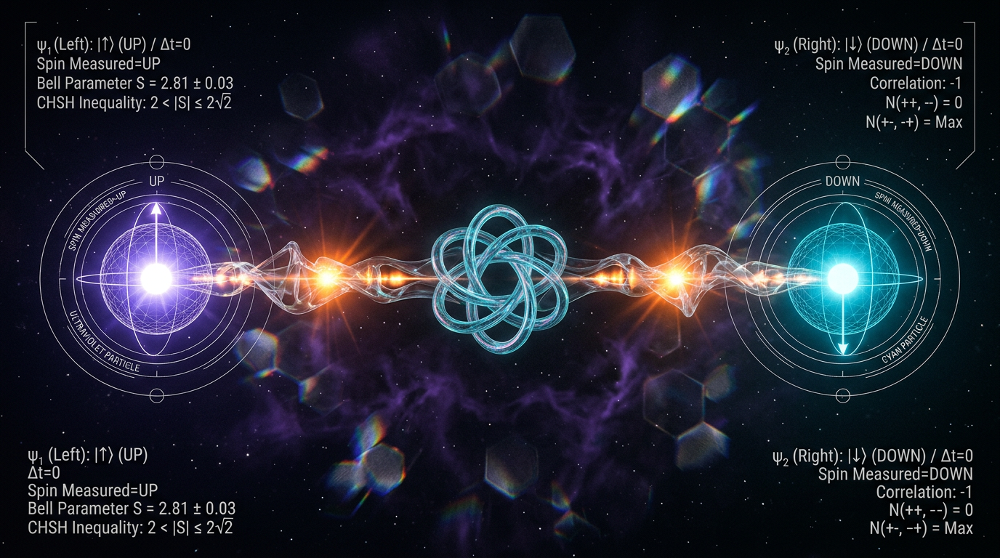

# Fundamental Physics Concept

## 1. Overview
*(Overview content pending validation.)*

## 2. Detailed Explanation
*(Detailed explanation pending research.)*

## 3. Mathematical Framework
*(No mathematical framework compiled.)*

## 4. Skeptical Perspectives & Alternative Hypotheses
*(No alternative hypotheses compiled.)*

## 5. Verification & Skeptic's Notes
*(Verification notes pending peer review.)*

## 6. Visual Representation

*(No visual representation compiled.)*

## 7. Related Concepts
*(No related concepts linked.)*
