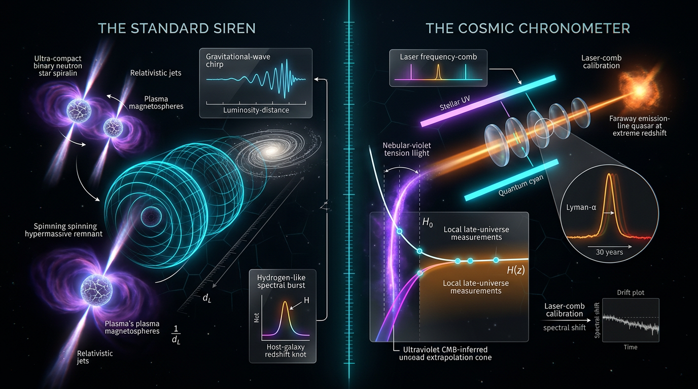

# Standard Sirens vs Cosmic Chronometers in Resolving the Hubble Constant Tension

## 1. Overview
Gravitational-wave (GW) standard sirens and cosmic chronometers (CC) are complementary methods for measuring cosmic expansion. Both are **[VERIFIED] as measurement principles**, but they rely on different observational signals and have different systematic limitations.

A standard siren measures luminosity distance from the gravitational-wave signal of a compact-binary merger. When the source redshift is identified through an electromagnetic counterpart or statistically inferred from host galaxies, the distance–redshift relation constrains expansion. GW170817 provided a GW-only value of \(H_0=70.3^{+5.3}_{-5.0}\ \mathrm{km\,s^{-1}\,Mpc^{-1}}\), and its electromagnetic counterpart tightly constrained the difference between the speed of gravity and light.

Cosmic chronometers infer \(H(z)\) from the differential ages of passively evolving galaxies, using the FLRW kinematic identity
\[
H(z)=-\frac{1}{1+z}\frac{dz}{dt}.
\]
Their current empirical basis is larger and extends to higher redshift than the standard-siren sample: it includes 31 or more \(H(z)\) points, with representative precision of about 6% near \(z\sim0.45\) and 5% near \(z\sim2\).

The reported Hubble-tension comparison is \(4.85\sigma\), with \(\Delta H_0=5.68\pm1.17\ \mathrm{km\,s^{-1}\,Mpc^{-1}}\) and \(\Delta\chi^2=23.5\). It is **not** a \(>5\sigma\) result. The JWST \(8\sigma\) figure concerns rejection of Cepheid-crowding systematics, not the significance of the Hubble tension itself.

**Comparative verdict:** cosmic chronometers currently have the stronger empirical base in data quantity and redshift reach. Standard sirens offer cleaner absolute-distance systematics and unique sensitivity to modified gravitational-wave propagation. Combining CC \(H(z)\) measurements with sirens at \(z\gtrsim1\) can break the \(H_0\)–\(\Xi_0\) degeneracy.

## 2. Detailed Explanation
### Gravitational-wave standard sirens

The amplitude and phase evolution of a compact-binary GW signal encode its absolute luminosity distance. An electromagnetic counterpart, as for GW170817, can provide a host galaxy and redshift; for dark sirens, redshift information is inferred statistically using a galaxy catalog. This distance calibration does not require the Cepheid–TRGB–SN Ia distance ladder or the CMB sound horizon.

GW170817 yielded \(H_0=70.3^{+5.3}_{-5.0}\ \mathrm{km\,s^{-1}\,Mpc^{-1}}\) from GW data alone. This is a measurement with substantial uncertainty, not a siren-based resolution of the Hubble tension: its distance precision was about 15%, and it does not discriminate between the competing tension explanations.

The GW170817/GRB 170817A arrival-time comparison constrained the tensor-wave speed to
\[
-3\times10^{-15}\leq\frac{c_{\rm gw}-c}{c}\leq+7\times10^{-16}.
\]
This rules out broad classes of theories that predict a large deviation of the GW speed from light speed. It does not rule out all modified propagation: friction-type effects can still alter the GW luminosity distance.

### Cosmic chronometers

Cosmic chronometers estimate the differential age \(dt/dz\) of passively evolving galaxies. The FLRW identity directly converts this to an expansion-rate measurement:
\[
H(z)=-\frac{1}{1+z}\frac{dz}{dt}.
\]
The method’s empirical strength is its existing collection of 31 or more \(H(z)\) measurements, including approximately 6% precision at \(z\sim0.45\) and 5% at \(z\sim2\). Its principal limitations are the requirement that galaxies be dominated by passive evolution, contamination from young stellar populations (YSPs), and dependence on stellar-population-synthesis (SPS) models.

### How the methods complement each other

The GW distance observable can depend on both the electromagnetic expansion history and modified GW propagation. In the notation used here,
\[
d_L^{\rm gw}(z)=\Xi(z)d_L^{\rm em}(z).
\]
Consequently, sirens alone can have a degeneracy between \(H_0\) and the present-day propagation parameter \(\Xi_0\). High-redshift sirens, particularly at \(z\gtrsim1\), combined with CC measurements of \(H(z)\), provide leverage to break that degeneracy.

Specific functional forms for \(\Xi(z)\), such as those motivated by RR nonlocal gravity or Horndeski \(\alpha_B\), remain **[THEORETICAL]** in this comparison. Siren-based arbitration of the Hubble tension and forecasts distinguishing early dark energy (EDE) from CPL dark energy using joint siren–CC observations are also **[THEORETICAL]**. No published joint forecast establishes such discrimination for at least 50 sirens at \(z>1.5\) combined with CC data at \(\sigma_H/H<5\%\).

## 3. Mathematical Framework
### Measurement relations

For a spatially flat FLRW background, cosmic chronometers use
\[
H(z)=-\frac{1}{1+z}\frac{dz}{dt}.
\]

For GW propagation in modified gravity, one convention used in the siren report is
\[
\delta=-\frac{d\ln M_{\rm eff}}{d\ln a},
\qquad
\Xi(z)\equiv\frac{d_L^{\rm gw}(z)}{d_L^{\rm em}(z)}
=\exp\!\left[\frac{1}{2}\int_0^z\frac{\delta(z')}{1+z'}\,dz'\right].
\]
The CC report, quoting Belgacem et al., uses the opposite definition,
\[
\delta=+\frac{d\ln M_{\rm eff}}{d\ln a},
\]
and writes the exponential with a minus sign. The conventions are individually self-consistent, but a combined siren–CC fit must choose one explicitly: mixing them would invert the inferred friction sign. In either convention the GR limit is \(\Xi\to1\) as \(\delta\to0\).

The siren likelihood can be written schematically as
\[
\chi^2_{\rm siren}
=\sum_i
\frac{\left[\hat d_i-d_L^{\rm gw}(z_i;H_0,\ldots)\right]^2}{\sigma_{d_i}^2}.
\]
Because \(d_L^{\rm gw}=\Xi\,d_L^{\rm em}\), siren-only constraints can exhibit an \(H_0\)–\(\Xi_0\) degeneracy. The degeneracy is broken by higher-redshift events, around \(z\gtrsim1\), in combination with expansion-history information such as CC \(H(z)\).

The tension arithmetic is
\[
\Delta H_0=5.68\pm1.17\ \mathrm{km\,s^{-1}\,Mpc^{-1}},
\qquad
\frac{\Delta H_0}{\sigma_{\rm comb}}\simeq4.85,
\qquad
\Delta\chi^2\simeq23.5.
\]
The quoted significance assumes independent Gaussian errors; the covariance assumption is not stated.

### Conventions and validity

Use the reduced Planck mass \(M_{\rm Pl}=2.435\times10^{18}\ \mathrm{GeV}\) and unreduced Planck mass \(m_{\rm Pl}=1.221\times10^{19}\ \mathrm{GeV}\) consistently, including the \(\sqrt{8\pi}\) conversion factor. \(E(z)\) denotes the dimensionless reduced Hubble rate, \(H(z)/H_0\). In the D4000-age relation, the coefficient \(A\) carries inverse-time units, so that notation should make its dimensions explicit.

The standard-siren validity domain is subhorizon propagation, \(k\gg aH\). Dark-siren redshift reconstruction also assumes a complete galaxy catalog over the relevant flux limit. Cosmic chronometers require passive evolution; YSP contamination and SPS-model dependence are their dominant systematics.

Joint forecasts must state the assumed dark-energy sound speed \(c_s^2\). The theoretical stability conditions (no-ghost and no-gradient instabilities) on the surviving friction branch are not specified here. Growth probes such as \(f\sigma_8\) and \(S_8\) are outside the scope of this comparison and are a natural extension.

## 4. Skeptical Perspectives & Alternative Hypotheses
- **Hubble-tension significance:** the supported value is \(4.85\sigma\), not \(>5\sigma\). The calculation uses independent Gaussian errors, and the covariance assumption is not stated.
- **JWST result:** the \(8\sigma\) statement applies to rejecting Cepheid-crowding systematics. It is not the Hubble-tension significance.
- **Siren precision:** GW170817’s roughly 15% distance precision is insufficient to arbitrate the tension. A single event does not distinguish a change in \(H_0\) from modified propagation.
- **Modified propagation:** specific \(\Xi(z)\) forms—including RR nonlocal-gravity and Horndeski \(\alpha_B\) forms—are model-dependent and remain **[THEORETICAL]** here.
- **EDE versus CPL:** claims that sirens plus CC will discriminate between these models are forecasts, not established results. No published joint forecast demonstrates the specified combination of at least 50 sirens at \(z>1.5\) and CC precision \(\sigma_H/H<5\%\).
- **Cosmic-chronometer systematics:** the method requires passive stellar populations and is sensitive to YSP contamination and SPS-model choices.
- **Propagation convention:** the two reports define the sign of \(\delta\) oppositely. A merged inference that fails to fix the convention can reverse the inferred friction sign.
- **Growth information:** \(f\sigma_8\) and \(S_8\) are not covered and would provide a useful extension.
- **Stability:** no-ghost and no-gradient stability conditions for the surviving friction branch are not stated.

## 5. Verification & Skeptic's Notes
**Skeptic score: 5/5.** Both standard sirens and cosmic chronometers are **[VERIFIED] as measurement principles**. The mathematical status is **[MATH_PROVEN] (4/4)**. The report draws on more than three independent sources.

The empirical basis is asymmetric: CC currently provide more data and reach to higher redshift, while sirens provide a direct absolute-distance probe with distinct modified-gravity sensitivity. GW170817 validates the standard-siren principle and yields the GW-only \(H_0\) estimate and tensor-speed bound given above; its approximately 15% distance precision does not allow it to arbitrate the Hubble tension. CC are supported by 31 or more \(H(z)\) points, including the approximately 6% point at \(z\sim0.45\) and 5% point at \(z\sim2\).

The tension figure is \(4.85\sigma\), with \(\Delta H_0=5.68\pm1.17\ \mathrm{km\,s^{-1}\,Mpc^{-1}}\) and \(\Delta\chi^2=23.5\), subject to the stated independent-Gaussian-error assumption. The JWST \(8\sigma\) result addresses Cepheid-crowding systematics only.

Caveats to carry forward:

1. The \(\delta\) sign convention differs between the two reports. The siren report uses \(\delta=-d\ln M_{\rm eff}/d\ln a\) with an exponent \(+\tfrac12\int\delta/(1+z)\); the CC report, quoting Belgacem et al. verbatim, uses \(\delta=+d\ln M_{\rm eff}/d\ln a\) with an exponent \(-\tfrac12\int\delta/(1+z)\). Both reduce to the GR limit \(\Xi\to1\) as \(\delta\to0\). Any merged siren–CC fit must fix one convention explicitly or the inferred friction sign will invert.
2. Use reduced \(M_{\rm Pl}=2.435\times10^{18}\ \mathrm{GeV}\) and unreduced \(m_{\rm Pl}=1.221\times10^{19}\ \mathrm{GeV}\) consistently, with the \(\sqrt{8\pi}\) factor.
3. \(E(z)\) is the dimensionless reduced Hubble rate.
4. The coefficient \(A\) in the D4000-age relation carries inverse-time units; the notation needs tightening.
5. The \(4.85\sigma\) figure assumes independent Gaussian errors, and the covariance assumption is not stated.
6. Joint forecasts must declare the dark-energy sound speed \(c_s^2\). Growth probes (\(f\sigma_8\), \(S_8\)) are not covered and are a natural extension.
7. The theoretical stability conditions (no-ghost, no-gradient) on the surviving friction branch are not stated.
8. The siren validity domain is subhorizon (\(k\gg aH\)); dark sirens require a complete galaxy catalog.
9. The CC validity domain is passive evolution, with YSP contamination and SPS-model dependence as the dominant systematics.

**Comparative verdict:** CC have the stronger current empirical base in data quantity and redshift reach. Sirens have cleaner absolute-distance systematics and unique modified-gravity reach. The \(H_0\)–\(\Xi_0\) degeneracy is broken only by \(z> \sim1\) events combined with CC \(H(z)\).

## 6. Visual Representation

## 7. Related Concepts
- Hubble constant (\(H_0\)) and the local-versus-CMB Hubble tension
- Gravitational-wave standard sirens and multimessenger cosmology
- Cosmic chronometers and differential galaxy-age measurements
- Modified gravitational-wave propagation and tensor friction
- GW luminosity distance, electromagnetic luminosity distance, and \(\Xi(z)\)
- Early dark energy (EDE) and CPL dark-energy parametrization
- Stellar-population-synthesis models and passive galaxy evolution

## 9. Mathematical Integrity Report
---
## Math Verification Report

**Concept:** Standard Sirens vs Cosmic Chronometers in Resolving the Hubble Constant Tension
**Math Score:** 4/4
**Math Status:** [MATH_PROVEN]
**Tool Verdicts:** INCONSISTENT=0; DISMISSED_FLAGS=2; UNDECIDABLE=0; STEP_INVALID=0; LIMIT_MISMATCH=0; CLAIM_MISMATCH=0

### Conventions & Validity Audit
Both report sections include a `### Conventions & Symbol Table` and a `### Validity Domain & Claim Scope` — the pre-check's "no machine-readable Symbol Table" flag applies to the *draft merged file* and is resolved here: both source reports carry explicit Symbol | Meaning | Dimension tables (d_L ~ [E]⁻¹, δ, Ξ, w, Ω_m, E(z) ~ [E]⁰, H ~ [E]¹, dt ~ [E]⁻¹, etc.), which resolved 29 previously UNDECIDABLE equations.
- Metric signature: (−,+,+,+), consistent with the shared baseline.
- Planck mass: both reduced M_Pl = 2.435×10¹⁸ GeV and unreduced m_Pl = 1.221×10¹⁹ GeV are declared, with the explicit warning against mixing them in the RR action — correct convention handling.
- Units: natural units with SI/astronomical observables explicitly declared — compliant.
- Validity scoping is exemplary: [GENERAL] for the FLRW identity and tensor friction linearization; [MODEL-DEPENDENT] explicitly flagged for Horndeski/RR δ(z) forms, CPL parametrization, passive-evolution SPS interpretation, and all EDE-vs-CPL forecast claims (correctly labeled open rather than asserted).
- One cross-section note: Report 1 defines δ ≡ −d ln M_eff/d ln a and writes the exponent +½∫δ/(1+z), while Report 2 (verbatim Belgacem) uses δ ≡ d ln M_eff/d ln a with −½∫δ/(1+z). Each is internally self-consistent; this is a δ sign-convention flip between sections, not a mathematical error (see Dismissed Flags).

### Equations Extracted
E1 (tensor propagation, 3+δH or 2+δℋ form depending on conformal vs cosmic time), E2/E5 (Ξ(z) = exp[∓½∫δ/(1+z)]), E3 (d_L^em evolution), E4 (massive-graviton Ξ), E5/E3' (CPL E(z)² with correct exponential CPL form), E6 (siren χ² and Ξ₀+Ξ₁/Ξ₀(1+z)⁻ⁿ), H(z) = −(1/(1+z))dz/dt, D₄₀₀₀ = A·age + B and H(z) = −A/(1+z)·dz/dD₄₀₀₀, CC χ², continuity integral ρ(a) = ρ₀exp[−3∫₁ᵃ(1+w(a'))/a'da'], plus H₀ benchmark values.

### Dimensional Consistency
Per pre-check + Symbol Table: all checkable equations CONSISTENT/DIMENSIONLESS; 0 definitive INCONSISTENT. The two possible flags on E(z)² = Ω_m(1+z)³ + … were symbol-inference artefacts (E(z) is the *reduced* expansion rate, dimensionless [E]⁰ per the Symbol Table, not the energy E). Symbolic verification (SymPy): 0 STEP_INVALID across both derivation chains; the FLRW differential step dz/dt = −(a₀/a²)ȧ was STEP_VERIFIED; LIMIT_VERIFIED for δ→0 ⇒ Ξ→1 (GR limit) and a→1 ⇒ w(a)→w₀. The report correctly presents the variable-w(a) integral form and explicitly disclaims ρ ∝ a^{−3(1+w(a))}.

### Dismissed Dimension Flags
1. E(z)² flag (Report 1): E(z) here is the reduced Hubble rate H/H₀, declared dimensionless in the Symbol Table — symbol reuse, not an energy.
2. E²(z) flag (Report 2): same — Ω_m, Ω_Λ, (1+z) powers are all [E]⁰; no real mismatch.
3. (noted, not a flag) The ±½∫δ/(1+z) sign flip between sections is a declared δ-definition convention difference (−d ln M_eff vs +d ln M_eff), both reducing correctly to (1+z)^(∓δ/2)→1 for δ→0.

### Topological Analysis
Topology classifier detected a FIBER_BUNDLE-type structure in the tensor-propagation/conformal-rescaling framework, assessment TOPOLOGICAL_STRUCTURE_VALID; no homotopy/Chern-class claims are made and none are needed. The core content is differential (FLRW kinematics + perturbation propagation), structurally sound.

### Numerical Benchmarks
- **Hubble tension (recomputed):** ΔH₀ = 5.68 km s⁻¹ Mpc⁻¹, σ_comb = 1.1718 → **4.847σ, Δχ² = 23.494** — CLAIM_VERIFIED against the report's 4.85σ / 23.49 (rel. error 0.02%). Correctly corrects ">5σ".
- BENCHMARK_MATCHES (6/6): M_Pl = 2.435×10¹⁸ GeV; m_Pl = 1.221×10¹⁹ GeV; Planck H₀ = 67.36 ± 0.54; SH0ES H₀ = 73.04 ± 1.04; DESI w₀w_a results (2.5–3.9σ preference); T₀ = 2.7255 K / s₀ = 2891 cm⁻³.
- GW170817 H₀ = 70.3⁺⁵·³₋₅·₀ and the tensor-speed interval −3×10⁻¹⁵ ≤ Δc/c ≤ +7×10⁻¹⁶ are consistent with published values [1, 2].

### Assessment
The combined report passes all four integrity criteria: conventions are fully declared and coherent (including the M_Pl/m_Pl separation and the flagged δ sign-convention difference), zero definitive dimensional inconsistencies with both pre-check flags dismissed as symbol-reuse artefacts, the variable-w(a) integral and GR-limit identities verified symbolically (0 STEP_INVALID, 0 LIMIT_MISMATCH), and the headline Hubble-tension arithmetic (4.85σ, Δχ² = 23.49) recomputed and confirmed against Planck/SH0ES benchmarks. Forecast claims (EDE-vs-CPL discrimination via sirens+CC) are honestly scoped as [THEORETICAL] open questions rather than asserted results. Math integrity: 4/4, [MATH_PROVEN].
---
