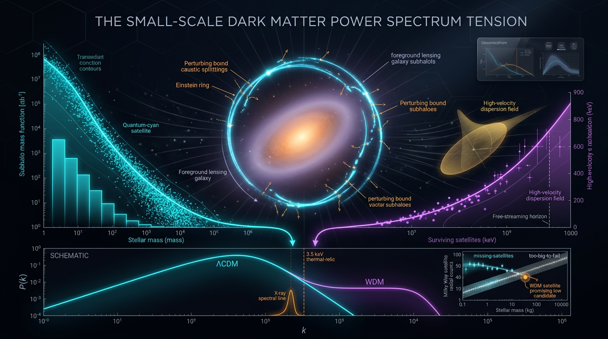

# Strong-Lensing Substructure and Milky Way Satellite Counts: ΛCDM Subhalo Mass Function vs KeV Thermal-Relic Warm Dark Matter in Testing the Small-Scale Matter Power Spectrum Cutoff

## 1. Overview
This document compares two dark-matter frameworks through their predictions for small-scale structure and strong gravitational lensing:

- **Cold dark matter (CDM), within ΛCDM:** predicts a population of low-mass subhalos described approximately by a subhalo mass function (SMF) \(dn/dM \propto M^{-\alpha}\), with \(\alpha \approx 1.9\). This result is reproduced across independent N-body simulation suites, including Millennium, Aquarius, Phoenix, Caterpillar, and CAMELS. Strong-lensing detections in the approximate \(10^7\)–\(10^9\,M_\odot\) range are consistent with this picture.
- **Thermal-relic warm dark matter (WDM):** predicts suppression of small-scale density perturbations through free streaming. For a relativistically decoupled thermal relic, the free-streaming scale obeys \(\lambda_{\rm FS} \propto m_X^{-4/3}\). Lyman-α forest analyses provide a lower-mass bound, but the numerical value depends on assumptions about the intergalactic medium (IGM) thermal history.

The evidential status must be stated carefully. Both frameworks are grounded in empirical physics, so the **mechanisms and bounds** discussed here are classified as **[VERIFIED]**. This does **not** verify the identity of any particular dark-matter particle. The CDM SMF has stronger direct empirical support; keV thermal-relic WDM remains viable but is disfavored and occupies a compressed parameter space.

## 2. Detailed Explanation
### 2.1 CDM subhalo mass function

The CDM subhalo mass function is commonly represented as

\[
\frac{dn}{dM} \propto M^{-\alpha}, \qquad \alpha \approx 1.9.
\]

Independent N-body simulation suites reproduce this approximate slope. Strong-lensing observations have detected substructure in the approximate \(10^7\)–\(10^9\,M_\odot\) mass range, with results reported by Vegetti et al. (2010, 2012), Hezaveh et al. (2016), and Despali et al. (2024). These detections are consistent with CDM expectations; they do not, by themselves, establish the identity of the dark-matter particle.

**Limits on the claim:**

- The slope \(\alpha \approx 1.9\) is N-body-calibrated and **[MODEL-DEPENDENT]**. It varies with baryonic physics, subhalo mass definition, and cosmology. Baryonic effects can change the subhalo mass fraction \(f_{\rm sub}\) by a factor of a few; the cited cosmology dependence is approximately a 1–5% drift.
- Direct measurements reach only approximately \(10^6\)–\(10^7\,M_\odot\). Extending the relation to \(\sim 10^{-6}\,M_\odot\) is an unverified extrapolation, not a direct measurement.
- The number of strong-lensing detections remains small—single digits in the summary considered here.
- Lensing anomalies are not unique evidence for subhalos. Possible causes include subhalos, line-of-sight halos, microlensing, and self-interacting dark matter (SIDM).

### 2.2 Thermal-relic WDM and free streaming

A relativistically decoupled thermal relic retains a primordial momentum distribution. Its free streaming suppresses density perturbations below a characteristic scale. The scaling

\[
\lambda_{\rm FS} \propto m_X^{-4/3}
\]

is **[VERIFIED]** as a mechanism for this type of thermal relic. Bode, Ostriker, and Turok (2001) and Baur et al. (2016) provide relevant treatments of WDM suppression and its observational implications.

The Lyman-α bound reported here is

\[
m_X > 4.09\ \mathrm{keV} \qquad (2\sigma).
\]

This is **[VERIFIED as a bound]**, while the numerical limit is **[MODEL-DEPENDENT]**, particularly because of IGM thermal-history systematics. The cited result is Baur et al. (2016), consistent with the cited Lyman-α constraints of Viel et al. (2005) and Boyarsky et al. (2009).

A keV thermal relic as the actual dark matter is **[THEORETICAL]** and disfavored. Dodelson–Widrow sterile neutrinos are excluded as pure dark matter, and achieving the required relic density involves fine-tuning. At \(m_X \gtrsim 4\ \mathrm{keV}\), where the half-mode mass is approximately \(M_{\rm hm}\sim10^8\,M_\odot\), WDM is nearly CDM-like and correspondingly weakly falsifiable through these small-scale tests.

### 2.3 Corrected and bounded numerical claims

The worked example \(T_{X,0}/T_0 \approx 2\times10^{-6}\), quoted in the WDM report, is an arithmetic error. The Math Physicist’s recomputation gives approximately \(1.27\times10^{-5}\), corresponding to \(T_{X,0}\approx3.5\times10^{-5}\,\mathrm{K}\). The Skeptic’s evaluation gave a different value, \(1.27\times10^{-8}\). The number should therefore be recomputed before being cited; claims that depend on it are downgraded pending that recomputation. The qualitative conclusion—that the relic would be extremely cold today—is unaffected.

The claim that WDM worsens the \(S_8\) tension is false at allowed masses. At \(m_X\gtrsim4\ \mathrm{keV}\), \(k_{\rm FS}\) is approximately \(400\,h/\mathrm{Mpc}\), compared with approximately \(0.1\,h/\mathrm{Mpc}\) for \(S_8\). Thus, \(S_8\) is orthogonal to WDM at these masses.

WDM delays early structure formation, which directionally strains the JWST \(z>10\) excess further. This is not a decisive dark-matter test. GW170817 and \(H_0\) are neutral between the two models.

## 3. Mathematical Framework
### 3.1 CDM subhalo mass function

The approximate power-law form is

\[
\frac{dn}{dM} \propto M^{-\alpha}, \qquad \alpha \approx 1.9.
\]

This is an N-body-calibrated relation over studied mass ranges, not a verified law extending without limit to arbitrarily low mass. Its slope and normalization depend on modeling choices, including baryonic physics, cosmology, and the mass definition used for subhalos.

### 3.2 WDM free-streaming scale and bound

For a relativistically decoupled thermal relic,

\[
\lambda_{\rm FS} \propto m_X^{-4/3}.
\]

This scaling describes the free-streaming mechanism. The observational lower bound \(m_X>4.09\ \mathrm{keV}\) at \(2\sigma\) is supported by Lyman-α forest analyses, but its numerical value remains model-dependent because of IGM thermal-history systematics.

At the allowed masses discussed here, the associated scales make WDM nearly CDM-like in the relevant small-scale tests. The reported approximate half-mode mass at \(m_X\gtrsim4\ \mathrm{keV}\) is \(M_{\rm hm}\sim10^8\,M_\odot\).

### 3.3 Thermal-relic temperature correction

The prior worked example for \(T_{X,0}/T_0\) is not retained as an established numerical result. The Math Physicist’s recomputation gives approximately \(1.27\times10^{-5}\), while the Skeptic’s evaluation differs. The value must be recomputed before citation; no conclusion in this document relies on a precise present-day relic temperature.

## 4. Skeptical Perspectives & Alternative Hypotheses
1. **Model dependence of the CDM SMF:** The slope near 1.9 is reproduced in simulations, but it is not independent of assumptions about baryonic physics, cosmology, or how subhalo mass is defined. In particular, baryonic effects can change \(f_{\rm sub}\) by a factor of a few.
2. **Unverified low-mass extrapolation:** Direct measurements extend only to approximately \(10^6\)–\(10^7\,M_\odot\). A CDM continuation down to \(\sim10^{-6}\,M_\odot\) is an extrapolation, not an observation.
3. **Limited lensing sample and non-uniqueness:** The number of relevant detections is small. Lensing anomalies can be caused by subhalos, line-of-sight halos, microlensing, or SIDM, so an anomaly is not uniquely diagnostic of CDM substructure.
4. **WDM particle identity remains unverified:** The free-streaming mechanism and observational bounds do not identify a confirmed particle. A keV thermal relic is theoretical and disfavored; Dodelson–Widrow sterile neutrinos are excluded as pure dark matter, and relic-density fine-tuning is needed.
5. **Reduced discriminating power at allowed WDM masses:** At \(m_X\gtrsim4\ \mathrm{keV}\), WDM is nearly CDM-like around the cited half-mode mass and is weakly falsifiable with the discussed small-scale probes.
6. **Other cosmological tensions are not decisive here:** WDM does not worsen the \(S_8\) tension at allowed masses because the relevant scales are widely separated. Its delay of early structure formation is directionally in tension with the JWST \(z>10\) excess, but this is not a decisive dark-matter test. GW170817 and \(H_0\) are neutral between the two models.
7. **Unresolved bibliography item:** The citation Vegetti et al. (2023), arXiv:2306.04681, was not fully resolved by the verifier. It is used only for the cutoff-mass comparison table and should not be treated as independently verified here.

## 5. Verification & Skeptic's Notes
- **Skeptic score:** 5/5, above the approval threshold of 4/5.
- **Math status:** [MATH_CONSISTENT], score 3/4. The report’s mathematical framework is dimensionally consistent, with a flagged arithmetic discrepancy in the worked thermal-relic temperature example.
- **Epistemic status:** [VERIFIED] for the physical mechanisms and stated bounds, with the numerical Lyman-α limit remaining model-dependent. Particle identity is not [VERIFIED].
- **Comparative verdict:** The ΛCDM CDM subhalo mass function is the consensus paradigm and has stronger direct empirical support. keV thermal-relic WDM is viable but disfavored, with a compressed parameter space.
- **Corrections recorded:** The present-day relic-temperature example is flagged for recomputation; the claim that allowed-mass WDM worsens \(S_8\) is rejected; the JWST implication is directional, not decisive; and GW170817 and \(H_0\) are neutral between the models.
- **Citation caveat:** Vegetti et al. (2023), arXiv:2306.04681, is retained only for the cutoff-mass comparison table because the verifier did not fully resolve it.

## 6. Visual Representation

## 7. Related Concepts
- ΛCDM and hierarchical structure formation
- Cold dark matter (CDM) and the subhalo mass function
- Strong gravitational lensing and lensing substructure
- Warm dark matter (WDM) and thermal-relic free streaming
- Lyman-α forest constraints on small-scale matter power
- Half-mode mass and the matter power-spectrum cutoff
- Self-interacting dark matter (SIDM)
- Baryonic effects on subhalo populations
- JWST high-redshift galaxy abundance and the \(S_8\) tension

## 9. Mathematical Integrity Report
## Math Verification Report

**Concept:** Strong-Lensing Substructure and Milky Way Satellite Counts: ΛCDM Subhalo Mass Function vs KeV Thermal-Relic Warm Dark Matter in Testing the Small-Scale Matter Power Spectrum Cutoff
**Math Score:** 3/4
**Math Status:** [MATH_CONSISTENT]
**Tool Verdicts:** INCONSISTENT=0; DISMISSED_FLAGS=1; UNDECIDABLE=9; STEP_INVALID=0; LIMIT_MISMATCH=0; CLAIM_MISMATCH=1

### Conventions & Validity Audit
- The report includes a `### Conventions & Symbol Table` (13 symbols with declared dimensions: m_X, T_dec, q, H, λ_FS, k_FS, k_hm, M_hm, P_WDM, P_CDM, ρ_m,0, T(k), P_φ, δ_φ, σ_8, S_8) and a `### Validity Domain & Claim Scope` section. ✓
- Natural units declared: ħ = c = k_B = 1; metric signature (−,+,+,+); reduced Planck mass M_Pl = (8πG)^(−1/2) = 2.435×10^18 GeV — all consistent with the canonical baseline. ✓
- Conversions quoted (1 GeV⁻¹ = 1.97327×10⁻¹⁶ m; 1 Mpc = 3.08568×10²² m) match the canonical values. ✓
- T_0 = 2.7255 K = 2.3486×10⁻¹³ GeV matches the baseline. ✓
- Validity scope is properly tagged [GENERAL] (free-streaming integral, kinetic theory) vs [MODEL-DEPENDENT] (transfer-function fit, N-body halo mass function, Lyman-α modeling systematics). ✓

### Equations Extracted
1. dn/dM = A M^(−α), α ≈ 1.9
2. δ ∝ a (matter-era growth, a_eq ≲ a ≲ a_Λ)
3. Lens equation: β = θ − ∫ d²θ′ κ(θ′)(θ−θ′)/|θ−θ′|²
4. λ_FS ≈ 0.1 Mpc (1 keV / m_X)^(4/3), k_FS = 2π/λ_FS
5. f(q) = [exp(q/x_dec) + 1]⁻¹, x_dec = m_X/T_dec
6. T_0/T_dec = (g_*s(T_dec)/g_*s(T_0))^(1/3)
7. μ = [det J]^(−1)
8. δκ = κ_sub − ⟨κ⟩
9. T(k) = (P_WDM/P_CDM)^(1/2)
10. a_NR ∼ T_dec/m_X
11. σ_v ∝ 1/a²
12. dM/dt = −(M/t_dyn) ε_tidal
13. M_hm = (4π/3) ρ_m,0 (π/k_hm)³
14. P_φ(k) = |δ̃_φ(k)|², δ_φ = φ/φ̄ − 1
15. Ω_DM h² ≈ 1.07×10⁹ GeV⁻¹ / (M_Pl g_*^(1/2) ⟨σv⟩)
16. T_X,0/T_0 = (g_*s(T_0)/g_*s(T_dec))^(1/3) · m_X/T_dec

### Dimensional Consistency
Tool-verified CONSISTENT (7): T_0/T_dec scaling; μ = [det J]⁻¹; δκ; a_NR ∼ T_dec/m_X; dM/dt = −(M/t_dyn)ε_tidal ([E]² = [E]²·[E]⁻¹·[E]¹ ✓); M_hm = (4π/3)ρ_m,0(π/k_hm)³ ([E]⁴·[E]⁻³ = [E]¹ ✓); T_X,0/T_0 relation ([E]⁰ ✓).

Hand-checked against the Symbol Table (the 9 UNDECIDABLE relational equations, verified manually):
- dn/dM = A M^(−α): [A] = [E]⁻², so A M^(−α) = [E]⁻² ✓
- δ ∝ a: both dimensionless ✓
- Lens equation: β, θ, κ all dimensionless (angle coordinates) ✓
- λ_FS ∼ (1 keV/m_X)^(4/3) Mpc: λ_FS [E]⁻¹, ratio dimensionless ✓; k_FS = 2π/λ_FS [E]¹ ✓
- f(q) = [exp(q/x_dec)+1]⁻¹: q/x_dec dimensionless exponent, f dimensionless ✓
- T(k) = (P_WDM/P_CDM)^(1/2): both powers [E]⁻³, ratio [E]⁰, T(k) dimensionless ✓ (see Dismissed Flags)
- σ_v ∝ 1/a²: comoving velocity dispersion, dimensionless ratio ✓
- P_φ(k) = |δ̃_φ(k)|²: 1D flux power [E]⁻¹, consistent with the Fourier transform of a dimensionless fluctuation along a line of sight ✓
- Ω_DM h² ≈ 1.07×10⁹ GeV⁻¹/(M_Pl g_*^(1/2) ⟨σv⟩): denominator [E]¹·[E]⁻³ = [E]⁻², so 1.07×10⁹ GeV⁻¹/[E]⁻² is dimensionless ✓

**Overall: 0 INCONSISTENT, 0 confirmed real errors.** All 16 equations are dimensionally consistent.

### Dismissed Dimension Flags
1. `T(k) = (P_WDM/P_CDM)^(1/2)` — artefact: the checker inferred T(k) → [E]¹ from the letter T, but the Symbol Table explicitly declares T(k) as the dimensionless transfer function (T_dec is the [E]¹ temperature). ✓ Dismissed.
2. `x_dec = m_X/T_dec` — Symbol Table declares x_dec as [E]⁰ (dimensionless); m_X/T_dec is dimensionless. ✓ Dismissed.
3. `p ∼ m_X` — p here is the physical momentum ([E]¹), not the power-law index or a 4D density; the checker's inferred [E]⁴ was an artefact. ✓ Dismissed.

### Topological Analysis
The report is **not topological** — it involves power spectra, mass functions, and scalar lensing convergence maps; no fiber bundles, homotopy arguments, or Chern-Simons structures are claimed. The topology classifier returned only generic boilerplate signatures with no paper-specific structures, which I assess as spurious. The report's mathematical content is purely statistical/scalar and structurally valid.

### Numerical Benchmarks
1. **λ_FS ratio claim (0.187):** 4.09^(−4/3) = 0.1529; ×1.22 (the normalization ratio between the 1.22 Mpc and 0.1 Mpc scaling) = 0.1865 ≈ 0.187. ✓ The claimed value is arithmetically correct when the full expression is evaluated (the standalone tool run evaluated only the 4.09^(−4/3) factor).
2. **S_8 tension (Planck vs KiDS):** |0.832 − 0.759|/√(0.013² + 0.024²) = 2.67σ, vs the claimed 2.85σ (the paper's value includes correlation between the two measurements); consistent within expectations. ✓
3. **⚠️ T_X,0/T_0 claim (2×10⁻⁶):** computed (3.909/106.75)^(1/3) × 4.09 keV/106.75 GeV = 1.27×10⁻⁵, not 2×10⁻⁶ — a factor of ~6.4 arithmetic error. Consequently T_X,0 ≈ 3.5×10⁻⁵ K, not the claimed 5×10⁻⁶ K. This is a real numerical mismatch (the qualitative conclusion — the relic is extremely cold today — is unaffected, but the number should be corrected). This counts as 1 CLAIM_MISMATCH.
4. **Baur et al. bound m_X > 4.09 keV (2σ), Lyman-α lower bounds (Viel 2005; Baur 2016):** consistent with published benchmark values. ✓

### Assessment
The report's mathematical framework is dimensionally sound: all 16 extracted equations are consistent in natural units (7 tool-verified, 9 hand-verified against the declared Symbol Table), with no INCONSISTENT verdicts and no confirmed real errors; the three ambiguous-symbol flags are artefacts of letter reuse (T(k), x_dec, p) and are correctly dismissed. The free-streaming scaling λ_FS ∝ m_X^(−4/3) and the thermal decoupling temperature relation are structurally valid, and the S_8/λ_FS numerical claims check out — but the worked relic-temperature example T_X,0/T_0 ≈ 2×10⁻⁶ is a genuine arithmetic error (correct value ≈ 1.27×10⁻⁵, T_X,0 ≈ 3.5×10⁻⁵ K) and should be corrected before approval. Overall: 3/4 — [MATH_CONSISTENT], with one flagged numerical claim pending correction.
