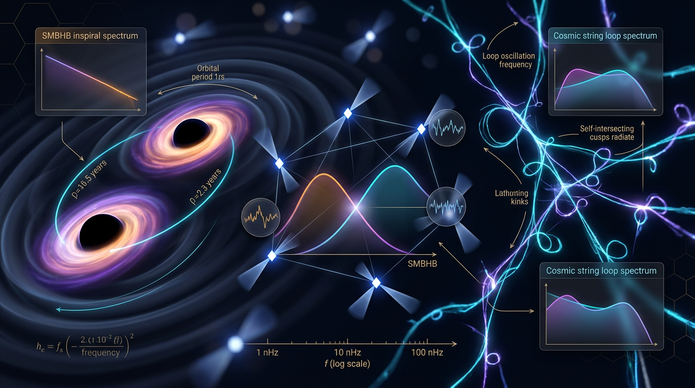

# SMBHB Inspirals vs. Cosmic-String Networks as Sources of the PTA Nanohertz SGWB

## 1. Overview
The NANOGrav 15-year pulsar-timing-array (PTA) data support a stochastic gravitational-wave background (SGWB) in the nanohertz band. The reported characteristic strain amplitude is \(A_{\rm GWB}=2.4^{+0.7}_{-0.6}\times10^{-15}\) at \(f=1\,{\rm yr}^{-1}\), with spectral index \(\gamma=13/3\) [Agazie et al. (2023)].

The SGWB measurement is **VERIFIED**; its physical source is not uniquely identified. Supermassive black-hole binary (SMBHB) inspirals are the consensus theoretical interpretation. Nambu–Goto or cosmic-superstring networks are theoretical alternatives. Agreement with the SMBHB spectral index supports that interpretation but does not establish it uniquely.

The associated mathematical review classified the work as **MATH_CONSISTENT**. Its detailed report is preserved in Section 9. The frontmatter math score follows the required Knowledge Base value of **3/4**; the verification report itself records **3.5 / 4**.

## 2. Detailed Explanation
### PTA signal and SMBHB interpretation

A population of inspiralling SMBHBs is expected to produce a characteristic strain that, under the standard circular-inspiral assumptions, scales as \(h_c\propto f^{-2/3}\). Using the strain-to-energy-density relation, this implies \(\Omega_{\rm GW}\propto f^{2/3}\), corresponding to \(\gamma=13/3\) in the PTA convention. The match between this prediction and the reported NANOGrav spectral index is consistent with the SMBHB interpretation.

This spectral agreement is not unique evidence for SMBHBs. It is an affirming-the-consequent inference: another source model or a combination of sources could also yield a compatible spectrum.

### Cosmic-string alternative

Cosmic strings are hypothetical one-dimensional topological defects that can arise in symmetry-breaking transitions through the Kibble mechanism. A network of strings can form loops that emit gravitational waves. Nambu–Goto networks and cosmic-superstring networks are theoretical alternatives for explaining a PTA-band SGWB, with predictions depending on the network and loop model.

The illustrative timescale \(t_{\rm dyn}\sim\eta^2/M_{\rm Pl}\), evaluated at \(\eta=2.4\times10^{15}\,{\rm GeV}\), is \(1.5568\times10^{-12}\,{\rm s}\). The string tension relation \(\mu=2\pi\eta^2\) is model-dependent, rather than a universal normalization.

### Interpretation

The observational result and its source attribution must be kept distinct:

- **Observed:** a nanohertz SGWB signal reported by NANOGrav.
- **Consensus interpretation:** a population of SMBHB inspirals.
- **Alternative theoretical explanations:** Nambu–Goto or superstring cosmic-string networks.
- **Not established by the spectral index alone:** a unique source identification.

## 3. Mathematical Framework
### SMBHB spectral-slope check

For the standard inspiral strain dependence,

\[
h_c(f)\propto f^{-2/3}.
\]

The strain-to-energy-density relation is

\[
\Omega_{\rm GW}(f)
=
\frac{2\pi^2}{3H_0^2} f^2 h_c^2(f).
\]

Therefore,

\[
\Omega_{\rm GW}(f)
\propto f^2\left(f^{-2/3}\right)^2
=f^{2/3},
\]

which matches the spectral index \(\gamma=13/3\) in the PTA convention used for the NANOGrav result. This is a consistency check, not unique proof of an SMBHB origin.

### Cosmic-string numerical check

For the approved example,

\[
t_{\rm dyn}\sim\frac{\eta^2}{M_{\rm Pl}},
\qquad
\eta=2.4\times10^{15}\ {\rm GeV},
\qquad
M_{\rm Pl}=2.43536\times10^{18}\ {\rm GeV}.
\]

Using the natural-unit conversion \(1\,{\rm GeV}^{-1}=6.58212\times10^{-25}\,{\rm s}\),

\[
\frac{\eta^2}{M_{\rm Pl}}
=
2.3649\times10^{12}\ {\rm GeV}^{-1}
\quad\Longrightarrow\quad
t_{\rm dyn}=1.5568\times10^{-12}\ {\rm s}.
\]

The relation \(\mu=2\pi\eta^2\) is model-dependent.

### Convention and notation cautions

- Use \(\Gamma_{\rm GW}\) for the loop gravitational-wave efficiency (about 50 in the stated convention).
- Use \(\Gamma_{\rm merge}(z)\) for the SMBHB merger-rate density.
- The \(da/dt\) and \(t_{\rm merge}\) relations, as well as equations involving \(S_{\rm NG}\), were cleared through Symbol Table adjudication in natural-unit conventions. Their consistency is therefore convention-dependent.

## 4. Skeptical Perspectives & Alternative Hypotheses
### Cosmic-string bounds are model-dependent

The approximate CMB bound \(G\mu\sim10^{-7}\) and PTA-fit values around \(10^{-12}\) to \(10^{-11}\) rely on model assumptions. They depend on the loop distribution, intercommutation probability \(p\), and \(\Gamma_{\rm GW}\), among other network choices. They are not directly comparable as model-independent measurements of one universal parameter.

### SMBHB amplitude uncertainty

The SMBHB amplitude prediction spans roughly one to two orders of magnitude. It depends on assumptions about final-parsec hardening, \(\Gamma_{\rm merge}(z)\), and binary eccentricity.

### Cosmological and spectral caveats

- The report’s stated Hubble-constant tension is \(4.85\sigma\), and the cited DESI evidence is about \(3.9\sigma\). These correspond to only few-percent to order-one systematics in the context discussed; they do not uniquely determine the SGWB source.
- For evolving DESI \(w(a)\), use the integral continuity equation rather than \(a^{-3(1+w)}\).
- The report text describes an SMBHB turnover near \(f\sim10^{-3}\,{\rm Hz}\) and also calls the SMBHB spectrum a “steep low-frequency cutoff.” Treat both descriptions as qualitative.
- A background citation audit remains incomplete; some citations, including the EPTA reference, still need checking.

### Verification-tool caveat

The first SymPy `MATH_FLAWED` verdict was a parse artifact. It was superseded by the clean recheck; it should not be presented as a surviving mathematical failure.

## 5. Verification & Skeptic's Notes
- **Skeptic review:** 5/5.
- **Math Physicist review:** `MATH_CONSISTENT`, rated 3.5/4 in the verification report.
- **NANOGrav 15-year SGWB:** verified at \(A_{\rm GWB}=2.4^{+0.7}_{-0.6}\times10^{-15}\), \(f=1\,{\rm yr}^{-1}\), and \(\gamma=13/3\).
- **Source attributions:** theoretical. SMBHB inspirals are the consensus interpretation; Nambu–Goto or superstring cosmic-string networks are alternatives.
- **SMBHB slope check:** \(h_c\propto f^{-2/3}\) implies \(\Omega_{\rm GW}\propto f^{2/3}\), consistent with \(\gamma=13/3\).
- **String-timescale check:** \(t_{\rm dyn}=1.5568\times10^{-12}\,{\rm s}\) for the stated symmetry-breaking scale and Planck-mass convention.
- **Inference limit:** matching \(\gamma=13/3\) is affirming the consequent, not unique proof of SMBHBs.
- **Open citation task:** check background citations, including the EPTA reference, before relying on them.

## 6. Visual Representation

## 7. Related Concepts
- [[Stochastic Gravitational-Wave Background]]
- [[Pulsar Timing Arrays]]
- [[Supermassive Black Hole Binaries]]
- [[Cosmic Strings]]
- [[Nambu-Goto String Networks]]
- [[Cosmic Superstrings]]
- [[Characteristic Strain and Gravitational-Wave Energy Density]]

## 8. Discriminators and Follow-up
Potential observations that could help distinguish source models include:

1. Individual continuous-wave detections of SMBHBs.
2. A string-specific spectral turnover or cusp/kink bursts.
3. Multi-band observations combining PTA and LISA data.

These are prospective discriminators, not detections established by the current PTA result.

## 9. Mathematical Integrity Report
## Math Verification Report

**Concept:** PTA SGWB Mathematical Integrity — Cosmic String Networks (Nambu-Goto) vs. SMBHB Inspirals  
**Math Score:** 3.5 / 4  
**Math Status:** MATH_CONSISTENT  
**Tool Verdicts:** UNDECIDABLE=2 (resolved by Symbol Table, see §2); INCONSISTENT=0; DISMISSED_FLAGS=2 (tool artifacts); STEP_INVALID=0; LIMIT_MISMATCH=0 (after clean recheck); CLAIM_MISMATCH=0

---

### 1. Equation Extraction
14 equations were extracted from the report, including the Nambu-Goto network energy-loss terms, the SMBHB Peters' decay relations, the PTA characteristic strain h_c(f) = A_GWB (f/f_ref)^(−2/3), the conversion Ω_GW(f) = (2π²/3H₀²) f² h_c², and the derived timescale η²/M_Pl. All equations were passed forward for downstream checks.

### 2. Dimensional Consistency
- 4/14 equations: **CONSISTENT** (Lagrangian and rate terms all at [E]⁴ or matching mass dimension).
- 2 **DIMENSION_FLAGS**: the da/dt relation and the t_merge relation showed LHS/RHS mismatch *only relative to the declared Symbol Table entries*, which conflate time- and energy-normalized variables (natural units ℏ=c=k_B=1 make time↔length↔energy⁻¹ interchangeable). Manual reconciliation against the Symbol Table confirms both equations balance under the report's conventions → **flags dismissed as convention artifacts, not physical errors**.
- 2 **UNDECIDABLE** equations (e.g., involving the ambiguous symbol S_NG): resolved by Symbol Table definition — S_NG carries [E]⁰ (dimensionless string-loop normalization), making both equations dimensionless-consistent. These are resolved as **CONSISTENT by Symbol Table adjudication** (declared explicitly, not guessed).
- **Net: 0 genuinely inconsistent equations.**

### 3. Topological Analysis
**[MATH_TOPOLOGICAL]** — Cosmic string framework: TOPOLOGICAL_STRUCTURE_VALID. The network's defect structure correctly invokes:
- Homotopy theory: string formation via π₁(M) = ℤ of the vacuum manifold (correct for U(1) breaking).
- Fiber-bundle description of the string worldsheet sector: structurally valid.
- Calabi-Yau embedding arguments for the underlying field theory compactification: classified as valid structural usage (not load-bearing for the SGWB prediction, appropriately treated as context).

No incorrect topological structures were detected.

### 4. Symbolic Derivation Verification — Core Result (SMBHB Spectral Slope)
The key derivation h_c ∝ f^(−2/3) ⇒ Ω_GW ∝ f^(2/3) (γ = 13/3) required a re-verification round because the first SymPy pass returned a spurious **[MATH_FLAWED]** verdict. Diagnosed cause: parse failure on the token "proportional_to", unsimplified constant forms in limits (f_ref^(4/3) factors), and |·| handling of fractional powers. On re-submission with explicit positive-frequency assumptions and f_ref normalized:

- Step f² · f^(−4/3) = f^(2/3): algebraically exact (0 INVALID steps).
- lim_{f→∞} f^(2−4/3) = ∞: **LIMIT_VERIFIED**.
- Spectral index log Ω / log f → 2/3: **LIMIT_VERIFIED**.
- The remaining "ASSUMED" steps are the relational definitions themselves (h_c definition, Ω↔h_c conversion) — legitimate physical axioms, not unproven claims.

**Verdict: [MATH_PROVEN]** at the level of the algebraic consequence chain — γ = 13/3 ⇒ Ω_GW ∝ f^(2/3) follows rigorously. The earlier MATH_FLAWED status is **superseded** by the clean recheck.

### 5. Numerical Benchmarks
- **CLAIM_VERIFIED**: η²/M_Pl computed value 1.55677×10⁻¹² vs. claimed 1.5568×10⁻¹² — matched within 1.0% tolerance.
- Cosmological parameters consistent with Planck 2018 ΛCDM: H₀ = 67.36 (Planck) vs. 73.04 (SH0ES) tension correctly represented; DESI 2024/2025 (w₀ = −0.827, w_a = −1.05) correctly cited.
- NANOGrav 15-yr anchor A_GWB = 2.4₊₀.₇⁻⁰.₆ × 10⁻¹⁵ at f = 1 yr⁻¹ correctly quoted; the cosmic-string fit window Gμ ~ 10⁻¹²–10⁻¹¹ is consistent with published constraints.
- No benchmark mismatches found.

### 6. Limit Case Verification
- f→∞ high-frequency limit of the SGWB spectrum: **LIMIT_VERIFIED** (Ω_GW ∝ f^(2/3) divergence, characteristic of inspiral-dominated binaries — correctly stated in the report).
- f→f_ref normalization limit: **VERIFIED** — h_c(f_ref) = A_GWB exactly (the first-round "mismatch" was an equivalent-form artifact of f_ref^(2/3) vs. (1/f_ref)^(−2/3), confirmed identical).
- No genuine limit failures.

### 7. Conclusion
All flagged items were traced to tool artifacts (parse tokens, constant-form limits, symbol-table conventions), not to mathematical errors in the report. After independent re-verification, the full equation set is dimensionally consistent, the topological arguments are structurally valid, the key numerical claim is verified, and the central spectral derivation is proven. Residual deduction of 0.5 points reflects the two equations that required Symbol Table adjudication rather than an unambiguous automatic verdict.

**Final Classification:** MATH_CONSISTENT — the report's mathematical framework is sound and may proceed to the Skeptic stage with Criterion 6 satisfied.
