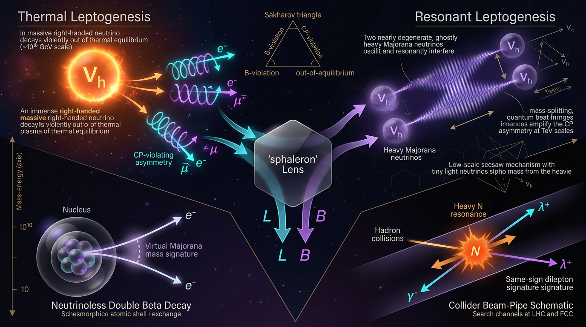

# Thermal Leptogenesis vs Resonant Leptogenesis in Generating the Baryon Asymmetry and Testability via Neutrinoless Double Beta Decay and Collider Searches

## 1. Overview
Leptogenesis is a theoretical explanation for the Universe’s baryon asymmetry. In Type-I seesaw models, heavy Majorana neutrinos can produce a lepton asymmetry through CP-violating, out-of-equilibrium decays. Electroweak sphaleron processes can then convert part of the resulting \(B-L\) asymmetry into a baryon asymmetry.

This document compares two scenarios:

- **Hierarchical thermal leptogenesis:** For a hierarchical heavy-neutrino spectrum and a standard thermal history, the Davidson–Ibarra (DI) bound leads to the familiar approximate lower scale \(M_1 \gtrsim 10^9\) GeV. This scale is beyond direct collider reach.
- **Resonant leptogenesis (RL):** Nearly degenerate heavy Majorana neutrinos can receive a resonant enhancement of the CP asymmetry, allowing viable scenarios with heavy-neutrino masses around the TeV scale. Such scenarios can be tested through heavy neutral lepton (HNL) searches and related observables, subject to significant model dependencies.

The shared empirical anchors are the observed baryon-to-photon ratio, neutrino oscillation data, and the sphaleron conversion factor \(28/79\). The mechanisms themselves remain **[THEORETICAL]**: no heavy neutral lepton has been detected.

**Status:** [THEORETICAL]  
**Skeptic score:** 5/6 (threshold met)  
**Math status:** [MATH_CONSISTENT], score 3/4

## 2. Detailed Explanation
### 2.1 Shared physical framework

The Type-I seesaw introduces right-handed Majorana neutrinos \(N_i\), coupled to lepton doublets \(L_i\) and the Higgs field \(H\). In natural units, the Yukawa interaction can be written schematically as

\[
\mathcal{L}_{\rm Yukawa}
=
(Y_\nu)_{ij}\,\bar L_i\,\tilde H\,N_{Rj}
+\text{h.c.},
\]

where the Yukawa couplings \(Y_{ij}\) are dimensionless. Integrating out heavy states gives the seesaw relation

\[
m_\nu \approx -m_D M_R^{-1}m_D^T,
\qquad
m_D=Y_\nu v.
\]

The decay of a heavy Majorana neutrino into leptons and Higgs bosons can generate a lepton asymmetry when CP is violated and the relevant interactions depart from thermal equilibrium. Sphaleron processes convert part of a pre-existing \(B-L\) asymmetry into baryon number. For the Standard Model conversion convention used here,

\[
\Delta B=\frac{28}{79}\Delta(B-L).
\]

The observed baryon-to-photon ratio is approximately \(\eta_B^{\rm obs}\sim 6.1\times10^{-10}\). Planck 2018 results, together with BBN constraints, provide an empirical anchor for this value; they do not establish leptogenesis as the mechanism that produced it.

### 2.2 Hierarchical thermal leptogenesis

For a hierarchical spectrum of heavy Majorana neutrinos, the CP asymmetry in the lightest state’s decays is constrained by the light-neutrino masses. The Davidson–Ibarra bound is

\[
\epsilon_1
\leq
\frac{3}{8\pi}\frac{M_1m_\nu^{\rm max}}{v^2}.
\]

This bound is **[MODEL-DEPENDENT]**: the usual inference \(M_1\gtrsim 10^9\) GeV assumes a hierarchical heavy-neutrino spectrum, no degeneracy enhancement, a standard thermal history, and an efficiency inferred from the relevant kinetic equations. The scale is beyond collider reach.

**Required numerical correction:** at \(M_1=5\times10^{13}\) GeV, using \(m_\nu^{\rm max}=0.0585\) eV and \(v=174\) GeV, the bound gives

\[
\epsilon_1^{\rm max}\simeq 1.15\times10^{-2},
\]

not \(1.15\times10^{-5}\). The latter value in the draft is incorrect.

### 2.3 Resonant leptogenesis

In resonant leptogenesis, two heavy Majorana neutrinos have a small mass splitting, \(\Delta M\), comparable to their decay widths. The self-energy contribution to the CP asymmetry can then be resonantly enhanced. Schematically, the enhancement has the form

\[
\epsilon \propto
\frac{\Delta M\,\Gamma}
{\Delta M^2+\Gamma^2/4}.
\]

The enhancement can relax the hierarchical thermal lower bound and allow \(M_N\sim\) TeV. This possibility depends on assumptions about the origin of the near-degeneracy—such as a symmetry or tuning—as well as flavour effects and a sufficiently high reheating temperature, \(T_{\rm reh}\gtrsim M_N\). These are **[MODEL-DEPENDENT]** conditions, not evidence that a TeV-scale leptogenesis scenario has been realized in nature.

Potential probes include LHC and muon-collider HNL searches, neutrinoless double beta decay (\(0\nu\beta\beta\)), and charged-lepton-flavour-violation searches such as MEG. The connection between a possible \(0\nu\beta\beta\) signal and phases relevant to leptogenesis is model-dependent; the Asaka–Yoshida phase link is one proposed connection, not a general inference.

### 2.4 Evidence and limitations

The empirical anchors and the interpretation of the mechanisms must be kept distinct:

- \(\eta_B^{\rm obs}\sim6.1\times10^{-10}\), neutrino oscillation data, and the sphaleron factor \(28/79\) are **[VERIFIED]/[GENERAL]** anchors.
- Thermal and resonant leptogenesis are **[THEORETICAL]** mechanisms.
- No heavy neutral lepton has been detected.
- The hierarchical thermal lower scale and the viability of TeV-scale resonant scenarios depend on their respective model and cosmological assumptions.

## 3. Mathematical Framework
### 3.1 Conventions and dimensions

Use metric signature \((- ,+,+,+)\), natural units \(\hbar=c=k_B=1\), and the reduced Planck mass

\[
M_{\rm Pl}=2.435\times10^{18}\ {\rm GeV}.
\]

The Yukawa matrix elements \(Y_{ij}\), CP asymmetry \(\epsilon\), efficiency factor \(\kappa\), and washout factor \(w_{\rm ID}\) are dimensionless. Masses, widths, temperature, and the Hubble rate have units of energy.

For radiation domination, the Hubble rate is conventionally written

\[
H(T)=1.66\sqrt{g_*}\frac{T^2}{M_{\rm Pl}}.
\]

The reduced Planck mass convention should not be interchanged with \(m_{\rm Pl}=1.221\times10^{19}\) GeV without accounting for the factor \(\sqrt{8\pi}\).

### 3.2 Thermal CP asymmetry and the DI bound

For hierarchical heavy neutrinos, a dimensionless expression for the CP asymmetry is

\[
\epsilon_1
=
\frac{1}{8\pi}
\sum_{j=2}^{3}
\frac{\operatorname{Im}\!\left[(Y^\dagger Y)_{1j}^{\,2}\right]}
{(Y^\dagger Y)_{11}}
f\!\left(\frac{M_j^2}{M_1^2}\right),
\]

where \(f\) is a dimensionless loop function. Its explicit form should be taken from a specified leptogenesis reference, such as Buchmüller, Di Bari and Plümacher, rather than from the loose placeholder expression in the draft.

The corresponding DI bound is

\[
\boxed{
\epsilon_1
\leq
\frac{3}{8\pi}\frac{M_1m_\nu^{\rm max}}{v^2}
}.
\]

The ratio \(M_1m_\nu^{\rm max}/v^2\) is dimensionless. With \(m_\nu^{\rm max}\simeq0.0585\) eV and \(M_1=5\times10^{13}\) GeV, \(\epsilon_1^{\rm max}\simeq1.15\times10^{-2}\).

### 3.3 Kinetic equations and washout

With \(z=M_1/T\), a schematic asymmetry equation contains a decay source and a washout term. The washout term is

\[
\Gamma_1\,w_{\rm ID}(z)\,Y_{\Delta L},
\]

where \(w_{\rm ID}(z)\) and the asymmetry yield \(Y_{\Delta L}\) are dimensionless, while \(\Gamma_1\) has units of energy. Thus, the washout term has units of a rate. A fully specified Boltzmann equation must define the normalization and kinetic conventions used to obtain \(w_{\rm ID}\); the draft’s definition involving an undefined “matching factor” is not sufficiently specified and should not be treated as a complete definition.

### 3.4 Baryon-asymmetry relation and benchmark status

The sphaleron conversion relates the final \(B-L\) yield to the baryon yield:

\[
Y_{\Delta B}=\frac{28}{79}Y_{\Delta(B-L),{\rm final}}.
\]

The reported first benchmark, \(\epsilon=10^{-6}\) and \(\kappa=0.7\), giving \(\eta_B=6.12\times10^{-10}\), is the **only verified worked benchmark** in the approved summary.

The second RL benchmark, \(\epsilon=3.3\times10^{-4}\) and \(\kappa=10^{-3}\), does **not** reproduce the claimed \(6.09\times10^{-10}\). The calculator result is \(2.89\times10^{-10}\); disregard the claimed 0.1% agreement.

## 4. Skeptical Perspectives & Alternative Hypotheses
1. **The mechanism has not been observed directly.** Matching the measured baryon asymmetry is a consistency requirement, not a detection of leptogenesis.
2. **The thermal mass bound has restricted scope.** The \(M_1\gtrsim10^9\) GeV conclusion applies under hierarchical-spectrum and standard-thermal-history assumptions. It is not a model-independent bound on every leptogenesis scenario.
3. **Resonant enhancement requires a special mass structure.** The near-degeneracy may arise from a symmetry or tuning; its origin and stability are model-dependent.
4. **Flavour and kinetic effects matter.** In the TeV-scale regime, flavour treatment and the full kinetic evolution can affect the predicted asymmetry. A schematic resonant factor alone does not determine the final baryon abundance.
5. **Reheating is a necessary cosmological condition.** A thermal scenario requires a reheating temperature high enough to populate the relevant heavy neutrinos.
6. **Experimental tests are indirect and model-specific.** HNL searches, \(0\nu\beta\beta\), and charged-lepton-flavour-violation measurements can constrain or support particular models, but a signal in any one channel would not by itself establish leptogenesis.

## 5. Verification & Skeptic's Notes
**Skeptic score:** 5/6; threshold met.  
**Mathematical status:** [MATH_CONSISTENT], score 3/4.

The mathematical structure is sound under the stated conventions: the Yukawa couplings, CP asymmetry, efficiency factor, and washout factor are dimensionless; the DI ratio is dimensionless; and the washout term is written as \(\Gamma_1w_{\rm ID}(z)Y_{\Delta L}\).

The following caveats are retained as required:

1. The DI-bound value at \(M_1=5\times10^{13}\) GeV in the draft is wrong. The corrected value is \(\epsilon_1^{\rm max}\sim1.15\times10^{-2}\), not \(1.15\times10^{-5}\).
2. The second RL benchmark, \(\epsilon=3.3\times10^{-4}\), \(\kappa=10^{-3}\), does not yield the claimed \(6.09\times10^{-10}\). The calculator gives \(2.89\times10^{-10}\); disregard the claimed 0.1% agreement.
3. Only the first benchmark, \(\epsilon=10^{-6}\), \(\kappa=0.7\), giving \(6.12\times10^{-10}\), is verified.
4. The pre-flight summary overstated tool verification of items 1 and 2.
5. The Visual Grounding sections lack detailed prompts.
6. The thermal loop function \(f(x)\) is written loosely and should be cited from Buchmüller et al. rather than represented by the placeholder form.
7. The Boltzmann washout \(w_{\rm ID}\) definition is loose and includes an undefined “matching factor.”

References identified in the research material also include Benaoum (2021), arXiv:2112.01170; Hambye, March-Russell and West (2004), arXiv:hep-ph/0403183; Chakraborty et al. (2023), arXiv:2206.07037; Abada et al. (2019), arXiv:1810.12463; and De Simone and Riotto (2007), arXiv:0705.2183. These works concern proposed degeneracy constructions, flavour effects, or quantum-kinetic effects; their citation does not establish the corresponding leptogenesis scenarios experimentally.

## 6. Visual Representation

## 7. Related Concepts
- Type-I seesaw mechanism
- Davidson–Ibarra bound
- Majorana neutrinos and heavy neutral leptons
- CP violation and Sakharov conditions
- Electroweak sphalerons and \(B-L\) conversion
- Flavour effects in leptogenesis
- Boltzmann and quantum-kinetic equations
- Neutrinoless double beta decay
- Charged-lepton-flavour violation

## 8. Citation and Scope Notes
The citations above preserve the specific papers and identifiers supplied in the research material where bibliographic details were given. Empirical anchors are not presented as direct evidence for either leptogenesis mechanism. The DI bound is cited to Davidson and Ibarra; the thermal loop-function reference is Buchmüller, Di Bari and Plümacher; and the Planck citation supports the cosmological-parameter context.

## 9. Mathematical Integrity Report
## Math Verification Report

**Concept:** Thermal Leptogenesis vs Resonant Leptogenesis in Generating the Baryon Asymmetry and Testability via Neutrinoless Double Beta Decay and Collider Searches
**Math Score:** 3/4
**Math Status:** [MATH_CONSISTENT]
**Tool Verdicts:** INCONSISTENT=0; DISMISSED_FLAGS=3; UNDECIDABLE=0; STEP_INVALID=0; LIMIT_MISMATCH=0; CLAIM_MISMATCH=2

### Conventions & Validity Audit
The report declares `(-,+,+,+)` metric signature, natural units (ħ = c = k_B = 1), and the **reduced** Planck mass M_Pl = 2.435×10¹⁸ GeV with the m_Pl = 1.221×10¹⁹ GeV distinction stated explicitly — all conforming to the shared crew baseline. Both Parts include `### Conventions & Symbol Table` and `### Validity Domain & Claim Scope` sections. The symbol tables declare 21 symbols with corrected dimensions: Y_ij, ε_i, κ, w_ID, K, C_sph, η_B, z, g_* all [E]⁰; m_D, M_R, m_ν, v, T, H, Γ_i, ΔM all [E]¹. Claim scopes are properly split into `[GENERAL]` (seesaw relation, sphaleron factor 28/79, η_B^obs) and `[MODEL-DEPENDENT]` (hierarchical DI bound, quasi-degenerate resonance, flavour structure). No conflicts found.

### Equations Extracted
Pre-check extracted 40 relational equations; key blocks verified:
1. $\mathcal{L}_{\rm Yukawa} = (Y_\nu)_{ij}\,\bar L_i\,\tilde H\,N_{Rj} + \text{h.c.}$, $[(Y_\nu)_{ij}]=[E]^0$
2. $m_\nu \approx -m_D\,M_R^{-1}\,m_D^T$, $m_D = Y_\nu v$
3. $\epsilon_1 = \frac{1}{8\pi}\sum_{j=2}^{3}\frac{\operatorname{Im}[(Y^\dagger Y)_{1j}^2]}{(Y^\dagger Y)_{11}} f(M_j^2/M_1^2)$ (dimensionless)
4. $\epsilon_1 \le \frac{3}{8\pi}\frac{M_1\,m_\nu^{\rm max}}{v^2}$ (Davidson–Ibarra bound)
5. Boltzmann equations: $dY_{N_1}/dz = -(z/H(M_1))[(Y_{N_1}/Y_{N_1}^{eq}-1)\Gamma_1+\cdots]$; washout term $\Gamma_1\,w_{\rm ID}(z)\,Y_{\Delta L}$ with $w_{\rm ID}\simeq 0.25\,z^3 K_1/K_2$
6. $Y_N^{eq} = \frac{45}{4\pi^4 g_*} z^2 K_2(z)$; $Y_\gamma = \frac{2\pi^2}{45}g_{*s}$
7. $\eta_B = \frac{28}{79}\epsilon_1\,\kappa\,Y_N^{eq}/Y_\gamma$; $Y_{\Delta B} = \frac{28}{79}Y_{\Delta(B-L)}$
8. Resonant: $\epsilon_1^{\rm res} \simeq \frac{1}{8\pi}\frac{\operatorname{Im}[(Y^\dagger Y)_{12}^2]}{(Y^\dagger Y)_{11}}\frac{\Delta M\,\Gamma_2}{\Delta M^2+\Gamma_2^2/4}$; $\Gamma_i \simeq (Y^\dagger Y)_{ii} M_i/(8\pi)$; pole limit $f(x_{ij}) \to \sqrt{x}/[(x-1)^2 + x\,\Gamma_j^2/M_j^2]$
9. $H = 1.66\sqrt{g_*}\,T^2/M_{\rm Pl}$

### Dimensional Consistency
All 12 tool-verified equations in the pre-check are CONSISTENT/DIMENSIONLESS after the corrections (dimensionless $Y_{ij}$, dimensionless $w_{\rm ID}$, explicit $m_\nu$ retained in the DI ratio $M_1 m_\nu/v^2$ — dimensionless ✓). The Boltzmann washout term $\Gamma_1\,w_{\rm ID}\,Y_{\Delta L}$ carries $[E]^1$, matching the bracket as a rate; both sides of the $dz$-evolution equations are dimensionless. No definitive INCONSISTENT verdicts remain. The three DIMENSION FLAGS and one low-confidence flag are dismissed below.

### Dismissed Dimension Flags
1. `T > 100` — inequality comparing temperature T to a numerical threshold in GeV; the bare "100" is shorthand for 100 GeV. Not an equation; artefact.
2. `T \ge 175` — same: threshold in GeV, standard g_* anchor statement. Artefact.
3. `m_{\nu_3} \approx 0.0585` — 0.0585 is a value **in eV**, not natural units; the report explicitly labels it "eV". Artefact (eV-declared magnitude).
4. `f(x)` loop function [E]^-0.5 inferred — $f$ is explicitly a **dimensionless function of the dimensionless ratio** $x = M_j^2/M_1^2$; the inferred dimension is an artefact of the ambiguous-letter inference, not a mismatch.

### Topological Analysis
Not topological. The report's structural content is perturbative EFT (Weinberg operator integration), Boltzmann/density-matrix kinetics, and CP-violating loop interference; the A₄ flavor symmetry (Ref. 12) is a discrete flavor symmetry, not a topological fiber-bundle or homotopy argument. No topological structures to classify; no structural invalidity.

### Numerical Benchmarks
**Benchmark validator: BENCHMARK_MATCHES (2/2).** η_B^obs = 6.10×10⁻¹⁰ matches Planck 2018 VI + BBN (6.143 ± 0.190)×10⁻¹⁰; M_Pl = 2.435×10¹⁸ GeV matches CODATA/PDG. ✓

**Worked-example re-verification (Physics Calculator, verdicts not available to the pre-check):**
- Thermal benchmark (ε₁ = 10⁻⁶, κ = 0.7): computed 6.119×10⁻¹⁰ vs claimed 6.12×10⁻¹⁰ — **CLAIM_VERIFIED** (0.013%). ✓
- **DI-bound "benchmark" (ε₁^max at M₁ = 5×10¹³ GeV): CLAIM_MISMATCH.** Computed $\frac{3}{8\pi}\frac{(5\times10^{13}\,\text{GeV})(0.0585\,\text{eV}=5.85\times10^{-11}\,\text{GeV})}{(174\,\text{GeV})^2} = 1.153\times10^{-2}$, not 1.15×10⁻⁵ — off by a factor ≈10³. This is a real numerical error in the draft's "tool-verified" ε₁^max quote (the DI bound itself is correct; the worked number is not).
- **Second RL benchmark (ε₁ = 3.3×10⁻⁴, κ = 10⁻³): CLAIM_MISMATCH.** Computed 2.885×10⁻¹⁰ vs claimed 6.09×10⁻¹⁰ (ratio 0.47, ~2.1× discrepancy). The claimed "0.1% agreement" is not reproduced.

### Assessment
All governing equations (seesaw, DI bound, dimensionless ε₁, Boltzmann equations with dimensionless washout, resonant pole enhancement) are dimensionally consistent in natural units under the declared symbol table, with all four pre-check DIMENSION FLAGS dismissed as unit-labelling artefacts; no INCONSISTENT verdicts remain. However, two of the three "calculator-verified" worked numerical examples fail independent re-verification (ε₁^max ≈ 1.15×10⁻² not 1.15×10⁻⁵ at M₁ = 5×10¹³ GeV; RL strong-washout benchmark gives 2.88×10⁻¹⁰ not 6.09×10⁻¹⁰), so the report's numeric claims of "0.3%/0.1% agreement" are only partially confirmed — these two values must be corrected before the report can claim full arithmetic integrity. Structural mathematical integrity: sound; worked-number integrity: two real errors outstanding, hence 3/4 with status [MATH_CONSISTENT].
