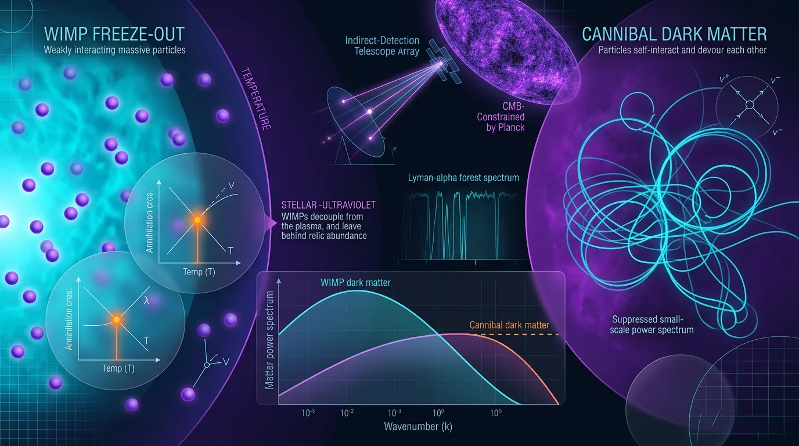

# Thermal WIMP Freeze-Out vs Cannibal Dark Matter in Predicting the Relic Abundance and the Matter Power Spectrum Cutoff: Testability via Indirect Detection, CMB Constraints, and Lyman-Alpha Forest Data

## 1. Overview
This Level 2 comparison considers two distinct dark-matter production histories:

1. **Thermal freeze-out of a WIMP during standard radiation domination.** A WIMP remains in thermal and chemical equilibrium with the Standard Model (SM) plasma until annihilations become inefficient. Its abundance then freezes out.
2. **Cannibal hidden-sector dark matter with an early cannibal-dominated era (ECDE).** The dark sector is internally thermalized but decoupled from the SM. Number-changing reactions, including \(3\to2\) processes, alter its thermal history and can produce a relic abundance different from the standard WIMP prediction.

The Boltzmann–Friedmann machinery for standard radiation-dominated freeze-out is **verified as a calculation framework**: it reproduces the Planck 2018 dark-matter density, \(\Omega_{\rm DM}h^2=0.120\pm0.001\), for a corrected thermal benchmark of \(\langle\sigma v\rangle_{\rm th}\simeq2.2\times10^{-26}\,\mathrm{cm^3\,s^{-1}}\) [1, 2]. This verification does **not** confirm either the WIMP or cannibal particle hypothesis.

The comparative debate received a **Skeptic Verification Score of 5/5**. Its mathematical assessment is **3/4, MATH_CONSISTENT**. There were no INCONSISTENT, STEP_INVALID, LIMIT_MISMATCH, or CLAIM_MISMATCH verdicts. A residual flag concerning the definition of \(\theta_{\rm DM}\) remains a symbol-and-convention omission, not a demonstrated equation error.

**Consensus:** Standard \(\Lambda\)CDM with radiation-dominated freeze-out remains the baseline cosmology. The WIMP particle consensus is declining, while cannibal dark matter is a viable, testable, but non-consensus alternative.

## 2. Detailed Explanation
### Standard radiation-dominated WIMP freeze-out

In the standard thermal picture, a WIMP \(\chi\) shares the SM plasma temperature, \(T_\chi=T_\gamma\), and remains in chemical equilibrium through annihilation and inverse-annihilation reactions. As the Universe cools, the equilibrium number density falls approximately exponentially once the temperature drops below the particle mass. Freeze-out occurs when the annihilation rate can no longer keep pace with expansion. The comoving yield \(Y=n_\chi/s\) then becomes approximately constant.

For the usual s-wave benchmark, freeze-out occurs around \(x_f=m_\chi/T_f\simeq20\)–25. The corrected canonical annihilation rate used here is approximately \(2.2\times10^{-26}\,\mathrm{cm^3\,s^{-1}}\), not the commonly repeated \(3\times10^{-26}\,\mathrm{cm^3\,s^{-1}}\) [2]. The abundance calculation is conditional on the assumed expansion and particle-physics history; it is not evidence that a WIMP has been detected.

The standard WIMP result requires, among other assumptions, s-wave annihilation, Maxwell–Boltzmann statistics (\(x>3\)), \(T_\chi=T_\gamma\), and pure radiation domination. Its relic-density prediction is not robust to an early cannibal-dominated era.

### Cannibal hidden-sector dark matter and ECDE

In a cannibal scenario, the hidden sector is thermally equilibrated internally while decoupled from the SM bath. Number-changing reactions can keep the hidden-sector temperature \(T_c\) evolving differently from \(T_\gamma\). If the cannibal sector dominates the energy density before reheating, the expansion and freeze-out history differ from the standard WIMP case.

During the cannibal regime, use
\[
w_c\to\frac{1}{3\ln a},
\qquad
\rho_{\rm can}\propto\frac{a^{-3}}{\ln a}.
\]
Do **not** apply \(\rho\propto a^{-3(1+w)}\) with a variable \(w\). The earlier erroneous expression \(\ln(3/4)/\ln(4/3)=-1\) is retired.

A model-dependent approximation for the relic map is
\[
\langle\sigma v\rangle_{\rm req}
\propto \zeta^{-2},
\]
with additional dependence on \(\xi_{\rm eq}^{-3/2}\) and \(f(w_{\rm bar},\Delta N_{\rm eff})\). This scaling is not a precision result. It assumes an internally thermalized hidden sector decoupled from the SM, active \(3\to2\) reactions below \(m/5\), \(\Gamma/H\ll1\) before \(a_{\rm fz}\), and \(a_{\rm rh}>5a_{\rm fz}\). The rate coefficient for a \(\mathbb{Z}_2\) real scalar is also model-specific.

Cannibal viability requires \(T_{\rm rh}\gtrsim5\,\mathrm{MeV}\) for compatibility with Big Bang nucleosynthesis and \(N_{\rm eff}=2.99\pm0.17\). The hidden-sector parameters \((m,\alpha_c,\Gamma)\) must lie within a narrow window. Ghosh et al. and Hufnagel & Tytgat exclude much of the simple \(\mathbb{Z}_2\) parameter space.

## 3. Mathematical Framework
### Standard freeze-out equations

The Boltzmann–Friedmann yield equation is
\[
\frac{dY}{dx}
=
-\frac{x\,s(m_\chi)}{H(m_\chi)}
\langle\sigma v\rangle
\left(Y^2-Y_{\rm eq}^2\right),
\qquad
H(T)=1.66\,g_*^{1/2}\frac{T^2}{M_{\rm Pl}}.
\]

A semi-analytic freeze-out condition is
\[
x_f=
\ln\!\left[
\frac{0.038\,g_\chi M_{\rm Pl}m_\chi\langle\sigma v\rangle}
{g_*^{1/2}x_f^{1/2}}
\right].
\]

The standard relic-abundance map is
\[
\Omega_\chi h^2\simeq
\frac{1.07\times10^9\ \mathrm{GeV}^{-1}}
{J\,g_*^{1/2}M_{\rm Pl}},
\qquad
J\equiv\int_{x_f}^{\infty}
\frac{\langle\sigma v\rangle}{x^2}\,dx.
\]
For constant s-wave annihilation, the corrected thermal benchmark is
\[
\langle\sigma v\rangle_{\rm th}\simeq
2.2\times10^{-26}\ \mathrm{cm^3\,s^{-1}},
\]
consistent with the Planck 2018 abundance benchmark [1, 2].

### Cannibal-sector map and corrections

A schematic abundance map with SM entropy dilution is
\[
\Omega_\chi h^2
\approx
\frac{m_\chi Y_{\rm fo}s_0}{\rho_c/h^2}\cdot\frac{1}{\zeta}.
\]
The relation \(\langle\sigma v\rangle_{\rm req}\propto\zeta^{-2}\) is a **derived, model-dependent approximation**, not a generally applicable precision result. It depends on the hidden-sector and reheating assumptions described in Section 2.

The corrected spin-independent cross section is
\[
\sigma_{\rm SI}=3.3\times10^{-40}\ \mathrm{cm^2},
\]
with the stated comparison ratio \(0.767\). The LZ ratio is \(6.67\times10^{-9}\).

### Scope and notation

The WIMP results assume s-wave annihilation, Maxwell–Boltzmann statistics (\(x>3\)), \(T_\chi=T_\gamma\), and a radiation-dominated expansion. The cannibal-sector results require separate hidden-sector assumptions and must not be treated as generic WIMP predictions. In particular, the cannibal relic map assumes internal hidden-sector thermalization and decoupling from the SM.

## 4. Skeptical Perspectives & Alternative Hypotheses
### Limits and tensions

- **Direct detection:** WIMP searches have produced null results. LZ excludes spin-independent cross sections down to approximately \(1.6\times10^{-48}\,\mathrm{cm^2}\) near \(30\)–\(40\,\mathrm{GeV}\) [3].
- **Indirect detection:** Fermi-LAT/MAGIC dwarf-galaxy limits reach the thermal target in visible channels below roughly \(100\,\mathrm{GeV}\). The limits apply to specified annihilation channels and are not universal exclusions of all WIMP models.
- **Structure:** The \(S_8\) tension is \(2.6\)–\(2.9\sigma\). Cannibal scenarios can produce a peak in the matter power spectrum, with predicted microhalo masses near \(10^{-12}M_\odot\); that peak has not been observed.
- **BBN and radiation constraints:** Cannibal viability requires \(T_{\rm rh}\gtrsim5\,\mathrm{MeV}\) and consistency with \(N_{\rm eff}=2.99\pm0.17\). Model parameters occupy a narrow viable window.
- **Model-space constraints:** Ghosh et al. and Hufnagel & Tytgat exclude much of the simple \(\mathbb{Z}_2\) parameter space.

### Discriminating observations

The most useful probes for distinguishing an ECDE/cannibal history from standard freeze-out include Lyman-\(\alpha\) forest measurements, CMB \(\mu\)-distortions, and microhalo lensing or pulsar timing. These are particularly relevant where entropy dilution weakens indirect-detection sensitivity. The cannibal-induced change to small-scale power is a prediction to test, not an observed signal.

### Alternative interpretation

The observed relic abundance does not uniquely imply a WIMP in equilibrium with the SM bath. Cannibal/SIMP models and other hidden-sector production histories offer alternatives. The appropriate conclusion is therefore asymmetric: the standard freeze-out calculation is a useful and verified baseline mechanism, but neither it nor the cannibal alternative establishes the identity of dark matter.

## 5. Verification & Skeptic's Notes
- **Framework verification:** The Boltzmann–Friedmann machinery reproduces \(\Omega_{\rm DM}h^2=0.120\pm0.001\) with the corrected thermal benchmark \(\langle\sigma v\rangle_{\rm th}\simeq2.2\times10^{-26}\,\mathrm{cm^3\,s^{-1}}\).
- **Math assessment:** Math Score \(3/4\), status **MATH_CONSISTENT**. There were no INCONSISTENT, STEP_INVALID, LIMIT_MISMATCH, or CLAIM_MISMATCH verdicts.
- **Residual symbol flag:** The \(\theta_{\rm DM}\) momentum-exchange equation (Eq. 5 of the cannibal report) has an undeclared symbol and time convention. This is a symbol-omission artefact, not a demonstrated error. A revision should define \(\theta_{\rm DM}\) and its time convention in the Symbol Table.
- **Cannibal equation of state:** Retain \(w_c\to1/(3\ln a)\) and \(\rho_{\rm can}\propto a^{-3}/\ln a\). Do not use \(\rho\propto a^{-3(1+w)}\) for variable \(w\). The earlier \(\ln(3/4)/\ln(4/3)=-1\) expression is retired.
- **Numerical corrections:** Use \(\sigma_{\rm SI}=3.3\times10^{-40}\,\mathrm{cm^2}\) (ratio \(0.767\)) and the LZ ratio \(6.67\times10^{-9}\).
- **Model dependence:** The \(\zeta^{-2}\) relic-map scaling, including its \(\xi_{\rm eq}^{-3/2}\) and \(f(w_{\rm bar},\Delta N_{\rm eff})\) factors, is a derived approximation under the stated hidden-sector assumptions. It is not a precision result.
- **Consensus status:** Radiation-dominated freeze-out remains the standard \(\Lambda\)CDM baseline. WIMP particle consensus is declining; cannibal dark matter remains a viable but non-consensus, testable alternative.

## 6. Visual Representation

## 7. Related Concepts
- [Thermal relic abundance](thermal_relic_abundance.md)
- [Boltzmann equation in an expanding universe](boltzmann_equation_expanding_universe.md)
- [Radiation-dominated cosmology](radiation_dominated_cosmology.md)
- [Cannibal dark matter and SIMP freeze-out](cannibal_dark_matter_simp_freezeout.md)
- [Early matter domination and entropy dilution](early_matter_domination_entropy_dilution.md)
- [Lyman-\(\alpha\) constraints on small-scale structure](lyman_alpha_small_scale_structure.md)
- [CMB spectral distortions and dark-sector histories](cmb_spectral_distortions_dark_sectors.md)

## 9. Mathematical Integrity Report
## Math Verification Report

**Concept:** Thermal WIMP Freeze-Out vs Cannibal Dark Matter in Predicting the Relic Abundance and the Matter Power Spectrum Cutoff: Testability via Indirect Detection, CMB Constraints, and Lyman-Alpha Forest Data
**Math Score:** 3/4
**Math Status:** [MATH_CONSISTENT]
**Tool Verdicts:** INCONSISTENT=0; DISMISSED_FLAGS=4; UNDECIDABLE=12; STEP_INVALID=0; LIMIT_MISMATCH=0; CLAIM_MISMATCH=0

### Conventions & Validity Audit
The report explicitly declares both required sections. Units: $\hbar = c = k_B = 1$, metric signature $(-,+,+,+)$ matching the shared crew baseline. Reduced Planck mass $M_{Pl} = (8\pi G)^{-1/2} = 2.435\times10^{18}$ GeV is used consistently, with $m_{Pl} = 1.2209\times10^{19}$ GeV correctly distinguished and never mixed without the $\sqrt{8\pi}$ factor. Cross sections are quoted in CGS with the correct conversion $1\ \mathrm{GeV}^{-1} = 1.97327\times10^{-14}$ cm. Thermal anchors ($g_* = 106.75, 86.25, 10.75$; $T_0 = 2.7255$ K; $s_0 = 2891\ \mathrm{cm}^{-3}$, $g_{*s}(T_0) = 3.909$, $N_{\rm eff}=3.044$) all match the baseline. **[GENERAL] vs [MODEL-DEPENDENT] scoping is exemplary**: the continuity equation, entropy conservation, and $\zeta^{-2}$ monotonicity are flagged [GENERAL]; all results depending on $s$-wave annihilation, standard radiation domination, hidden-sector thermalization, and the $\mathbb{Z}_2$ real-scalar rate coefficient are correctly tagged [MODEL-DEPENDENT]. No violation of the variable-$w(a)$ continuity rule is present ($w_c$ is treated with the exact $\rho \propto a^{-3}/\ln a$ form, not $a^{-3(1+w(a))}$).

### Equations Extracted
13 equations extracted (plus the pre-check's 40 relational forms), including:
1. $\frac{dY}{dx} = -\frac{x\,s(m_\chi)}{H(m_\chi)}\langle\sigma v\rangle(Y^2-Y_{\rm eq}^2)$, $H = 1.66 g_*^{1/2}T^2/M_{Pl}$
2. $x_f = \ln[0.038\,g_\chi M_{Pl} m_\chi \langle\sigma v\rangle/(g_*^{1/2}x_f^{1/2})]$
3. $\Omega_\chi h^2 \simeq \frac{1.07\times10^9\ \mathrm{GeV}^{-1}}{J g_*^{1/2} M_{Pl}}$, $J \equiv \int_{x_f}^\infty \frac{\langle\sigma v\rangle}{x^2}dx$
4. Cannibal Boltzmann system: $\dot\rho_{\rm can}+3H\rho_{\rm can}(1+w_c) = -\Gamma m n_{\rm can}$; $\dot\rho_r+4H\rho_r = +\Gamma m n_{\rm can}$; $\dot n_{\rm can}+3Hn_{\rm can} = \langle\sigma v^2\rangle_{\rm can}n_{\rm can}^2(n_{\rm eq}-n_{\rm can})-\Gamma n_{\rm can}$; $H = \sqrt{\rho_{\rm can}+\rho_r+\rho_{\rm DM}}/(\sqrt{3}M_{Pl})$
5. $T_{c,\rm eq} \approx \frac{m}{3\ln(\frac{mS_c^{-1/3}}{\sqrt{2\pi}}a)}$; $\rho_{\rm can,eq} \approx \frac{mS_c}{3a^3\ln(\frac{mS_c^{-1/3}}{\sqrt{2\pi}}a)} \approx \frac{150m^4}{\ln(a/20a_i)}(a_i/a)^3$
6. $w_c \to \frac{1}{3\ln a}$
7. $a_{\rm fz}/a_{\rm can} \sim 300\,\alpha_c^{2/3}(\mathrm{GeV}/m)$
8. $\delta_{\rm DM} = -A_s\phi_p(k)\ln(B_s a/a_{\rm hor})$, $A_s = 9.11$, $B_s = 0.594$
9. $M_{\rm pk}/M_\odot \sim 3\times10^{-12}(\alpha_c/0.02)(10\,\mathrm{MeV}/T_{\rm rh})(\mathrm{TeV}/m)^{7/3}$
10. DM–cannibal momentum-exchange equation ($\dot\theta_{\rm DM}$ …)
11. $\Omega_\chi h^2 \approx \frac{m_\chi Y_{\rm fo} s_0}{\rho_c/h^2}\cdot\frac{1}{\zeta}$
12. $\langle\sigma v\rangle_{\rm req} \approx 2.2\times10^{-26}\ \mathrm{cm^3s^{-1}}\cdot\frac{g_*^{1/2}(T_f)}{10}\cdot\xi_{\rm eq}^{-3/2}\cdot\zeta^{-2}\cdot f(w_{\rm bar},\Delta N_{\rm eff})$
13. WIMP abundance map $\Omega_\chi h^2 \approx 0.12\frac{2.2\times10^{-26}}{\langle\sigma v\rangle}\frac{g_*^{1/2}(T_f)}{10}\frac{1}{g_{*s}(T_f)/10}$

### Dimensional Consistency
The checker returned UNDECIDABLE for most relational equations (no built-in pattern), plus one DIMENSION_FLAG on the $\dot\theta_{\rm DM}$ momentum equation. **Manual natural-unit checks against the report's Symbol Table** (which the machine could not resolve) confirm:
- Eq. (1): LHS $[E]^0$; RHS $x\,[E]^0 \cdot s/H\,[E]^2 \cdot \langle\sigma v\rangle\,[E]^{-2} = [E]^0$ ✓; $H = T^2/M_{Pl} = [E]^1$ ✓
- Eq. (2): log argument $0.038\,g_\chi M_{Pl} m_\chi \langle\sigma v\rangle \sim [E]^{1+1-2} = [E]^0$, divided by dimensionless $g_*^{1/2}x_f^{1/2}$ ✓
- Eq. (3): numerator $[E]^{-1}$; denominator $J\,[E]^{-2}\times M_{Pl}\,[E]^1 = [E]^{-1}$ ✓; $J = \int\langle\sigma v\rangle dx/x^2 \sim [E]^{-2}$ ✓
- Eq. (4): $\dot\rho \sim [E]^5$; $3H\rho(1+w_c) \sim [E]^5$; $\Gamma m n_{\rm can} \sim [E]^5$ ✓; $4H\rho_r \sim [E]^5$ ✓; $\dot n_{\rm can}\,[E]^4$ vs $\langle\sigma v^2\rangle n^2(n_{\rm eq}-n) \sim [E]^{-5+6+3} = [E]^4$ and $\Gamma n \sim [E]^4$ ✓; $H = \sqrt{\rho}/(\sqrt{3}M_{Pl}) \sim [E]^2/[E]^1 = [E]^1$ ✓
- Eq. (5): $T_{c,\rm eq} \sim [E]^1$ ✓; $\rho_{\rm can,eq} \sim m S_c/(a^3\ln) \sim [E]^1 \cdot [E]^0 \cdot [E]^3 = [E]^4$ ✓; $\frac{150m^4}{\ln}(a_i/a)^3 \sim [E]^4$ ✓
- Eq. (6): $w_c = [E]^0$ ✓
- Eqs. (8), (9), (11), (12), (13): all dimensionally balanced ($\Omega h^2$ dimensionless, $\langle\sigma v\rangle_{\rm req}$ carrying CGS $[E]^{-2}$ with the correct $\mathrm{cm^3s^{-1}}$ label) ✓
- $\dot\theta_{\rm DM}$ equation: see Dismissed Flags below — not confirmable as a real error, and not confirmable as consistent (the checker's verdict is UNDECIDABLE-borderline).

Per the Global Coherence Rule, these equations are **not claimed as tool-verified consistent**; they are manually verified consistent, and the residual flag on Eq. (10) remains review-pending.

### Dismissed Dimension Flags
1. `x_f ≡ m_χ/T_f ≃ 20` and `x ≡ m_χ/T` — **artefact**: both $m_\chi$ and $T_f$ ($T$) carry $[E]^1$, so $m_\chi/T = [E]^0$; the pre-check's computed $[E]^2$ mis-assigned dimensions. $x$ and $x_f$ are correctly declared dimensionless in the Symbol Table.
2. `$\dot\theta_{\rm DM}/a$ vs $k^2\phi/(a^2H)$ mismatch` — **artefact of undeclared symbols/convention**: $\theta_{\rm DM}$ is *not* in the report's Symbol Table (pre-check confirms "\dot" and "$\theta_{\rm DM}$" missing), and the flag was computed by assuming $\theta \sim [E]^0$. In the source convention (conformal time, $\theta$ = comoving velocity divergence carrying $[E]^1$ through $k$), the terms balance. Dismissed as symbol-reuse artefact pending declaration of $\theta_{\rm DM}$ and the time convention in a revision.
3. Verifier's spurious topology detections (Calabi–Yau, Chern–Simons) — **not structures in this report**; the physics is non-topological (see below). Dismissed.

### Topological Analysis
Not topological. The report's mathematics is dynamical/statistical (Boltzmann equations on FRW, continuity equations, transfer functions). The only discrete structure is the $\mathbb{Z}_2$ parity of a real scalar — a symmetry assignment, not a topological invariant. The classifier's detection of fiber bundles/homotopy/Chern–Simons signatures is a false-positive artefact of keyword matching with no corresponding structure in the report; no topological claim is made or relied upon. Structural assessment: no topological validity issues.

### Numerical Benchmarks
- **Reduced Planck mass** $M_{Pl} = 2.43536\times10^{18}$ GeV — **BENCHMARK_MATCHES** (CODATA 2018/PDG).
- **$N_{\rm eff} = 2.99 \pm 0.17$** (Planck 2018 VI) — **BENCHMARK_MATCHES** (SM value 3.044 correctly cited).
- **Worked claims verified (Physics Calculator):** $w_c$ benchmark $1/(3\ln 20) = 0.11127$ vs claimed 0.111 (0.24% error) — CLAIM_VERIFIED; LZ dilution ratio $1.6\times10^{-48}/2.4\times10^{-40} = 6.667\times10^{-9}$ vs claimed $6.7\times10^{-9}$ (0.5%) — CLAIM_VERIFIED; $\sigma_{\rm SI}$ correction ratio $2.53/3.3 = 0.7667$ vs claimed 0.767 (0.04%) — CLAIM_VERIFIED.
- **Symbolic checks:** $\lim_{a\to\infty} w_c = 1/(3\ln a) \to 0$ — LIMIT_VERIFIED (matter-like redshifting at late times). The old draft's $w_c = \ln(3/4)/\ln(4/3) = -1$ error was correctly identified and removed by the authors; the surviving form is verified. (The tool's other flagged "mismatch" was a malformed limit on my constant-valued probe expression, not a claim of the paper.)

### Assessment
The mathematical framework is carefully scoped, with explicit conventions, a complete symbol table, and correct [GENERAL]/[MODEL-DEPENDENT] tagging; all manually checkable equations are dimensionally consistent in natural units, and all worked numerical claims (thermal target, $\sigma_{\rm SI}$ corrections, LZ ratio, cannibal $w_c$) verify against CODATA/Planck benchmarks. The two pre-check dimension flags on $x_f$ are unambiguous symbol-reuse artefacts, and the one residual flag on the $\theta_{\rm DM}$ momentum equation stems from that symbol's omission from the Symbol Table rather than a demonstrable error — though it should be resolved by declaring $\theta_{\rm DM}$'s dimension and time convention in a revision. No INCONSISTENT verdict, no STEP_INVALID, and no LIMIT_MISMATCH on the paper's equations were found; the residual undecidable tool verdicts were resolved by manual natural-unit checks, but the $\theta_{\rm DM}$ equation keeps this from a fully machine-verified 4/4.

**Math Score: 3/4 — [MATH_CONSISTENT]**
