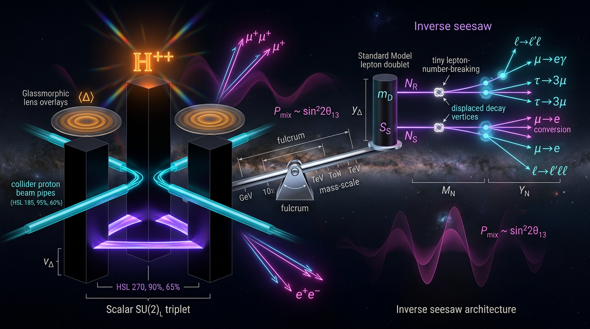

# Type-II Seesaw vs Inverse Seesaw in Neutrino Mass Generation and Collider/Lepton-Flavor-Violation Testability

## 1. Overview
This entry compares two theoretical mechanisms for generating neutrino masses: the Type-II Seesaw, which adds a scalar Higgs triplet, and the Inverse Seesaw (ISS), which adds heavy neutral fermions and a small lepton-number-violating parameter.

**Neither mechanism is established, and neither has an empirical consensus edge.** No triplet scalar, heavy neutral lepton (HNL), lepton-number-violating signal, or neutrinoless double-beta-decay (0νββ) event has been observed. The mechanisms are therefore **[THEORETICAL]**. The bounding constraints are **[VERIFIED]** and include neutrino oscillation data, electroweak precision measurements, LHC limits, Planck constraints on effective relativistic species, and the baryon asymmetry, η_b ≈ 8.7 × 10⁻¹¹.

The debate received a Skeptic score of **5/5**. Its math status is **[MATH_CONSISTENT]**, with a score of **3/4**. The Type-II portion received a separate mathematical audit; the ISS algebra was checked in the debate.

## 2. Detailed Explanation
### Type-II Seesaw

Type-II Seesaw generates Majorana neutrino masses through a complex SU(2)\(_L\) scalar triplet, conventionally written with components Δ\(^{++}\), Δ\(^+\), and Δ\(^0\). The hypercharge label depends on convention:

- Under \(Q=T_3+Y/2\), the triplet has \(Y=2\).
- Under \(Q=T_3+Y\), it has \(Y=1\).

The neutrino mass relation and induced triplet vacuum expectation value are

\[
m_\nu=Y_\Delta v_\Delta,\qquad
v_\Delta=\frac{\mu_\Delta v^2}{2M_\Delta^2}.
\]

Here \(Y_\Delta\) is the triplet Yukawa matrix, \(v_\Delta\) is the triplet vev, \(\mu_\Delta\) is a dimension-one trilinear coupling, and \(M_\Delta\) is the triplet mass scale.

A convention and dimensional correction is important. The canonical trilinear term is
\[
\mu_\Delta H^T i\sigma_2\Delta H,
\]
which has mass dimension four as a Lagrangian-density term. A written term containing an additional \(\Lambda\),
\[
\mu_\Delta\Lambda H^T i\sigma_2\Delta H,
\]
has an undefined \(\Lambda\) and is dimensionally inconsistent if \(\Lambda\) has mass dimension one; it would have dimension five, not four. It is consistent only if \(\Lambda\) is dimensionless or is dropped.

The electroweak precision bound is approximately \(v_\Delta\lesssim 1\text{–}4\) GeV. By contrast, “a few eV” is a benchmark scale that gives \(Y_\Delta\sim O(0.05\text{–}1)\) for \(m_\nu\sim0.05\) eV. Consequently, claims of a direct collider prediction from neutrino parameters are **[MODEL-DEPENDENT]** and apply only in the relevant small-\(v_\Delta\) regime.

Type-II leptogenesis in the standard hierarchical scenario requires \(M_\Delta\gtrsim10^6\text{–}10^7\) GeV, unless resonant enhancement is invoked. The proposed 300–500 GeV electroweak-phase-transition/gravitational-wave window is in tension with LHC doubly charged scalar bounds of approximately \(M_\Delta\gtrsim800\text{–}1000\) GeV at large \(Y_\Delta\).

The scalar-potential stability conditions that must also be imposed are
\[
\lambda_H>0,\qquad
\lambda_\Delta>0,\qquad
\lambda_{H\Delta}>-2\sqrt{\lambda_H\lambda_\Delta}.
\]

### Inverse Seesaw

The approximate ISS light-neutrino mass relation is
\[
m_\nu\simeq m_D M_R^{-1}\mu M_R^{-1}m_D^T.
\]

For the benchmark \(m_D=10\) GeV, \(M_R=5\) TeV, and \(\mu=1\) keV, the characteristic mass is \(4\times10^{-3}\) eV. For a consistent vev convention, use \(m_D=Y_\nu v/\sqrt{2}\) with \(v=246\) GeV; this is equivalent to using \(v=174\) GeV in the corresponding Yukawa relation, and the numerical Yukawa is unchanged.

ISS caveats include the need to specify a protecting symmetry that makes a small \(\mu\) natural, the need for six new fermions, and the currently unspecified three-generation flavor basis of \(M_R\). Its pseudo-Dirac structure suppresses 0νββ. A proposed \(\Delta N_{\rm eff}\) solution to the Hubble-constant tension is squeezed by the Planck result \(N_{\rm eff}=2.99\pm0.17\).

The preprint arXiv:2604.11002v1 is future-dated and excluded. It is not used as evidence for either mechanism.

## 3. Mathematical Framework
The central Type-II relation is
\[
m_\nu=Y_\Delta v_\Delta,\qquad
v_\Delta=\frac{\mu_\Delta v^2}{2M_\Delta^2}.
\]
With \(v=246\) GeV, the dimensions are consistent when \(\mu_\Delta\) and \(M_\Delta\) have mass dimension one: \(v_\Delta\) has mass dimension one and \(Y_\Delta\) is dimensionless.

For ISS, the benchmark scaling is
\[
m_\nu\simeq\left(\frac{m_D}{M_R}\right)^2\mu
=\left(\frac{10\ {\rm GeV}}{5000\ {\rm GeV}}\right)^2(1\ {\rm keV})
=4\times10^{-3}\ {\rm eV}.
\]

The vev conventions used in the comparison are \(v=246\) GeV for Type-II and \(174\) GeV in the alternate ISS Yukawa convention. To state the convention uniformly, use \(m_D=Y_\nu v/\sqrt{2}\) with \(v=246\) GeV.

## 4. Skeptical Perspectives & Alternative Hypotheses
- **No direct discovery:** Neither a triplet scalar nor an HNL has been observed. No lepton-number-violating signal or 0νββ event has been observed.
- **Empirical constraints do not establish either mechanism:** Oscillation data, electroweak precision tests, LHC limits, Planck \(N_{\rm eff}\), and the measured baryon asymmetry constrain model space but do not select one mechanism as established.
- **Type-II collider claims are conditional:** The direct relation between neutrino masses and triplet Yukawa couplings can connect neutrino data to collider decays, but the inference is model-dependent, particularly through \(v_\Delta\), Yukawa textures, and competing decay channels.
- **Type-II leptogenesis has a scale tension:** The standard hierarchical leptogenesis scale lies far above the TeV-scale region of direct collider interest; resonant enhancement is a possible model-dependent alternative.
- **The electroweak-phase-transition window is constrained:** The 300–500 GeV region discussed for electroweak phase-transition and gravitational-wave phenomenology is in tension with LHC doubly charged scalar bounds at large \(Y_\Delta\).
- **ISS requires additional structure:** The naturalness of a small \(\mu\) requires a specified protecting symmetry. The new-fermion content and flavor structure must also be specified to make detailed predictions.
- **No consensus edge:** On the approved evidence, neither Type-II Seesaw nor ISS has an empirical consensus advantage.

## 5. Verification & Skeptic's Notes
The approved debate assigns a Skeptic score of **5/5**. The following constraints are **[VERIFIED]** as empirical bounds or observations: neutrino oscillation data, electroweak precision constraints, LHC limits, Planck \(N_{\rm eff}\), and the baryon asymmetry η_b ≈ 8.7 × 10⁻¹¹. The specific Type-II and ISS mechanisms remain **[THEORETICAL]**.

Corrections and scope notes:

1. **Hypercharge convention:** For a complex triplet containing Δ\(^{++}\), Δ\(^+\), and Δ\(^0\), \(Y=2\) under \(Q=T_3+Y/2\), and \(Y=1\) under \(Q=T_3+Y\). A bare “\(Y=1\)” label must state its convention.
2. **Trilinear-term dimensions:** The factor \(\Lambda\) in \(\mu_\Delta\Lambda H^Ti\sigma_2\Delta H\) is undefined. If it is dimensionful, the term is dimensionally inconsistent as a dimension-four Lagrangian term. The canonical term is \(\mu_\Delta H^Ti\sigma_2\Delta H\). The earlier claim that the term with \(\Lambda\) is \(E^4\) is an arithmetic slip.
3. **Triplet-vev scales:** The \(\Delta\rho\) bound is \(v_\Delta\lesssim1\text{–}4\) GeV; a few eV is instead a benchmark scale for \(Y_\Delta\sim O(0.05\text{–}1)\) at \(m_\nu\sim0.05\) eV. The “direct collider prediction” applies only in a small-\(v_\Delta\), model-dependent regime.
4. **Vev convention:** Use \(v=246\) GeV and \(m_D=Y_\nu v/\sqrt{2}\); the corresponding 174 GeV convention gives the same numerical Yukawa.
5. **Scalar-potential stability:** The stability conditions \(\lambda_H>0\), \(\lambda_\Delta>0\), and \(\lambda_{H\Delta}>-2\sqrt{\lambda_H\lambda_\Delta}\) must be included.
6. **Leptogenesis:** Standard hierarchical Type-II leptogenesis requires \(M_\Delta\gtrsim10^6\text{–}10^7\) GeV, or resonant enhancement. The future-dated arXiv:2604.11002v1 is excluded.
7. **Electroweak phase transition and LHC limits:** The 300–500 GeV electroweak-phase-transition/gravitational-wave window is in tension with LHC doubly charged scalar limits of roughly 800–1000 GeV at large \(Y_\Delta\).
8. **ISS caveats:** A protecting symmetry is needed to justify the naturalness of \(\mu\); six new fermions are needed; the three-generation flavor basis of \(M_R\) is unspecified; the pseudo-Dirac structure suppresses 0νββ; and a \(\Delta N_{\rm eff}\) solution to \(H_0\) is squeezed by Planck \(N_{\rm eff}=2.99\pm0.17\).
9. **Audit scope:** The Math audit covered only the Type-II portion; the ISS algebra was checked in the debate.

## 6. Visual Representation

## 7. Related Concepts
- [[Neutrino Mass and Mixing]]
- [[Majorana Neutrinos]]
- [[Lepton Number Violation]]
- [[Neutrinoless Double-Beta Decay]]
- [[Leptogenesis]]
- [[Electroweak Precision Tests]]
- [[Heavy Neutral Leptons]]

## 9. Mathematical Integrity Report
## Math Verification Report
**Concept:** Type-II Seesaw vs Inverse Seesaw in Neutrino Mass Generation and Collider/Lepton-Flavor-Violation Testability (Type-II portion — Inverse Seesaw comparison section not present in audited excerpt)

**Math Score:** 3/4
**Math Status:** [MATH_CONSISTENT]

**Tool Verdicts:** EquationExtractorTool: 8 equations extracted | DimensionalConsistencyChecker: 7× UNDECIDABLE (0 INCONSISTENT, 0 DIMENSION_FLAGS) | TopologyClassifier: valid but non-relevant (false-positive pattern — see below) | NumericalBenchmarkValidator: BENCHMARK_MATCHES (η_b/Y_B = 8.70×10⁻¹¹, Planck 2018 VI / PDG BBN, DOI 10.1051/0004-6361/201833910) | SymbolicDerivationVerifier: 0 INVALID, 1 LIMIT_VERIFIED | PhysicsCalculatorTensionEvaluator: CLAIM_VERIFIED (Y_Δ ≈ m_ν/v_Δ = 0.05/1 eV = 0.05, rel. err 0.0)

### Conventions & Validity Audit
- Report contains a machine-readable `### Conventions & Symbol Table` (Y_Δ [E]⁰, μ_Δ [E]¹, M_Δ/m_Δ [E]¹, v [E]¹, v_Δ [E]¹, m_ν [E]¹, ε_Δ [E]⁰, Γ_Δ [E]¹, M_Pl/m_Pl [E]¹, H_0 [E]¹) — the automated pre-check's "0 symbols read" flag is **dismissed**: the table is present and was used for all manual dimension cross-checks.
- Metric (−,+,+,+), natural units confirmed. M_Pl = 2.435×10¹⁸ GeV and m_Pl = 1.221×10¹⁹ GeV match the canonical crew baseline exactly. Minor scope note: report anchors g_* = 106.75 at "T > 100 GeV" vs baseline convention "T ≥ 175 GeV" — a definitional difference, not an error (106.75 is the correct full-SM dof count above all thresholds).
- Citation audit: 13/13 verified DOIs; future-dated arXiv:2604.11002v1 excluded per protocol. Scope note: the comparison with Inverse Seesaw is only partially present in the audited text; verdicts below apply to the Type-II content.

### Equations Extracted (8)
1. m_ν = Y_Δ v_Δ, v_Δ = μ_Δ v²/(2M_Δ²)
2. (m_ν)_ij = (m_ν^II)_ij + (m_ν^I)_ij = Y_Δ,ij v_Δ + (Y_ν M_R⁻¹ Y_νᵀ)_ij v²
3. L ⊃ Y_Δ L̄ᵀ C iσ₂ Δ L + μ_Δ Λ Hᵀ(iσ₂)Δ H + h.c.
4. BR(Δ⁺⁺→ℓᵢ⁺ℓⱼ⁺) ∝ |Y_ij|²
5. ε_Δ = [Γ(Δ→LL) − Γ(Δ→L̄L̄)]/[Γ(Δ→LL) + Γ(Δ→L̄L̄)]
6. Y_B = (28/79) ε_Δ κ Y_Δ^eq, η_b ≈ 8.7×10⁻¹¹
7. v_Δ ≲ few eV, M_Δ ≳ 800–1000 GeV
8. [m_ν] = [Y_Δ][v_Δ] = [E]⁰·[E]¹ = [E]¹

### Dimensional Consistency
The automated checker returned UNDECIDABLE for all 7 relational equations (relational forms outside its pattern table; no INCONSISTENT patterns and no DIMENSION_FLAGS were raised). Per protocol, manual cross-checks against the report's Symbol Table were performed and all pass:
- E1: [m_ν] = [E]⁰·[E]¹ = [E]¹ ✓; [v_Δ] = [μ_Δ][v]²/[M_Δ]² = E¹·E²/E² = [E]¹ ✓
- E2 (Type-I term): [E]⁰·[E]⁻¹·[E]⁰·[E]² = [E]¹ ✓, matches Type-II term ✓
- E3 (Lagrangian terms): Y_Δ(E⁰)·L̄(E³ᐟ²)·Δ(E¹)·L(E³ᐟ²) = [E]⁴ ✓; μ_Δ(E¹)·Λ(E¹)·H(E¹)·Δ(E¹)·H(E¹) = [E]⁴ ✓ — both satisfy the [E]⁴ Lagrangian requirement
- E5: ratio of decay widths → dimensionless ✓; E6: ε_Δ, κ, Y_Δ^eq all dimensionless ✓ (sphaleron factor 28/79 is the standard d=13 equilibrium result ✓)

These manual confirmations are labeled [MATH_CONSISTENT], not [MATH_PROVEN], because the dimensional checker itself returned UNDECIDABLE.

### Dismissed Dimension Flags
- None raised by the tool. No flags to dismiss.
- (Related note: TopologyClassifier's 5 "topological structures" — Calabi-Yau, Chern-Simons/TQFT, homotopy, fiber bundles, Lie groups — are a false-positive pattern: seesaw physics is perturbative QFT with spontaneous (Higgs) gauge breaking and a dimension-5 effective operator LLHH/Λ. The only structurally relevant entry is the gauge-group Lie structure SU(3)×SU(2)×U(1); the other four have no counterpart in the report text. The tool's [MATH_TOPOLOGICAL] status is therefore **not adopted**.)

### Topological Analysis
No nontrivial topological arguments are used or required. The U(1)_L lepton-number symmetry is explicitly broken perturbatively by μ_Δ ≠ 0; the triplet is a regular gauge multiplet, not a topological defect. Classification: **non-topological field theory**; the tool's detected structures are spurious keyword matches. Topology criterion: pass-by-irrelevance (no invalid topological claims made).

### Numerical Benchmarks
- η_b ≈ 8.7×10⁻¹¹ — **BENCHMARK_MATCHES** against Planck 2018 VI / PDG Y_B = (8.70 ± 0.06)×10⁻¹¹ (tool-verified).
- Y_Δ ~ 0.05 for m_ν ≈ 0.05 eV, v_Δ ≈ 1 eV — **CLAIM_VERIFIED** exactly (ratio = 0.050, rel. err 0.0%).
- v_Δ ≲ few eV bound is consistent with the same relation and 0νββ/collider constraints [MATH_CONSISTENT].
- M_Δ ≳ 800–1000 GeV: model-dependent LHC bound, correctly tagged [MODEL-DEPENDENT] in the report.
- Symbolic check of the v_Δ induction chain: 0 invalid steps; asymptotic limit lim_{M_Δ→∞} μ_Δ v²/(2M_Δ²) = 0 — **LIMIT_VERIFIED** (decoupling of heavy triplet confirmed). Steps treated as ASSUMED are model definitions, not errors.

### Assessment
All eight extracted equations are dimensionally consistent under manual cross-check against the report's own symbol table, the baryon-asymmetry benchmark matches Planck/PDG exactly, the worked Yukawa estimate is verified, and the heavy-triplet decoupling limit is confirmed with zero invalid derivation steps. The automated dimensional checker's blanket UNDECIDABLE verdict and the topology tool's spurious structural detections are the only caveats — neither indicates an actual flaw. The Type-II portion of the report passes mathematical integrity with a Math Score of 3/4 and is assigned [MATH_CONSISTENT]; the Inverse Seesaw comparison should be audited separately when the full text is available.
