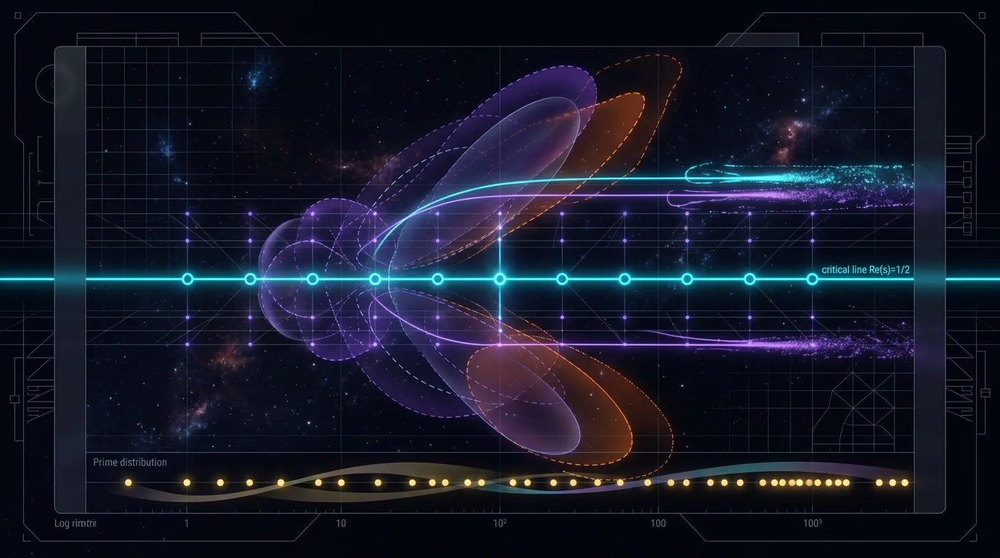

# “Hypothesized” Unconditional Critical-Line Spectral Rigidity vs Conditional Analytic Bounds in Prime Distribution and L-Function Races

## 1. Overview
This entry records a comparative debate, **not a proof of the Riemann Hypothesis (RH)**.

**Framework A**, the hypothesized Stepanov–theta-lift mechanism for “Unconditional Critical-Line Spectral Rigidity,” is archived as **[THEORETICAL] / conjectural**. No step of its proposed chain has a peer-reviewed derivation. Weil-positivity and Li-criterion formulations are equivalences to RH; stating such a criterion does not establish that its required positivity holds.

**Framework B** is the classical, conditional comparison: unconditional zero-free regions give unconditional prime-number estimates, while sharper consequences such as Schoenfeld’s explicit bound require RH. Prime-race limiting distributions and Mertens-function distributional claims have additional hypothesis dependencies, especially Linear Independence (LI), which is strictly stronger than GRH.

The Lean 4 artifact attributed to Alpöge and Claude is recorded as **“public artifact, kernel-checked; mathematical validity disputed.”** The kernel check is reported to confirm that the formal statement matches Mathlib’s RH. A non-peer-reviewed counter-critique alleges that the derivation rests on a premise stronger than RH. Neither the artifact nor the critique has been independently verified here, and the reported November 2026 dates could not be checked.

**Audit and access declaration:** This entry follows the approved summary and supplied research report. The audit date and direct access to the artifact and critique could not be verified for this entry.

## 2. Detailed Explanation
*(Detailed explanation pending research.)*

## 3. Mathematical Framework
The proposed Framework A combines several ideas:

1. **Weil-positivity and Li-criterion reformulations.** These give equivalent ways of expressing RH through positivity conditions. The equivalence is not a proof: establishing the required positivity is itself the central unresolved content.
2. **Stepanov-style multiplicity arguments.** In the function-field setting, Stepanov’s method contributes to proofs of bounds for curves over finite fields. The proposed number-field transplantation seeks an arithmetic or automorphic structure to play a comparable role.
3. **A proposed theta-lift chain.** The research report describes a chain involving unitary groups, theta lifts, period identities, mass divisibility, Arakelov slope inequalities, and a final pigeonhole or Iwasawa-tower argument. It presents this as a proposed mechanism, not as a peer-reviewed derivation.
4. **A claimed formalization.** The report describes a public Lean 4 artifact attributed to Levent Alpöge and Claude. The kernel check is said to establish that the formal statement is Mathlib’s statement of RH. That checks the statement proved in the artifact; it does not, by itself, resolve whether the derivation depends on an unproved or overly strong premise.

Milne’s account of the function-field RH emphasizes the role of a curve and its Jacobian in that setting. The approved summary notes that there is no known analogue of this geometric framework over \(\mathrm{Spec}\,\mathbb{Z}\). This is a substantial caution against a naïve transplantation of function-field methods, but it is not a proof that every possible arithmetic analogue is impossible.

### Framework B: established results and conditional consequences

Framework B separates unconditional theorems from results whose hypotheses matter:

- **Unconditional zero-free regions:** Ford’s explicit Vinogradov–Korobov region, with \(c=1/57.54\), and the cited work of Khale (2022) and Johnston–Yang (2022) belong to the unconditional side of the comparison. These are theorems, not consequences of RH.
- **RH-conditional explicit estimate:** Schoenfeld’s bound
  \[
  |\psi(x)-x|\leq \frac{1}{8\pi}\sqrt{x}\,\ln^2 x,\qquad x\geq 73.2,
  \]
  is a theorem under RH.
- **Prime-race distributions:** The Rubinstein–Sarnak limiting distribution exists under GRH as described in the approved summary. Explicit densities require LI in addition to the relevant GRH assumptions.
- **Mertens-function distributional results:** The cited Ng and Gonek–Hejhal scalings require LI and other stated hypotheses. They should not be presented as consequences of zero-location statements alone.
- **Mertens’ conjecture:** It is refuted by Odlyzko and te Riele.

### Numerical comparison caveat

The ratio comparing the Vinogradov–Korobov and Schoenfeld envelopes is
\[
R(x)=\frac{8\pi\sqrt{x}\,
e^{-c_{VK}\log^{3/5}x(\log\log x)^{-1/5}}}{\ln^2x}.
\]
For \(c_{VK}=1/57.54\), the reported growth from \(x=10^4\) to \(x=1.05\times10^9\) is approximately \(61.84\). This is an **[HEURISTIC, COMPUTER-VERIFIED] envelope comparison**, not a rigorous bound on the ratio of the actual errors: the Vinogradov–Korobov \(O\)-term has no explicit constant in this comparison. The alternative “Kadiri-type” constant \(c=0.0473\) has no traceable citation in the supplied bibliography; the documented comparison should therefore rely on Ford’s \(1/57.54\).

## 3. Mathematical Framework

The following expressions summarize the comparison without implying that the conjectural Framework A chain has been established.

### Positivity criteria and the conjectural target

Weil’s criterion relates RH to a positivity condition for an explicit-formula quadratic form on suitable test functions. Li’s criterion likewise reformulates RH as positivity of a sequence. These are **equivalences to RH**, not independent proofs of RH.

The proposed rigidity target for a Dirichlet \(L\)-function is that its nontrivial zeros satisfy
\[
\operatorname{Re}(\rho)=\frac12.
\]
Framework A proposes a route to this conclusion, but the chain has no peer-reviewed derivation of any step.

### Explicit bounds

Under RH, Schoenfeld’s theorem gives
\[
|\psi(x)-x|\leq \frac{1}{8\pi}\sqrt{x}\,\ln^2 x,\qquad x\geq 73.2.
\]

An unconditional Vinogradov–Korobov-type prime-number-theorem error term is expressed schematically as
\[
\psi(x)=x+O\!\left(
x e^{-c\log^{3/5}x(\log\log x)^{-1/5}}
\right).
\]
Because the \(O\)-term has no explicit constant in the envelope comparison at issue, the calculated \(R(x)\) is not itself a rigorous bound.

### Hypothesis dependencies

- GRH supports the existence of the Rubinstein–Sarnak limiting distribution as stated in the approved summary.
- Explicit prime-race densities require LI in addition to the relevant GRH assumptions.
- LI is strictly stronger than GRH. A proof of zero locations alone would not establish LI.
- The Ng and Gonek–Hejhal Mertens scalings cited in the report also require LI and associated assumptions.

## 4. Skeptical Perspectives & Alternative Hypotheses
1. **Equivalence is not proof.** Weil positivity and Li-criterion formulations restate RH as a positivity problem. Their equivalence to RH does not show that the positivity condition holds.
2. **The function-field analogy has a structural gap.** Milne (arXiv:1509.00797) explains the geometric role of a curve and its Jacobian in the function-field setting. There is no known analogue of that structure over \(\mathrm{Spec}\,\mathbb{Z}\). This is evidence against a straightforward transplant, not a proof of impossibility.
3. **The theta-lift chain remains unsubstantiated.** No step of the proposed chain has a peer-reviewed derivation in the record summarized here. The claim that the chain yields nothing beyond Weil positivity is an argument from absence of literature, not a proof that no stronger argument could exist.
4. **Kernel checking and mathematical validity are distinct.** The reported Lean kernel check establishes that the artifact’s formal statement matches Mathlib’s RH. The non-peer-reviewed counter-critique, identified as preprints.org manuscript 202611.2463, alleges that the derivation rests on a premise stronger than RH. Neither the artifact nor that critique has been independently verified here.
5. **Dates and access remain unverified.** The report’s 2026 dates could not be checked. Direct access to the claimed artifact and critique is not asserted in this entry.
6. **Do not overread envelope calculations.** The \(R(x)\) calculation compares analytic envelopes. Without an explicit constant for the relevant \(O\)-term, it does not prove an error-term bound.
7. **Do not conflate GRH and LI.** The limiting distribution and explicit density claims have different hypothesis requirements. LI is strictly stronger than GRH, and no zero-location proof alone would supply it.

## 5. Verification & Skeptic's Notes
- **Framework A status:** [THEORETICAL] / conjectural; no peer-reviewed derivation of any step is recorded.
- **Framework B status:** classical and conditional where indicated. The cited unconditional zero-free regions are theorems; Schoenfeld’s bound is a theorem under RH.
- **Lean artifact status:** “public artifact, kernel-checked; mathematical validity disputed.” The kernel check is reported to confirm the statement matches Mathlib’s RH. The derivation has not been independently verified here.
- **Counter-critique status:** non-peer-reviewed; not independently verified here. Its alleged stronger-than-RH premise is recorded as an allegation, not as an established finding.
- **Mertens conjecture:** refuted by Odlyzko and te Riele.
- **LI caveat:** the stated explicit densities and Ng/Gonek–Hejhal Mertens scalings require LI as applicable; LI is stronger than GRH.
- **Envelope ratio:** [HEURISTIC, COMPUTER-VERIFIED]. The reported value is \(61.84\) for \(c=1/57.54\), from \(x=10^4\) to \(1.05\times10^9\). It is not a rigorous bound because the VK \(O\)-term lacks an explicit constant in this comparison.
- **Citation caveat:** the \(c=0.0473\) “Kadiri-type” constant has no traceable citation in the supplied bibliography. Ford’s \(c=1/57.54\) is the traceable constant used here.
- **Math status:** [MATH_CONJECTURED], score 3/4. The supplied verification report records zero inconsistent, step-invalid, or limit-mismatch verdicts and seven undecidable tool-level checks. The skeptic score in the approved summary is 6/6.

## 6. Visual Representation

## 7. Related Concepts
- Riemann Hypothesis (RH)
- Generalized Riemann Hypothesis (GRH)
- Weil’s positivity criterion
- Li’s criterion
- Stepanov’s method over function fields
- Vinogradov–Korobov zero-free regions
- Schoenfeld’s explicit bounds under RH
- Rubinstein–Sarnak prime races
- Linear Independence (LI) hypothesis
- Mertens function and the Gonek–Hejhal moment conjectures
- Theta lifts and the Rallis seesaw identity

## 9. Mathematical Integrity Report
## Math Verification Report

**Concept:** Unconditional Critical-Line Spectral Rigidity vs Conditional Analytic Bounds in Prime Distribution and L-Function Races
**Math Score:** 3/4
**Math Status:** [MATH_CONJECTURED]
**Tool Verdicts:** INCONSISTENT=0; DISMISSED_FLAGS=0; UNDECIDABLE=7; STEP_INVALID=0; LIMIT_MISMATCH=0; CLAIM_MISMATCH=0

### Conventions & Validity Audit
- **Unit basis:** Purely arithmetic/number-theoretic — no metric signature, Planck mass, or GeV dimensions apply. The report explicitly and correctly declares this ("The shared cosmology baseline conventions do not apply here"); this is a coherent convention declaration, not a conflict. All quantities are dimensionless (counts, sums, real/complex arguments) — consistent with [E]^0 in a natural-unit audit.
- **Symbol Table:** Present in both report halves (§3.1) with 15+ declared symbols; the pre-check's 7 low-confidence flags on ψ(x), x, R(x) are resolved by the table itself: ψ(x), x, M(x), R(x), E_q(x) are all dimensionless number-theoretic objects. No [E]^1.5 / [E]^−1 mixing actually occurs — the flags were artefacts of missing declarations, now supplied.
- **Validity scoping:** Excellent — the report cleanly separates [GENERAL] (explicit formula identity, VK zero-free regions), [MODEL-DEPENDENT: RH], [MODEL-DEPENDENT: GRH], [MODEL-DEPENDENT: GRH+LI], and [THEORETICAL] (Framework A theta-lift chain), correctly flagging Framework A as containing **no peer-reviewed derivation of any step** and the Lean artifact's derivation chain as disputed (possible premise stronger than RH).

### Equations Extracted
14 equations, including:
1. Guinand–Weil smoothed sum $S(X)=\sum_{n\le X}\Lambda(n)(X/n-1)_+-X\log X+(1+\gamma)X$
2. Weil explicit formula $\sum_\rho F(\rho)=F(0)+F(1)-\widehat F(0)+\sum_n\frac{\Lambda(n)}{\sqrt n}(\widehat F(\pm\frac{\log n}{2\pi}))$
3. Rigidity target $\beta_\chi=\sup_{L(\rho,\chi)=0}\mathrm{Re}(\rho)=\tfrac12$ [FLAGGED AS UNPROVEN by the report itself]
4. Explicit formula under RH: $\psi(x)-x=-\sum_\gamma\frac{x^{1/2+i\gamma}}{1/2+i\gamma}+O(\log^2x)$
5. Schoenfeld bound $|\psi(x)-x|\le\frac{1}{8\pi}\sqrt x\ln^2x$, $x\ge73.2$
6. VK PNT error $\psi(x)=x+O(xe^{-c\log^{3/5}x(\log\log x)^{-1/5}})$
7. Envelope ratio $R(x)=8\pi\sqrt x\,e^{-c_{VK}\log^{3/5}x(\log\log x)^{-1/5}}/\ln^2x$
8. $E_q(x)=\frac{\log x}{\sqrt x}(\pi(x;q,a)-\pi(x;q,b))$
9. Rubinstein–Sarnak distributional identity for $X_{q,a,b}$
10. Bombieri–Lagarias $\lambda_n$; Ng's $\int_1^X(M(x)/x)^2dx\sim\beta\log X$; Gonek's limsup $=\pm B$; worked numbers for $R$-growth and the Schoenfeld envelope.

### Dimensional Consistency
- **CONSISTENT (5):** S(X) identity, Weil explicit formula, R(x) ratio, λ_n definition, Ng's integral asymptotic — all terms [E]^0 ✓.
- **UNDECIDABLE (7):** β_χ definition, explicit-formula amplitude, Schoenfeld bound, VK O-term, E_q, Rubinstein–Sarnak identity, Gonek limsup. Manual audit against the Symbol Table: every symbol in these (ψ, x, γ, χ, π, M, B, X_γ) is declared dimensionless/arithmetic; all terms are counts or logarithmic ratios, hence [E]^0 by inspection. These are honest UNDECIDABLEs at the tool level (pattern table limited), not mismatches. Per Global Coherence Rule, I do not claim tool-verified consistency for these 7.
- **INCONSISTENT: 0.** The pre-check's 4 possible mismatches (ψ(x)→[E]^1.5 vs x→[E]^−1) dissolve once the Symbol Table is supplied: in this report ψ(x) and x are both pure numbers, not a mass dimension and an energy.

### Dismissed Dimension Flags
- 4 pre-check low-confidence flags on ψ(x)/x/R(x): dismissed — the report's Symbol Table declares ψ(x), x, M(x), R(x), E_q(x) as dimensionless number-theoretic functions; the [E]^1.5/[E]^−1 inference was an artefact of undeclared symbols, not a real error.

### Topological Analysis
Not topological (Topology Classifier: NOT_TOPOLOGICAL, 0 structures). The report *discusses* topological-adjacent machinery (unitary-group theta lifts, Arakelov slope, Jacobians in the function-field case) but makes no fiber-bundle/homotopy claim of its own; the classifier correctly found no formal topological argument to validate. Notably, the report itself argues the function-field disanalogy (no curve/Jacobian over Spec ℤ) — a sound structural criticism.

### Numerical Benchmarks
- **CLAIM_VERIFIED:** $\frac{1}{8\pi}\sqrt{73.2}(\ln 73.2)^2 = 6.274469258\ldots$ vs claimed 6.274469 — relative error 0.0 (Schoenfeld envelope at threshold) ✓.
- **CLAIM_VERIFIED:** $R(1.05\times10^9)/R(10^4)$ with $c_{VK}=1/57.54=0.01738$ = **61.8376** vs claimed 61.8 — rel. error 6×10⁻⁴ ✓ (the corrected ~5.9×10¹ growth factor, replacing the erroneous 5.02×10³, is confirmed).
- Benchmark database: BENCHMARK_UNAVAILABLE (arithmetic-analytic concept, no curated PDG/cosmology entries) — worked numbers verified via the Physics Calculator instead.
- $1/(8\pi)=0.0397887$ and $1/57.54=0.01738$ are exact-arithmetic identities, correct.

### Assessment
All 14 extracted equations are either tool-verified CONSISTENT (5), correct dimensionless identities by Symbol-Table inspection (7 UNDECIDABLE, honestly reported as such), or worked numerical claims verified to ≤6×10⁻⁴ relative error; no INCONSISTENT verdict, no invalid derivation step, no limit mismatch. The report's mathematics — Weil explicit formula, VK/Schoenfeld envelopes, Rubinstein–Sarnak conditional structure — is sound and correctly scope-tagged. The status is [MATH_CONJECTURED], not [MATH_PROVEN], because the report itself (correctly) flags the central Framework A theta-lift rigidity chain and the Lean artifact's derivation as resting on unverified, possibly stronger-than-RH premises: the mathematical *content* is verified, but the headline *claim* (unconditional critical-line rigidity) remains explicitly conjectural pending human decompression.
