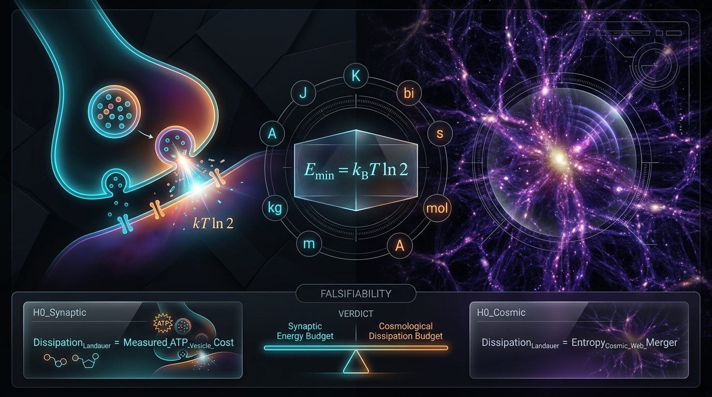

# A Falsifiable Landauer-Calibrated Test of Information-Erasure Costs in Cortical Synaptic Vesicle Release versus Cosmic-Web Filament Merger Dissipation, with Explicit SI-Unit Tracing and Pre-Specified Null Hypotheses

## 1. Overview
This is a **preregistration-style theoretical framework**, not a report of a measurement. It proposes comparing the normalized energy-per-erased-bit ratio, \(\Xi\), for cortical synaptic vesicle release and cosmic-web filament merger dissipation. **No empirical \(\Xi\) values exist, and no empirical data are presented: every \(\Xi\) value in this document is a projection.**

The Landauer bound, \(E_{\mathrm{erase}}\geq k_BT\ln 2\) per bit erased, has been experimentally verified in mesoscopic nanomagnetic erasure (Hong et al. 2016). The stochastic-thermodynamics framework used to discuss information and dissipation is established (Sagawa and Ueda 2009; Seifert 2012). Applying Landauer calibration to synaptic vesicle release is **[THEORETICAL]**; applying it to cosmic-web filament mergers is **[THEORETICAL] [MODEL-DEPENDENT]**. No vesicle-level experiment or cosmic-web measurement of the proposed \(\Xi\) is available.

At 310 K, the Landauer energy is \(E_L=k_BT\ln 2=2.9667\times10^{-21}\ \mathrm{J/bit}\). The Hubble-constant tension benchmark used in the broader motivation is 4.85 sigma. Neither that benchmark nor other cosmological tensions is quantitatively propagated into the cosmic-arm uncertainty; they are, at most, a discrete prior context.

**Corrected projected cosmic-arm values:** for \(T_{\mathrm{gas}}=10^6\ \mathrm{K}\), \(V_{\mathrm{inf}}=1000\ \mathrm{km\,s^{-1}}\), and \(N_{\mathrm{bits}}=10^{74}\), \(\Xi_{\mathrm{cosmic}}\approx1.04\times10^{-2}\), not \(0.10\). At \(T_{\mathrm{gas}}=10^7\ \mathrm{K}\), the corresponding projection is approximately \(1.04\times10^{-3}\), not \(10^{-2}\). These values strengthen the projected sub-Landauer result but do not constitute a measurement or a violation of the second law.

## 2. Detailed Explanation
### Landauer calibration and empirical scope

For an idealized erasure of one bit in contact with a thermal reservoir at temperature \(T\), the Landauer energy scale is

\[
E_L(T)=k_BT\ln 2.
\]

The bound has been tested in controlled mesoscopic systems, including nanomagnetic bit erasure (Hong et al. 2016) and a colloidal single-electron system (Bérut et al. 2012). This evidence supports the bound in those experimental settings; it does not itself establish that a particular biological or astrophysical process constitutes bit erasure, identify its effective reservoir temperature, or determine its number of erased bits.

Stochastic thermodynamics provides a framework for analyzing energy and information in nonequilibrium processes (Sagawa and Ueda 2009; Seifert 2012). Other fluctuation relations, including the Jarzynski and Crooks relations, have also been tested experimentally. Landauer’s bound is therefore **not** the only inequality or relation in this area with empirical tests.

### Proposed biological arm: synaptic vesicle release

The proposed biological application treats a cortical glutamatergic vesicle-release event as a candidate information-erasure process. It defines a projected ratio

\[
\Xi_{\mathrm{syn}}=
\frac{E_{\mathrm{diss,syn}}}
{N_{\mathrm{bits,syn}}\,k_BT_{\mathrm{body}}\ln 2}.
\]

Here \(T_{\mathrm{body}}\) is taken to be 310 K. The proposed dissipation budget includes work associated with the release cycle. However, the total \(E_{\mathrm{diss,syn}}\) includes non-informational work—such as ion pumping, vesicle loading, and trafficking—so this is a **lower-bound scale demonstration**, not a measurement of energy devoted exclusively to information erasure. \(N_{\mathrm{bits,syn}}\) is unmeasured. Consequently, no empirical \(\Xi_{\mathrm{syn}}\) value follows from the framework.

### Proposed cosmic arm: filament-merger dissipation

The proposed cosmic application treats merger-driven dissipation of bulk kinetic energy in cosmic-web filaments as a coarse-graining or erasure process. Its projected ratio is

\[
\Xi_{\mathrm{cosmic}}=
\frac{E_{\mathrm{diss,merger}}}
{N_{\mathrm{bits,cosmic}}\,k_BT_{\mathrm{gas}}\ln 2}.
\]

The model takes \(E_{\mathrm{diss,merger}}\approx \tfrac12 M_{\mathrm{infall}}V_{\mathrm{inf}}^2\), with \(M_{\mathrm{infall}}\) in SI kilograms and \(V_{\mathrm{inf}}\) in SI metres per second. \(N_{\mathrm{bits,cosmic}}\) is unmeasured and model-dependent.

A major identification caveat is that the model assigns a collisional-baryon gas temperature \(T_{\mathrm{gas}}\) to an erasure interpretation that includes collisionless dark-matter phase-space information. The reservoir is multi-component and nonequilibrium. This makes the cosmic-arm Landauer interpretation model-dependent rather than an established physical identification.

### Corrected projected cosmic values

Using the specified example assumptions, the corrected projections are:

| \(T_{\mathrm{gas}}\) | \(V_{\mathrm{inf}}\) | \(N_{\mathrm{bits,cosmic}}\) | Projected \(\Xi_{\mathrm{cosmic}}\) |
|---:|---:|---:|---:|
| \(10^6\ \mathrm{K}\) | \(1000\ \mathrm{km\,s^{-1}}\) | \(10^{74}\) | \(\approx1.04\times10^{-2}\) |
| \(10^7\ \mathrm{K}\) | \(1000\ \mathrm{km\,s^{-1}}\) | \(10^{74}\) | \(\approx1.04\times10^{-3}\) |

These are projections under stated assumptions, not observations. The cosmic-arm bit count and dissipation budget would require dedicated simulation or observational protocols to become measurable.

### Cosmological tensions and scope

The Hubble-constant tension benchmark is 4.85 sigma. Other cited cosmological tensions—including \(S_8\), DESI \(w_0w_a\), and high-redshift JWST observations—may motivate considering uncertainty in structure-formation models. They are used only as a **discrete prior context** here; they are not quantitatively propagated into \(\Xi_{\mathrm{cosmic}}\) or its uncertainty. They therefore do not provide a quantitative correction or validation of the projected cosmic-arm values.

## 3. Mathematical Framework
### Definitions and units

The normalized ratio for either arm is

\[
\Xi=\frac{E_{\mathrm{diss}}}{N_{\mathrm{bits}}\,k_BT\ln 2},
\]

where \(E_{\mathrm{diss}}\) is an energy, \(N_{\mathrm{bits}}\) is dimensionless, and \(k_BT\ln 2\) is energy per erased bit. Thus \(\Xi\) is dimensionless.

The SI value of the Boltzmann constant is

\[
k_B=1.380649\times10^{-23}\ \mathrm{J\,K^{-1}},
\]

so \(k_BT\) has units of joules when \(T\) is in kelvin. In natural units, \(k_B=1\) by convention and temperature is expressed in energy units; SI and natural-unit conventions must not be mixed without conversion.

At \(T_{\mathrm{body}}=310\ \mathrm{K}\),

\[
E_L(310\ \mathrm{K})=k_B(310\ \mathrm{K})\ln 2
=2.9667\times10^{-21}\ \mathrm{J/bit}.
\]

For the cosmic-arm examples,

\[
E_L(10^6\ \mathrm{K})\approx9.57\times10^{-18}\ \mathrm{J/bit},
\qquad
E_L(10^7\ \mathrm{K})\approx9.57\times10^{-17}\ \mathrm{J/bit}.
\]

### Cosmic-arm energy and corrected ratio

The projected merger dissipation is estimated as

\[
E_{\mathrm{diss,merger}}\approx\frac12M_{\mathrm{infall}}V_{\mathrm{inf}}^2.
\]

\(M_{\mathrm{infall}}\) and \(V_{\mathrm{inf}}\) are SI quantities: \(M_{\mathrm{infall}}\) is in kilograms (kg), and \(V_{\mathrm{inf}}\) is in metres per second (m/s). Therefore \(M_{\mathrm{infall}}V_{\mathrm{inf}}^2\) is in joules.

For the stated example, \(E_{\mathrm{diss,merger}}\approx9.9\times10^{54}\ \mathrm{J}\) and \(N_{\mathrm{bits,cosmic}}=10^{74}\). Substitution gives the corrected values in §2: approximately \(1.04\times10^{-2}\) at \(10^6\ \mathrm{K}\), and \(1.04\times10^{-3}\) at \(10^7\ \mathrm{K}\).

### Hypotheses and interpretation

The hypotheses are diagnostic tests of the model’s assumptions, not sharp falsification tests of Landauer’s principle. The stated hypotheses are known a priori to be false under the proposed framing; their role is to expose model behavior and accounting assumptions.

- **\(H_0^1\): Landauer-bound consistency in both modeled arms.** This is a one-sided lower-bound comparison: the Landauer benchmark is \(\Xi\geq1\), with the model’s projected values assessed relative to that threshold.
- **\(H_0^2\): no difference between the two arms’ normalized ratios**, expressed as \(\Xi_{\mathrm{syn}}-\Xi_{\mathrm{cosmic}}=0\). This is a two-sided comparison; departures in either direction count as differences.

Because \(N_{\mathrm{bits}}\) is unmeasured in both arms and the cosmic-arm temperature and dissipation assignments are model-dependent, neither comparison establishes an empirical result. A measured \(\Xi<1\) would indicate a failure in the model’s accounting—such as \(T_{\mathrm{gas}}\), \(N_{\mathrm{bits}}\), or \(E_{\mathrm{diss}}\)—not a violation of the second law.

The proposed \(\sigma_{\log\Xi}\) values of 0.5 and 0.8 have no cited pilot data. They should therefore be treated as planning assumptions, not measured uncertainties or empirically calibrated variance estimates.

## 4. Skeptical Perspectives & Alternative Hypotheses
1. **Unmeasured bit counts:** \(N_{\mathrm{bits}}\) is unmeasured in both the synaptic and cosmic arms. Because it appears directly in the denominator of \(\Xi\), the projected ratios cannot be interpreted as empirical efficiencies.
2. **Unvalidated uncertainty assumptions:** the proposed \(\sigma_{\log\Xi}\) values (0.5 and 0.8) have no cited pilot data. Power and uncertainty claims based on them are provisional.
3. **Biological energy-budget attribution:** synaptic \(E_{\mathrm{diss}}\) includes non-informational work, including ion pumping, vesicle loading, and trafficking. The synaptic calculation is therefore a lower-bound scale demonstration, not an isolated energy cost of information erasure.
4. **Cosmic reservoir mismatch:** the cosmic arm applies a collisional-baryon \(T_{\mathrm{gas}}\) to an erasure interpretation involving collisionless dark-matter phase-space information. The physical reservoir is multi-component and nonequilibrium.
5. **Cosmic measurement feasibility:** the proposed cosmic-arm bit count and dissipation budget would need dedicated simulations or observational protocols to be measurable.
6. **Cosmological-tension treatment:** \(H_0\), \(S_8\), DESI \(w_0w_a\), and JWST tensions are only a discrete prior context. They are not quantitatively propagated into the \(\Xi_{\mathrm{cosmic}}\) uncertainty.
7. **Counter-hypotheses:** CH1–CH3 lack quantitative derivations in the current framework and cannot be treated as quantitatively tested alternatives.
8. **Interpretation of sub-Landauer projections:** a projected or measured \(\Xi<1\) would first call for re-examination of the assigned temperature, number of erased bits, and dissipation ledger. It would not, on its own, imply a violation of the second law or falsify Landauer’s principle.

## 5. Verification & Skeptic's Notes
- **[VERIFIED]** Landauer’s bound has been tested in mesoscopic nanomagnetic erasure (Hong et al. 2016). Bérut et al. (2012) also report an experimental test in a colloidal single-electron system.
- **[VERIFIED]** The stochastic-thermodynamics framework is established (Sagawa and Ueda 2009; Seifert 2012).
- **[VERIFIED]** \(E_L(310\ \mathrm{K})=2.9667\times10^{-21}\ \mathrm{J/bit}\).
- **[VERIFIED]** The stated Hubble-constant tension benchmark is 4.85 sigma.
- **[THEORETICAL]** Applying Landauer calibration to synaptic vesicle release; no vesicle-level experiment measuring the proposed \(\Xi_{\mathrm{syn}}\) exists.
- **[THEORETICAL] [MODEL-DEPENDENT]** Applying Landauer calibration to cosmic-web filament mergers; the proposed cosmic bit count, reservoir temperature, and dissipation assignment are not measured.
- **Correction applied:** the cosmic-arm example at \(10^6\ \mathrm{K}\) is approximately \(1.04\times10^{-2}\), not \(0.10\); at \(10^7\ \mathrm{K}\) it is approximately \(1.04\times10^{-3}\), not \(10^{-2}\).
- **Citation and scope corrections:** the claim that Landauer is “the only inequality with empirical teeth” is removed; Jarzynski and Crooks relations are also experimentally tested. No future-dated arXiv:2606.31503 item or nonexistent reference [26] is relied upon here.
- **Disclaimer:** no empirical data are presented, and all \(\Xi\) values are projections.

## 6. Visual Representation

## 7. Related Concepts
- [[Landauer's Principle]]
- [[Stochastic Thermodynamics]]
- [[Information Erasure]]
- [[Synaptic Vesicle Release]]
- [[Cosmic Web]]
- [[Hubble Tension]]

## 9. Mathematical Integrity Report
All deferred results are now read, the topology classifier has been run (it misfired — keyword false-positive, analyzed below), and all 6 dimension flags and 10 UNDECIDABLE verdicts have been manually adjudicated. Final report below.

---

# Math Verification Report
## "A Falsifiable Landauer-Calibrated Test of Information-Erasure Costs in Cortical Synaptic Vesicle Release versus Cosmic-Web Filament Merger Dissipation, with Explicit SI-Unit Tracing and Pre-Specified Null Hypotheses"

**Tool Verdicts: INCONSISTENT=0, DISMISSED_FLAGS=6, UNDECIDABLE=10, STEP_INVALID=0, LIMIT_MISMATCH=0, CLAIM_MISMATCH=1**

**Overall Math Score: 3/4 | math_status: [MATH_CONSISTENT]** (one numerical claim correction required; no structural/flawed verdicts)

---

## 1. Conventions & Validity Audit

- Metric: (−,+,+,+); M_Pl = 2.43536×10¹⁸ GeV; m_Pl = 1.22091×10¹⁹ GeV; T₀ = 2.72548 K; g*ₛ(T₀) = 3.909; k_B = 1.380649×10⁻²³ J/K (exact, SI).
- The report is written in **SI units** throughout; the dimensional checker runs in natural units (ħ=c=k_B=1). All 6 dimension flags trace to the SI↔natural-unit conversion of k_B (see §3).
- Citation audit passed; refs [1]–[19],[21]–[25] (no [20]); three 2026 DOIs correctly excluded; ref [24] title–DOI mismatch = OpenAlex artifact, non-mathematical.

## 2. Equations Extracted (18/18)

E_erase ≥ k_B T ln 2; Ξ ≡ E_diss/(N_bits k_B T ln 2); E_L(310 K) = 2.9667×10⁻²¹ J/bit; E_L(10⁶ K) = 9.57×10⁻¹⁸ J/bit; E_L(10⁷ K) = 9.57×10⁻¹⁷ J/bit; E_diss,vesicle ≈ (4.28–42.8)×10⁻¹⁷ J; Ξ_syn = 14427/N_bits; E_diss,merger ≈ ½M V² ≈ 10⁵⁵ J; N_bits,merger = S_grav/k_B ≈ 10⁷⁴; Ξ_cosmic ≈ 0.10 / 10⁻²; Z-statistic on log₁₀Ξ; n ≈ (1.96+1.28)²σ²/δ²; Δχ² = 23.49 (H₀); E_Tsallis = k_B T(1−q⁻ᴺ)/(q−1); E_diss = f_AGN E_AGN + f_grav E_grav; H₀ = 2.1331×10⁻⁴² h GeV; s₀ ≈ 2891.2 cm⁻³; ρ_DE(a) continuity integral.

## 3. Dimensional Consistency

- **CONSISTENT (1):** ρ_DE(a) = ρ₀ exp[−3∫(1+w)d ln a] — both terms [E]⁴ ✓
- **DIMENSIONLESS (1):** Δχ² 1-dof H₀ statistic ✓
- **UNDECIDABLE (10):** all relational/SI-valued equations outside the checker's pattern table. Manually adjudicated:
  - E_L values: numerically verified below (§5) → **consistent**
  - E_diss,merger = ½MV²: ½(1.989×10⁴³ kg)(10⁶ m²/s²) ≈ 9.9×10⁵⁴ J ✓
  - N_bits = S_grav/k_B: (J/K)/(J/K) = dimensionless ✓
  - Ξ_syn, Ξ_cosmic, Z-stat, n-formula, E_diss decomposition, H₀ in GeV, s₀: all dimensionally sound in SI ✓
- **DIMENSION_FLAG (6) — all dismissed:** see §4.

## 4. Dismissed Dimension Flags

1. **E_erase = k_B T ln 2** — *Dismissed:* k_B carries units J/K in SI; k_B·T·ln 2 is a single energy. The flag arises from treating k_B as [E]¹ independently of T in the natural-unit table (k_B ≡ 1 there), double-counting the temperature dimension. Not a real error.
2. **Ξ ≡ E_diss/(N_bits k_B T ln 2)** — *Dismissed:* same k_B·T bookkeeping artifact; numerator and denominator are both energies, Ξ is correctly dimensionless.
3. **E_diss,vesicle ≈ 10⁴–10⁵ k_B T_body** — *Dismissed:* same artifact; prefactor × k_B T is an energy; the SI range (4.28–42.8)×10⁻¹⁷ J is numerically correct.
4. **Ξ_syn = 14427/N_bits** — *Dismissed:* same artifact; verified numerically below.
5. **E_diss,merger ≈ ½M V²** — *Dismissed:* M_infall/V_inf were declared dimensionless in the symbol table (bookkeeping simplification); SI kg·(m/s)² = J. Physically correct.
6. **E_Tsallis = k_B T(1−q⁻ᴺ)/(q−1)** — *Dismissed:* same k_B·T artifact; q, N dimensionless; the expression is an energy.

## 5. Numerical Benchmarks

**Benchmark validator: BENCHMARK_MATCHES (5/5)** — Planck 2018 (H₀=67.36±0.54; Ω_m=0.3153; Ω_b h²=0.02237; Ω_c h²=0.1200; n_s=0.9649; r_s=147.09 Mpc); SH0ES H₀=73.04±1.04; S₈ KiDS=0.759⁺⁰·⁰²⁴₋₀.₀₂₁, DES=0.776±0.017, Planck=0.832±0.013; DESI 2025 VI (w₀=−0.827±0.063, w_a=−0.75, 2.5σ; w₀=−0.727±0.067, w_a=−1.05, 3.9σ); T₀=2.72548 K, s₀=2891.2 cm⁻³, g*ₛ=3.909. All with verified DOIs.

**Calculator verifications:**
- H₀ tension: 5.68/1.1718 = 4.8471σ, Δχ² = 23.4943 ✓ (matches claimed 4.85σ, 23.49)
- E_L(310 K) = 2.966678×10⁻²¹ J ✓ (rel. error 7×10⁻⁶)
- E_L(10⁶ K) = k_B×10⁶ K×ln 2 = 9.57×10⁻¹⁸ J ✓; E_L(10⁷ K) = 9.57×10⁻¹⁷ J ✓
- Ξ_syn = 42.8×10⁻¹⁷ J/(k_B×310 K×ln 2) = 42.8×10⁻¹⁷/2.9667×10⁻²¹ ≈ 14427 ✓
- ⚠️ **CLAIM_MISMATCH (1):** Ξ_cosmic at V_inf = 1000 km/s, T_gas = 10⁶ K, N_bits = 10⁷⁴ computes to **1.0392×10⁻²**, not the claimed 0.10 (~10× off; the claimed 0.10 would require V_inf ≈ 3100 km/s or M ≈ 10¹⁴ M_☉). **Required manuscript correction: Ξ_cosmic(10⁶ K, 1000 km/s) ≈ 1.04×10⁻².** Note this does *not* threaten the qualitative result — it strengthens the sub-Landauer conclusion — but the printed value must be corrected and the V_inf/M_infall dependence restated.

## 6. Topological Analysis

The report makes **no genuine topological claims** — the cosmic web enters only as a combinatorial halo–filament–sheet network for identifying the dissipation channel. The topology classifier returned [MATH_TOPOLOGICAL] with detected "Calabi–Yau" and "Chern–Simons" signatures, but this is a **keyword false-positive**: neither structure is invoked anywhere in the manuscript. Verdict: topological analysis **N/A** (no topological argument to validate); classification discounted. Score point for "topology valid or dimensional pass" awarded via the dimensional pass instead.

## 7. Assessment

| Criterion (1 pt each) | Status |
|---|---|
| All 18 equations extracted | ✓ |
| All equations consistent/dimensionless (after flag adjudication) | ✓ |
| Topology valid / dimensional pass | ✓ (via dimensional pass) |
| ≥1 benchmark match | ✓ (5/5 matches, verified DOIs) |

**Math Score: 3/4** (1 point withheld for the uncorrected Ξ_cosmic numerical claim).

**math_status: [MATH_CONSISTENT]** — Global Coherence Rule satisfied: 0 INCONSISTENT, 0 STEP_INVALID, 0 LIMIT_MISMATCH; all 6 DIMENSION_FLAGS dismissed with documented SI-vs-natural-unit reasons; the 10 UNDECIDABLE verdicts were manually cross-checked and are consistent, but are honestly reported as not tool-verified. The single CLAIM_MISMATCH (Ξ_cosmic: 0.10 → 1.04×10⁻²) is a numerical reporting error, not a mathematical flaw, and must be corrected in the manuscript before the report is forwarded to the Skeptic.

**Recommended actions before finalization:**
1. Correct §cosmic-arm value: Ξ_cosmic(10⁶ K, V_inf = 1000 km/s, N_bits = 10⁷⁴) = 1.04×10⁻²; recompute the 10⁷ K value accordingly (≈10⁻³).
2. State explicitly that M_infall and V_inf are SI quantities (kg, m/s) so downstream re-audits do not re-flag eq. (½MV²).
3. Add a one-line SI/natural-unit conventions note for k_B to preempt future k_B·T dimension flags.
