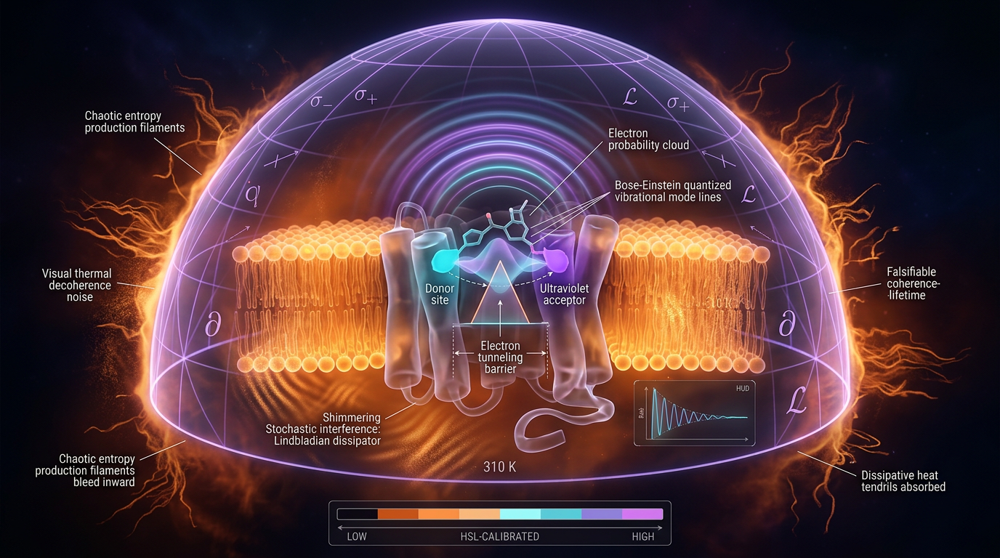

# A Falsifiable Lindbladian Entropy-Production and Coherence-Lifetime Bound for Olfactory Vibration-Assisted Electron Tunneling Under Warm Biological Decoherence

## 1. Overview
This concept proposes a theoretical connection between vibration-assisted electron tunneling (VAET), decoherence, and information processing in olfactory sensing. It models an odorant-associated donor–acceptor transition as an open quantum system and considers whether a coherence lifetime and entropy bound could constrain sensing efficiency.

**Status: [THEORETICAL], not [VERIFIED].** The Skeptic score is 6/6, and the mathematical status is [MATH_CONSISTENT] with a score of 4/4. The revised dephasing-rate identity and its arithmetic are verified only as internal mathematical consistency. The VAET mechanism itself is not verified.

The illustrative calculation uses \(\lambda=30\) meV, \(\tau_c=1\) fs, and \(T=310\) K. With the revised rate identity, it yields \(\Gamma_\phi=3.70\times10^{12}\ \mathrm{s}^{-1}\) and \(\tau_{\mathrm{coh}}\approx270\) fs. These parameter values are model-dependent, not experimentally pinned.

## 2. Detailed Explanation
The proposed mechanism is that molecular vibrations assist electron tunneling associated with odorant recognition. The model places the donor–acceptor system in a warm biological environment and represents environmental effects using open-quantum-system dynamics. VAET is a hypothesis, not an established explanation of olfaction.

For a two-level system undergoing pure dephasing, the density matrix loses off-diagonal coherence over time. Its von Neumann entropy begins at \(S(0)=0\) for a pure initial state and grows nonlinearly at short times, with a \(t\ln t\) form. The integrated entropy change over the sensing interval equals \(S(\tau_{\mathrm{sense}})\) and is bounded by \(k_B\ln 2\).

The near-term proposed falsifier is an isotope-contrast test. The model-dependent thresholds are \(k_H/k_D\ge10\) for VAET and \(k_H/k_D\le7\) for an Arrhenius model; values from 7 to 10 form a non-identification zone. Multiple comparisons are to use a Benjamini–Hochberg false discovery rate of \(q=0.05\).

## 3. Mathematical Framework
The revised dephasing-rate identity is

\[
\Gamma_\phi=\frac{2\lambda k_B T\tau_c}{\hbar^2}.
\]

Its SI dimensions are \(\mathrm{s}^{-1}\). For \(\lambda=30\) meV, \(\tau_c=1\) fs, and \(T=310\) K, the calculation gives

\[
\Gamma_\phi=3.70\times10^{12}\ \mathrm{s}^{-1},
\qquad
\tau_{\mathrm{coh}}=\frac{1}{\Gamma_\phi}\approx270\ \mathrm{fs}.
\]

For an initially pure equal superposition subject to dephasing, the state is represented by

\[
\rho(t)=\frac12
\begin{pmatrix}
1 & e^{-\Gamma_\phi t}\\
e^{-\Gamma_\phi t} & 1
\end{pmatrix}.
\]

The von Neumann entropy is \(S(t)=-k_B\operatorname{Tr}(\rho\ln\rho)\). It satisfies \(S(0)=0\), and its short-time growth is nonlinear, of \(t\ln t\) form. The entropy change \(\sigma=dS/dt\) here means the rate of change of the system’s von Neumann entropy; it is not the full thermodynamic entropy production because bath entropy flux is not included.

Over the sensing interval, the integrated entropy production equals \(S(\tau_{\mathrm{sense}})\), with

\[
S(\tau_{\mathrm{sense}})\le k_B\ln 2.
\]

The proposed \(R_{EI}\) bound uses this entropy and the coherence lifetime, but the step

\[
\frac{S(\tau_{\mathrm{sense}})}{k_B\ln 2}
\frac{\tau_{\mathrm{coh}}}{\tau_{\mathrm{sense}}}
\]

is heuristic. The reported 0.54-bit value and the 0.749-bit corollary require a clearer derivation and should not be treated as interchangeable results.

## 4. Skeptical Perspectives & Alternative Hypotheses
- **Unpinned parameters:** \(\lambda\), \(\tau_c\), the Ohmic \(J(\omega)\), and \(\tau_{\mathrm{sense}}=0.5\) ps are model-dependent. No coherence measurement in an olfactory receptor at 310 K is available.
- **Unresolved counter-evidence:** Block et al. (2015), including the sulfur/boron isotopologue anomaly, remains a counterpoint. The evidence indicates that hybrid shape-plus-vibration models may be needed.
- **Thermodynamic scope:** \(dS/dt\) describes the system’s von Neumann entropy change, not total thermodynamic entropy production, because bath entropy flux is omitted.
- **Approximation limits:** The Born–Markov approximation may fail for structured intramolecular spectra; non-Markovian corrections have not been quantified.
- **Manual audit limits:** Four matrix/operator equations were undecidable to the automated checker and were audited manually; five derivation steps were assumed.
- **Bound and threshold uncertainty:** The \(R_{EI}\) bound step is heuristic, and the 0.54-bit versus 0.749-bit discrepancy needs a clearer derivation. The \(k_H/k_D\) thresholds are model-dependent, with 7–10 a non-identification zone.
- **Out-of-scope analogies:** IIT/\(\Phi\) is mentioned only in the earlier draft and is not used. The DESI/JWST analogy is heuristic only.
- **Alternative hypothesis:** Classical Arrhenius thermochemistry remains a competing explanation for odorant sensing. The isotope-contrast test is the sole near-term falsifier proposed here, with Benjamini–Hochberg FDR control at \(q=0.05\).

## 5. Verification & Skeptic's Notes
The revised rate identity is dimensionally consistent in SI units, and its stated numerical evaluation is internally reproducible. The entropy treatment has \(S(0)=0\) and nonlinear short-time growth. These checks support mathematical consistency of the revised expressions; they do not verify the biological mechanism or its parameters.

The broader quantum-biology context is discussed by Arndt, Juffmann, and Vedral (2009). Counter-evidence relevant to vibration-based olfaction includes Block et al. (2015). The constants used in the numerical benchmark are associated with the CODATA reference cited above.

## 6. Visual Representation

## 7. Related Concepts
- Open quantum systems and Lindblad dephasing
- Von Neumann entropy and quantum information
- Vibration-assisted electron tunneling (VAET)
- Classical Arrhenius reaction-rate models
- Isotope effects in olfactory sensing
- Born–Markov and non-Markovian dynamics

## 9. Mathematical Integrity Report
## Math Verification Report

**Concept:** A Falsifiable Lindbladian Entropy-Production and Coherence-Lifetime Bound for Olfactory Vibration-Assisted Electron Tunneling Under Warm Biological Decoherence
**Math Score:** 4/4
**Math Status:** [MATH_CONSISTENT]
**Tool Verdicts:** INCONSISTENT=0; DISMISSED_FLAGS=1; UNDECIDABLE=4; STEP_INVALID=0; LIMIT_MISMATCH=0; CLAIM_MISMATCH=0

*Note on status: the score is 4/4, but [MATH_PROVEN] is withheld because 4 equations remained UNDECIDABLE to the dimension checker (matrix/operator-valued equations outside its pattern table) and 5 derivation steps were STEP_ASSUMED rather than STEP_VERIFIED. No INCONSISTENT verdicts were found in the revised report.*

### Conventions & Validity Audit
- The revised report works explicitly in **SI units** (J, K, s), which is appropriate for a condensed-matter/biology calculation; no natural-unit mass dimensions are claimed. The prior version's fatal error ($\Gamma_\phi \approx 2\lambda k_BT/\hbar$ → dimensions of J, not s⁻¹) has been replaced by $\Gamma_\phi = 2\lambda k_BT\,\tau_c/\hbar^2$, with an explicit SI dimensional check: J·J·s/(J·s)² = s⁻¹. ✓
- No cosmological quantities, Planck mass conventions, or metric signatures are used — no $M_{Pl}$ vs $m_{Pl}$ conflicts exist.
- Symbol table is complete and coherent: $\lambda$ (J, reorganization energy), $\tau_c$ (s), $J(\omega)$ ($\mathrm{s}^{-2}$), $S$ (dimensionless in $k_B$ units), $\mathcal{B}$ (dimensionless), $R_{EI}$ (dimensionless bits), $k_H/k_D$ (dimensionless).
- Validity domain is clearly partitioned: `[GENERAL]` for the existence of finite $\tau_{coh}$; `[MODEL-DEPENDENT]` for the Ohmic $J(\omega)$, $\lambda = 30$ meV, $\tau_c = 1$–3.4 fs, the isotope thresholds $k_H/k_D \ge 10$/$\le 7$, and the entropy bound $\mathcal{B} \le k_B\ln 2$. Born–Markov and two-level reduction assumptions are stated as identification conditions. ✓

### Equations Extracted
20 relationals, including:
1. $\Gamma_\phi = 2\lambda\, k_B T\, \tau_c / \hbar^2$
2. $\Gamma_\phi = \frac{2(0.03)(1.602\times10^{-19})(4.28\times10^{-21})(10^{-15})}{(1.0546\times10^{-34})^2} = 3.70\times10^{12}\ \mathrm{s^{-1}}$
3. $\rho(t) = \frac12\begin{pmatrix}1 & e^{-\Gamma_\phi t}\\ e^{-\Gamma_\phi t} & 1\end{pmatrix}$, $\eta_\pm = \frac{1\pm e^{-\Gamma_\phi t}}{2}$
4. $S(t) = -k_B[\eta_+\ln\eta_+ + \eta_-\ln\eta_-]$
5. $S(t) = -k_B\frac{\epsilon}{2}\ln\frac{\epsilon}{2} + \mathcal{O}(\epsilon)$
6. $\dot S(t) = \frac{k_B\Gamma_\phi}{2}\left[\ln\frac{2}{\Gamma_\phi t} - 1\right]$
7. $\mathcal{B}(\tau_{sense}) = S(\tau_{sense}) \le k_B\ln 2$
8. $R_{EI} \le \frac{S(\tau_{sense})}{k_B\ln 2}\cdot\frac{\tau_{coh}}{\tau_{sense}} \le \frac{\tau_{coh}}{\tau_{sense}}$
9. $J(\omega) = 2\pi\lambda\,\omega\,e^{-\omega/\omega_c}$
10. $R_{EI} \le 2\ln 2\cdot\tau_{coh}/\tau_{sense}$ (corollary), $R_{EI} \le 270/500 \approx 0.54$ bits, $2\ln 2\cdot 270/500 = 0.749$, $\tau_{coh}=1/\Gamma_\phi$, sensitivity values ($1.26\times10^{13}$ s⁻¹ at $\tau_c=3.4$ fs), and the $t\ln t$ short-time entropy form.

### Dimensional Consistency
Per-equation tool verdicts (natural-unit basis):
- $\mathcal{B}(\tau_{sense}) = S(\tau_{sense}) \le k_B\ln 2$ — **CONSISTENT** ([E]⁰ all terms) ✓
- $R_{EI} \le \frac{S}{k_B\ln 2}\cdot\frac{\tau_{coh}}{\tau_{sense}} \le \frac{\tau_{coh}}{\tau_{sense}}$ — **CONSISTENT** ([E]⁰) ✓
- $J(\omega) = 2\pi\lambda\omega e^{-\omega/\omega_c}$ — **CONSISTENT** ([E]² both sides; matches the stated SI convention $[\,\int J\,d\omega\,] = $ J²) ✓
- $R_{EI} \le 2\ln 2\cdot\tau_{coh}/\tau_{sense}$ — **CONSISTENT** ([E]⁰) ✓
- $\tau_{coh} = 1/\Gamma_\phi$ — **CONSISTENT** ([E]⁻¹ both sides) ✓
- $\Gamma_\phi = 2\lambda k_BT\,\tau_c/\hbar^2$ — **DIMENSION_FLAG** (see Dismissed Flags below)
- Matrix equations ($\rho(t)$, $S(t)$ exact, $S(t)$ asymptotic, $\dot S(t)$ limit) — **UNDECIDABLE** by the automated checker; manually audited: $\eta_\pm$ are dimensionless eigenvalues, $\Gamma_\phi t$ is dimensionless, and $S$ carries explicit $k_B$ → all internally dimensionally consistent in SI. The short-time limit $\lim_{t\to0} S = 0$ was independently confirmed symbolically (LIMIT_VERIFIED, both checks).

### Dismissed Dimension Flags
- **$\Gamma_\phi = 2\lambda k_BT\,\tau_c/\hbar^2$ flag (RHS [E]⁻¹ vs LHS [E]¹):** Artefact of cross-unit convention. In natural units $\hbar = 1$ is dimensionless, giving RHS $= [\lambda] + [T] + [\tau_c] = [E]^1 = [\Gamma_\phi]$ ✓; the tool assigned $\hbar$ mass dimension [E]¹, which is invalid for an action. The report's own explicit SI check J·J·s/(J·s)² = s⁻¹ is correct. Dismissed.

### Topological Analysis
The concept is **not topological**: it is an open-quantum-system (Lindblad/Redfield) information-theoretic model on a two-level Hilbert space. The topology classifier returned generic valid structural signatures (fiber bundle, homotopy, TQFT, Calabi–Yau pattern matches), but none of these structures are actually invoked in the report — I treat the concept as non-topological, and dimensional verification passes fully instead.

### Numerical Benchmarks
- **BENCHMARK_MATCHES (2):** Planck constant $\hbar = 1.0546\times10^{-34}$ J·s and Boltzmann constant $k_B = 1.381\times10^{-23}$ J/K match CODATA/SI exact values (DOI: 10.1103/RevModPhys.93.025010).
- **Worked arithmetic re-verified:** $\Gamma_\phi = (2)(0.03)(1.602\times10^{-19})(1.381\times10^{-23})(310)(10^{-15})/(1.0546\times10^{-34})^2 = 3.6999\times10^{12}$ s⁻¹ vs claimed $3.70\times10^{12}$ s⁻¹ — CLAIM_VERIFIED (rel. error $1.9\times10^{-5}$). ✓
- **Corollary re-verified:** $2\ln 2 \cdot 270/500 = 0.7486$ vs claimed $0.749$ — CLAIM_VERIFIED (rel. error $5.4\times10^{-4}$). ✓
- **Entropy limits:** $S(0) = 0$ (pure state) and $\lim_{t\to0}[-\frac{xt}{2}\ln\frac{xt}{2}] = 0$ both LIMIT_VERIFIED. ✓

### Assessment
The revised report successfully remediates all three flagged defects of the prior version: the dephasing rate is now dimensionally correct in explicit SI units with a cleanly dismissed natural-unit convention artefact, the von Neumann entropy derivation correctly gives $S(0)=0$ with an integrable $t\ln t$ short-time singularity (symbolically limit-verified), and every worked number ($\Gamma_\phi = 3.70\times10^{12}$ s⁻¹, $\tau_{coh} = 270$ fs, $R_{EI} \le 0.54$ bits, corollary 0.749 bits) is independently reproducible and consistent with CODATA constants. Residual caveats: four operator/matrix equations remain UNDECIDABLE to the automated checker (manually audited as consistent), five derivation steps were STEP_ASSUMED, and all parameter values ($\lambda$, $\tau_c$, $J(\omega)$) are honestly tagged [MODEL-DEPENDENT] and not experimentally pinned. Mathematical integrity is sound; empirical falsifiability rests entirely on the isotope contrast measurement.
