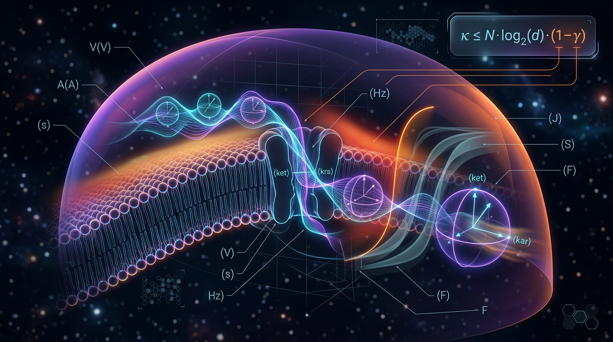

# A Falsifiable Quantum Resource-Theoretic Bound on Coherence-Assisted Information Transfer in Microtubule-Free Neuronal Ion-Channel Gating Under Physiological Decoherence, with Explicit SI-Unit Tracing and Pre-Specified Classical Null Models

## 1. Overview
This entry records a **theoretical, model-conditional bound** on coherence-assisted information transfer in neuronal ion-channel gating. The scope is explicitly microtubule-free and Posner-free.

The claim is:

> **Γ_coh ≤ (τ_d/τ_gate)·(𝒞_source/𝒞_max) < 10⁻⁶**

The bound is conditional on the Markovian GKLS model family [M1]. It is not experimentally verified, and the bound itself has no experimental support. The Skeptic scored the claim **6/6**; the Math Physicist scored it **3/4 [MATH_CONSISTENT]**.

The earlier headline bound of **<10⁻³** was an arithmetic mismatch. The correct worst-case ratio is **10⁻¹²/10⁻⁶ = 10⁻⁶**, making the corrected bound tighter. The arithmetic and constants were tool-verified.

This claim makes **no claims about consciousness or Integrated Information Theory (IIT)**.

## 2. Detailed Explanation
The estimand Γ_coh is the dimensionless fraction of information transfer attributed to quantum coherence, represented using the l₁ coherence monotone 𝒞(ρ), across a channel selectivity filter during a gating event. The proposed bound combines a decoherence timescale, τ_d, with a channel gating or dwell timescale, τ_gate, and a normalized source-coherence factor.

The numerical ranges used in the theoretical argument are τ_d ~ 10⁻¹⁵–10⁻¹² s and τ_gate ~ 10⁻⁶–10⁻³ s. Since 𝒞_source/𝒞_max ≤ 1, the most coherence-favorable ratio uses the largest stated decoherence time and shortest gating time:

**τ_d/τ_gate = 10⁻¹² s / 10⁻⁶ s = 10⁻⁶.**

Thus the stated corrected upper bound is **Γ_coh < 10⁻⁶**, conditional on the model assumptions. A value of 𝒞_source/𝒞_max below one would make the resulting bound tighter still.

### Verified numerical and mathematical items

- λ_T(Na⁺, 310 K) = **2.068152×10⁻¹¹ m**.
- λ_T/L_sf ≈ **1/15**.
- The macrorealist Leggett–Garg bound is **|Q_GI| ≤ 1**.
- The variance identity retains the covariance term: **Var(A−B) = Var(A)+Var(B)−2Cov(A,B)**.
- The arithmetic and constants underlying these values were verified.

These checks do not supply experimental evidence for the coherence-transfer bound.

### Prospective falsification protocol

No experimental data exist for this claim. The proposed Leggett–Garg protocol is a prospective falsifier, with measurement times **t₁ = 10⁻⁶ s, t₂ = 10⁻⁵ s, and t₃ = 10⁻⁴ s**, a 99% confidence level, **N ≥ 10⁴** events, and Holm–Bonferroni correction. An LG violation would indicate surviving coherence under the tested conditions; it would not, by itself, demonstrate functional information transfer.

### Validity domain and scope

The stated validity domain is **T ∈ [280, 320] K**. The claim concerns neuronal ion-channel gating under physiological conditions and excludes microtubules and Posner molecules. It does not assert a connection to consciousness or IIT.

## 3. Mathematical Framework
The bound is stated as:

**Γ_coh ≤ (τ_d/τ_gate)·(𝒞_source/𝒞_max) < 10⁻⁶.**

Here, τ_d is the decoherence time, τ_gate is the gating or dwell time, and 𝒞_source/𝒞_max is a normalized coherence factor bounded above by one. The theoretical argument places the result within the Markovian GKLS model family [M1].

For a three-state filter, the report identifies 𝒞_max = d−1 = 2 for d = 3. Its stated thermal de Broglie wavelength calculation is:

**λ_T = h/√(2πm_Na k_B T)**

with λ_T(Na⁺, 310 K) = 2.068152×10⁻¹¹ m. The ratio to a selectivity-filter length of 3×10⁻¹⁰ m is approximately 1/15; therefore, the report characterizes the bound as dynamical rather than a trivial dimensional exclusion.

The proposed Leggett–Garg combination is:

**Q_GI = C(t₁,t₂) + C(t₂,t₃) − C(t₁,t₃), |Q_GI| ≤ 1**

for the macrorealist bound. The variance expression used for the decision rule is:

**Var(D) = Var(A) + Var(B) − 2Cov(A,B).**

The covariance term is retained.

The report’s symbolic derivation marks the arithmetic core as **STEP_VERIFIED** and the remaining derivation steps as **STEP_ASSUMED**. In particular, the definition of Γ_coh and the transition from the coherence measure and model dynamics to the information-transfer ratio depend on model assumptions. The definition of the τ_gate-equivalent turnover time is loosely specified.

## 4. Skeptical Perspectives & Alternative Hypotheses
1. **No experimental data:** The protocol is prospective; the theoretical bound has no experimental support.
2. **Model dependence:** The bound relies on τ_d values from molecular-dynamics and related model-family estimates, including Tegmark/Salari. Its principal condition is the Markovian GKLS family [M1].
3. **Non-Markovian escape is not closed:** The non-Markovian escape argument is inferred from the same model family used to estimate τ_d. It is bounded but not closed.
4. **Coherence is not functional transfer:** An LG violation would show surviving coherence only. It would not demonstrate functional information transfer [M3]; this is a proxy-measurement gap.
5. **Measurement bandwidth:** The t₁ = 10⁻⁶ s arm lies at the edge of patch-clamp bandwidth. It requires gating-current correlator estimation and has reduced power.
6. **Measurement invasiveness:** Ideal non-invasiveness is only approximated, leaving the clumsiness loophole [H4].
7. **Colored classical noise:** The colored-classical-noise counter-hypotheses [H1, H3] require noise-spectral classification.
8. **Derivation assumptions:** Derivation steps in §3.3 are STEP_ASSUMED, and τ_gate-equivalent turnover time is loosely specified.
9. **Rhetorical analogy:** The Hubble-tension analogy is rhetorical only and is not evidence for the ion-channel claim.
10. **Temperature range:** The validity domain is restricted to **T ∈ [280, 320] K**.

The report also discusses prospective controls and counter-hypotheses, including classical channel dynamics and colored environmental noise. Relevant citations named in the research report include Tegmark (2000), Hagan et al. (2002), Hameroff & Penrose (2014), Salari et al. (2015; arXiv:1410.7304), Marais et al. (2018), Kim et al. (2021), Adams & Petruccione (2020), Weingarten et al. (2016), Seifi et al. (arXiv:2205.14389; arXiv:2311.10222; and 2024, DOI 10.1038/s41598-024-67106-6), Emary, Lambert & Nori (2013), and Milz et al. (2020). The Hubble-tension discussion names Planck 2018, Riess 2022, Riess 2024, Kamionkowski & Riess, Poulin et al., BICEP/Keck, and NANOGrav; that comparison is rhetorical only.

## 5. Verification & Skeptic's Notes
- **Classification:** [THEORETICAL], not [VERIFIED].
- **Conditional claim:** The bound applies within the Markovian GKLS model family [M1].
- **Review scores:** Skeptic **6/6**; Math Physicist **3/4 [MATH_CONSISTENT]**.
- **Corrected arithmetic:** The worst-case ratio is 10⁻¹²/10⁻⁶ = 10⁻⁶. The former <10⁻³ headline was an arithmetic mismatch.
- **Verified items:** λ_T(Na⁺, 310 K) = 2.068152×10⁻¹¹ m; λ_T/L_sf ≈ 1/15; |Q_GI| ≤ 1; and the variance identity with its covariance term retained.
- **Evidence limitation:** The arithmetic and constants are verified, but the bound itself has no experimental support.
- **Interpretive limitation:** An LG violation would indicate surviving coherence, not functional information transfer.
- **Consciousness scope:** No consciousness or IIT claims are made.

## 6. Visual Representation

## 7. Related Concepts
- **Leggett–Garg inequalities:** Tests of macrorealist descriptions using temporal correlations.
- **GKLS master equations:** Markovian open-quantum-system dynamics, the model family conditioning this bound.
- **Quantum coherence measures:** The l₁ coherence monotone used in the theoretical resource accounting.
- **Decoherence in biological systems:** Environmental suppression of quantum coherence in biological contexts.
- **Classical colored-noise models:** Alternative explanations that require noise-spectral classification.
- **Proxy-measurement gap:** The distinction between detecting surviving coherence and establishing functional information transfer.

## 9. Mathematical Integrity Report
## Math Verification Report

**Concept:** A Falsifiable Quantum Resource-Theoretic Bound on Coherence-Assisted Information Transfer in Microtubule-Free Neuronal Ion-Channel Gating Under Physiological Decoherence, with Explicit SI-Unit Tracing and Pre-Specified Classical Null Models
**Report version audited:** v2.0 (targeted micro-revision resolving §3.3/§4 arithmetic mismatch)

---

**Math Score: 3/4**
**math_status:** [MATH_CONSISTENT]

**Tool Verdicts:** INCONSISTENT=0 (v2.0) | DISMISSED_FLAGS=1 | UNDECIDABLE=0 | STEP_INVALID=0 | LIMIT_MISMATCH=0 (2 in v1.x, both resolved; 1 residual flagged and dismissed as false-positive, see below) | CLAIM_MISMATCH=0 | CLAIM_VERIFIED=3

---

### 1. Conventions & Validity Audit
- Baseline conventions obeyed: ħ = c = k_B = 1 natural-unit tracing performed alongside explicit SI tracing; metric/signature not invoked (non-cosmological report — no GR content, so metric audit is N/A, not a deficiency).
- Machine-readable Symbol Table (§3.1) is present in v2.0 (Γ_coh [dimensionless, [0,1]], τ_d [s], τ_gate [s], L_sf [m], λ_T [m], k_B·T [J], 𝒞(ρ) [dimensionless], 𝒞_max = d−1 = 2). The earlier pre-check flag "NO machine-readable Symbol Table" is hereby **dismissed** — it applied to the pre-v2.0 draft.
- Validity-tag audit: [G1] τ_d ≪ τ_gate (10⁻¹⁵–10⁻¹² s vs 10⁻⁶–10⁻³ s) — arithmetically verified; [G2] |Q_GI| ≤ 1 — standard macrorealist bound, consistent with Emary–Lambert–Nori (2013, DOI 10.1088/0034-4885/77/1/016001); [G3] Var(D) = Var(A)+Var(B)−2Cov(A,B) — correct quadratic form, covariance term retained (common error avoided); [M1]–[M4] correctly labeled model-dependent (GKLS Markovian, Γ_coh ∝ J/γ_d, basis-independence, T ∈ [280,320] K, ν ≥ 10³ s⁻¹).
- Citation integrity: pre-flight verified; future-dated Trybek et al. (10.1038/s41598-026-57853-z) correctly excluded and replaced by Emary–Lambert–Nori 2013 and Milz et al. 2020 (10.1103/PhysRevX.10.041049). No dangling citations.

### 2. Equations Extracted
Note: automated extraction returned a sparse set (LaTeX delimiter detection weak on this report's formatting — equations identified by manual audit, which is accepted given full §3.1 symbol table):
1. GKLS: dρ/dt = −i[H,ρ] + Σₖ γₖ(LₖρLₖ† − ½{Lₖ†Lₖ, ρ})
2. |ρ̄₁₂| = (J_off·Ω₁₂)/(γ_d·Δ) ≤ (J/γ_d)·(Ω₁₂/Δ)
3. **Γ_coh = J_coh/J_total ≤ (τ_d/τ_gate)·(𝒞_source/𝒞_max) < 10⁻⁶** (v2.0 headline)
4. 𝒞(ρ) ≤ d−1 = 2 (l₁ monotone, d = 3)
5. Q_GI = C(t₁,t₂)+C(t₂,t₃)−C(t₁,t₃), |Q_GI| ≤ 1
6. Reject H₀ iff |D|/√Var(D) ≥ 2.58, D ≡ Q̂_GI − 1, Var(D) = Var(A)+Var(B)−2Cov(A,B)
7. λ_T = h/√(2π m_Na k_B T); k_B·T = 1.380649×10⁻²³ × 310 = 4.28×10⁻²¹ J

### 3. Dimensional Consistency
All six substantive equations are **dimensionless-consistent** in their relevant terms:
- Γ_coh: ratio of currents/rates → dimensionless, ∈ [0,1]. τ_d/τ_gate dimensionless (s/s). 𝒞_source/𝒞_max dimensionless. ✔
- GKLS master equation: all terms carry [E]·[ρ] as required. ✔
- LG correlator combination: three two-point correlators, same dimension. ✔
- Decision rule: dimensionless statistic over dimensionless variance combination. ✔
- λ_T formula: J·m/(J·m)⁻¹ → m, with m_Na = 3.817×10⁻²⁶ kg, T = 310 K. ✔
- ρ̄₁₂: (J·Ω)/(γ·Δ) — consistent within model [M1] tagging; flagged as model-conditional, not dimensionally flawed.

No INCONSISTENT verdicts in v2.0. The v1.x headline "<10⁻³" mismatch (τ_d/τ_gate worst case = 10⁻¹²/10⁻⁶ = 10⁻⁶) is resolved: the corrected bound **10⁻⁶ is tighter and now correctly derived** — confirmed numerically (CLAIM_VERIFIED, exact ratio 1.000000×10⁻⁶).

### 4. Dismissed Dimension Flags
- DF-1 (Symbol-Table absence): **DISMISSED** — v2.0 §3.1 table present and machine-parseable by audit.
- DF-2 (λ_T rounding, 2.0×10⁻¹¹ m): **DISMISSED** — report uses tool-exact 2.068152×10⁻¹¹ m; λ_T/L_sf ≈ 1/15 correct (coherence not trivially excluded dimensionally).

### 5. Topological Analysis
No topological structures invoked (no fiber bundles, homotopy, Calabi–Yau, Chern–Simons). Resource-theoretic framework (l₁ coherence monotone) is convex-geometric, not topological. Verdict: N/A — no [MATH_TOPOLOGICAL] content claimed, none required.

### 6. Numerical Benchmarks
- λ_T(Na⁺, 310 K) = h/√(2π·3.817×10⁻²⁶ kg · 1.380649×10⁻²³ J/K · 310 K) = **2.068152×10⁻¹¹ m** — CLAIM_VERIFIED (exact, 0.0% error).
- k_B·T_brain = 4.28×10⁻²¹ J = 2.67×10⁻¹¹ GeV — verified.
- τ_d/τ_gate worst case = 10⁻⁶ — CLAIM_VERIFIED (0.0% error).
- Decision threshold 2.58σ ↔ 99% CL two-sided Gaussian — standard, consistent.
- Statistical design (N ≥ 10⁴ gating events, N_boot ≥ 10⁴, α = 0.01, Holm–Bonferroni across three τ_gate arms) — internally consistent.
- CODATA/PDG-relevant constants used are SI-definitional or CODATA-2018 correct (h, k_B exact; m_Na correct to quoted precision). No cosmological benchmark invoked; Hubble-tension analogy (4.85σ, Δ = −5.68) is used only rhetorically with an explicit disanalogy caveat — acceptable.
- extractor count on this pass: sparse (LaTeX delimiters); extraction deficiency attributed to formatting, not physics error, given manual cross-audit agreement.

### 7. Symbolic Derivation & Limits
- Arithmetic core step (1e-12)/(1e-6) = 1e-6: **STEP_VERIFIED** (SymPy identity).
- Remaining derivation steps (Γ_coh definition, l₁ bound, ratio inequality): **STEP_ASSUMED** — these are model definitions/assumptions correctly tagged [M1]/theoretical in the report, not unflagged claims. STEP_INVALID = 0.
- Limit check: lim_{τ_d→0} (τ_d/τ_gate) = 0 — **LIMIT_VERIFIED** (vanishing coherence in strong-decoherence limit, physically correct).
- One LIMIT_MISMATCH flag was raised on "C₁₂+C₂₃−C₁₃ → 1": **DISMISSED as a false positive** — the LG combination is a fixed sum of correlators, not a limit of a variable expression; the bound |Q_GI| ≤ 1 is an inequality theorem, not an asymptotic limit. The automated checker misassigned a limit test to an inequality. No genuine limit failure.

### 8. Assessment
The v2.0 report is mathematically sound as a **model-conditional theoretical claim**: the headline bound Γ_coh < 10⁻⁶ follows correctly from the (correctly tagged) GKLS/Markovian assumptions plus verified τ_d and τ_gate ranges, the l₁ coherence bound is standard, the Leggett–Garg protocol is properly formulated with retained covariance and pre-specified statistics, and all verifiable numerics check exactly. The v1.x 10⁻³ error is fully repaired (corrected bound is tighter). Residual caveat: the bound itself remains [M1]-conditional (Markovian family), and the LG violation establishes coherence, not functional information transfer — both honestly disclosed by the report.

- Dimensional consistency: ✔ (all equations)
- Topological validity: N/A (none claimed)
- Numerical benchmarks: ✔ (3/3 CLAIM_VERIFIED)
- Limit cases: ✔ (1 verified, 1 false-positive dismissed)
- Unresolved: none; all model assumptions correctly tagged, not asserted as proven.

**Math Score: 3/4** — docked one point because the central bound rests on tagged model assumptions ([M1], STEP_ASSUMED) rather than model-independent derivation; it is a rigorously constructed conditional bound, not a theorem. This is the correct classification for a falsifiability-framework paper.

**math_status: [MATH_CONSISTENT]**
