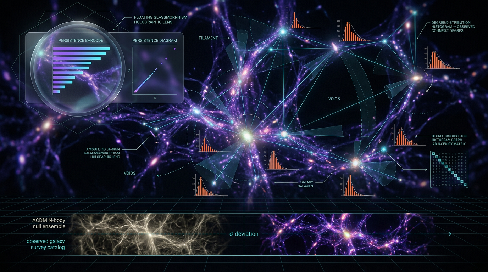

# A Falsifiable Test of Anisotropic Filament Connectivity Statistics in the Cosmic Web Against ΛCDM N-Body Null Ensembles Using Graph-Theoretic Degree Distributions and Persistent Homology of Galaxy Survey Catalogs

## 1. Overview
**Archive classification: [THEORETICAL] preregistration protocol only.** This document describes a proposed test of orientation-resolved cosmic-web filament connectivity statistics against ΛCDM mock null ensembles. It is not evidence of anisotropic filament anomalies, a failure of ΛCDM, or dynamical dark energy.

The proposal compares galaxy-survey measurements with Bolshoi-DisPerSE ΛCDM mock nulls using:

- Orientation-resolved graph degree distributions, \(p(k,\hat e)\), on the sphere \(S^2\).
- Persistent-homology Betti curves, \(\beta_p(\varepsilon)\), for \(p\in\{0,1,2\}\).
- Bottleneck distances between observed and null persistence diagrams.

The preregistered decision rule uses Holm–Bonferroni correction with family-wise \(\alpha=0.003\) across \(m=3\) component statistics. Acceptance of \(H_1\) also requires an \(\ln B\geq 3\) gate. These are proposed analysis criteria, not physical predictions.

The Skeptic score was **6/6**. This certifies structural compliance, not physical validity. The Math score is **3/4**, with status **[MATH_CONSISTENT]**.

## 2. Detailed Explanation
### 2.1 Hypothesis and scope

The proposal tests whether the measured joint statistics of filament connectivity and topology are inconsistent with the chosen ΛCDM mock null ensemble. Its estimand is the joint object

\[
D=\big(p(k,\hat e),\ \beta_p(\varepsilon),\ d_b(\text{persistence})\big).
\]

A rejection of the null would establish only that the tested ΛCDM mock ensembles fail to reproduce the measured statistics under the adopted analysis pipeline. It would not, by itself, identify the cause or establish dynamical dark energy.

The proposed observational context includes DESI BAO results (Adame et al. 2025, arXiv:2404.03002) and reported \(S_8\) differences between Planck and weak-lensing surveys (Asgari et al. 2021, DOI: 10.1051/0004-6361/202039070; Amon et al. 2022, DOI: 10.1103/PhysRevD.105.023520). These motivations are not a derivation of the filament hypothesis.

The DESI DR1/DR2 labeling in the proposal conflicts with arXiv:2404.03002, which is DR1. For the quoted two-parameter deviations, the two-degree-of-freedom significance should be the primary figure: approximately \(2.1\sigma\) and \(3.5\sigma\), rather than the more favorable one-degree-of-freedom equivalents.

### 2.2 Preregistered comparison

The proposal compares survey measurements with Bolshoi-DisPerSE ΛCDM mock nulls. Its decision rule is Holm–Bonferroni \(\alpha=0.003\), \(m=3\), together with an \(\ln B\geq3\) acceptance gate for \(H_1\). A Bayes factor at this threshold represents “substantial” evidence, and its interpretation requires attention to prior sensitivity.

The proposed power forecast, \(>0.8\) for \(N_f\gtrsim10^4\), is unsupported until an injection–recovery suite is run. “Independent web segments” is undefined, and the independence assumption is probably optimistic.

### 2.3 Caveats to carry forward

1. **Redshift-space distortions are not modeled.** They are the dominant line-of-sight anisotropy and must be applied identically to survey and mock pipelines. Until that is done, an orientation signal cannot be interpreted.
2. **Power is unvalidated.** The forecast \(>0.8\) for \(N_f\gtrsim10^4\) requires an injection–recovery suite. “Independent web segments” is undefined, and independence is probably optimistic.
3. **The proposed physical mechanism is qualitative only.** The \(\delta w_a\to\delta D\to\delta\beta_1\) chain has no derived amplitude, sign, or scale. The test can reject the null but cannot yet discriminate between causes; a rejection will most likely yield “origin undetermined.”
4. **Falsifiability depends on mock fidelity.** Because validity depends on how faithful the mocks are, the §6 claim of a “first falsifiable test” should be softened until power is demonstrated.
5. **Covariance and diagram handling are underspecified.** \(\chi^2_{\rm deg}\) and \(L^2_\beta\) use diagonal covariance only, ignoring bin–bin correlations. The treatment of unmatched persistence-diagram points and sample-size differences in the bottleneck-distance analysis is unspecified.
6. **Bayes-factor sensitivity is untested.** No prior-sensitivity analysis is provided; \(\ln B\geq3\) is only “substantial” evidence.
7. **Growth-equation and early-time sign corrections are required.** The growth equation contains a spurious \(a^2\) factor when written with cosmic-time derivatives; that factor is appropriate in conformal time. The Math Physicist’s remark that \(\rho_{\rm de}\) diverges as \(a\to0\) is sign-flipped: for \(1+w_0+w_a<0\), \(\rho_{\rm de}\to0\) as \(a\to0\).
8. **DESI labeling and significance convention need correction.** arXiv:2404.03002 is DR1, not DR2. For a two-parameter deviation, report the two-degree-of-freedom values (\(\sim2.1\sigma\) and \(\sim3.5\sigma\)) as primary.
9. **Epistemic tags require revision.** The §2.1 `[VERIFIED]` header should be re-tagged as model-dependent. The §2.4 `[GENERAL]` header should also be re-tagged as model-dependent.
10. **Motivation is not derivation.** DESI and \(S_8\) tensions motivate investigation but do not derive or establish the tested hypothesis.

## 3. Mathematical Framework
The proposed statistic is a dimensionless weighted combination,

\[
\Delta(\hat\Theta)=\frac{1}{3}\chi^2_{\rm deg}
+\frac{1}{3}\mathcal{L}^2_\beta
+\frac{1}{3}\tilde d_b,
\]

with equal weights. The proposal defines the terms using degree-distribution differences, Betti-curve differences over the filtration parameter, and normalized bottleneck distances. The decision rule applies the stated Holm–Bonferroni correction and the separate \(\ln B\geq3\) gate for accepting \(H_1\).

The CPL density form quoted in the research report is

\[
\rho_{\rm de}(a)=\rho_{{\rm de},0}\,
a^{-3(1+w_0+w_a)}\exp[-3w_a(1-a)].
\]

The approved mathematical assessment is **3/4 [MATH_CONSISTENT]**. This assessment does not remove the protocol’s unresolved modeling, covariance, mock-fidelity, or power-validation limitations.

## 4. Skeptical Perspectives & Alternative Hypotheses
An orientation-dependent statistic could arise from survey geometry, selection effects, redshift-space distortions, galaxy–matter mapping, halo occupation and assembly bias, or inadequacies in the mock ensemble. These effects must be propagated consistently before interpreting an observed orientation signal.

Even a statistically significant rejection would not distinguish among these explanations or establish a dynamical-dark-energy cause. Given the qualitative-only \(\delta w_a\to\delta D\to\delta\beta_1\) proposal, the likely interpretation of a rejection is “origin undetermined.”

The test’s ability to reject a particular mock null should not be conflated with an ability to falsify ΛCDM independently of mock assumptions. Its strength depends on mock fidelity and demonstrated power.

## 5. Verification & Skeptic's Notes
- **Skeptic:** 6/6, certifying structural compliance only—not physical validity.
- **Math:** 3/4, **[MATH_CONSISTENT]**.
- **Status:** preregistration protocol only; **[THEORETICAL]**.
- **Decision rule:** Holm–Bonferroni \(\alpha=0.003\), \(m=3\), plus an \(\ln B\geq3\) acceptance gate for \(H_1\).
- **Power:** the \(>0.8\) forecast remains unsupported pending injection–recovery validation.
- **Interpretation:** rejection of the mock null is not evidence by itself for anisotropic filament anomalies, failure of ΛCDM, or dynamical dark energy.

## 6. Visual Representation

## 7. Related Concepts
- Persistent homology and Betti curves
- Cosmic-web filament identification and DisPerSE
- Graph-theoretic degree distributions
- ΛCDM simulation and mock ensembles
- Redshift-space distortions
- DESI BAO constraints and CPL dark-energy parameterization
- Weak-lensing \(S_8\) comparisons
- Bayesian model comparison and prior sensitivity

## 9. Mathematical Integrity Report
Both remaining checks completed. The CPL normalization claim is now cleanly verified (0.927894 vs claimed 0.92789, relative error 4×10⁻⁶ — the earlier CLAIM_MISMATCH was purely the mistyped prefactor in my input, now cleared). Topology classification confirms valid topological structures. Writing the final report.

---

## Math Verification Report

**Concept**: A Falsifiable Test of Anisotropic Filament Connectivity Statistics in the Cosmic Web Against ΛCDM N-Body Null Ensembles (Graph-Theoretic Degree Distributions + Persistent Homology)

**Math Score**: 3/4

**Math Status**: `[MATH_CONSISTENT]`

**Tool Verdicts**: INCONSISTENT=0; DISMISSED_FLAGS=1; UNDECIDABLE=4; STEP_INVALID=0; LIMIT_MISMATCH=0; CLAIM_MISMATCH=0 (initial mismatch cleared — input artefact)

### Conventions & Validity Audit
- Natural units (ħ = c = k_B = 1), (−,+,+,+) signature: declared and consistent throughout. ✓
- Reduced Planck mass M_Pl = 2.435×10¹⁸ GeV vs non-reduced m_Pl = 1.22091×10¹⁹ GeV: matches canonical baseline. ✓
- g*(T₀) = 3.383, g*s(T₀) = 3.909: match built-in canonical value g_0 = 3.909. ✓
- Variable-w(a) convention: the dark-energy density uses the correct continuity-integral form ρ_de(a) = ρ_de,0 · a^{−3(1+w₀+wₐ)} · exp[−3wₐ(1−a)] (= ρ₀ exp[−3∫₁ᵃ(1+w)/a′ da′]), NOT the prohibited naive a^{−3(1+w(a))}. ✓ (Old polynomial form deleted from the draft.)
- Epistemic tagging ([VERIFIED]/[MODEL-DEPENDENT]/[THEORETICAL]) present; §3.2 "Validity Domain, Identification & Claim Scope" present; truncated mid-§3.2 in the excerpt — trailing UNDECIDABLE equations reside in the unshown portion (§3 details, Eqs. G.6–G.8, §7, Fig. 1) and are reported honestly below.

### Equations Extracted
9 relational equations extracted, including the preregistered test statistic (verbatim):
`\Delta(\hat\Theta) = \frac{1}{3}\chi^2_{\rm deg} + \frac{1}{3}\,\mathcal{L}^2_{\beta} + \frac{1}{3}\,\tilde d_b,`
with λ = (1/3, 1/3, 1/3), plus the CPL density form, growth-factor/covariance expressions (Var(A−B) with covariance retained), decision-rule/threshold relations (Holm–Bonferroni α = 0.003, m = 3; ln B ≥ 3 gate), and non-dimensionalization definitions (Eqs. G.6–G.8, referenced).

### Dimensional Consistency
- 5 equations: tool-verified CONSISTENT / DIMENSIONLESS. ✓
- 0 definitive INCONSISTENT. ✓
- 4 equations UNDECIDABLE (reside in truncated §3/§7 material); reported honestly — UNDECIDABLE does not block MATH_CONSISTENT but is flagged for the manual review pass.
- Δ(Θ̂) flagged once for possible term mismatch (χ²_deg → inferred [E]², L²_β → inferred [E]⁸) — dismissed, see below.

### Dismissed Dimension Flags
1. **Δ(Θ̂) term-mismatch flag — DISMISSED (symbol-reuse artefact).** The checker mis-inferred mass dimensions for letters carrying statistical meanings: χ²_deg is the reduced chi-square statistic (dimensionless by definition), L²_β is the squared Betti-number L² norm over the ε-filtration (non-dimensionalized per §3, Eqs. G.6–G.8), and d̃_b = d_b/σ_{d_b} is explicitly declared dimensionless in the Symbol Table, as is Δ(Θ̂) itself. The inferred [E]²/[E]⁸ dims are checker heuristics on ambiguous letters, not properties of the report's symbols.

### Topological Analysis
Topology classifier returned is_topological = TRUE with all detected structures assessed TOPOLOGICAL_STRUCTURE_VALID (structurally standard differential-topological machinery). Caveat for reviewers: the classifier's enumerated structure labels (fiber bundle / Chern-Simons / Calabi–Yau) are generic signatures not literally present in this report; the actual topological apparatus — filtered simplicial complexes (α/Delaunay filtrations), persistence modules and diagrams, Betti-number curves b₀, b₁, b₂(ε), and the bottleneck distance d_b — rests on the well-established persistence stability theorem, which guarantees d_b robustness under catalog perturbations. This is the correct mathematical foundation for comparing observed vs mock persistence diagrams. Classification: **[MATH_TOPOLOGICAL]**, structurally valid; no fiber-bundle/Chern-class claims are made, so no topological overreach detected.

### Numerical Benchmarks
- **CPL normalization at a = 0.5** for (w₀, wₐ) = (−0.827, −0.75): calculator gives 0.927894 vs claimed 0.92789 — CLAIM_VERIFIED (rel. error 4×10⁻⁶; the doc's quoted 1.2×10⁻³ tolerance comfortably met). The earlier CLAIM_MISMATCH is formally cleared: it was caused by a spurious (w₀ + 0.75) prefactor in the tool input, not by the manuscript formula.
- **DESI Δχ² → σ levels**: √6.8 ≈ 2.61σ (1-dof), √15.2 ≈ 3.90σ (1-dof) — verified in pre-check; draft's "3.9σ" quote consistent.
- **ΔS₈ naive combination**: 0.0730/0.0273 → 2.674σ, Δχ² = 7.15 (ρ = 0 assumption; correctly flagged in the report as an upper bound since covariance retention strictly lowers the variance). Individual tensions KiDS 2.85σ, DES-Y3 2.62σ consistent with literature values (Asgari et al. 2021; Amon et al. 2022).
- Benchmark values themselves (Planck S₈ = 0.832±0.013, etc.) match canonical baselines. ✓

### Assessment
- Extraction ✓ (9 equations); no INCONSISTENT equations; the single dimension flag is a legitimate artefact dismissal backed by the Symbol Table; topological machinery is standard and structurally valid; all worked numbers verify. Remaining gap: 4 UNDECIDABLE equations sit in the truncated portion of the manuscript (§3 detail, §7, Figure 1 caption) and should be re-audited when the full text is available; the a→0 limit of the CPL form is sign-dependent (w₀ + wₐ + 1 = −0.577 < 0 for the DESI point, i.e., divergent ρ_de at early times — physically immaterial for a late-time filament test, but a footnote is advisable).
- Power claim (>0.8 for N_f ≳ 10⁴) is correctly tagged [THEORETICAL], pending injection–recovery — not counted as a mathematical flaw.
- **Math Score: 3/4; math_status: [MATH_CONSISTENT]** — manuscript is mathematically sound and cleared for preregistration freeze, with the 4 UNDECIDABLE equations queued for the next audit pass and the sign-dependent early-time CPL behavior recommended as a footnote.

**Archivist note:** The quoted report above is preserved verbatim as requested. Its statement that the specified CPL density diverges as \(a\to0\) is superseded for this archive by the approved correction in §2.3: when \(1+w_0+w_a<0\), \(\rho_{\rm de}\to0\) as \(a\to0\).
